# 历史

[单词](Word.md)

- [关于俄罗斯与俄罗斯人](#russia-and-russians)
- [历史课件](#lecture-slides)
- [历史课题](#course-topics)
- [在俄罗斯的学习与生活](#study-and-life)

## 关于俄罗斯与俄罗斯人

### 第一部分：地理与历史

#### 第一章：世界地图上的俄罗斯

##### §1.1. 地图上的俄罗斯 (РОССИЯ НА КАРТЕ МИРА)
- 俄罗斯位于欧洲东部和亚洲北部。其中乌拉尔山以西的欧洲领土占全国面积的23%。乌拉尔山脉以东亚洲部分占据了乌拉尔山脉以东约76%的领土。
- 俄罗斯的地理中心位于克拉斯诺亚尔斯克边疆区。

##### §1.2. 俄罗斯行政区划 (РОССИЯ: АДМИНИСТРАТИВНАЯ КАРТА)
- 俄罗斯联邦现由85个联邦主体组成：22个自治共和国、9个边疆区、46个州、3个联邦直辖市、1个自治州、4个民族自治区

##### §1.3. 俄罗斯地理 (НЕМНОГО О ГЕОГРАФИИ РОССИИ)
- 俄罗斯是世界上最大的国家。从北到南，国土绵延四千多公里，从东到西，近万公里。
- 地理上俄罗斯可分为三个大区：俄罗斯欧洲地区、西伯利亚和远东地区。
- 俄罗斯有10个时区。当俄罗斯东部的时钟显示晚上12点，西部的时钟才下午3点。

##### §1.4. 自然资源 (ПРИРОДНЫЕ РЕСУРСЫ)
- 俄罗斯有14片海。
- 在其境内的西伯利亚，有世界上最深的湖泊——贝加尔湖，欧洲最大的湖泊——拉多加湖。
- 俄罗斯最大的河流是欧洲部分的伏尔加河和西伯利亚的列那河、奥布河和伊尔蒂什河。
- 俄罗斯有高加索、阿尔泰、乌拉尔等山脉。乌拉尔山脉是欧洲和亚洲的地理边界。其中，高加索的埃尔布鲁斯山是欧洲最高的山。
- 俄罗斯有石油、天然气、煤炭、铁矿石、镍、铝、黄金、钻石和其他矿物。

##### §1.5. 自然气候 (ПРИРОДА И КЛИМАТ)
- 俄罗斯有冬、春、夏、秋四个季节。
- 俄罗斯有很多森林。森林里有各种动物：熊、狼、狐狸。野兔和其他动物。
- 俄罗斯的气候变化很大。西伯利亚是俄罗斯最寒冷的地区。在雅库特，冬天的气温可以达到-50度。甚至-70度。
- 俄罗斯欧洲地区的气候比较温和。莫斯科一月的平均气温是-7度，七月的平均气温是+20度。

##### §1.6. 冬季 (ВРЕМЕНА ГОДА: ЗИМА)
- 俄罗斯冬季比其他季节时间长，约四个半个月，从11月中旬开始，大约一直到3月底。
- 在北极圈(Поля,рный кру,г)之内，会有极夜现象，那时白天会像黑夜一样黑暗。
- 冬季时，俄罗斯大部分地区都被雪覆盖，河流和湖泊都被冻结。
- 12月，几乎没有太阳，持续阴天。
- 1月，太阳开始出现。
- 2月常有暴风雪，白天逐渐变长。
- 3月，积雪开始融化，但夜间仍有霜冻。

##### §1.7. 春季 (ВРЕМЕНА ГОДА: ВЕСНА)
- 从3月中旬开始，阳光愈加灿烂。
- 从4月中旬开始，不仅阳光明媚，而且气候温暖，冰雪融化。
- 但在俄罗斯的欧洲地区，真正的春天在5月才到来：树木变绿，田野里出现了第一朵花，在森林里和城市公园里，从南方飞来的鸟儿开始歌唱。黑麦、小麦等作物在5月份播种。

###### §1.8. 夏季 (ВРЕМЕНА ГОДА: ЛЕТО)
- 5月底6月初，迎来了温暖的，时而有些热夏天，持续三个月——直到9月初
- 夏天时，白天变长，夜晚变短。在北方，有白夜现象，夜晚几乎和白天一样明亮。北极圈之内，还会出现极昼。
- 夏天是放假、休假的时间，也是积极从事农业劳动的时间。

###### §1.9. 秋季 (ВРЕМЕНА ГОДА: ОСЕНЬ)
- 从9月中旬开始，天气转凉。降雨也会逐渐频繁。
- 不过，有时在9月中旬会有一段短暂的温暖宜人的天气。这就是通常所说的秋老虎(бабье лето)。
- 9月和10月上半月，俄罗斯的自然风光十分美丽。漫天飘舞着金色黄色红色的树叶。这个短暂而而美丽时光在俄罗斯被称作金秋(золотая осень)。
- 到11月，树上的叶子已经落完，开始下冷雨，天黑得越来越早。第一场雪落下，鸟儿向南迁徙。

###### §1.10. 人口 (НАСЕЛЕНИЕ)
- 目前在俄罗斯有1.44亿人。
- 俄罗斯是一百多个不同民族的家园，他们说着一百多种不同的语言。然而，他们都有共同的语言——俄语。
- 俄罗斯族目前占人口的80%以上。
- 俄语中有两个词：“россиянин”和“русский”。 "россиянин"一词指的是具有俄罗斯公民。"русский"一词表示属于俄罗斯民族的人。不每一个俄罗斯公民都是俄罗斯族人。
- 除俄罗斯族人外，俄罗斯还有鞑靼族人--约占人口的4%，乌克兰族人--约占人口的3%，白俄罗斯族人--约占1%，约100万犹太人，以及其他民族的人。

###### §1.11. 城市 (ГОРОДА)
- 俄罗斯大部分人口（约70%）居住在城市。俄罗斯有1000多个城市。其中有15个城市的人口超过100万。
- 俄罗斯最大、最著名的城市有：俄罗斯首都莫斯科、俄罗斯前首都圣彼得堡，以及下诺夫哥罗德、叶卡捷琳堡、喀山、新西伯利亚、符拉迪沃斯托克、顿河畔罗斯托夫、克拉斯诺亚尔斯克、彼尔姆、沃罗涅日、伏尔加格勒、塞瓦斯托波尔等。
- 莫斯科 (МОСКВА)
  - 莫斯科时俄罗斯最大的城市，有1200多万人。
  - 莫斯科的中心是克里姆林宫和红场。红色(красный)在古俄语中是 "美丽(красивыйы) "的意思。
  - 莫斯科有许多有趣的博物馆和剧院。莫斯科最著名的博物馆是克里姆林宫(Кремль)和特列季亚科夫美术馆(Третьяковская галерея)。关于剧院，最著名的是以表演歌剧和芭蕾为主的大剧院(Большой театр)和表演戏剧为主的：小剧院(Малый театр)和МХТ(Московский художественный театр)——莫斯科艺术剧院。
  - 莫斯科有很多大学。其中最著名的是莫斯科国立罗蒙诺索夫大学(МГУ – Московский государственный университет имени Ломоносова)和俄罗斯人民友谊大学(РУДН – Российский университет дружбы народов)。
- 圣彼得堡 (САНКТ-ПЕТЕРБУРГ)
  - 圣彼得堡是俄罗斯第二大城市，也是俄罗斯最美丽的城市之一。由俄国沙皇彼得大帝于1703年建立。被称为俄罗斯的文化之都。
  - 从1712年到1918年，圣彼得堡是俄罗斯的首都
  - 这个城市有许多漂亮的博物馆和剧院。这里有世界著名的埃尔米塔什博物馆(музей Эрмитаж)和主要表演歌剧和芭蕾舞的马林斯基剧院(Мариинский театр)。
  - 圣彼得堡和莫斯科一样，有很多大学，其中最著名的是圣彼得堡国立大学( СПбГУ-Санкт-Петербургский государственный университет)
  - 圣彼得堡郊区有世界著名的宫殿和公园：彼得霍夫(Петергоф)、沙尔科耶塞洛(普希金故居)和巴甫洛夫斯克(Павловск)。

#### 第二章：俄罗斯有史以来的历史

##### §2.1. 基辅罗斯时期 （КИЕВСКАЯ РУСЬ）

- 俄罗斯国家（Русское государство）成立于 9 世纪，首都是基辅（Киев，今天是乌克兰的首都）
- 第一个王朝是鲁里克维奇王朝（династия Рюриковичей）
- 采用基督教是基辅罗斯历史上的重要事件，998 年弗拉基米尔（Владимир）是基辅王子时，基督徒将书籍和西里尔字母带到了俄罗斯。
- 弗拉基米尔的儿子亚罗斯拉夫王子（Ярослав）发展了俄罗斯教育，被称为“智者亚罗斯拉夫”（[Ярослав Владимирович Мудрый](https://zh.wikipedia.org/zh-tw/%E6%99%BA%E8%80%85%E9%9B%85%E7%BD%97%E6%96%AF%E6%8B%89%E5%A4%AB)）
- 1240 年基辅罗斯被蒙古人（монголо-татары）征服

##### §2.2. 诺夫哥罗德（НОВГОРОД）

- 诺夫哥罗德位于俄罗斯西北部，是一个大型贸易中心，在 13 世纪的诺夫哥罗德元首是亚历山大王子（князь Александр）
- 1240 年，亚历山大王子在涅瓦河上击败了瑞典人，获得了涅夫斯基（Невский）的名字
- 1242 年，亚历山大王子击败了从西方进攻俄罗斯的德国骑士
- 亚历山大王子与蒙古人谈判，成为基辅大公获得了征税权。

##### §2.3. 莫斯科罗斯时期（МОСКОВСКАЯ РУСЬ）

- 14 世纪莫斯科成为俄罗斯的一个新的宗教、贸易和政治中心
- 1380 年在顿河（река Дон）莫斯科王子德米特里（Дмитрий）赢得了对蒙古人的首场胜利，获得了 Донской 的称号，掌握征税权。德米特里用税在克林姆林宫上重建了一座木制堡垒。
- 1480 年莫斯科王子伊凡三世（Иван III）领导俄罗斯从蒙古解放出来，俄罗斯国家（莫斯科罗斯-Московская Русь 或俄罗斯-Россия）重新出现。
- 1574 年莫斯科王子伊凡四世（Иван IV）首次自封为沙皇，因残酷性格被称为恐怖伊凡（Иван Грозный），在伏尔加河（Волга），乌拉尔（Урал）和西伯利亚（Сибирь）上征服了喀山（Казанское ханство）和阿斯特拉恩（Астраханское ханство ）汗国。
- 
##### §2.4. 俄罗斯混乱时期（СМУТНОЕ ВРЕМЯ）

- 1598 年鲁里克王朝（династия Рюриковичи）最后一个沙皇费奥多（Фёдор）去世，他没有孩子，因此他姐姐的丈夫鲍里斯·戈杜诺夫（Бориса Годунова）成为沙皇。
- 鲍里斯·戈杜诺夫逝世后，混乱时期开始，波兰人占领了莫斯科。
- 1612 年，在商人米宁（Минин）和波扎尔斯基（Пожарский）王子的领导下，俄罗斯人民解放了莫斯科，现在他们的英雄纪念碑位于红场。
- 1613 年米哈伊尔·罗曼诺夫（Михаил Романов）被选为新沙皇，罗曼诺夫王朝（Династия Романовых）一直统治着俄罗斯，直到1917年。
- 自2004年11月4日莫斯科解放日以来，已经成为一个假期——全国统一日（Днём народного единства）。

##### §2.5. 沙皇彼得一世（ЦАРЬ ПЁТР I）第一部分

- 在17世纪（17世纪）末期，彼得一世（ПЁТР I）成为俄国沙皇，进行了 [改革](https://zh.wikipedia.org/zh-hans/%E5%BD%BC%E5%BE%97%E5%A4%A7%E5%B8%9D%E6%94%B9%E9%9D%A9)，在 1700 年 - 1721 年的 [大北方战争](https://zh.wikipedia.org/wiki/%E5%A4%A7%E5%8C%97%E6%96%B9%E6%88%B0%E7%88%AD) 中取得胜利，重新获得了通往欧洲的波罗的海贸易路线。
- 1703年，彼得一世在涅瓦河上建立了一个港口城市，并将其命名为圣彼得堡。
- 彼得在1712年将圣彼得堡作为俄罗斯的新都。 俄罗斯第一个博物馆，科学院，出现在彼得的圣彼得堡下。 

##### §2.6. 沙皇彼得一世（ЦАРЬ ПЁТР I）第二部分

- 1721年，彼得一世宣布俄罗斯为帝国，并宣布自己为第一位俄罗斯皇帝。

##### §2.7. 俄罗斯女王（РУССКИЕ ЦАРИЦЫ）

- 在 18 世纪中叶，彼得一世的女儿伊丽莎白（Елизавета）统治了俄罗斯。在伊丽莎白的领导下，冬宫在圣彼得堡建成，第一个俄罗斯剧院和莫斯科大学成立。俄罗斯包括白俄罗斯东部，阿尔泰和哈萨克斯坦的一部分。
- 1762 年，第二叶卡捷琳娜（Екатерина Вторая）成为俄罗斯的沙皇。她是一个聪明而才华横溢的女人，因此她的统治被称为“黄金时代”（Золотой век）。在叶卡捷琳娜大帝统治下，俄罗斯包括克里米亚，奥塞梯，波罗的海国家（拉脱维亚，立陶宛，爱沙尼亚），千岛群岛，阿拉斯加，乔治亚州，亚美尼亚北部，阿塞拜疆和摩尔多瓦的一部分。叶卡捷琳娜二世开始收集绘画作品，这就是冬宫博物馆的开始。在她的领导下，成立了艺术学院，莫斯科大剧院和马林斯基剧院。在圣彼得堡，有一座叶卡捷琳娜二世纪念碑。 

##### §2.8. 1812年战争的开始

- 1801 年，叶卡捷琳娜二世的孙子亚历山大一世（Александр I）成为俄国沙皇。
- 1812 年，法国军队在拿破仑·波拿巴的指挥下进入俄罗斯领土。
- 1812 年秋天，俄国人和法国人在 Бородино 村附近发生了一场战斗。

##### §2.9. 1812年战争的结束

- 在远离法国的地方，法国军队发现自己处于非常困难的位置，拿破仑下令撤退。 法国人离开了燃烧的莫斯科。俄罗斯的冬天已经开始。 饿着肚子，没有穿冬衣的法国人沿着攻击莫斯科的那条路撤退了。 在俄罗斯旅行期间拿破仑几乎失去了他的整个军队。
- 1814 年，俄罗斯军队进入巴黎。

##### §2.10. 农奴制改革

- 在 19 世纪上半叶，农奴制在俄罗斯存在。农民不是自由的-他们属于贵族，必须为他们工作，因为所有土地都属于贵族。
- 直到 1861 年，俄国沙皇亚历山大二世才在俄罗斯废除了神职人员法律，农民被剥夺了土地，但获得了自由。国王的名字叫“解放者”（освободитель）。
- 1881 年 3 月 1 日，他们杀死了改革派国王。他的儿子亚历山大三世成为新国王。

##### §2.11. 高加索地区的俄罗斯

- 在高加索地区的18世纪（18世纪），俄罗斯，波斯（伊朗）和土耳其的利益达到了顶峰。这些国家争夺该地区的经济，政治和宗教影响力。 
- 1783年，格鲁吉亚与俄罗斯签署了一项协议，其中俄罗斯承诺格鲁吉亚不受土耳其的保护，然后格鲁吉亚成为俄罗斯的一部分。
- 由于1814年和1828年两次俄波​​斯战争，阿塞拜疆的汗国和亚美尼亚东部也成为俄罗斯的一部分。
- 穿过北高加索地区的道路非常危险。俄罗斯原本应确保安全地过境到高加索地区。外交谈判没有成功，俄罗斯转向了军事行动。高加索战争开始了，持续了近50年（1817-1864）。

##### §2.12. 俄罗斯在中亚

- 许多中亚人民处于不同的政治和经济发展水平。他们中有些人从事游牧牛的繁殖，另一些人从事农业。手工艺和贸易在许多领域蓬勃发展。几乎没有工业生产。
- 俄罗斯仅在19世纪（19世纪）上半叶才开始与东南邻国家发展贸易。但是，当时的俄罗斯并未对中亚实行认真的外交政策，在19世纪下半叶，情况发生了变化，因为英国决定将中亚作为其殖民地，以控制通往中亚的道路。英属印度。俄罗斯不希望加强其南部边界的大不列颠。 
- 1880年至1881年，以斯科博列夫将军为首的俄罗斯军队在土库曼斯坦发起了一场战役。
-  1884年土库曼斯坦并入俄罗斯使中亚加入了俄罗斯，中亚的加入可以用不同的方式进行评估。一方面，俄罗斯获得这些土地的主要原因是军事行动。另一方面，加入俄罗斯给中亚带​​来了很多进步。

##### §2.13. 俄罗斯帝国的尽头

- 1905年，第一次俄罗斯革命在莫斯科举行。革命后，沙皇尼古拉二世允许政党参加，杜马州出现了，该国可以向沙皇提供建议，但仍无法通过法律。
- 总理斯托利平（П.А. Столыпин）开始了成功的农业改革。俄罗斯经济开始迅速发展。
- 1914年，第一次世界大战开始了。这场战争的主要对手是俄罗斯和德国。俄罗斯首都圣彼得堡的德语名称（Санкт-Петербург）更改为俄语-Петроград。战争期间的生活变得艰难，人民感到不满。
- 1917年2月，革命开始了，沙皇尼古拉二世放弃了政权。这就是罗曼诺夫王朝历史的终结。
- 1917年10月，权力掌握在工人代表和农民代表苏维埃手中，因此它被称为苏维埃，而该国被称为苏维埃俄罗斯。 

#### 第三章：苏联与后苏联时期

##### §3.1. 苏维埃社会主义共和国联盟 (СССР)
- 在十月革命发动之后，莫斯科和其他一些城市也发生了起义。并于1918 年 3 月，在俄国全境建立起了苏维埃政权。  
随后，以列宁为首的新政府投身于社会改革之中。《土地法令》是新政权最先颁布的法令之一，它宣布废除土地私有制，把以前属于地主、修道院和教会的全部土地交由地方苏维埃支配，以便在劳动者之间平分。这个法令符合农民的利益。但遭到了往日的统治阶级和党派的顽固抵抗。
- 1918 年，国内战争爆发。许多俄罗斯人在战争后离开了家乡。革命和战争摧毁了国家的经济，工厂停产，交通停滞。人民挨饿。出于这个原因，布尔什维克在一段时间内允许私有财产，称之为“战时共产主义”。
- 1922 年 12 月 30 日，苏联第一届苏维埃代表大会批准了关于成立苏联的宣言和由俄罗斯、乌克兰、白俄罗斯及外高加索签署的联盟条约。莫斯科成为苏联的首都。各共和国在联盟内部的一切权利及自由退出联盟的权利得到保证。1924 年颁布的苏联宪法还确定了其他社会主义共和国自由加入联盟的权利。1925 年，乌兹别克和土库曼共和国加入苏联；1929 年,塔吉克共和国加入苏联。

##### §3.2. 建立一个新世界
- 1924 年 1 月 21 日，列宁逝世，彼得格勒-圣彼得堡被命名为列宁格勒。斯大林成为苏维埃国家的首脑。国家开始发展社会主义，也就是公共的、国有的经济。
- 工业化和集体化
  - 联共（布尔什维克）领导层提出了将苏联由落后农业国变成发达工业强国的任务。1925 年 12 月，党的第十四次代表大会提出了社会主义工业化的方针：发展国民经济的最初几个五年计划都是为这个目的服务的。“一五”（1928-1932）和“二五”（1933-1937）计划期间，整个国家都变成了庞大的建设工地。在乌拉尔地区、西伯利亚地区、乌克兰建成了拖拉机厂、钢铁厂。1935年，莫斯科地铁通车。新的水电站、铁路和新兴城市如雨后春笋般地出现，还诞生了一批新的、最先进的工业部门——汽车、航空、化学部门。这些巨型企业在很长一段时期成为苏联经济、尤其是工业和军事实力的重要基础。
  - 苏联的工业化是在同资本主义国家的军事威胁作斗争的口号下进行的。斯大林曾经感慨道：“被动就会挨打”，“赶超”才有出路，然而，经济发展战略放在优先发展重工业和军事工业上，日用消费品生产退到次要位置。人民生活水平问题也没有引起重视，苏联前几个五年计划的成就主要是依靠人民的饱满热情而取得的。当时，为超额完成定额和计划而发起的斯达汉诺夫运动获得了很大的发展。
- 20-30 年代，苏维埃社会发生了重大变化，过去的许多阶级和阶层消失。尤其在工业化开始以后，社会结构发生了根本性的改变。数百万农民涌向城市和工业工地。国家急需新型的、首先是技术型的知识分子，况且在十月事命后，有约 200 万人离开了俄国，其中包括许多旧知识分子的代表。苏维埃国家采取措施大力发展国民教育，扫除文盲。在前几个五年计划期间，掌握知识和新技术的重要性得到强调，建立起各类学校和工人职业培训班。1929 年——1930 年，整个高等和中等技术教育体制都得到了改造。一批批年轻工人被送入高校，从中培养出工程师、厂长和领导干部。他们成为新型知识分子和新一代苏维埃领导人的基础。30 年代末，苏联基本上消除了文盲。
  
##### §3.3. 伟大的卫国战争（战争的开始）
- 1939 年 9 月 1 日，以希特勒为首的法西斯德国进攻波兰 —— 第二次世界大战爆发。
- 尽管签订了苏德条约，希特勒仍继续准备同苏联进行战争。1941 年春夏之交，法西斯德国将自己兵力的 70% 以及盟国匈牙利、罗马尼亚、芬兰的军队集中起来，对付苏联。侵略者的军队共有 500 万人，4000 辆坦克和 5000 架飞机。进攻苏联的计划寄希望于“闪电战”。1941 年 6 月 22 日凌晨，德国军队不宣而战，越过苏联的西部边境。苏军对战争准备不足，在战争刚开始的日子里蒙受了重大损失，武装得很好的希特勒军队迅速占领了苏联的大片土地。这里居住着苏联 40% 的人口，工业生产总值的 33% 均产于此。6 月 28 日，明斯克陷落。9月，基辅被攻下。敌人占领了全部白俄罗斯、立陶宛、拉脱维亚、爱沙尼亚、摩尔多瓦和乌克兰的许多州。
- 9 月 9 日，列宁格勒围困开始。列宁格勒居民同饥饿、严寒、机枪扫射和炮弹轰炸进行了长达 900 天的斗争。在列宁格勒围困中，总共共有 100 多万人丧失了生命。

##### §3.4. 伟大的卫国战争（战争的结束）
- 在经历了短暂的惊慌以后，苏联高层领导成立了中央集权机构 —— 国家防卫委员会。斯大林成为最高统帅。1941 年 9 月，希特勒下令不惜一切代价攻取莫斯科。1941 年 11 月 7 日，尽管德国人距克里姆林宫仅有几十公里了，红场上传统的阅兵式依然在进行。在这次阅兵式上，斯大林发表了讲话。红军从阅兵式现场直接奔赴战场。12 月初，苏军在格 · 朱可夫的指挥下转人反攻。1942 年 1 月敌人被打退到距莫斯科几百公里远的地方。奠斯科城下的胜利标志着“闪电战”的破产。
- 1942 年 7 月，德军主要力量集中到斯大林格勒方面。法西斯分子打算拿下斯大林格勒并渡过伏尔加河。在这紧要关头，被任命为最高副统帅的格 · 朱可夫受命领导城市保卫工作。德国人指望通过一次猛攻就能得到城市，但是，战役持续了好几个月。展开了保卫每一条街道、每一幢房屋的战斗。瓦 · 崔可夫领导的军队在保卫斯大林格勒的战役中发挥了巨大作用。1942 年 11 月，进攻斯大林格勒的德军被包围并被消灭，苏联军队转向进攻。
- 斯大林格勒城下的胜利为战争的根本转折奠定了基础：1943 年7-8月，双方在库尔斯克城下又发生了一次交战，在这次战役中，双方共投人了 1500 辆坦克，这是历史上最大的一次坦克战，战役以苏军的胜利而告终。1943 年秋，苏军一路作战，渡过第聂伯河并解放了包括基辅城在内的乌克兰大部分地区。随后，开始了全线进攻。
- 渐渐地，苏军把波兰、捷克共和国、斯洛伐克、奥地利、罗马尼亚、匈牙利、保加利亚和挪威的一部分从法西斯手中分离出来。战争开始在德国的领土进行。 同时，反希特勒联盟国家（美国、英国和法国）开始了积极的军事行动。 1945 年 4 月 25 日，盟国在易北河畔会师。苏联军队占领了德国首都柏林，并于 1945 年 5 月 8 日迫使德国签署投降书。现在，每年的5月9日是俄罗斯的胜利日。
- 卫国战争是俄罗斯历史上一场最严酷的战争。战争期间，苏联共失去约 2700 万人口，其中 70% 为平民，被毁城市和工人居住区 1710 个，工业企业 32000 家、铁路 65000 公里。然而，严峻的考验增强了国民的凝聚力，提高了爱国主义热情。卫国战争期同、涌现出一大批享誉国内外的英雄。苏联人的大无畏精神和英雄主义气概推动国家走向战胜德国法西斯的胜利。
- 在第二次世界大战结束后，另一场战争 —— 冷战开始了。这是两个政治制度之间的经济和意识形态斗争的名称。

##### §3.5. 战后的苏联（科学和经济）
- 战后，苏联开始重建其被破坏的经济。到 1950 年，该国已达到战前的生产水平。并在 20 世纪 60 年代，建立了一个养老金制度，并引入了每周40小时工作制和两天休息制。国家为所有苏维埃共和国的经济发展投入了大量资金。
- 苏联在科学技术的各个领域取得了巨大的成功。1957 年，苏联向太空发射了第一颗人造卫星，1961 年，第一位宇航员，苏联飞行员尤里 · 加加林进入太空，这是人类历史上第一次宇宙飞行，在宇宙研究领域，苏联曾一度领先美国。并且利用核能建造了核电站和核破冰船。一些苏联科学家成为诺贝尔科学和技术奖获得者。
- 但国家的问题也在不断增加。冷战需要发展军备，而和平工业却没有得到充分发展。人们的工资并不取决于劳动的质量。企业希望有更多的独立性，进取心强的人希望能赚更多的钱。而老一代的政治家们没有能力进行国家所需的经济改革。

##### §3.6. 赫鲁晓夫的“解冻”
- 1953 年 3 月 5 日，斯大林去世，党和国家的权力逐渐集中到赫鲁晓夫手中。在 1956 年，在共产党第二十次代表大会上，国家的新领导人赫鲁晓夫做了一份关于斯大林“个人崇拜”的报告；在报告中他批评了斯大林极权主义政权。在斯大林的个人崇拜时期，许多苏联人因反苏活动而被定罪。
- 赫鲁晓夫执政时期的特点是：试图缓和紧张的国内政治气氛和国际环境，推行了一些往往是缺乏周密性和连续性的改革。暂时中止了大清洗政策，为斯大林时期遭到清洗的许多党和军界领导人恢复了名誉。1953 年 —— 1956 年，多数政治犯从集中营获释。依据爱伦堡于 1954 年发表的同名小说，赫鲁晓夫时代的相对自由化和书刊检查的放松被称作“解冻”。
- 解放带来了新的机会。在文化和艺术方面取得了巨大进步，如文学、戏剧和电影。民族文学的优秀作品被翻译成俄文，并从俄文翻译成世界其他语言。与外国的关系开始发展，1957年在莫斯科举行了世界青年和学生节。数十万外国人到苏联学习。
- 20 世纪 60 年代苏联的年轻人希望像在西方一样生活：穿着相似，听同样的音乐，自由旅行。但政治和经济制度没有给他们这样的机会。

##### §3.7. 苏联的解体与变革（东欧剧变）
- 苏联国家逐渐陷入了政治和经济危机。苏联首脑米哈伊尔 · 戈尔巴乔夫于 1984 年开始实施政治和经济改革。私人财产再次出现在国内，企业家精神开始发展，政党出现了。同样，改革是不连贯的，也是不成功的。慢慢的，苏联中央统治与各地区和各共和国之间的冲突逐渐加剧了。
- 1991 年，各共和国的领导人签署了从苏联分离的协议，各共和国成为独立的国家。1991 年 6 月 12 日，在世界地图上俄罗斯再次出现。因此 6 月 12 日成为俄罗斯的国定假日 —— 俄罗斯日。

##### §3.8. 二十一世纪的俄罗斯
- 鲍里斯 · 叶利钦是俄罗斯的第一任总统。他统治的年代被称为 "艰苦的 90 年代 "。市场关系难以发展，国家开始依赖西方贷款，犯罪率上升。1999 年 12 月 31 日，普京总理接任国家总统。2000 年 3 月，弗拉基米尔 · 弗拉基米罗维奇 · 普京当选为俄罗斯总统。从那时起，俄罗斯就开始奉行更加独立的外交政策。经济已经明显改善，俄罗斯人的生活水平也有所提高。
- 2004 年，普京连任。梅德韦杰夫于 2008 年成为俄罗斯总统。2012年，普京再次当选为总统。梅德韦杰夫为总理。

##### §3.9. 克里米亚回归俄罗斯
- 1954 年，赫鲁晓夫决定将俄罗斯克里米亚移交给乌克兰，当时是苏联的一部分。而苏联解体后，乌克兰成为一个独立国家，克里米亚仍然是乌克兰的一部分。
- 2014 年 3 月，克里米亚半岛的居民进行公投，他们决定脱离乌克兰，加入俄罗斯。3 月 18 日，俄罗斯总统普京在克里姆林宫与克里米亚议会主席签署了关于克里米亚和塞瓦斯托波尔加入俄罗斯的协议，3月21日签署了关于两个新实体加入俄罗斯联邦的法律：克里米亚共和国和塞瓦斯托波尔市。

#### 第四章：国家结构

##### §4.1. 总统
- 俄罗斯是一个世俗的社会多民族联邦国家。它由联邦的85个主体组成。
- 该国的官方名称是俄罗斯联邦。根据宪法，现代俄罗斯是一个总统议会制共和国，但实际上它是一个总统制的共和国。
- 俄罗斯的官方语言是俄语。共和国还有22种州语言。
- 总统由俄罗斯公民通过普遍、直接和无记名投票选出。总统的任期为6年。同一人不得连续两次以上当选这一高级职位。

##### §4.2. 立法机构
- 根据俄罗斯宪法和分权原则，俄罗斯的立法权由联邦议会（议会）行使，在各主体一级，由不同名称的地方议会（代表大会、区域委员会、[人民呼拉尔](https://baike.baidu.com/item/%E5%A4%A7%E5%91%BC%E6%8B%89%E5%B0%94/9939262?fr=aladdin)等）行使权力。
- 联邦议会由两个议院组成：联邦委员会（“参议院”）和州杜马（“议会”）。
- 联邦委员会由来自俄罗斯联邦主体的两名成员组成。
- 国家杜马的450名代表是通过普遍、直接和无记名投票从政党名单或独立候选人中选出。
- 一个政党如果在选举中获得至少5-7%的选票，就有权在杜马中拥有自己的派别。
- 2014年，有四个政党参加了杜马："统一俄罗斯"、"俄罗斯联邦共产党"、"俄罗斯自由民主党 "和 "公正俄罗斯 "党。
- 俄罗斯联邦的主体由州长领导。

##### §4.3. 行政机构
- 俄罗斯的行政权属于政府或内阁。
- 政府的首脑是总理，或称首相。他的候选人资格由总统提议，并由杜马州议员批准。
- 总理向总统提议部长的候选人资格，包括国防部长，紧急情况部长，内政部长，外交部长，教育和科学部长等。总统批准政府的组成。他还任命了 ФСБ($FSB$)（联邦安全局）局长和俄罗斯中央银行行长。

##### §4.4. 司法部门
- 司法机构是现代俄罗斯国家权力的第三个分支。它包括：
    - 俄罗斯联邦宪法法院、联邦主体的宪法和法定法院
    - 具有一般管辖权的法院，包括地方法院和军事法院
    - 仲裁法院
- 所有的刑事、行政和民事案件都由具有一般管辖权的法院审理。陪审员可以参与这些法院的工作。
- 陪审团审判只审理涉及最严重刑事犯罪的案件：恐怖主义、土匪行为、情节严重的预谋杀人、叛国罪等。惩罚仅由法官决定。
- 军事人员的犯罪行为由军事法庭审理。
- 轻微罪行由治安官审理。
- 经济领域的争端将在俄罗斯联邦的仲裁法院审理。
- 如果公民不同意法院的决定，他有权向上级法院提出上诉（撤销原判上诉）。所有具有一般管辖权的法院均由俄罗斯联邦最高法院负责。

#### 第五章：教育

##### §5.1. 学前教育（幼儿园）
- 俄罗斯的大多数妇女都在工作。因此，国内有一个发达的幼儿园网络。
- 通常情况下，孩子从三岁开始上幼儿园。在那之前母亲们从国家领取育儿津贴，保住了自己的工作。
- 幼儿园有三个年龄组：幼儿园、中学和学前班。之所以称为这个小组，是因为这个时候孩子们正在为上学做准备。他们被教导阅读、书写和计数。
- 幼儿园的教学是用俄语和俄罗斯其他民族的语言进行的。

##### §5.2. 中小学教育（学校）
- 儿童在六岁或七岁时开始上学。 学校有三个级别：小学，初中和高中。
- 一个孩子在6-7岁时进入学校，并在小学学习了4年。然后他在初中学习了5年，并接受了另外2年的完整中等教育。九年级的学生通过国家期末考试（ГИА - государственная итоговая аттестация）。
- 基础教育是义务性（强制性）的。儿童在11年内接受完整的中学教育。最后一个年级被称为毕业班，其学生被称为毕业生。在最后一年结束时，学生们参加集中式的毕业测试（ЕГЭ - централизованный выпускный экзамен），并获得了一份完整的中等教育证书。这就是所谓的“毕业证书”。根据考试结果，应届毕业生可以进入大学。

#####  §5.3. 高等教育（大学）
- 在完成中学教育后，年轻人有权进入任何高等教育机构。
- 在俄罗斯。进入大学的应届毕业生被称为申请人。为了进入大学，申请人必须有良好的 USE（集中式的毕业测试）成绩，有时还要通过特殊的入学考试。
- 俄罗斯高等教育有两个阶段：学士和硕士学位。
- 学士阶段的学习时间为 4 年，硕士阶段为 2 年。在课程结束时，学生要写一篇毕业论文。因此，大学毕业生获得了专业，以及有关高等教育的文件 —— 文凭。
- 除了全日制教育外，还有夜校和非全日制部门，由在职学生参加。许多大学提供远程学习。

##### §5.4. 研究生院
- 对于那些希望从事科学事业的人来说，有可能在研究生系统中继续接受教育。
- 要进入研究生院，您需要先通过入学考试，然后再进行所谓的候选人最低考试，以获得学科学士的学位。
- 获得学士学位的主要前提是准备和答辩一项科学工作 —— 学士的论文。
- 可以努力准备论文，并在继续工作的同时通过最低限度的考试，这样的人被称为博士生。
- 学术学位为专业人员的创造性和职业发展提供了新的机会，例如被授予副教授的头衔，有时是教授。

##### §5.5. 博士研究生
- 严谨的科学家并不局限于科学副博士学位。他们致力于写一篇新的、更有科学深度的论文 —— 博士论文 (докторская диссертация)。
- 在学术委员会为论文辩护并获得高级认证委员会的批准后，该副博士成为科学博士，可以申请其专业领域的更高职位，例如教授的职位和学历。
- 通常情况下，博士论文由知名科学家进行答辩。
- 在俄语中有一句俗语："活到老，学到老！" 他们还说，科学副博士 (кандидат наук) 在答辩中产生，而科学博士 (доктор) 产生在答辩之前。

##### §5.6. 外国教育
- 外国公民可以根据国际协议进入俄罗斯高等院校。他们可以根据俄罗斯教育和科学部或莫斯科政府的特别计划免费学习，也可以根据与他们想学习的大学的直接协议收费学习。某些专业不接受外国人。
- 为同胞 (соотечественник) 中最有天赋的孩子提供国家大学免费教育的特别奖学金。这些奖学金是由俄罗斯大使馆根据同胞组织的建议分配的。奥林匹克竞赛每年在[独联体](https://baike.baidu.com/item/%E7%8B%AC%E8%81%94%E4%BD%93%E5%9B%BD%E5%AE%B6/7688433?fr=aladdin) (СНГ - Содружество Независимых Государств) 和[波罗的海](https://baike.baidu.com/item/%E6%B3%A2%E7%BD%97%E7%9A%84%E6%B5%B7%E5%9B%BD%E5%AE%B6) (Балтия) 国家的俄罗斯学校的孩子中举行，获胜者在录取中具有优势。
- 获得俄罗斯文凭最经济的方式是远程学习。

### 第二部分：工作与娱乐生活（Делу время - Потехе Час）

#### 第六章：文化和艺术 （КУЛЬТУРА И ИСКУССТВО）

##### §6.1. 19世纪的艺术、文学 ，第一部分（ИСКУССТВО В 19 ВЕКЕ. ЛИТЕРАТУРА. Часть 1-я）
- 19世纪被正确地认为是俄罗斯艺术的 "黄金时代"（золотoй век）。正是在这个世纪，俄罗斯在传统艺术的所有领域都达到了最高的高度：文学、音乐和绘画。
- 在19世纪出现了杰出的俄罗斯作家：普希金、果戈理、莱蒙托夫、屠格涅夫、涅克拉索夫、托尔斯泰、陀思妥耶夫斯基、契诃夫（ Пушкин, Гоголь, Лермонтов, Тургенев, Некрасов, Толстой, Достоевский, Чехов）和其他天才作家。

##### §6.2. 19世纪的艺术、文学 ，第二部分（ИСКУССТВО В 19 ВЕКЕ. ЛИТЕРАТУРА. Часть 2-я）
- 19世纪俄罗斯古典文学的著名作品有：普希金的诗体小说《尤金-奥涅金》和悲剧《鲍里斯-戈杜诺夫》，果戈理的《死魂灵》和喜剧《探长》，《时代英雄》。莱蒙托夫，屠格涅夫的《父亲和孩子》，涅克拉索夫的《谁会在俄罗斯活得好》和《俄罗斯妇女》，列夫-托尔斯泰的《战争与和平》和《安娜-卡列尼娜》，陀思妥耶夫斯基的《罪与罚》和《白痴》，契诃夫的戏剧《三姐妹》和《樱桃园》（роман в стихах «Евгений Онегин» и трагедия «Борис Годунов» Пушкина, «Мёртвые души» и комедия «Ревизор» Гоголя, «Герой нашего времени» Лермонтова, «Отцы и дети» Тургенева, «Кому на Руси жить хорошо» и «Русские женщины» Некрасова, «Война и мир» и «Анна Каренина» Льва Толстого, «Преступление и наказание» и «Идиот» Достоевского, драмы «Три сестры» и «Вишнёвый сад» Чехова）。
- 亚历山大-谢尔盖耶维奇-普希金被称为 "俄罗斯诗歌的太阳"，他被认为是现代俄罗斯文学语言的创造者。

##### §6.3. 19世纪的艺术、音乐（ИСКУССТВО В 19 ВЕКЕ. МУЗЫКА）
- 19世纪是俄罗斯古典音乐的全盛时期。
- 俄罗斯作曲家，如格林卡（俄罗斯第一部歌剧《为沙皇而生》的作者）、穆索尔斯基（歌剧《鲍里斯-戈杜诺夫》和歌剧故事的作者）都很有名。但当时世界上最著名的俄罗斯作曲家是彼得-柴可夫斯基。他的交响曲和歌剧《尤金-奥涅金》和《黑桃皇后》、芭蕾舞剧《胡桃夹子》和《天鹅湖》（симфонии и оперы «Евгений Онегин» и «Пиковая дама», балеты «Щелкунчик» и «Лебединое озеро»）在全世界都很出名，并且深受人们喜爱。
- 在19世纪的莫斯科和圣彼得堡建立了高等音乐教育机构--音乐学院，时至今日都依然在培养优秀的音乐家。

##### §6.4. 19-20世纪初的艺术、写生画（ИСКУССТВО В 19 – НАЧАЛЕ 20 ВЕКА. ЖИВОПИСЬ）
- 19世纪也在绘画艺术高速发展的一个世纪。正是在这一时期，布留洛夫、艾瓦佐夫斯基、库因兹、希什金、波列诺夫、韦列夏金（Брюллов, Айвазовский, Куинджи, Шишкин, Поленов, Верещагин）等杰出艺术家创作了大量的绘画作品。
- 在19-20世纪之交，列宾、瓦斯涅佐夫、谢罗夫、弗鲁贝尔和列维坦（Репин, Васнецов, Серов, Врубель и Левитан）也创作了许多举世闻名的画作。在莫斯科的特列季亚科夫画廊和圣彼得堡的俄罗斯博物馆可以看到著名俄罗斯艺术家的绘画作品。

##### §6.5. 20世纪的艺术、文学（ИСКУССТВО В 20 ВЕКЕ. ЛИТЕРАТУРА）
- 对俄罗斯艺术，特别是俄罗斯文学来说，富有成效的是20世纪。
- 当时俄罗斯诗人亚历山大——布洛克、谢尔盖——叶塞宁、弗拉基米尔——马雅可夫斯基和其他许多人，他们创作了诸如《克里玛-萨姆金的生活》（高尔基）、《静静的顿河》（肖洛霍夫）、《大师与玛格丽特》（布尔加科夫）、《红轮》（索尔仁尼琴）（«Жизнь Клима Самгина» Горького, «Тихий Дон» Шолохова, «Мастер и Маргарита» Булгакова, «Красное колесо» Солженицына）等伟大的文学作品。
- 作家布宁、肖洛霍夫和索尔仁尼琴（Бунин, Шолохов и Солженицын）、诗人帕斯捷尔纳克和布罗茨基（Пастернак и Бродский）被授予诺贝尔文学奖。

##### §6.6. 20世纪的艺术、音乐 ИСКУССТВО В 20 ВЕКЕ. МУЗЫКА）
- 俄罗斯传统音乐流派由杰出的作曲家格拉祖诺夫、普罗科菲耶夫和肖斯塔科维奇（Глазунов, Прокофьев и Шостакович）发展。
- 音乐表演和芭蕾艺术的发展已经达到了很高的水平。全世界的人都知道并欣赏大剧院和马林斯基剧院著名艺术家的技艺。

##### §6.7. 20世纪的艺术、剧院（ИСКУССТВО В 20 ВЕКЕ. ТЕАТР)
- 20世纪是戏剧艺术真正蓬勃发展的时代。
- 在20世纪初，由斯坦尼斯拉夫斯基（Станиславски）领导的著名的莫斯科艺术剧院在莫斯科开业。当时涌现了一批伟大的剧作家，如契诃夫和高尔基。苏联时期还出现了剧作家--罗佐夫、沃洛金和万皮洛夫（Розов, Володин и Вампилов），以及戏剧导演--瓦赫坦戈夫、托夫斯托诺夫（Вахтангов, Товстоногов, Любимов и Ефремов）、柳比莫夫和埃夫雷莫夫。
  
##### §6.8. 20世纪的艺术、电影，第一部分（ИСКУССТВО В 20 ВЕКЕ. КИНО. Часть 1-я）
- 在20世纪下半叶，电影艺术达到了顶峰。
- 科津采夫导演的《哈姆雷特》、卡拉托佐夫的《鹤立鸡群》、丘赫莱的《士兵谣》、门绍夫的《莫斯科不相信眼泪》、米哈尔科夫的《未完成的弹琴曲》和《五个晚上》（«Гамлет» режис-сёра Козинцева, «Летят журавли» Калатозова, «Баллада о солдате» Чухрая, «Москва слезам не верит» Меньшова, «Неоконченная пьеса для механического пианино» и «Пять вечеров» Михалкова）。
- 当年的喜剧电影也受各年龄段的观众的喜爱：其中有盖代的《钻石臂》、《高加索的俘虏》和《伊万-瓦西里耶维奇改变他的职业》，梁赞诺夫的《狂欢夜》，达内利亚的《秋季马拉松》（«Бриллиантовая рука», «Кавказская пленница» и «Иван Васильевич меняет профессию» Гайдая, «Карнавальная ночь» Рязанова, «Осенний марафон»  Данелии）等等。
- 自1959年以来，莫斯科国际电影节一直在莫斯科举行，世界电影界的明星们总是参与其中。

##### §6.9. 20世纪的艺术、电影，第二部分（ИСКУССТВО В 20 ВЕКЕ. КИНО. Часть 2-я）
- 俄罗斯和苏联电影曾多次获得美国奥斯卡最佳外国电影奖。
- 1943年，纪录片《德军在莫斯科的失败》（«Разгром немецких войск под Москвой»）获得奥斯卡奖。1968年，谢尔盖-邦达尔丘克的《战争与和平》获奖，1975年，《德苏·乌萨拉》（苏联和日本的联合项目，导演为 黑泽明朗）获奖，1981年-弗拉基米尔-门索夫的《莫斯科不相信眼泪》。1995年-尼基塔-米哈尔科夫的《被太阳灼伤的人》（«Утомлённые солнцем»）。而在2000年-一部动画片：彼得罗夫的《老人与海》（«Старик и море»）。
- 随书附赠观影网站：[https://afisha.mail.ru/cinema/selection/367_10_rossiiskih_filmov_nominantov_na_oskar/]

##### §6.10. 20世纪的艺术、电视（ИСКУССТВО В 20 ВЕКЕ. ТЕЛЕВИДЕНИЕ）
- 苏联的电视相关产业达到了一个很高的水平。
- 电视上播出了一些杰作：埃尔达尔-梁赞诺夫导演的《命运的讽刺或轻松的蒸汽》和《服务小说》，斯坦尼斯拉夫-戈沃鲁金的《改变的地方》，米哈伊尔-科扎科夫的《波克罗夫斯基的沃罗塔》，弗拉基米尔-博尔特科的《狗心》（«Ирония судьбы или с лёгким паром!» и «Служебный роман» режиссёра Эльдара Рязанова, «Место встречи изменить нельзя» Станислава Говорухина, «Покровские ворота» Михаила Козакова, «Собачье сердце» Владимира Бортко）等等。

#### 第七章：居住（Где жить）

##### §7.1. 贫富差距（Богатые и бедные）
- 苏联没有私有财产。所有自然资源，土地，工厂和企业均属于国家所有。因此，在苏维埃俄罗斯，没有非常富有和非常贫穷的人民。
- 目前，俄罗斯正在发展市场经济。大多数自然资源以及工厂和工厂都转为私有。
- 俄罗斯国的人口分为两个不平等的群体：出现了非常富有的人们，所谓的新俄罗斯人（новые русские），他们只占少数，而占多数的是穷人。正如谚语所说：“饱汉子不知饿汉子饥！（Сытый голодного не разумеет!）”
- 除此之外也有一些人拿到平均的收入，也就是中产阶级（средний класс）。但是，他们在俄罗斯占比很小，发挥不了显著作用。

##### §7.2. 家庭和住房：城市1（Семья и Жильё. Часть 1-я）
- 现代俄罗斯城市家庭平均由三个人组成，有时也是四个人：一个父亲、一个母亲和一个孩子，很少会是两个。
- 通常情况下，父母都会工作。女人通常不想呆在家里，俗称"困居四壁（сидеть в четырёх стенах）"，只做一个家庭主妇。
- 在城市里，家庭通常住在一个两室或三室的公寓里，有的是自己的，有的是公共公寓，有的是租来的公寓。一个典型的三室公寓有一个客厅，一家人在这里休息和接待客人。第二个房间是父母的卧室。而第三个房间是儿童房。除了这三个房间外，公寓还有一个厨房-餐厅，一家人在这里吃早餐、午餐和晚餐。现代公寓必然有一个浴室和厕所，通常是分开的，在较新的建筑中，可能有不止一个。
单身年轻人选择小型单间公寓。如果可能的话，老年人会搬到郊区，建自己的房子。

##### §7.3. 家庭和住房：城市2（Семья и Жильё. Часть 2-я）
- 当孩子长大，结婚或娶妻时，父母试图帮助这对年轻夫妇购买新公寓。
- 可以全款购买（但不是每个人都有足够的钱能负担得起），可以向银行申请抵押贷款，也可以租房居住。然后两代人住在一个屋檐下（在一个房子内）。
- 在这种情况下，这个家庭可能由五、六个人组成：一个祖父和一个祖母，一个父亲和一个母亲，以及一个孙子或孙女。
- 常言道，俄罗斯的家庭（семья）一词可以读作并理解为 "七个я（семь-я）"：即两个祖父，两个祖母，父亲，母亲和孩子。

##### §7.4. 家庭和住房：农村（Семья и Жильё. Деревня）
- 与工业化的其他地区一样，俄罗斯的村庄正在成为历史。现在为城市提供的产品不是在村里生产，而是在大型农业企业生产。农村往往既没有工作机会，也没有像城市那样的设施，因此年轻人大多都去了城市。农村的新房子通常是由城市居民建造的，他们希望在夏天能到农村去。
- 传统的俄罗斯房子有三扇窗户望向街道。房子前面经常种植鲜花。 房子后面开始有一个院子，有一个花园和一个菜园。
- 门前通常由4-5级台阶高的门廊，这样做是为了在冬天开门时不被雪阻挡。
- 从门廊进入，人们会先进入前厅（入口大厅，将户外的冷空气留在这里），然后进入房子。
- 在一个典型的乡村住宅中，有两个房间——一个带炉子的冬季小房间和一个较大的夏季房间，为了省钱，冬季不供暖。
- 在屋顶下，会有阁楼，是孩子们喜欢存放他们的旧衣服和玩耍的地方。
- 外墙建筑可以与房屋位于同一屋檐下。只有浴室是独立的。

#### 第八章：商店与市场（Магазины и Рынки）

##### §8.1. 商品（Продуктовые Магазины и Универсамы）
- 杂货是在杂货店（продуктовый магазин）、超市（супермаркет）或市场（рынка）上购买的。
- 杂货店可大可小。城市居民通常在大型自助商店购买食品杂货。这些商店被称为超级市场或百货商店。
- 百货公司（универсам）这个词是由两部分组成的：通用（универсальный）和自助服务（самообслуживание）。
- 除了大商店外，还有许多小商店，其中许多是24小时营业的，可以说是非常方便。你也可以在杂货店市场购买食物--那里的商品往往更新鲜，因为它们通常是当地生产的。

##### §8.2. 超市部门（Отделы Супермаркетов）
- 超市有许多不同的部门：肉类、鱼类、乳制品类、香肠类、蔬菜类、酒类、面点类、杂货类、糖果类和熟食类。
- 在肉类区，你可以购买各种肉类：牛肉、猪肉、羊肉、鸡肉、鸭肉、鹅肉或火鸡等。
- 在鱼类区，你可以购买淡水或咸水鱼。乳品市场出售牛奶、奶酪、酸奶油、黄油、奶酪、酸奶和各种酸奶等。
- 在香肠区 - 有水煮香肠和烟熏香肠和法兰克福香肠等。
- 在蔬菜区，你可以购买蔬菜：土豆、卷心菜、甜菜、黄瓜、西红柿、洋葱和大蒜等。
- 在水果区，你可以买到水果和浆果：苹果、梨、李子、香蕉、桃子、菠萝、草莓、樱桃和西瓜等。
- 在酒类区，你可以购买葡萄酒、啤酒、香槟、伏特加、白兰地和利口酒等。
- 在面点区，出售有面包（棕色和白色）和面包卷等。
- 杂货区出售面食、面粉、大米、荞麦、麦片和其他谷物、糖和调味品等。
- 糖果区还为喜欢甜食的人准备了一切：蛋糕、馅饼、包子、饼干、姜饼和各种糖果，还有蜂蜜和果酱。
- 你还可以在熟食区购买已经半熟或全熟的产品。它们也可以在家里重新加热或快速准备，包括煮熟的肉排、饺子或煎饼、各种沙拉、烤鸡等。

##### §8.3. 大型商场（Универмаги）
- 服装和鞋类在各种商店、大型百货公司、超市、大卖场和服装市场均有销售。
- 在大型百货公司（универсальный магазин - универмаг）有各种部门，你可以买到不同类型的衣服和鞋子。在这里，你可以找到女装、裙子、衬衫和上衣，以及男装、夹克、长裤、衬衫和领带等。
- 在外衣部门，你会发现大衣、雨衣、夹克、毛皮大衣和羊皮大衣等。
- 在内衣部，出售连裤袜、裤袜、胸罩、T-恤、睡衣、浴袍和睡衣等。
- 在亚麻布部门，我们出售枕套、床单和羽绒被等。
- 在鞋类部门，你可以买到女式高跟鞋和高跟鞋、夏季凉鞋和冬季靴子，以及男式鞋、半鞋、凉鞋和拖鞋等。
- 运动部门销售运动服、T恤、泳装、游泳裤和运动鞋。所有这些产品也可以在小商店和市场购买。那里的质量通常较低，但价格也较便宜。最昂贵的物品是在精品店出售。

##### §8.4. 巨型超级市场（Гипермаркет）
- 最近在俄罗斯出现了一种新型的百货公司（гипермаркет），特别是在大城市：例如连锁大卖场，以及国际大卖场。
- 通常情况下，这样的商店就像大型成品仓库，你可以买到任何东西，从缝纫针到现成的房子，从甜面包或沙拉到来自海外的异国水果。
- 人们经常开着车来到这些商店，买下整个星期的杂货。购物中心通常是娱乐综合体的一部分，有电影院、餐厅和儿童游乐场。
- 在购物中心，家庭可以度过一整个周末。

#### 第九章：交通运输（Средства Передвижения）

##### §9.1. 城市交通：上（Городской Транспорт. Часть 1-я）
- 俄罗斯的公共交通相当发达。在城市中，有公共汽车、无轨电车、有轨电车和计程出租车等交通类型。
- 计程出租车（Маршрутное Такси）按照自己的路线行驶，但与巴士不同的是，巴士只在车站停靠，路线出租车可以应乘客的要求在任何地方停靠。计程出租车没有月票，养老金领取者可以免费乘车。
- 大城市中最受欢迎的交通工具是地铁，而其他地方则是公交车。俄罗斯的地铁通常深入地下，只能通过长长的扶梯到达。

##### §9.2. 城市交通：下（Городской Транспорт. Часть 2-я）
- 最近，很多私家车出现在城市的街道上。因此，在高峰期，当人们上班或下班时，街道上经常形成交通堵塞，汽车以行人一般的速度行驶。
- 因为人们经常在城市工作，住在郊区。许多人乘坐电动火车（электропоезде - электричкой）从城市到郊区，再回到城市。

##### §9.2. 城际交通：上（Междугородный транспорт. Часть 1-я）
- 就面积而言，俄罗斯是世界上最大的国家。其城市之间有数千公里的距离。因此城际交通在人民和国家的生活中发挥着如此重要的作用。
- 俄罗斯拥有特别发达的铁路运输：客运、快速和高速长途列车。
- 俄罗斯铁路有5种类型的车厢供乘客乘坐：普通车厢（有座位）、客室车厢，其中的铺位与公共通道没有门隔开；隔间车厢，其中每四个座位组成一个独立的隔间，与走廊有门隔开；所谓的 "СВ"（卧铺车厢），其中每个独立隔间只有两个铺位。最贵的是商务舱的长途汽车。
- 在受欢迎的目的地，有舒适的快速列车。在这样的列车上，乘客可以得到很多额外的服务，甚至还有互联网。

##### §9.2. 城际交通：下（Междугородный транспорт. Часть 1-я）
- 在俄罗斯，不仅有铁路，航空运输也相当发达。可以用飞机从一个城市飞到另一个城市，有时也可以用直升飞机。遗憾的是，俄罗斯的大型转机中心不多，大部分航线都要经过莫斯科，那里有多达3个机场。
- 此外，从一个城市到另一个城市，可以乘坐舒适的城际巴士，或者乘坐河上和海上的客船。

#### 第十章：空闲时间（Свободное время）

##### §10.1. 假期与假日1（Каникулы и отпуск）

- 为了在一个人不忙于工作或学习而可以休息时指定空闲时间，俄语中存在以下单词：休息日（выходной день），假期（каникулы）和假日（отпуск）。
- 俄罗斯有两天休息日-周六和周日。
- школьник 的学年分为四个部分，为期两到三个月。在四个部分之间，школьник 休息大约一周。
- **школьник 和 студент 的休息时间**称为 каникулы 。夏天最大的学校假期持续三个月。新学年开始于暑假之后-9月1日。

##### §10.2. 假期与假日2（Каникулы и отпуск）

- 大学的学年比学校长。它由两个学期组成：秋季和春季。
- 每学期末，冬季或夏季举行一次考试。
    - 在 1 月 25 日的冬季考试之后，寒假开始，持续两个星期。
    - 夏季考试结束后，将进行为期两个月的暑假。
- 每年给**工作的人**休息时间，这称为假期（отпуск）。假期持续28天，部分专业更长。假期可以分部分进行，但必须要进行。
- 此外，俄罗斯人有八个公共假日。

##### §10.3. 别墅1（Дача）

- 有一种观点认为俄罗斯人是懒惰的。这是不正确的-俄罗斯人知道如何做得很好，玩得开心。人们在空闲时间做什么？
- 许多俄罗斯城市家庭都有别墅。Дача 是夏季休憩的木制乡间别墅，较少石材。每个这样的乡间别墅都有自己的地块，即一小块土地，面积为6到12英亩或更多。
- 在这块土地上，夏季居民安排了一个小花园和一个菜园。花园里种着鲜花和果树，花园里夏天的居民种着各种蔬菜：土豆，白菜，胡萝卜，西葫芦，洋葱和大蒜。当然，别墅里有鲜花。近来，通常不设置菜园而是布置草坪。

##### §10.4. 别墅2（Дача）

- 在温暖的季节，人们通常每个周末都在别墅里度过。有时他们在冬天去那里。
    - 夏季，他们喜欢在河流和湖泊中游泳，骑自行车和滑板，打排球和羽毛球。 
    - 在冬季，人们喜欢滑雪和滑冰，滑雪板和雪橇，芝士蛋糕和风筝。
    - 而且他们全年都邀请朋友烧烤。
- 您可以乘坐火车，公共汽车或您自己的车去小屋。

##### §10.5. 蘑菇采摘（Грибная охота）

- 秋天，许多俄罗斯人到森林里采蘑菇。 蘑菇采摘有时被称为“грибная охота”。
- 这是一种很棒的娱乐方式：一个人走了几个小时，穿过秋天的树林，采摘蘑菇。
- 蘑菇的采集方式非常不同：白色（牛肝菌 боровики），红色（山葵 подосиновики），牛肝菌 подберёзовики，鸡油菌 лисички 以及红菇乳菇 сыроежки грузди 和海浪 волнушки。
- 蘑菇可以炸，煮，加盐和腌制。 牛肝菌蘑菇 Белые грибы 经过干燥，以这种形式可以保存一年，而不会失去它们的味道。

##### §10.6. 钓鱼（рыбалка）

- 俄罗斯男人也很喜欢钓鱼。他们认为这是放松身心的绝妙方式。而且，它们不仅在夏天钓鱼，而且在冬天钓鱼。
- 在冬季，穿着暖和的渔民会走到覆盖江河和湖泊的冰上。他们在冰上打了个小洞，然后用一根短钓鱼竿在上面坐了几个小时。 
- “Рыбак рыбака видит издалека!” -俄罗斯人谈论有共同利益的人。
- 钓鱼故事中有一条大鱼被捕获并几乎被捕获，但在最后一刻仍然没有被捕获，这是与渔民开玩笑的常见话题。
- 钓鱼后，最好去澡堂。

##### §10.7. 俄罗斯桑拿1（Русская баня）

- 通常，夏季居民在别墅旁，为自己建造一个小型俄罗斯澡堂。
- 俄罗斯浴不同于芬兰桑拿浴。桑拿浴室中有干燥的热空气，俄罗斯浴中有热水。为此，在浴槽内设置了一个特殊的烤箱，在烤箱上将大石头加热到很高的温度。如果将此类热石浇上热水，它们就会发出嘶嘶声，并以蒸汽的形式散发热量。因此，它在浴缸中变热和变湿
- 然后人们开始用热的桦木扫帚（有叶子的树枝）扫自己进行蒸煮。它没有伤害，但令人愉悦且实用——出色的全身按摩。

##### §10.8. 俄罗斯桑拿2（Русская баня）

- 一个刚洗完澡的人被打招呼：“享受你的蒸汽！”（С лёгким паром!）
- 浴室旁有湖泊或河流是很好的：从热水浴中可以潜入冷水中，然后返回热水浴。
- 在冬天，它们从浴池跳入雪中或潜入冰洞-湖或河中一小部分专门清除了冰块。它也很健康。
- 洗澡后，每个人都喝茶，男人通常喝一杯伏特加酒-这是俄罗斯的传统。甚至有一句话：“После бани и (даже) нищие пьют!”最主要的是要知道何时停止！难怪还有另一句俄罗斯谚语：“Пей, да знай меру!”亲爱的客人总是被邀请到澡堂里，在这里和今天，俄罗斯商人和政治人物经常会决定重要的事情。

##### §10.9. 旅行1（Путешествия）

- 当假期来临或假期时间到来时，人们会尝试去一些遥远的地方，例如向南去黑海（на Чёрное море）。
- 有针对学生的夏令营（летние оздоровительные лагеря）。年轻人更喜欢去旅游的某个地方-高加索，乌拉尔，阿尔泰或贝加尔湖山。
- 为了自己送孩子去营地，远足或去度假胜地，您可以购买许可证（путевка）-赋予游览权的文件（документ, дающий право на тур.）。在大型企业的工会委员会中，可以购买疗养院的优惠券。

##### §10.10. 旅行2（Путешествия）

- 许多俄罗斯人寻求在国外度过假期：在土耳其和埃及。在那里休息通常比在俄罗斯便宜。老年人去泰国或印度，在塞浦路斯，希腊或西班牙的加那利群岛度假。国外旅行团可以在旅行社购买。或者，您也可以自己制作路线，并通过网络订购门票，酒店和短途旅行。
- 俄罗斯人喜欢把钱花在度假上。如果英国人或德国人支付 1 美元，俄罗斯人将支付 10 美元。家庭可以整年储蓄，而不是购买最必需的东西，但是在度假时，所有的钱都必须花在娱乐上，以便以后会有一些需要记住的东西。
- 一些国家不仅仅因为俄罗斯游客带钱返回而喜欢俄罗斯游客，他们认为这是错误的。

##### §10.11. 娱乐1（Развлечения）

- 闲暇时，俄罗斯人可以去电影院，剧院，音乐会或餐厅。年轻人更喜欢咖啡馆，迪斯科舞厅和夜总会。
- 戏剧艺术在俄罗斯高度发达。剧院有两种主要类型：戏剧剧院（драматический театр）和音乐剧院（музыкальный театр）（`歌剧（театр оперы）和芭蕾舞剧院（балета）和歌剧剧院（театр оперетты）或音乐喜剧剧院（театр музыкальной комедии）`）。
    - 戏剧剧院上演悲剧，戏剧和喜剧。
    - 在音乐剧院，您可以听歌剧或轻歌剧，也可以看芭蕾舞。оперетты 结合了戏剧艺术的不同流派：喜剧，歌剧和芭蕾舞。轻歌剧或音乐喜剧的艺术最接近美国音乐剧。

##### §10.12. 娱乐2（Развлечения）

- 俄罗斯是一个有着丰富音乐传统的国家。 古典音乐艺术在俄罗斯已得到高度发展。
- 在爱乐乐团或音乐学院的音乐会上，您有机会聆听专业交响乐团演奏的出色古典音乐。
- 年轻人喜欢迪斯科舞厅和夜总会，那里各种团体都在播放现代流行音乐，您可以跳舞。
- 除了传统的娱乐活动，还可以打台球或打保龄球。 正如他们所说，众口难调（о вкусах не спорят）。

#### 第十一章：俄餐 （РУССКАЯ КУХНЯ）

##### §11.1. 日常食品（ЕЖЕДНЕВНОЕ ПИТАНИЕ）
- 俄罗斯人通常一天吃三餐：上午、下午和晚上。人们在早上吃早餐，下午吃午餐，晚上吃晚餐。
- 在近代，俄语的午餐“Ланч”是由英文音译过来的，用来表示在工作时间的午餐时间。
- 俄罗斯人认为上午和下午吃东西是健康的；但晚上吃得多是有害的！。
- 以下是俄罗斯谚语的说法："自己吃早餐，与朋友分享午餐，把晚餐送给敌人！" （«Завтрак съешь сам, обедом поделись с другом, а ужин отдай врагу!»）

##### §11.2. 早餐（ЗАВТРАК）
- 早餐时，俄罗斯人最常准备煎蛋或粥，并将松软的奶酪与酸奶油一起食用。
- 煎蛋是将两个或三个鸡蛋放在煎锅中煎制。
- 最受欢迎的粥是：荞麦粥和燕麦粥。燕麦片因其有益的品质而被称为 "大力士"。小米粥是由小米制成的；大米粥是由大米制成的；精米粥是由磨碎的小麦，或精米制成的；大麦粥和大麦粥是由大麦制成。
- 俄罗斯的粥是用水或牛奶煮的，他们喜欢加糖和黄油。
- 俄罗斯人说，"卡沙不能用黄油糟蹋"（«Кашу маслом не испортишь»）。
- 早餐后，俄罗斯人喜欢喝上一杯浓郁的红茶或咖啡。咖啡是喝黑咖啡或加牛奶，茶则加糖或者柠檬。
- 在周末，当女主人有时间时。女主人可以烘烤煎饼作为早餐，也可以烘烤薄饼（煎饼里的开菲尔）。煎饼可以和酸奶油、蜂蜜或果酱一起吃。或者你可以用松软干酪制作凝乳，或松饼，加酸奶油和糖。

##### §11.3. 午餐 第一道菜（汤类）（ОБЕД. ПЕРВЫЕ БЛЮДА супы）
- 传统的俄罗斯午餐由三道菜组成，它们被称为：第一道、第二道和第三道，即甜点。
- 俄罗斯人第一道菜是喝汤。俄罗斯最常见的汤是白菜汤，罗宋汤，鱼汤和蘑菇汤。通常用肉汤作为主食，但也有蔬菜汤。无论是卷心菜，还是酸白菜都是汤的主要成分。每道汤上面也都有洋葱和胡萝卜。
- 关于艰苦的工作，俄罗斯人说："这不是为你蹒跚而行（吃）的！"（«Это тебе не щи хлебать (есть)!»）。
- 准确地说，红菜汤如说是乌克兰的，但它是长期以来一直是俄罗斯的一道传统菜肴。主要成分是其中的甜菜根，它使红菜汤获得特有的暗红色。

##### §11.4. 午餐 第二道菜（ОБЕД. ВТОРЫЕ БЛЮДА）
- 传统上，俄罗斯人的第二道菜是由肉或鱼加上一道配菜组成。
- 肉类菜肴种类繁多：可以是肉片或鸡肉；可以是炸肉片（或牛排）或鱼；可以是浓汁炖肉片，可以是烤箱烤鸡等等。
- 在炭火上烤制的什锦肉片，已经成为户外晚餐的一道非常受欢迎的菜肴。这道菜是从高加索传来的。
- 最常见的配菜是炸或煮的土豆、意大利面、米饭或肉酱荞麦。
- 第二道菜通常伴有由粗切的新鲜蔬菜组成的沙拉。传统的沙拉是新鲜番茄和黄瓜加洋葱或大蒜。莳萝（茴香）和欧芹是俄罗斯人最常使用的蔬菜。

##### §11.5. 午餐 第三道菜 甜点（ОБЕД. ТРЕТЬИ БЛЮДА десерт）
- 第三道菜，即甜点，通常有水果或甜的东西：甜红茶加柠檬或咖啡，以及某种甜糕点。一个甜面包，一个带果酱的甜蛋糕，或一个糕点。
- 有些人喜欢用冰激凌做甜点，有些人则喜欢喝一种混合的饮料：鲜果或干果、果酱、果汁或矿泉水。

##### §11.6. 晚餐（УЖИН） 
- 晚上下班后，人们吃晚饭。有时他们的晚餐还有第二道菜。有时他们还有茶和三明治。
- 俄罗斯的三明治与欧美国家的三明治几乎一样，只是面包较少：香肠或奶酪放在一片面包或小面包上，并涂上黄油，放在面包上，而不是在面包之间。有时他们会做一个经典的三明治——只是用黄油。

##### §11.7. 食品——面包（ПРОДУКТЫ ПИТАНИЯ. ХЛЕБ И БУЛКА）
- 在俄罗斯，面包分为白色和黑色。白面包是由小麦粉烤制而成。俄罗斯特有的是简单的黑面包，它用黑麦面粉烘烤而成。也有用混合面粉制作的面包品种。
- 在俄罗斯有很多关于面包的谚语："有面包就有歌！"（«Будет хлеб будут и песни!»），"面包是万物之首"（«Хлеб – всему голова»）。

##### §11.8. 食物——乳制品（ПРОДУКТЫ ПИТАНИЯ. МОЛОЧНЫЕ ПРОДУКТЫ）
- 乳制品包括牛奶、奶油、黄油、酸奶油、奶酪、松软干酪等等。
- 酸奶油是一种特殊的发酵乳制品，它在大多数外国没有类似的产品，但在俄罗斯却非常受欢迎。总的来说，各种奶制品和酸奶产品在俄罗斯非常受欢迎：牛奶、酸奶、奶酪。奶酪可以是硬的、软的。它们可以像黄油一样涂在面包上。

##### §11.9. 食物——泡菜（ПРОДУКТЫ ПИТАНИЯ. СОЛЕНИЯ）
- 在夏末秋初，很多人喜欢去森林里找蘑菇。蘑菇可以油炸、做汤、盐渍、腌制和晒干过冬。
- 除了蘑菇，俄罗斯人还腌制西红柿、大蒜、盐渍黄瓜和酸白菜过冬。
- 酸菜的制作方法：首先将卷心菜切碎，然后将胡萝卜加入其中，用盐腌制，混合后在负重下放置几天，以便发酵。当卷心菜会出汁并开始变酸时，就应该把它拿出去冷藏。几天后，酸菜就做好了。在这种形式下，它可以储存整个冬天。酸菜可以作为沙拉吃，也可以做成所谓的酸菜汤。它非常有用，因为它的维生素可以保留到春天。

##### §11.10. 节日餐桌（ПРАЗДНИЧНЫЙ СТОЛ） 
- 节日的餐桌通常包括传统的俄罗斯美食和小吃：红黑鱼子酱、鲑鱼和鲟鱼、火腿和烤肉、腌黄瓜和自制西红柿、沙拉......
- 女主人为节日烘烤馅饼。馅饼的馅儿可以是肉、鱼、卷心菜或蘑菇。甚至有一句戏言："如果你吃了有蘑菇的馅饼，请闭上你的嘴！"（«Ешь пирог с грибами – держи язык за зубами!»）馅饼不可以做成大的，而是烤出许多小的、有食欲的馅饼。你也可能在节日的餐桌上看到刚刚在商店买的蛋糕或糕点。

##### §11.11. 饮品（НАПИТКИ）
- 节日的餐桌上提供各种饮品，包括酒精饮品。 
- 在非酒精饮品中，最流行的俄罗斯饮品是格瓦斯，这是传统上由陈旧（干）黑面包制成的。 
- 酒精饮品有：干酒（无糖）和甜酒，香槟，伏特加，白兰地和利口酒。
- 人们普遍认为，俄罗斯人喝得很多，但这并不完全正确。许多国家的人比俄罗斯人喝得多，例如法国人、西班牙人或意大利人。但他们喜欢喝各种葡萄酒，而俄罗斯人则喜欢喝烈性酒，主要是伏特加。毕竟，葡萄不在俄罗斯生长，而葡萄酒在寒冷的环境中会结冰，在冬天很难储存。
- 俄罗斯人认为单独饮酒是不雅的。沉默地喝酒，没有心与心的交谈，也是不雅的。三人饮酒的传统"：思考三杯"(«соображать на троих»)，诞生于苏联时期，当时伏特加酒的价格是两卢布八十七戈比。再加上一份点心——13戈比的加工奶酪。换句话说，必须从三个人那里每人给一个卢布来喝伏特加和吃饭。妻子曾经每天给丈夫一个卢布作为午餐费。

#### 第十二章：节日（Праздники）

##### §12.1. 公共假期1（Государственные праздники）
- 节日可以是法定的，可以是公共的，可以是宗教的，可以是传统的，也可以是单纯的乐趣。
- 俄罗斯日（День России）是一个重要的公共假期。
- 自 2004 年起，他们开始在 11 月 4 日庆祝民族团结日 —— 1612 年，由米宁（Минина）和波扎尔斯基（Пожарский）领导的人民从波兰入侵者手中解放了莫斯科克里姆林宫。此后，一个新的王朝 —— 罗曼诺夫家族（Романовы）登上了俄罗斯王位。
- 接着是 5 月 1 日 —— 春天和劳动节。而最主要的公共假期在 5 月 9 日 —— 伟大卫国战争（1941-1945）胜利日。在这一天，许多城市都有阅兵式和喜庆的鸣炮仪式。人们为战争英雄的纪念碑和阵亡士兵的坟墓献花。抗战老兵佩戴军功章，年轻人在胜利日向他们表示祝贺

##### §12.2. 公共假期2（Государственные праздники）
- 在公共假期中，有一些特别受人们喜爱的日子。这些活动首先包括 3 月 8 日的国际妇女节和2月23日的祖国保卫者日。
- 2 月 23 日，不仅是军人，所有男人都是聚光灯下的焦点，所有的人都会被女人送上礼物。
- 3 月 8 日，双方的角色发生了逆转。在这一天，所有女性都成为男性特别关注的焦点。他们受到祝贺并被送花。在这一天，男人通常会处理所有家务：他们打扫公寓，去商店并准备节日晚餐。妇女在这一天经常说："为什么 3 月 8 日一年只有一次？" 

##### §12.3. 新年1（Новый год）
- 从12月下旬到1月中旬（从 12 月 25 日的欧洲圣诞节到 1 月 14 日的旧新年），俄罗斯欢庆各种节日。
- 一年中成人最长的假期是从 1 月 1 日开始，将近 10 天，孩子们也放假了，因为他们最喜欢的假期 —— 新年来了。在俄罗斯，连圣诞节都淡化了
- 在 12 月 31 日晚至 1 月 1 日，人们聚集在节日的餐桌旁，靠近装饰华丽的圣诞树。桌子上是苏联时期的传统沙拉 "奥利维尔"。通常会准备烤鹅、火鸡或烤火腿。在过去，它们通常是为圣诞节准备的。
- 新年的餐桌简直是爆满的待遇。家庭主妇们烘烤馅饼 —— 配卷心菜、肉、鱼、蘑菇或果酱。除夕前几分钟，国家总统在电视上向全国人民致以问候。然后克里姆林宫斯巴斯克塔楼（Cпасская башня）上的钟庄严地敲 12 下 —— 新年开始了！人们互相祝贺。 “新年快乐，新年幸福！” —— 他们互相说

##### §12.4. 新年2（Новый год）
- 午夜过后，每个人都看着圣诞树下，那里有为每个人准备的一份礼物。在这个夜晚，不仅儿童，成年人也相信礼物是由善良的圣诞老人（Дед Мороз）和他美丽的孙女雪姑娘（Снегурочка）带给他们的。与西欧的圣诞老人拿着棍子来对付淘气的孩子相比，俄罗斯的圣诞老人总是很善良。
- 而在窗外的街道上，人们正在布置节日的烟花。这一天晚上，人们一直玩到早上。许多人走上街头，到处都能听到音乐和笑声。数以十万计的烟花在夜空中绽放，噼里啪啦，呼呼作响。在这个美妙的除夕夜，每个人都玩得很开心，感觉很幸福，因为他们知道："你如何庆祝新年，你就会如何度过新年！"这句话也出现在最受欢迎的苏联电影之一《命运的讽刺，或享受你的沐浴》中。该片讲述了一个关于幸福和爱的童话般的新年故事。12月31日在电视上播放这部电影已经成为新年的传统。"命运的讽刺 "现在就像香槟和圣诞树一样是新年必不可少的一部分。
- 圣诞树通常在俄罗斯家庭中一直存在到 1 月 14 日，届时以旧历庆祝新年（根据[儒略历](https://baike.baidu.com/item/%E5%84%92%E7%95%A5%E5%8E%86/3052736?fr=aladdin)，俄罗斯一直使用到 1917 年）

##### §12.5. 东正教节日 —— 圣诞节（ПРАВОСЛАВНЫЕ ПРАЗДНИКИ —— РОЖДЕСТВО）
- 除法定节假日外，宗教节日在人们的生活中占有重要地位。
- 东正教是俄罗斯的主要宗教。在12个最重要的东正教节日中，现今最受欢迎的是圣诞节（Рождество）、主显节（Крещение）、复活节（Пасха）和圣灵降临节（Троица）。俄罗斯的教会节日的日期与欧洲的日期不一致。发生这种情况是因为俄罗斯东正教会仍然按照儒略历生活，而儒略历正好 "滞后 "公历 13 天。也就是说，具有确切日期的假期会在13天后到达俄罗斯和其他东正教国家。
- 俄罗斯的圣诞节不是在 12 月 25 日庆祝，而是在 1 月 7 日庆祝。主显节在 1 月 19 日庆祝。在圣诞节和主显节之间的将近两周时间里，圣诞快乐仍在继续。不幸的是，在俄罗斯，圣诞节的传统并没有延续下来，庆祝新年的活动已经占据了主要位置。
- 复活节周期的节庆没有确切的日期，因为它们与农历有关。复活节，即基督复活日，是在春天庆祝的，通常在 4 月至 5 月。复活节的日期决定了圣灵降临节的日期。

##### §12.6. 东正教节日 —— 主显节（ПРАВОСЛАВНЫЕ ПРАЗДНИКИ —— КРЕЩЕНИ）
- 主显节期间，人们在河流和湖泊上将冰洞凿出十字架的形状。冰洞里的水由祭司祝福，所有年龄段的人都开始在冰洞里洗澡，以纪念基督在约旦河（Иордан）的洗礼。但他们是在俄罗斯严冬的条件下进行的：在霜冻的天气里，他们脱掉衣服，在冷水中洗澡。他们说，如果你在主显节期间在冰窟窿里洗澡，你一整年都不会生病！"。
- 如果不能洗澡，你可以把教堂里的圣水带回家，它可以储存一年。人们相信，洗礼水有助于治疗疾病。而在主显节，有强烈的主显节霜冻，如果不能洗澡，你可以把教堂里的圣水带回家，它可以储存一年。人们相信，洗礼水有助于治疗疾病。而在主显节，有强烈的主显节霜冻，洗礼之夜的女孩们会看关于新郎的占卜。

##### §12.7. 东正教节日 —— 复活节（ПРАВОСЛАВНЫЕ ПРАЗДНИКИ —— ПАСХА）
- 复活节是东正教中最重要的节日，甚至比圣诞节还要重要。圣诞节是上帝降临人间的节日，在这里上帝与人类更亲近。而复活节是上帝对人的邀请，让人跟着他升天，与上帝更亲密。要想升天，你应该做很多工作，你应该让自己变得更好，比你现在更好。向上的道路对人来说永远是一种考验。因此，在庆祝复活节之前，东正教人要通过考验，即大斋期（四旬斋）。
- 大斋期在告别日（прощёное воскресенье）人们请求朋友和亲戚原谅他们在一年中的所有罪行。在大斋期的 40 天里，信徒们尽量不与人争吵，在享乐和食物方面限制自己，他们不吃肉和其他 "动物 "产品。餐馆提供特殊的斋戒菜单。
- 安息日（Вербноевоскресенье）是在复活节前一周庆祝的。在家里，房屋用柳树装饰，它在春天第一个开花。大斋期的最后一周被称为圣周。这周的斋戒特别严格。
- 在基督复活前夕的大晚上，信徒们连夜去教堂，晚上 12 点以后，他们互相问候：“基督复活了！”（Христос воскресе!）有人回应说。“真的复活了！”（Воистину воскресе!），并在两边的脸颊上亲了三下。
- 复活节的节日餐桌是非常美丽。桌子上必有的装饰品是甜面包和甜乳。人们互相交换彩蛋。

##### §12.8. 俄罗斯传统节日 —— 谢肉节（ ТРАДИЦИОННЫЕ РУССКИЕ ПРАЗДНИКИ —— МАСЛЕНИЦА）
- 一些传统节日结合了前基督教和基督教的传统。第一个这样的假期是谢肉节（Масленица）。节日的日期取决于复活节的日期，通常是在二月。谢肉节是对俄罗斯漫长冬季的传统快乐告别。人们欢欣鼓舞地迎接春天的到来。
- 谢肉节的主要节日菜肴是煎饼——大如盘子，薄如纸，圆润而金黄，就像春天的太阳一样。煎饼与酸奶油、蜂蜜和红鱼子酱一起食用。在最后一天，在公园和广场，有时只是在别墅，他们会烧掉谢肉节的雕像 —— 这是冬天的象征。
- 告别日是谢肉周的最后一天。

##### §12.9. 俄罗斯传统节日 —— 圣灵降临节（ТРАДИЦИОННЫЕ РУССКИЕ ПРАЗДНИКИ —— ТРОИЦА）
- 从前基督教时代开始，圣灵降临节就一直是俄罗斯人民最喜爱的节日之一。在谢肉节，人们送走了冬天，而在圣灵降临节，则送走了春天。该节日在复活节后的 7 周内庆祝，即 5-6 月。在过去，这一天与许多习俗有关。如今，基督教之前的传统几乎被遗忘，主要在博物馆和旅游中心可以看到。
- 但有些传统一直保留在生活中：到了这一天，我们应该打扫房子，清洁屋子，用白桦树枝装饰家和教堂。俄罗斯人相信，白桦树能抵御邪恶。节日前，人们会去墓地：打扫过冬后的坟墓，把白桦树枝放进坟墓，并回忆起亲戚和朋友。
- 这个节日有一个教义：从邪恶中解放一个人的灵魂。它的第二个名字是圣灵节（Духов день）。据说，无论圣灵节的天气如何，它都会再持续6周。

##### §12.10. 欢乐的节日 —— 情人节（ВЕСЁЛЫЕ ПРАЗДНИКИ —— ВАЛЕНТИНОВ ДЕНЬ）
- 情人节对俄罗斯来说是一个全新的节日。如今，它已成为俄罗斯最受欢迎的天主教节日，特别是在非常年轻的人中，已经流行起来：61% 的 18-24 岁俄罗斯人和 39% 的 25-39 岁俄罗斯人总是计划以某种特殊方式与他们的另一半一起度过这一天。
- 在俄罗斯东正教日历中，还有一个恋人的节日，纪念圣徒彼得（Пётр）和费弗罗尼亚（Феврония）。根据新历，它是在夏天的 7 月 8 日庆祝的。史篇告诉我们，穆罗姆的彼得王子和他的妻子费夫罗尼亚生活在 13 世纪。他们一起生活在爱与和谐之中。留下了那样美好的回忆，以至于这对夫妇被尊为圣人。

##### §12.11. 欢乐的节日 —— 知识日（ВЕСЁЛЫЕ ПРАЗДНИКИ —— ДЕНЬ ЗНАНИЙ）
- 9 月 1 日是一个欢乐的日子 —— 知识节，全国所有的教育机构 —— 学校和大学开始新的学年，第一声上课铃响起。这一天的选择并非偶然。在彼得大帝之前，俄罗斯的新年都是在这一天开始。9 月 1 日也是秋天的第一天，是告别夏天的日子。
- 在这一天，你可以在街上看到很多鲜花 —— 每个学生都带着美丽的花束，作为礼物送给他心爱的老师。似乎走在街上的不是孩子，而是活生生花束。

##### §12.12. 欢乐的节日：城市日（Весёлые Праздники. День Города）
- 城市日是几乎所有大城市和通常不那么大的城市的年度节日。
- 城市日通常是一个城市的公民参加的最大庆祝活动。在这一天，会有一些节日活动-城市领导人的讲话、巡游、游行、集市和节日音乐会。
- 一个城市日通常以烟花和焰火结束。庆祝活动通常从星期六开始，持续两天，星期六和星期天。
- 城市日的庆祝活动通常在春季至初秋期间进行，此时天气良好。
- 另外，在俄罗斯，像其他地方一样，人们会庆祝生日、婚礼、学校或大学毕业，还有很多很多。

##### §12.13. 欢乐的节日：婚礼（Весёлые Праздники. Свадьба）
- 如今，只有少数俄罗斯婚礼传统得以保存下来。在婚礼的前一天早上，新娘穿上美丽的白色礼服和面纱。伴娘们帮助她。
- 如今，裙子通常是租来的，女孩在美发师和化妆师的帮助下进行打扮。
- 新郎召集朋友和亲戚，准备好钱和礼物，前往新娘家。新娘的女友和亲戚站在她家的大门口（靠近入口处），向新郎提问和猜谜。每有一个谜语未能解开，新郎都会给伴娘们一份礼物或钱。伴娘们把新娘的鞋子藏起来，没有鞋子她就不能去参加婚礼。新郎也要为他们赎身。
- 新婚夫妇和客人去参加婚姻登记，有时也参加婚礼仪式。新婚夫妇将订婚戒指戴在对方右手的无名指上。
- 登记仪式结束后，客人们向新婚夫妇赠送花瓣、谷物和小硬币。在盛宴之前，新婚夫妇经常开车在城市周围拍照。
- 父母给新婚夫妇带来面包和盐。新娘和新郎接受面包，丈夫掰下一块面包，调好味，献给他的妻子。妻子也是这样做的。丈夫挽着妻子进屋（或餐厅），向管家表明她现在在家里。
- 然后开始一场盛宴。宾客们祝酒。 新婚夫妇跳起婚礼华尔兹。传统上，新婚夫妇往往在远离家乡的地方，在酒店或在乡下度过他们的第一个新婚之夜。婚礼结束后，有时他们会去度蜜月。一个年轻家庭生活的第一个月被称为蜜月。
##### §12.14. 欢乐的节日：生日（Весёлые Праздники. День Рождения）
- 庆祝生日的活动在欧洲很早就开始了。人们害怕邪灵，所以在他们的生日上，他们试图用朋友和亲戚包围自己。他们的良好祝愿和礼物，加上一顿饭，是为了保护佩戴者免受未知的危险。 
- 许多人用 "寿星（именинник）"这个词来指代过生日的人。事实上，寿星不是过生日的人，而是过命名日（именины）的人，或者说是过天使日（день ангела）的人。基督徒的命名日是一个纪念圣人的日子，他的名字是在受洗时被赋予的。
- 最常见的生日传统之一是生日蛋糕，在上面点燃与寿星年龄一样多的蜡烛。在切蛋糕之前，过生日的人吹灭蛋糕上燃烧的所有蜡烛，并许下一个愿望。如果他们设法一次吹灭所有的蜡烛，愿望就会实现。
- 在孩子生日的时候，通常在幼儿园里，客人们会带领大家围着生日的孩子跳圆舞曲，唱 "面包（Каравай）"歌，并打手势表示他们烤了什么面包（节日面包）："就像在玛莎（萨沙、科利亚等）的名字日，我们烤了一个面包，那么高，那么低，那么宽，那么沉闷。"面包，面包，选择你所爱的人"。寿星说："我爱你们所有人，但最爱的是戈沙（Masha，Gleb）！" 他选择的那个人就成为圆圈的中心。
- 在西方时尚的影响下，面包歌（Каравай）有时被 生日快乐歌（Happy Birthday to You）所取代。
- 有一种风俗是将寿星的耳朵拉起来，拉耳朵其次数与他的年龄相当，以帮助他快速成长。

##### §13.1. 欧洲还是亚洲？（Европа или Азия?）
- 俄罗斯国家受到历史和地理特征的影响。俄罗斯历史的早期与欧洲紧密相关。
- 蒙古鞑靼人来到俄罗斯之后和彼得一世之前，俄罗斯国家的发展更加符合亚洲的传统。
- 俄罗斯地理位置的特殊性在于它同时位于两个大陆-东欧和北亚。
- 这种地理特色也影响了民族特色，民族文化。它结合了西欧文化和亚洲民族文化的特征。
- 俄罗斯的国徽是两头鹰并非巧合。这个象征是从拜占庭来到俄罗斯的。一只鹰的头正视着欧洲西部，另一只鹰头则望着亚洲东部。在不同的历史时期，一边赢了，然后另一个人赢了（В разные периоды истории побеждает то одна голова, то другая.翻译存疑）。
- 即使是只有一个头脑的俄罗斯人也很容易兼具欧洲和亚洲的性格特征。最重要的是，他们彼此和平相处。

##### §13.2. 西方派与亲斯拉夫派？（Европа или Азия?）
- 俄罗斯地缘政治地位的特殊性也影响了人民的社会和政治意识。
- 俄罗斯社会长期以来被分为两个部分：
    - 一部分由所谓的西方人（западник，现在称为民主派、自由派、右翼分子）组成，即以西方道德和物质价值为导向的人。
    - 而第二部分的代表是亲斯拉夫派（славянофил，爱国者，保守派，左派）。他们认为，俄罗斯有自己的发展方式和自己的精神价值。
- 俄罗斯人，以及现在的俄罗斯社会，分为这两个主要 "党派 "的做法在今天仍然很重要。
- 同时，成为一个亲斯拉夫主义者并不意味着要与西方派开战。它意味着能够在自己的国家选择自己的生活方式。而支持西方、认同外国看到所有好的东西，而拒绝自己的民族文化，正如俄罗斯哲学家（Н. Бердяев）所写的那样，这并不意味着要去做一个欧洲人。这是一个典型的俄罗斯的、东方的、亚洲的特征。（При этом быть патриотом и славянофилом со- всем не значит идти на Запад войной. Это значит иметь возможность выбрать свой стиль жизни в своей стране. А видеть всё лучшее только на Западе, в чужих странах, отказываться от своей национальной культуры, как писал русский философ Н. Бердяев, совсем не означает быть европейцем. Это типично русская, восточная, азиатская черта.翻译存疑）

##### §13.3. 自由意志与无政府主义？（Свобода, Воля, и Анархизм）
- 俄罗斯民族性格中的典型特征是什么？对自由的爱，更确切地说-对意志的爱，那是没有任何界限的自由。
- 认为俄罗斯人是一个 "奴隶的国家 "的观点是完全错误的。的确，俄罗斯人可能看起来过于耐心，甚至没有能力抗议。但这种印象是欺骗性的。造反的俄罗斯人就像唤醒睡梦中的熊一样危险。俄罗斯人的抗议是一种明显的无政府主义，甚至是抢劫行为。
- 无政府主义，即拒绝任何权力、拒绝国家的理论，这种主义诞生于俄罗斯并非巧合。俄罗斯无政府主义者说："无政府主义是秩序之母。"（Анархия – мать порядка）
- 俄罗斯民间英雄斯捷潘-拉金（Степан Разин）和叶梅利安-普加乔夫（Емельян Пугачёв）梦想的是意志，而不是自由，俄罗斯人为此唱起了歌。而伟大的俄罗斯诗人普希金写道："上帝不允许看到俄罗斯的叛乱--毫无意义和无情！" 这种 "造反 "的一个突出例子可以为1917年的革命服务。这导致了俄罗斯的内战，当时兄弟与他的兄弟作对，而儿子--与他的父亲作对! 哦，普希金说得多么正确啊！

##### §13.4. 攻击性还是礼仪：上？（Агрессивность или Гостеприимство: Часть 1-я）
- 俄罗斯人有时看起来很有攻击性，特别是在他们喝酒后。
- 在俄罗斯，在假期结束时进行常见的徒手搏斗曾经是一种最受欢迎的消遣方式，当时所有年龄段的男人都 "人墙对人墙"。参加战斗的人打得很残酷，但很公平。他们从来不会攻击倒地的对手，也没有从后面偷袭。而且经常在战斗中保护和捍卫战友。那是一项奇特的民族运动。今天，俄罗斯人把冰球这样艰难的比赛打得如此出色，这不是巧合。这项运动有类似的规则。
- 俄罗斯人往往看起来不是很友好，对陌生人也不一定有足够的礼貌。俄罗斯人一般不会接受来自陌生人礼貌的正式微笑，也不会向陌生人做出这种微笑。他们说："没有理由的笑是愚蠢的表现"。但是...

##### §13.5. 攻击性还是礼仪：下？（Агрессивность или Гостеприимство: Часть 2-я）
- ...但在内心深处，俄罗斯人是开明的，如果一个人真的不开心，他们总是准备来安慰。俄罗斯人非常喜欢接待客人。即使是偶尔来的客人，也一定会请他们在餐桌旁就坐，并享受屋内的任何东西。因此，俄罗斯人的一个显著特点是传统上被认为是好客。一句民谚说："你的烤箱里有什么，你就可以把它放在桌子上"。那么，对于俄罗斯人来说，什么是更突出的--咄咄逼人还是热情好客？答案是：两者都有! 这再次揭示了俄罗斯人的矛盾性。

##### §13.6. 对权力的态度（Отношение к Власти）
- 俄罗斯人总是怀疑权力，他认为它是一种外来的力量。他也不喜欢那些太富有的人。
- 俄罗斯人认为，以诚实的方式赚大钱是不可能的。俄语中有一句谚语："你不会从正直（诚实）的工作中得到石室（房屋）！"（От трудов праведных (честных) не наживёшь палат (до- мов) каменных!）
- 通常情况下，俄罗斯人不相信广告和官方宣传。他早就学会了所谓的 "在字里行间种阅读（читать между строк）"，即猜测报纸版面上隐藏和遗漏的内容。
- 俄罗斯人不能说是守法的公民：几乎每个俄罗斯人身上都沉睡着一个抢劫犯。但这是一个了不起的强盗，在20世纪习惯了他所有的问题都被解决了......的国家。（Но это удивительный разбойник, который привык в 20 (ХХ) веке, что все его проблемы решает... государство.翻译存疑）这又是俄罗斯人的矛盾!

##### §13.6. 依法或依良心（По Закону или По Совести）
- 外国人应该记住，俄罗斯人不喜欢按照 "法律条文"（法律要求）行事，而更喜欢按照真理行事，但每个人都能以自己的方式理解。俄罗斯人不相信法律的公正性。
- 尼古拉-果戈理的著名喜剧《探长》问犯了罪的商人："我们应该根据法律还是根据你的良心来审判你？毋庸置疑，他们选择："......根据良心！"。共同意识，即上帝和人对情况的共同看法，比法律更接近俄罗斯的灵魂。
- 渴望找到最正确的真理，真正的（上帝的）真理，往往使俄罗斯人在生活的困难情况下无法做出精力充沛、坚定的决定。
- 无独有偶，即使在流行的文学作品的标题中，仍然保留着俄罗斯生活中最重要的问题："在俄罗斯谁生活得好？"、"谁应该受到责备？"和 "应该怎么做？"等等。推测这些问题，在促膝长谈中寻求答案，是俄罗斯人最喜欢的消遣方式。

#### 参考文献：

- 预科历史教材:《О России И Русских》

## 历史课件

### 伊凡四世的国内和外交政策

- 伊凡四世（Иван IV Грозный 1533–1584）
    - 1547年——伊凡雷帝成为沙皇
- 改革（Реформы Избранной рады）：
    - 1549 年——第一个全俄缙绅会议（Земский Собор）的召开
    - 1550 年——伊凡四世的法典
    - 1550 年——高级神职人员会议（Стоглавый собор - церковный собор）
    - 创建 Приказ（命令系统 - Приказной системы）。
    - 创建斯特列茨部队（стрельцы）。
    - 等等
- 削藩制（1565–1572）
    - 伊凡四世统治国家的特别程序——1565-1572 年的紧急内部政治措施系统。 （大规模镇压、处决、没收土地等）以打击博雅反对派（боярская оппозиция），加强专制权力。
- 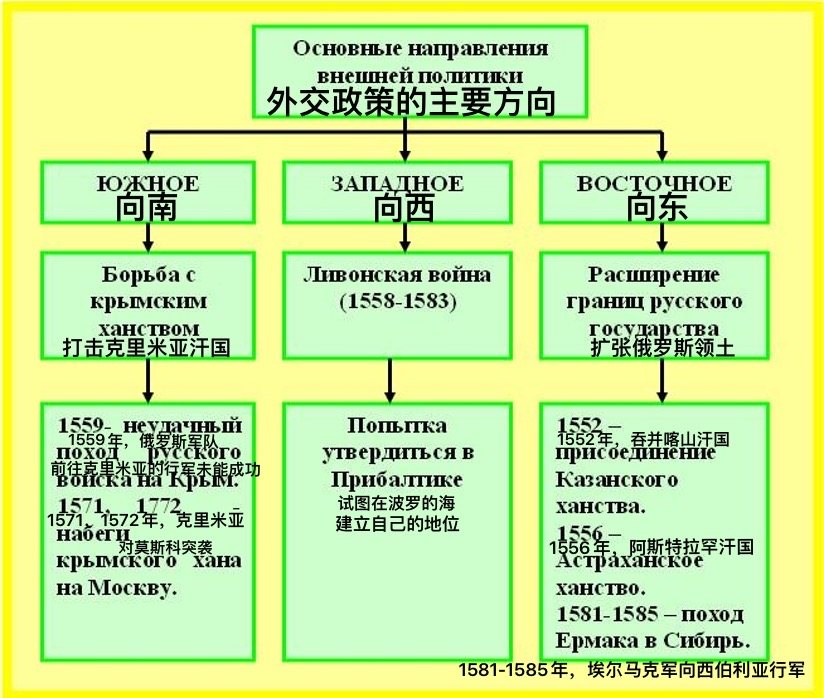

### 莫斯科周围俄罗斯土地的统一

- 时间：十五世纪末至十六世纪初完成统一
- 人物：
    - 伊凡三世（Иван III 1462–1505）
        - 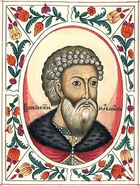
    - 瓦西里三世（Василии III 1505–1533）
        - 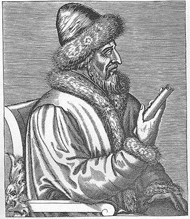
- 过程
    - 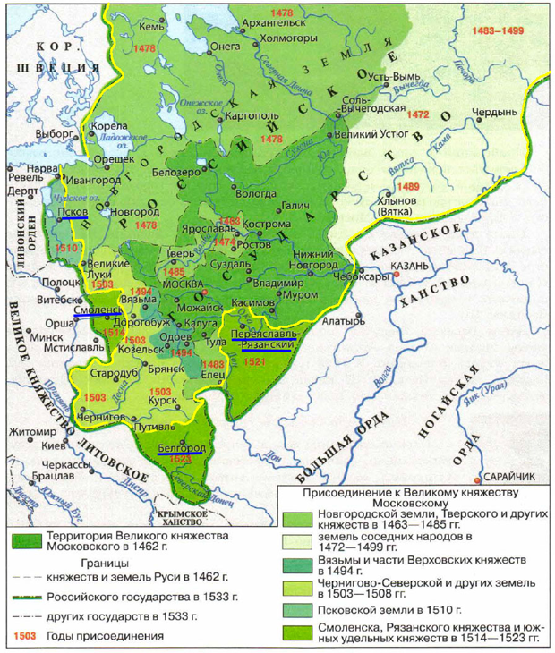
    - 1478 年
        - 加入诺夫哥罗德(诺夫哥罗德-维切共和国 Новгородской вечевой республики)
    - 1480 年 - 立于在尤拉河上（стояние на реке Угре）
        - 伊凡三世 $\Leftrightarrow$ 汗-阿赫玛特（хан Ахмат）
        - 从金帐汗国的枷锁中彻底解放出来
- 权力的集中化
    - 颁布 1497 年的法律法典 $\Rightarrow$ 俄国农奴制开始形成（圣乔治日的确定）
    - 大贵族杜马（Боярская дума）
    - 俄罗斯的双头国徽确定
- 欧洲地区的活动
    - 1453年 - 君士坦丁堡的陷落
    - 1492年 - H. 哥伦布发现美洲
    - 1517年 - 欧洲宗教改革的开始

### 十七世纪的俄罗斯

- 混乱的时代 1598-1613
    - 时任沙皇：
        - 1598年-1605年，鲍里斯·戈东诺夫
        - 1605年-1606年，伪沙皇季米特里一世
        - 1606年-1610年，瓦西里·舒斯基
        - 1607年-1610年，伪沙皇季米特里二世（来历不明的冒名顶替者）
        - 1610年-1613年，弗拉迪斯拉夫四世
    - 混乱的原因：
        1. 经济危机
        2. 加强农奴制
        3. 王朝危机。 伊凡雷帝之后，他的儿子费奥多尔·伊万诺维奇统治，他死后没有继承人。 鲁里科维奇的统治王朝被打断了。 权力斗争开始了。 
        4. 国际矛盾的加剧。邻国 —— 波兰、瑞典、土耳其，想夺取某些俄罗斯领土。
- 混乱的特点：
    - 民众起义和动乱 - 伊万·博洛特尼科夫 (1606-1607) 领导的起义
    - 外国干预：波兰和瑞典，其中莫斯科被波兰人占领。
- 从波兰人手中解放莫斯科：
    - 1612年 —— 由商人库兹马·米宁和德米特里·波扎尔斯基王子领导的人民民兵从波兰人手中解放了莫斯科。     
- 第一代罗曼诺夫人当选为皇帝
    - 动乱的主要后果：
        1. 经济危机。花了几十年时间才消除了经济危机带来的破坏。
        2. 由于男仆和贵族为了恢复经济而加强了对农民的剥削，农奴制进一步加强。
        3. 一个新的沙皇王朝的开始--罗曼诺夫王朝。
        4. 与邻国关系的复杂化。 俄罗斯土地的一部分仍掌握在瑞典人和波兰人手中。
    - 罗曼诺夫王朝一览表
        - 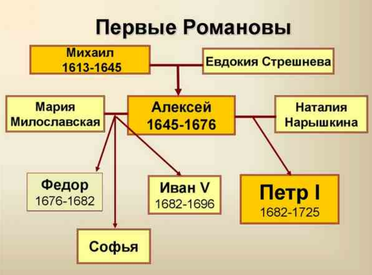
- 米哈伊尔·罗曼诺夫统治下的俄罗斯（1613年-1645年）  
    - 国内政治：
        - 两项任务是恢复经济和加强新王朝的权力。
        - 自 1619 年以来，他实际上与他的父亲菲拉雷特族长一起统治。
    - 外交政策：
        - 1617年 —— 与瑞典签订《斯托尔博夫和约》(Столбовский мир)
        - 1618年 —— 与波兰的德林休战      
        - 1632-1634年 —— 斯摩棱斯克战争(Смоленская война)
- 阿列克谢·米哈伊洛维奇统治下的俄罗斯
    - 国内政治：
        - 1648年 —— 盐业叛乱
        - 1649年 —— 《苏波尔法典》
        - 1650年代 —— 牧首尼康的改革导致了教会分裂
        - 1670-1671 —— 斯捷潘·拉辛起义
        - 建立统一的俄罗斯国内市场

### 彼得大帝的外交政策

- 彼得一世外交政策的主要方向：
    - 欧洲（西北部）：
        - 统一所有属于旧俄罗斯国家的土地。
        - 为进入波罗的海而斗争。
        - 加强俄罗斯在欧洲的地位：彼得一世的对外旅行，开始与德意志国家建立王朝关系。
    - 亚洲（南部）：
        - 与土耳其和克里米亚汗国的斗争，以维护俄罗斯在黑海的存在：1695-1696 年的亚速战役， 以及 1710 - 1711 年的普鲁特战役。
        - 为进入伊朗和印度而战：1723-1724年的波斯（里海）战役。
- 1700-1721年的北方战争
    - 战争原因：
        1. 瑞典的帝国政策和对波罗的海地区主导地位的渴望。
        2. 俄罗斯需要通过波罗的海和波罗的海领土进入欧洲。
        3. 瑞典与欧洲列强之间的地缘政治矛盾。
    - 俄罗斯在战争中的目标：
        1. 进入波罗的海。
        2. 回到 17 世纪初被瑞典占领的芬兰湾沿岸。
        3. 提高俄罗斯的国际地位，使俄罗斯成为海上强国。
    - 1699 北方联盟对抗瑞典：
        - 俄罗斯、丹麦、萨克森、波兰、立陶宛
    - 第一阶段："丹麦"，1700-1701年
        - 主要事件：
            - 1700 - 瑞典进攻丹麦
            - 1700 年 11 月 - 纳尔瓦战役（“纳尔瓦混乱”）
        - 结果和意义：
            - 丹麦退出战争与“北方联盟”
            - 彻底击败俄军
            - 损失所有大炮
            - 瑞典主力军对抗波兰
        - 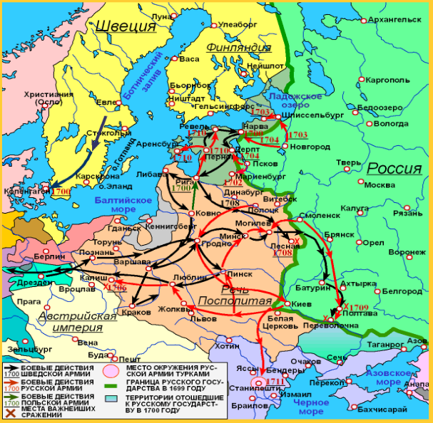
    - 第二阶段："波兰"，1701-1706
        - 主要事件：
            - 瑞典在欧洲萨克森和波兰境内的军事行动。
        - 结果和意义：
            - 击败撒克逊选帝侯奥古斯都二世，他放弃波兰王位转而支持瑞典门生斯坦尼斯拉夫·莱什钦斯基，退出北方联盟。
        - 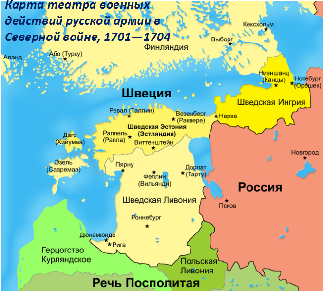
    - 第三阶段：“俄罗斯”，1707-1709
        - 主要事件：
            - 1708年9月28日——莱斯纳亚战役（"波尔塔瓦战役之母"）。
            - 1709年6月27日——波尔塔瓦之战
        - 结果和意义：
            - 与莱文豪特的车队一起打败了瑞典军团，剥夺了查理十二世的额外力量。
            - 击败瑞典陆军。
            - 消除了被瑞典征服的危险。
            - 波罗的海战争进程的急剧变化。
            - 恢复“北方联盟”。
            - 提高俄罗斯的国际地位。
        - 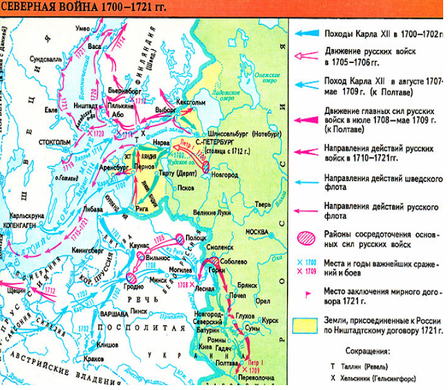
    - 第四阶段：“土耳其”，1709-1714
        - 主要事件：
            - 1710 - 1713，俄土战争。
            - 1710 - 1711，彼得一世对土耳其的普鲁特战役。俄罗斯军队战败。
        - 结果和意义：
            - 1711 - 《普鲁特和约》。
            - 俄罗斯失去亚速地区。
            - 1713 - 《阿德里亚诺普尔条约》；《普鲁特和约》的主要条款得到确认。
            - 对土耳其战争的结束使集中力量对付瑞典成为可能。
        - 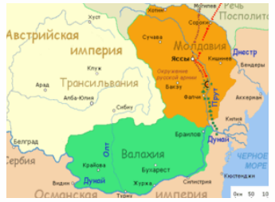
    - 第五阶段：“瑞典-挪威”，1714-1721
        - 主要事件：
            - 1714年7月27日， 甘古特角（芬兰汉科半岛）附近的一场海战。
            - 1720年， 格伦甘岛（奥兰群岛的南部群岛）附近的一场海战。
        - 结果和意义：
            - 第一个重大的海军胜利。
            - 一个新的海军强国的诞生。
            - 结束瑞典在波罗的海的不可撼动的影响并在其上建立俄罗斯。
        - 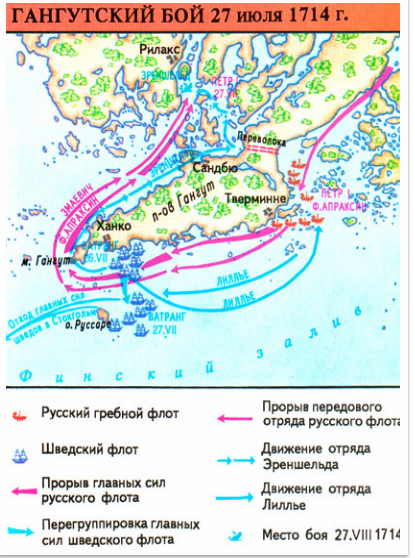 
    - 1721年--《尼斯塔特和约》：
        - 瑞典承认利沃尼亚、爱沙尼亚、英格曼兰、卡累利阿（所谓的旧芬兰）的一部分和其他领土被并入俄罗斯。
        - 俄罗斯承诺向瑞典支付金钱赔偿并归还芬兰。
- 1722-1723，彼得大帝的里海战役
    - 波斯战役是俄罗斯陆军和海军对属于波斯的北阿塞拜疆和达吉斯坦的一次战役。
    - 该战役的目标：
        - 巩固俄罗斯在里海地区的地位。
        - 协助外高加索地区（格鲁吉亚、亚美尼亚）的基督教人民对抗波斯。
        - 为获得进入波斯和印度的机会而斗争。
    - 北方战争结束后，彼得一世决定向里海西岸进军，在掌握里海后，恢复从中亚和印度到欧洲的贸易路线，这对俄罗斯商人非常有用。这条路线要经过印度、波斯，并从那里经过格鲁吉亚到达阿斯特拉罕，计划从那里向整个俄罗斯帝国分发货物。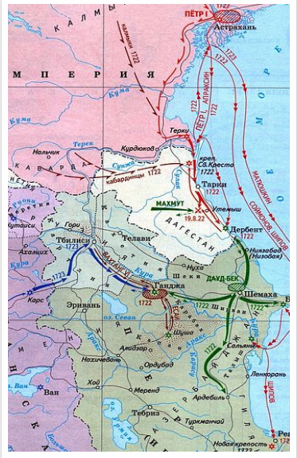
    - 1723年--俄罗斯和波斯签订了《圣彼得堡条约》：
        - 俄罗斯得到了里海的西岸和南岸的德本特、巴库、雷什特和阿斯特拉巴德等城市。
    - 1724年--俄罗斯和土耳其签订了《君士坦丁堡条约》“
        - 苏丹承认俄罗斯在里海地区的收购，俄罗斯也承认苏丹在西外高加索的权利。
    - 后来，由于俄土关系的恶化，俄罗斯政府为了避免与奥斯曼帝国发生新的战争，并有意与波斯结盟，通过《雷什特条约》（1732年）和《甘贾条约》（1735年）将里海所有省份归还给波斯。
- 结论：
    - 彼得大帝领导下的俄罗斯实现了进入波罗的海的机会，并成为一个海上强国。
    - 俄罗斯的国际地位已经上升。
    - 其余的外交政策任务将由彼得大帝的继任者来完成。

### 彼得大帝的改革

- 彼得一世简历
    - 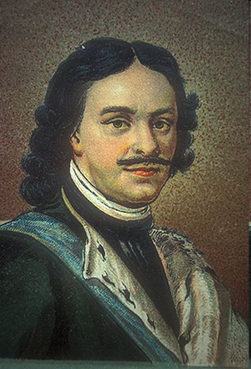 
    - 彼得出生于 1672 年，是沙皇阿列克塞最小的儿子，原本他没有机会登上王位，但他的兄长，即阿列克塞的长子于 1682 年病逝，身后无嗣，另一名异母兄伊凡五世虽然有更优先的继承权，然而伊凡有严重的身体和精神上的问题，因此波雅尔杜马乃选举时年十岁的彼得为沙皇。同年四月，他的异母姐姐索菲亚煽动射手卫队暴动，此次暴乱后，伊凡和彼得成为共同沙皇，以伊凡为长；索菲亚担任摄政，实际上手掌大权。
    - 彼得生长在远离宫廷的环境下，他享有很大的自由，能够同社会各阶层交往。彼得喜欢钻研数学，肯于动手，酷爱造船和军事事务，他特地为军事游戏组织了两个童子军团并推选外国人作指挥。就是在这样的训练战中产生了一支具有彼得风格的新军队。
    - 执掌政权后，彼得决定赴欧洲学习。1697 年 3 月，“大使团”驶离莫斯科。此次出行历时一年多，他有做地利用了这段时光。他学习了军事技术和造船技术，在奥地利进行了外交谈判并接触到那里的宫延生活。同时，他还招聘欧洲专家到俄国工作。
- 改革的特征
    1. 按照欧洲的模式进行。
    2. 以强硬的方式快速进行。
    3. 改革缺乏系统体系。
    4. 在农奴制度的基础上进行。
    5. 涵盖了几乎所有的社会生活领域。
    6. 取决于外交政策。
    7. 改革的主要推动力是战争。  
- 改革的主要领域
    1. 军事改革。
    2. 工业方面的改革。
    3. 教育改革。
    4. 国家机关的改革（中央政府改革）。 
    5. 地方政府的改革（城市管理的改革和区域改革）。
    6. 社会政策改革。建立级别表（Табель о рангах）。
- 军事改革
    - 彼得废除了旧军队，按照欧洲的方式建立了一支完全新型的常备军，与此同时，俄国历史上的第一支海军舰队也建立了起来。
    - 为培养陆军与海军军官，开办了诸多军事、工程和航海学校。
    - 军队内部的体制及其森严，农民被强制服兵役，期限长达 25 年。
- 军事改革取得的结果
    - 建立一支正规的军队。
    - 涌现出一批优秀的指挥官。
    - 从无到有创造出了一支强大的海军。
    - 军费开支的飞速增长是以残酷地压榨劳苦人民为代价的。  
>为实现沙皇的战略目标，必须发展经济，首先是发展重工业，工业改革迫在眉睫
- 工业改革
    - 自 18 世纪初开始，俄国开始在各地区建立兵工厂，发展起炼铜、化学和纺织品工业，同时在乌拉尔建设金属冶炼厂。
    - 乌拉尔成为俄国的工业基地，它能够为陆军提供大炮和其他类型的武器。
- 行政改革
    - 18 世纪初的君主专制
       - 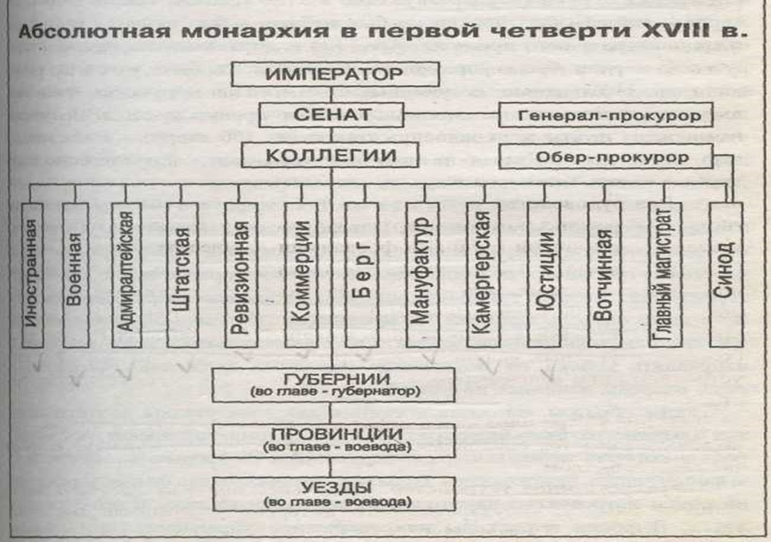 
    - 废除衙门，设立了 11 个委员会（коллегия），各个部门有各自的职责。
    - 每个委员会设一名主席、一名副主席和若干名顾问。委员会所作出的决定是集体讨论的结果（коллективно）。
    - 由中央往下划分省，省下划分县。
- 级别表
    - 这一制度给了任何在职者晋升的机会，无论其背景如何。（如下表）
  
| Классы | Чины военные сухопутные           | Чины гражданские                 |
| ------ | --------------------------------- | -------------------------------- |
| I      | Генералиссимус. Фельдмаршал       | Канцлер                          |
| II     | Генерал от артиллерии, инфантерии | Действительный тайный советник   |
| III    | Генерал-лейтенант                 | Тайный советник                  |
| IV     | Генерал-майор                     | Действительный статский советник |
| V      | Бригадир                          | Статский советник                |
| VI     | Полковник                         | Коллежский советник              |
| VII    | Подполковник                      | Надворный советник               |
| VIII   | Майор                             | Коллежский асессор               |
| IX     | Капитан                           | Титулярный советник              |
| X      | Штабс-капитан                     | Коллежский секретарь             |
| XI     | —                                 | Сенатский секретарь              |
| XII    | Поручик                           | Губернский секретарь             |
| XIII   | Подпоручик                        | Сенатский регистратор            |
| XIV    | Прапорщик                         | Коллежский регистратор           |
- 教育改革
    - 在彼得统治期间，莫斯科和圣彼得堡等地开设了数学和航海科学学校、炮兵学校、工程学校、医学院、海事学院、矿业学校、士兵子女的驻军学校。科学院也在彼得死后不久开放。
    - 贵族都必须学习科学。没有完成学业的人被禁止结婚。 
- 教会改革 
    - 彼得废除了教会组织，代之以神圣会议，其所有成员均由沙皇任命。
    - 彼得奉行宗教宽容政策，为旧教徒的存在提供便利，并允许外国人自由地信奉他们的信仰。
- 文化改革
    - 建立了俄罗斯第一家博物馆 —— Кунсткамеры。
    - 要求贵族们穿上欧洲服装。
    - 创建新的印刷厂，将许多欧洲书籍翻译成俄语。
- 改革的意义
    1. 外交政策任务得到了解决。
    2. 俄罗斯跻身欧洲大国之列。
    3. 伯爵和贵族在地位上是平等的。
    4. 地方政府系统得到改善，城市管理中的选举原则被引入。
    5. 教会从属于国家。
    6. 建立起来了一个正规的陆军和海军，确保了国家的安全。

### 保罗一世的外交政策
- 保罗一世时期外交政策的变化
    - 1797年——俄国退出了第一次反法联盟。
    - 1798年——法国占领马耳他岛，该岛是法国的属地。
    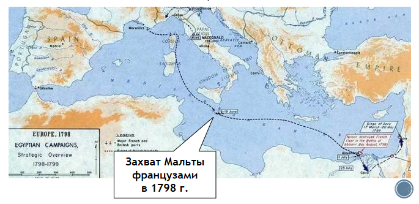
- 马耳他骑士团（在保罗一世的赞助下）：自1797年以来，保罗一世一直是马耳他骑士团的保护者；在马耳他被法国人占领后，他保证了马耳他在俄罗斯的活动，1798年 他接受了一些骑士的建议，成为大团长，即骑士团的首领。在俄罗斯，马耳他骑士团被称为耶路撒冷的圣约翰骑士团。 保罗一世力图将马耳他从法国人手中解放出来。
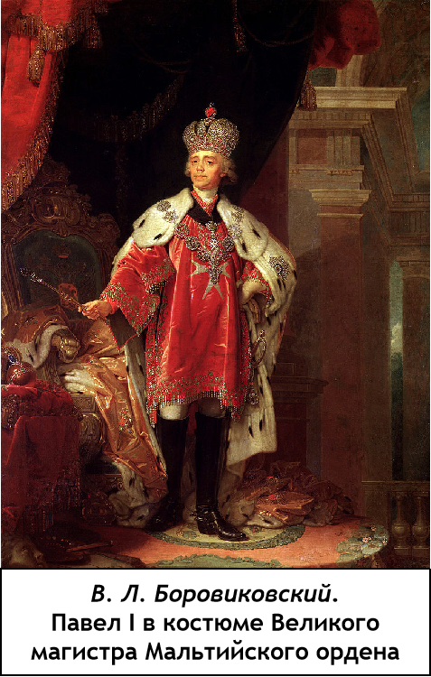
- 意大利和瑞士的十字军东征
    - 1798年——俄国加入第二次反法联盟。
    - 1799年——意大利和瑞士战役（А.В.Суворова）
    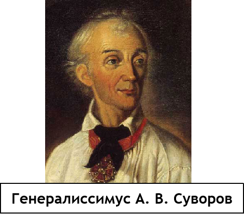
    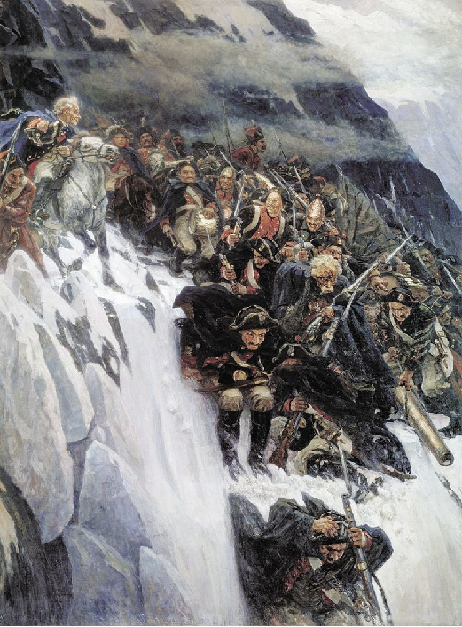
    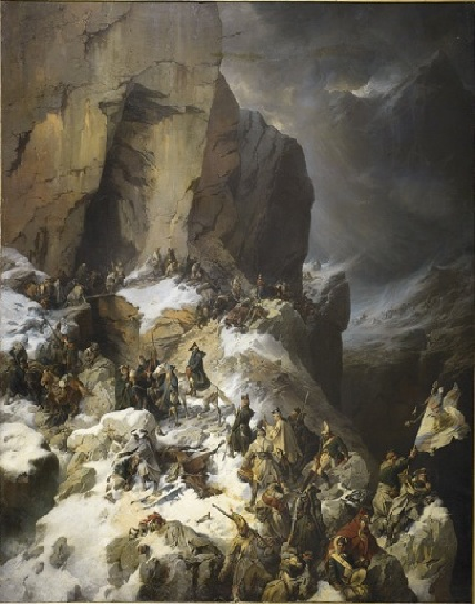
    - 结果：奥地利控制了被俄国军队解放的意大利。英国拒绝割让它所解放的马耳他骑士团，并建立了自己对它的控制。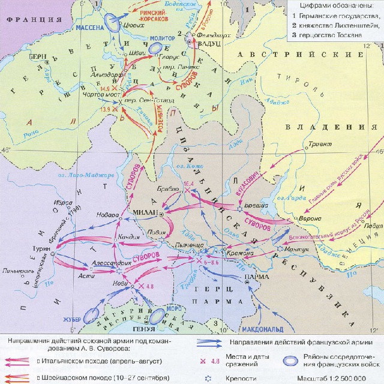
- 地中海战役（Ф.Ф.Ушаковым）
    - 1798 - 1799 年——围攻和占领科孚岛。
    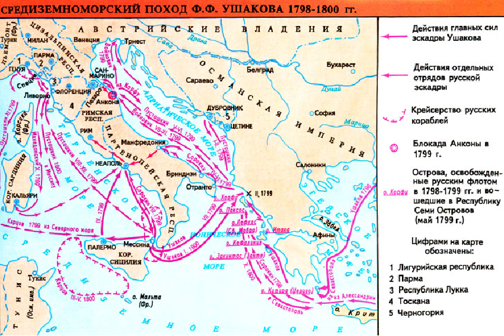
- 与法国的和平和联盟  
    - 俄国和法国缔结和平后，拿破仑-波拿巴提出了两国之间结成军事 联盟对抗英国的问题。
    - 欧洲的权力平衡正在发生变化。以前，法国独自一人，没有得到任何国家的支持，现在得到了俄国的支持，站在一个新的欧洲联盟的顶端，转而反对被抛弃的英国。法国、俄国、瑞典、普鲁士、丹麦、荷兰、西班牙联合起来反对英国。 1800 年 12 月，俄罗斯、普鲁士、瑞典和丹麦之间签署了一项联盟条约。这几乎是对英国的宣战。英国当局下令扣押属于联盟国家的船只。作为回应，盟国禁止向英国出口所有货物，欧洲的许多港口都对英国关闭。国家第一次开始出现面包短缺。在这种情况下，有关法俄对印度的战役（印度战役计划）的准备工作的信息像晴天霹雳一样传到了伦敦。但这场战役并没有发生。
    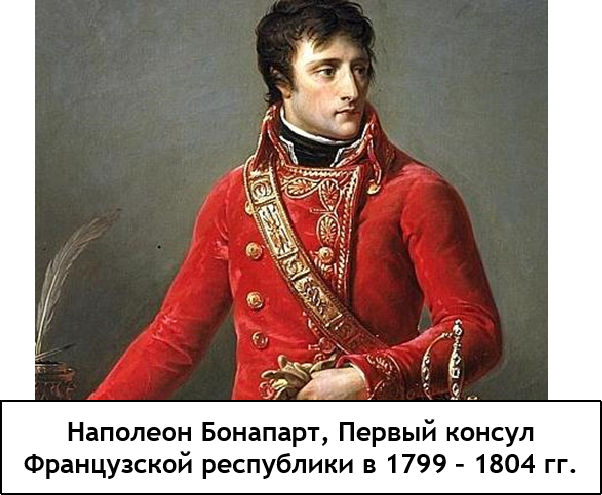
    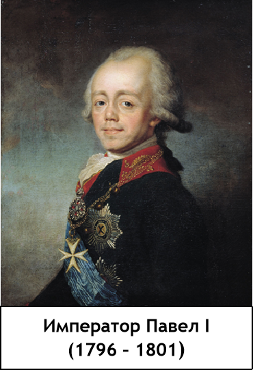
- 保罗一世被暗杀
    - 1801 年 3 月 11 日——保罗一世皇帝被伯爵 П.А.Пален 暗杀。
    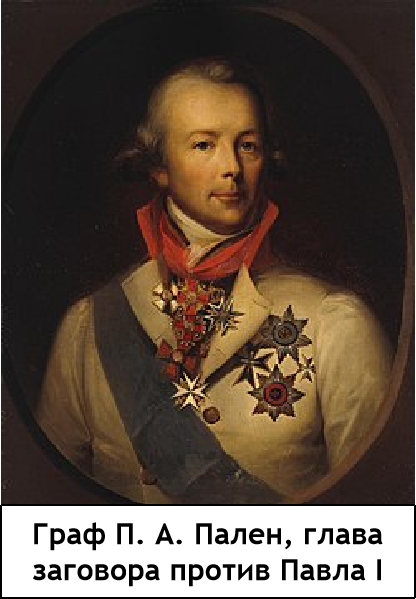
    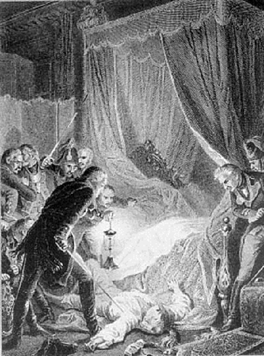

### 1812 年的卫国战争（Отечественная война 1812 года）
 
- 战争伊始（Начало войны）
    - 继《提尔西特和约》（заключения Тильзитского）之后，拿破仑追求对世界的统治。一些国家：法国、奥地利和普鲁士与他缔结了盟约。拿破仑试图对英国发动决定性的打击，但这被俄罗斯阻止了，它没有满足大陆封锁的条件。于是法国与俄国的战争变得不可避免。
    - 法兰西的拿破仑大帝（Наполеон-император Франции）
    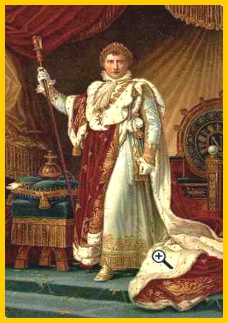
    - 战争初始形势
    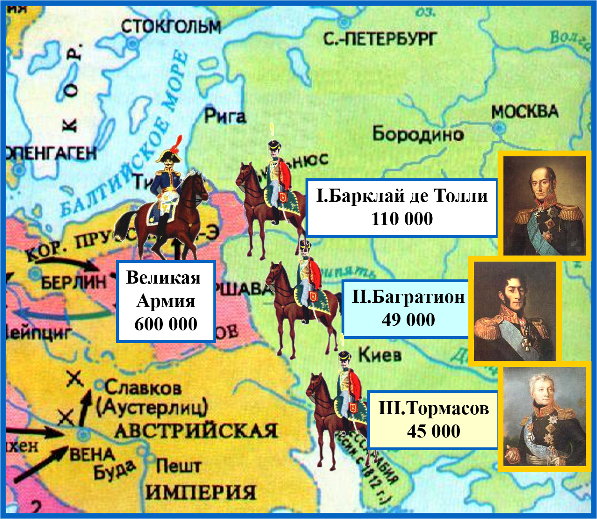
        - 俄国人不知道拿破仑的计划，将军队分成3个集团，并沿整个边界布置
        - 拿破仑希望能在边境战役中击败敌人，并对和平条款进行支配
        - 1812年夏天，60万人的法国军队在波兰境内集结
    - 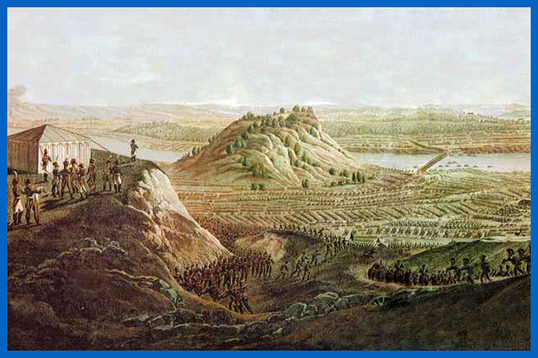
        - 1812年6月12日。"二十国联军军"（армия двунадесяти языков）越过涅曼河，迅速行动，阻止了俄国第一和第二军队的统一。
        - 俄国军队的总司令是亚历山大一世，由于他的指挥不当。他很快被劝说离职，但之后没有任命新的总司令。
- 拿破仑军队的入侵
    - 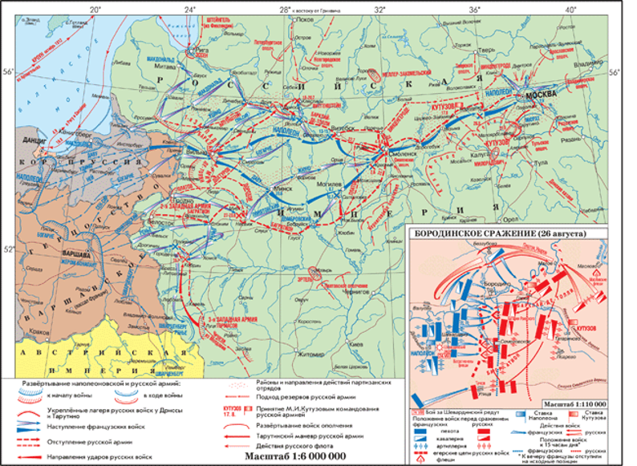
    - 起初，俄国人希望在德里萨防御营（Дрисский укрепленный лагерено ）会和，但法军阻止了他们这样做。
    - 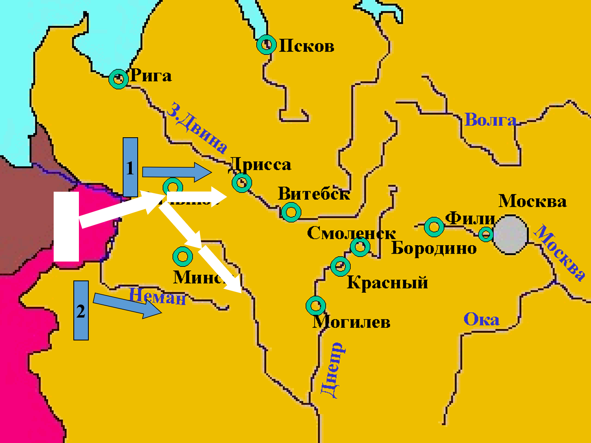
    - 法军的行动迫使俄国最高统帅部下令撤退，以防拿破仑将第一和第二军逐一击溃
    - 俄国军队的位置不断移动，直到七月在斯摩棱斯克附近相遇。
    - 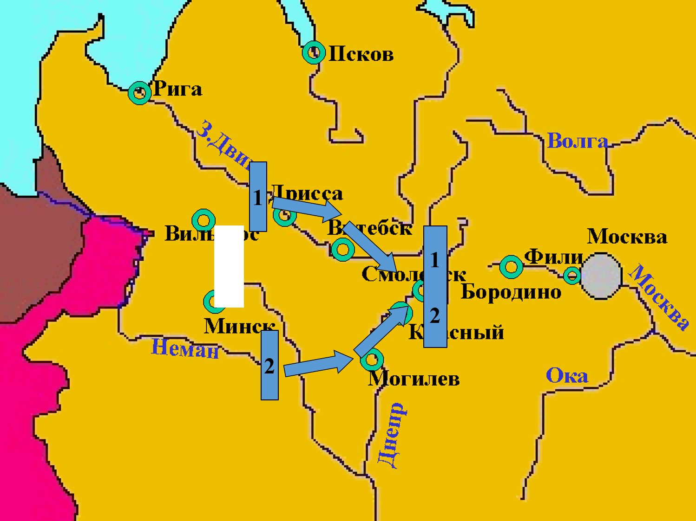
- 斯摩棱斯克之战（Смоленское сражение）
    - 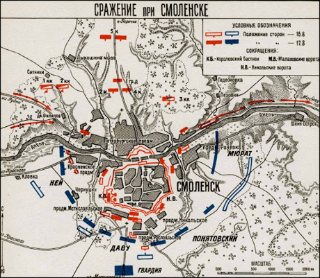
    - 8 月 5 日，在斯摩棱斯克，一场激烈的战斗展开了。 法军在损失了20,000名士兵后，在俄国指挥官认为进一步防守毫无意义并下令继续撤退时才占领了该城
    - 库图佐夫（Кутузов）在察雷沃-扎伊米什的阅兵式上
    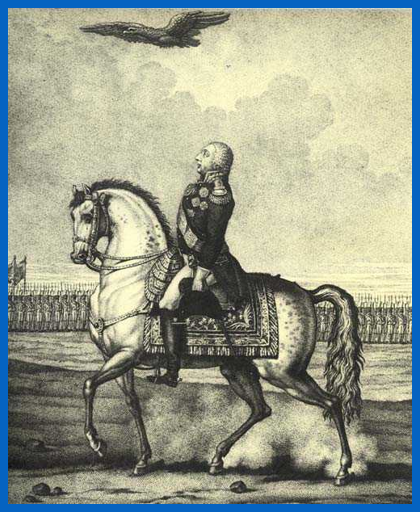
    - 战争初期的失败迫使皇帝寻找一个新的总司令。在公众的压力下，亚历山大一世让米哈伊尔一世-库图佐夫（М.И.Кутузова）担任军队首领，他很快就来到了察雷沃-扎伊米什（Царево-Займище）附近
- 鲍罗迪诺战役（Бородинская битва）
    - М.И.Кутузов
    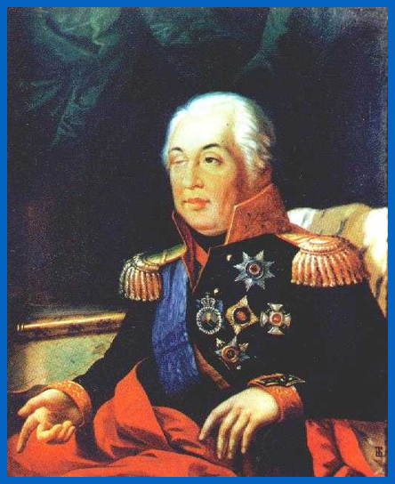
    - 新任总司令继续撤退，寻找总攻的地方，直到他发现自己距离莫斯科110公里，在博罗迪诺村附近
- 谢瓦丁堡垒之战（Бой за Шевардинский редут）
    - 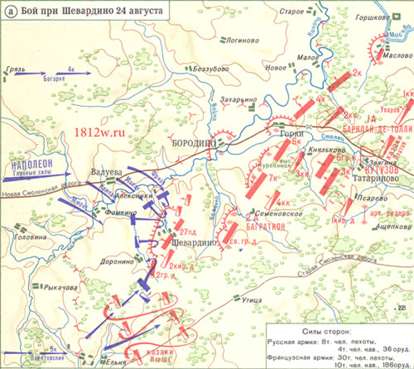
    - 根据库图佐夫的命令，在谢瓦尔德诺村附近开始建造土质工事--红堡。
    - 8月24日，法国人接近了谢瓦迪诺村。他们立即攻击了红堡。这场战斗一直持续到深夜。
    - 早上，拿破仑得到报告说，俄国人已经撤走了。
    - 8月25日，双方都在为即将到来的战斗做准备。
    - 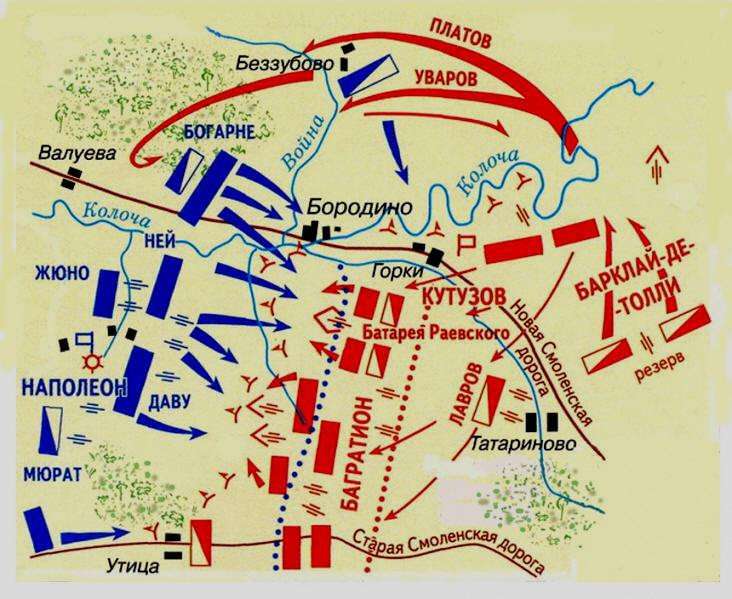
    - 8月26日清晨，指挥官们将部队撤回到他们原来的位置
- 塔鲁蒂诺的演习（Тарутинский маневр）
    - 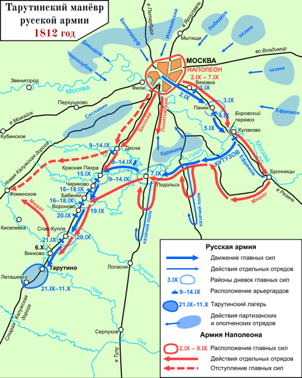
    - 菲利的战争委员会（1812年9月1日）——决定撤军，把莫斯科留给拿破仑
    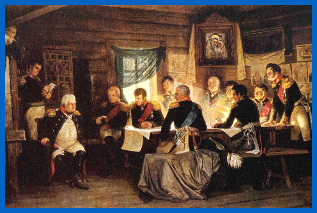
- 游击活动（Партизанское движение）
    - 丹尼斯-达维多夫（Денис Давыдов）
    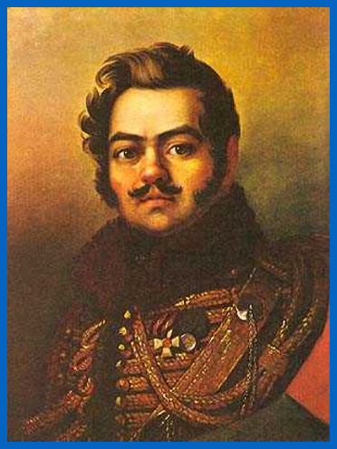
    - 游击队给法国人造成了巨大损失，阻断了法国从莫斯科到西方边境的通讯
    - 游击队运动的发起人是达维多夫上校，他在博罗季诺战役之前就得到了库图佐夫先生的同意。很快，在敌人占领的领土上开始出现由当地居民组成的地方小队。
    - 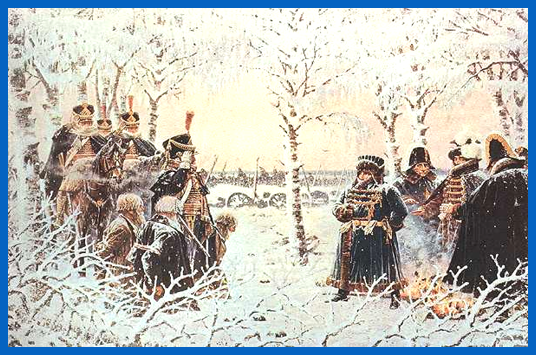
    - 游击队中著名的人员有：军官——A.塞斯拉文（А.Сеславин）、A.菲格纳（А.Фигнер），士兵——E.切特弗塔科夫（Е. Четвертаков），农民——G.库林（Г.Курин ）和V.科日纳（В.Кожина）
    游击队在打败敌人方面的贡献具有完整的基础，可以称为1812年的战争，爱国战争
- "伟大军队"的溃败（Гибель «Великой армии»）
    - 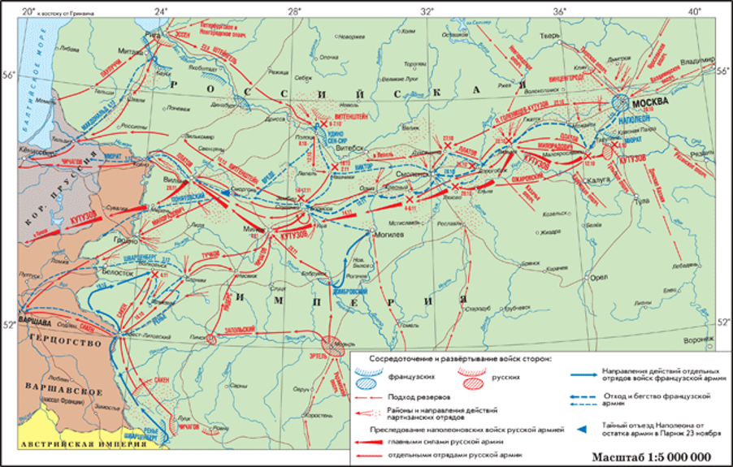
    - 穿越别列津纳河（р.Березину）
    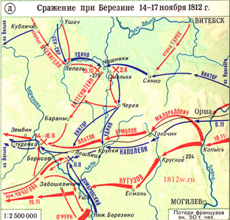
    - 最后的战斗是在1812年11月的别列津纳河渡口进行的。俄国人袭击了法国人，拿破仑在那里又损失了3万名士兵，他放弃了军队，带着旧卫队的残部回到了巴黎。
    - 1812年12月25日。亚历山大一世发表了关于将敌人驱逐出俄罗斯和结束卫国战争的宣言。
- 俄国军队的国外战役
    - "俄军的海外战役"：敌对行动转移到德国和法国境内
    - 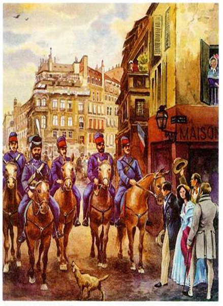
    - 在1814年的春天，俄罗斯哥萨克人作为联军的一部分进入巴黎
    - 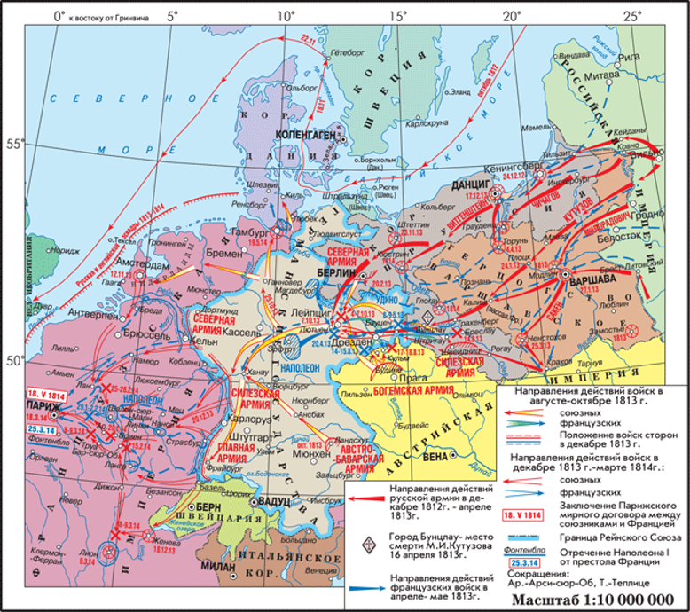
- 1812 年战争纪念建筑
    - 莫斯科的凯旋门
    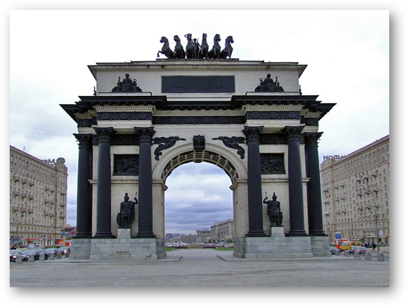
    鲍罗迪诺战场主纪念碑
    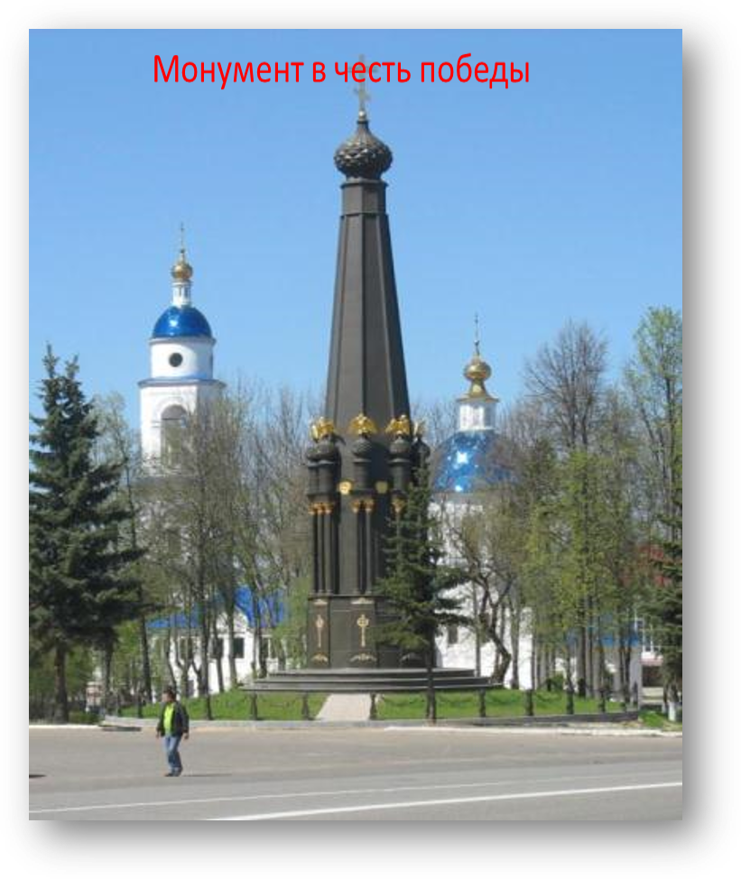
    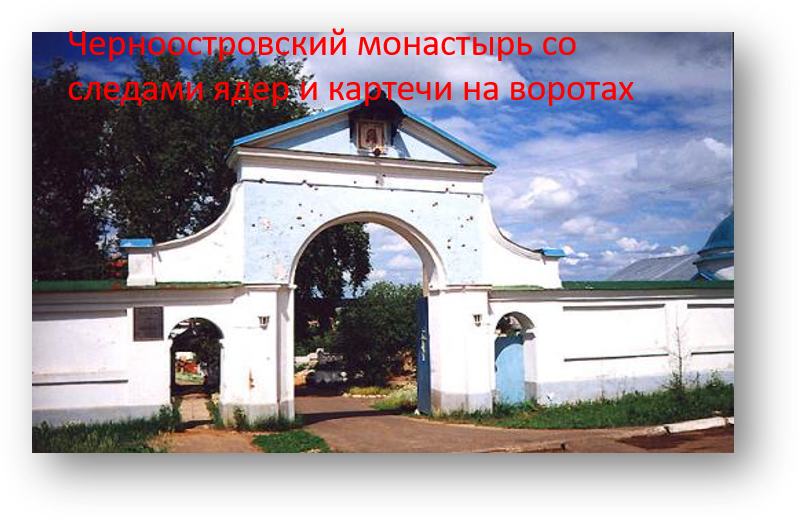
    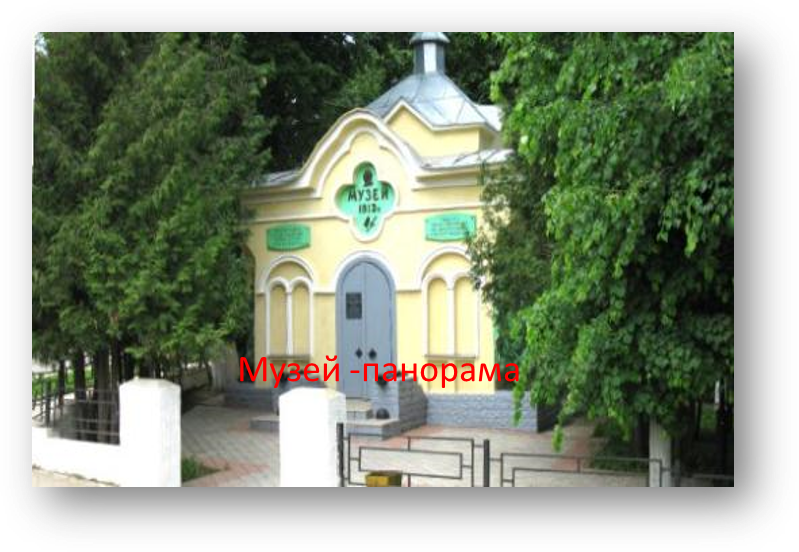

### 俄罗斯军队的海外战役及 1812 年后的对外政策

- 1813-1814 年俄军海外战役的目的
    - 增强俄罗斯在欧洲的影响力
    - 终结拿破仑的侵略计划
    - 将西欧国家从法国统治中解放出来
- 海外战役开始（Начало заграничного похода）
    - 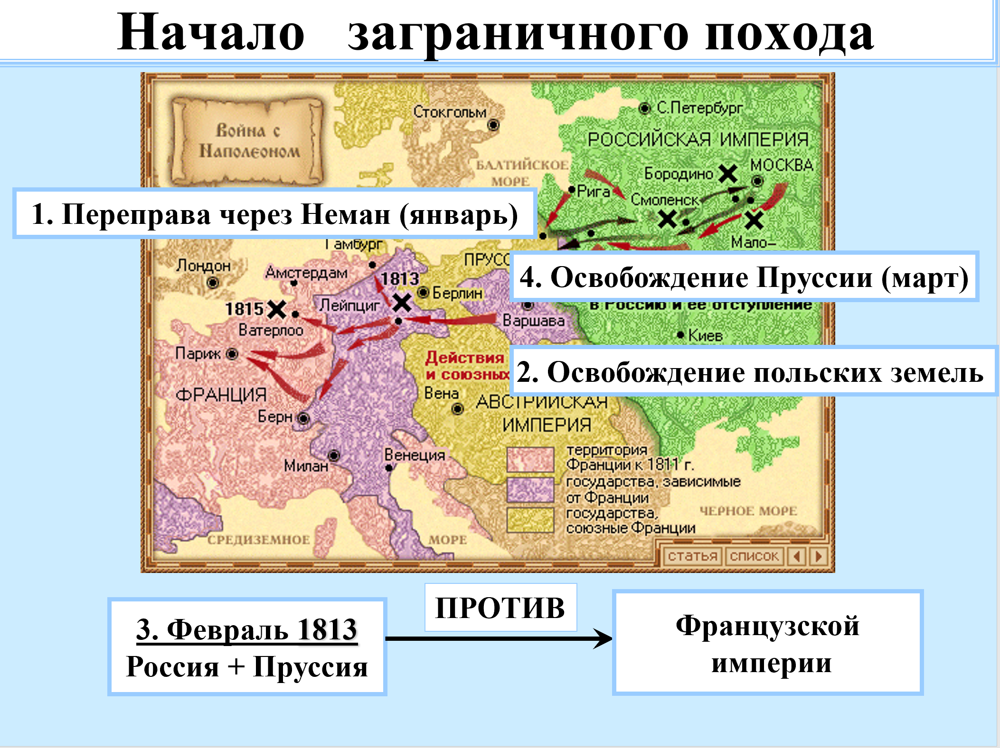
    1. 1813 年 1 月——穿越涅曼（Неман）
    2. 解放波兰（Польша）土地
    3. 1813 年 2 月——俄罗斯和普鲁士（Пруссия）联军讨伐法兰西帝国（Французской империи）
    4. 1813 年 3 月——解放普鲁士
- 击溃拿破仑（Наполеон）
    - 第五次反法同盟（5-ая антифранцузской коалиции）：
        - 成立时间：1813 年 7-8 月
        - 同盟国家：俄国、普鲁士、英国（Англия）、瑞典（Швеция）、奥地利（Австрия）。
    - 1813 年 10 月 —— 在莱比锡（Лейпциг）的“民族之战（Битва народов）”，俄罗斯-普鲁士-奥地利的部队胜利。 $\to$ 军事行动转移到法国领土。  
      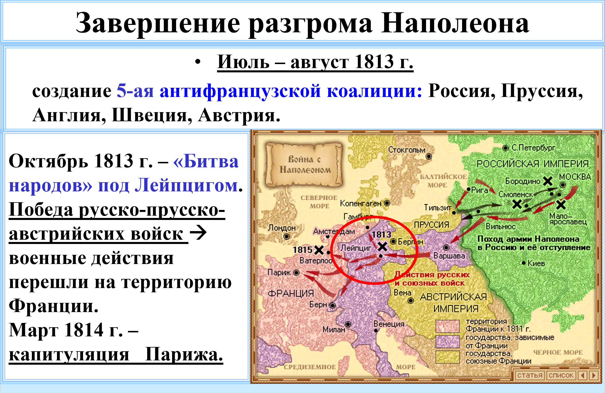
    - 1814 年 3 月——巴黎（Париж）投降。
- 维也纳会议
    - 俄罗斯在与拿破仑战争中的胜利，大大提高了其国际地位和对：“欧洲事务”的影响。
    - 会议时间：1814 年 9 月 - 1815 年 6 月
    - 会议目的：
         1. 解决战后结构问题
         2. 制约欧洲国家的立场，防止革命
    - 会议决定：
         1. 波兰王国是俄罗斯帝国的一部分
         2. 随着卢森堡（Люксембург）的加入，荷兰（Голландия）和比利时（Бельгия）合并为荷兰联合王国（Объединенное королевство Нидерландов）
         3. 在意大利北部，伦巴第（Ломбардия）和威尼斯（Венеция）合并为伦巴第-威尼斯王国（Ломбардо-Венецианское королевство），由奥地利统治
         4. 英国收复了之前失去的殖民地，并重新确立了对马耳他（Мальта）的占有权
         5. 法国仍在其 1792 年的边界内，占领军驻扎在其领土上，波旁王朝（династия Бурбонов）重新登上法国王位
         6. 教皇再次恢复对梵蒂冈和教皇地区的权力
         7. 德意志邦联（Германский союз）成立
         8. 法国的盟友丹麦（Дания）失去了挪威（Норвегия），挪威被割让给了瑞典（Швеция）
- 滑铁卢战役（Битва при Ватерлоо）
    - 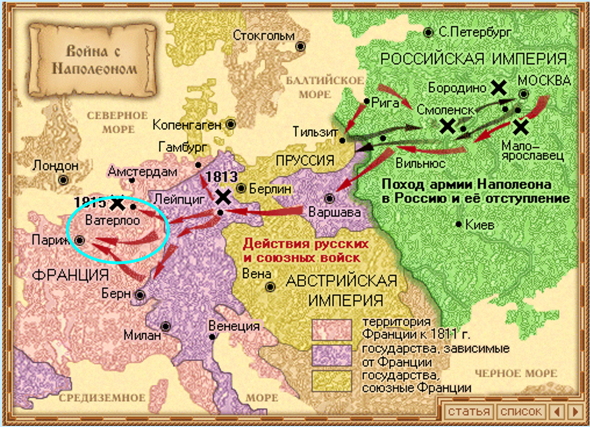
    - 时间：1815 年 6 月 6 日
    - 结果：拿破仑战败，被推翻、流放到圣赫勒拿岛（остров Святой Елены）
- 欧洲君主们的“神圣同盟（Священный союз）”
    - 时间：1815 年 9 月由俄罗斯帝国皇帝亚历山大一世倡议
    - 神圣的亚历山大  
      
    - 内容（革命理想）：
        - 根据维也纳会议保护边境
        - 巩固旧封建王朝的统治
        - 镇压欧洲革命运动
- 东方问题
    - 1821 年，希腊民族解放革命，企图宣布独立。  
      
    - 俄罗斯违反《正统主义（легитимизм）》的原则，支持希腊。
    - 但欧洲并不希望俄罗斯在巴尔干地区得到加强，也不支持其努力。
    - 结果：东方问题未得到解决，神圣同盟濒临瓦解。
- 俄罗斯美洲
    - 
    - 俄罗斯美洲 - 18 世纪初，阿拉斯加（Аляска）、阿留申群岛（Алеутские острова）和北加利福尼亚（северная калифорния）的一部分。
    - 亚历山大一世——在美洲的巩固：
        - 1804 年在阿拉斯加成立新阿尔汉格尔斯克（Новоархангельск），1867 年后为锡特卡（Ситка）
        - 1808 年——与美国（США）建立外交关系
        - 1812 年——在加利福尼亚建立了俄罗斯殖民地
    - 1821 年——俄罗斯宣布其对阿拉斯加的专有权，并很快与美国和英国签订了条约，确保了这一权利

## 历史课题

### 课题一：旧俄罗斯国家的形成和发展

#### 主要日期

- 公元九世纪 - 旧俄罗斯国家开始形成。
- 862 年 - 留里克王朝建立，传统上，它被认为是俄罗斯国家的起点。([призвание варягов](https://ru.wikipedia.org/wiki/%D0%9F%D1%80%D0%B8%D0%B7%D0%B2%D0%B0%D0%BD%D0%B8%D0%B5_%D0%B2%D0%B0%D1%80%D1%8F%D0%B3%D0%BE%D0%B2))
- 882 年 - 奥列格（Олег）占领基辅，诺夫哥罗德与基辅合并，史称基辅罗斯。
- 882 - 972 年，奥列格（Олег）、伊戈尔（Игорь）、奥尔加（Ольга）、斯维亚托斯拉夫（Святослав）相继统治。他们是最早的一批基辅大公。
    - 统治时期：
        - 882 - 912 奥列格（Олег）
        - 912 - 945 伊戈尔（Игорь）
        - 945 - 964 奥尔加（Ольга）
        - 964 - 972 斯维亚托斯拉夫（Святослав）
- 978 - 1015 年，弗拉基米尔 - 斯维亚托斯拉夫维奇（Владимир Святославович）的公国统治时期。
- 988 年，罗斯受洗，即罗斯接受基督教信仰。
- 1019 - 1054 年，雅罗斯拉夫（Ярослав Мудрый）的公国统治时期。
- 十二世纪初，旧俄罗斯国家解体，政治分化开始。

#### 课文一：东斯拉夫人

- 俄罗斯的历史起始于公元第一个千年东欧领土上的东斯拉夫人的定居。
- 斯拉夫人的语言属于印欧语系的大群体。在公元前一千年前，从印欧语系的部落群体中分离出来的部落群，占据了捷克、波兰直至第聂伯的领土。斯拉夫民族开始从这些部落进行发展。在一千年中期，由于各民族的迁徙，斯拉夫人分裂为了三个群体，被分配为：西部、南部和东部。东斯拉夫人是俄罗斯、乌克兰和白俄罗斯民族的祖先。
- 关于斯拉夫人最古老的历史，我们从拜占庭和阿拉伯作家的作品中得知。除此之外，最重要的历史资料是由修道士涅斯托尔（Нестор）于十二世纪初撰写的第一部俄罗斯编年史《往年纪事（Повесть временных лет）》。
- 在六至八世纪，东斯拉夫人广泛分散居住于在东欧平原，北至拉多加湖，东至伏尔加河。他们以联盟的形式生活，我们称之为部落联盟（союзы племён.）。
- 东斯拉夫人主要以农业和畜牧业为主，此外，各部落还从事狩猎、捕鱼、采集野生蜂蜜（养蜂）等活动。他们当时还存在一些手艺，例如，织布、武器和珠宝制作。在当时有一个占主导地位的自给自足的经济方式。
- 异教是东斯拉夫人的宗教。在异教观念的帮助下，他们试图解释自己的存在和自然界的所有现象。

#### 课文二：旧俄罗斯国家的形成

- 九世纪时，在东斯拉夫人中出现了通常被称为基辅罗斯（以其首都的名字命名）或称为旧俄罗斯的国家。
- 国家的出现是世界发展的一个自然阶段。国家的形成具有很长的过程。先决条件，也就是建立国家的初步条件:
    1. 东斯拉夫人已经发展了几个世纪。
    2. 部落体系的衰败与瓦解。
    3. 出现了土地和所有物质的私有制。
    4. 财产和社会不平等出现了，权力转移到部落贵族手中。
- 由于需要强大的力量来保护更富有和更高贵的部落成员的财产权，以及防止来自邻近部落的攻击，使得东斯拉夫人在一位王子的统治下团结起来，进而形成了国家。
- 在《往年记事（Повесть временных лет）》中称，俄罗斯的王室王朝起源于诺夫哥罗德。862 年，诺夫哥罗德的公民为了阻止内战，邀请了一群由留里克（Рюрик）王子领导的维京人来到俄罗斯，留里克王子成为王朝的创始人。
- 人们普遍认为，旧俄罗斯国家的形成日期为 882 年。留里克的亲戚奥列格亲王（先知奥列格），从诺夫哥罗德出发，向基辅发起攻势。他首次将斯拉夫人北部和南部的土地统一为一个国家。基辅为其首都。
- 旧俄罗斯国家的首脑称为基辅大公。军队称为卫队（дружина）。国家的一些土地由大公的亲属（通常是他已经成年的儿子）来统治。
- 第一批所有的基辅大公（奥列格、伊戈尔、奥尔加、斯维亚托斯拉夫）在九至十世纪末执政时，都实行了统一东斯拉夫土地的政策，并组织对抗邻近游牧民族的攻击。
- 10 世纪末，在弗拉基米尔 - 斯维亚托斯拉夫维奇（Владимир Святославович）统治时期，东斯拉夫人的政治统一因其信仰的统一而得到巩固加强。988年发生了罗斯受洗仪式：俄罗斯接受基督教为国教。俄罗斯的基督教来自于拜占庭帝国。俄罗斯采用了东方拜占庭式的基督教——东正教，因此成为一个信仰东正教国家。
- 基辅罗斯在雅罗斯拉夫（Ярослав Мудрый）统治时期达到鼎盛。它成为欧洲最强大的国家之一。其领土从白海延伸到黑海，从伏尔加河延伸到喀尔巴阡山脉。基辅的王子们与许多欧洲皇室——法国、挪威、瑞典和拜占庭都有关系。基辅——国家的首都以其宏伟和富裕，让许多外来者都感到惊讶。
- 国家发展的同时，文化也在不断发展。学校和图书馆相继开放，寺庙、雕塑不断建造，各种文学作品如雨后春笋般出现。
- 雅罗斯拉夫死后，各王子为争夺基辅的王位而进行的斗争加剧。渐渐地，基辅中央权力开始被削弱，在十二世纪初，基辅罗斯分裂为独立的公国。一个封建分裂的时期开始了。

#### 拓展阅读一：东斯拉夫人的生活方式与习惯

- 东部斯拉夫人的部落建立在东欧平原上，主要占据森林和草原地带，有复杂的河流系统、湖泊和沼泽。
- 公元7——8世纪，东斯拉夫人居住在东欧平原上第聂伯河沿岸森林及其以北的地区。平原、森林、丰富的河流和湖泊决定了他们的经营活动方式和社会发展方向。平原地形能够使东斯拉夫人的迁徙进行得畅通无阻，肥沃的土壤为农耕业发展提供了便利条件。然而，当时东斯拉夫人的农业尚处于原始阶段，当一块耕地失去肥力以后，东斯拉夫人就要弃家搬迁，到新的土地上另谋出路。因此，东斯拉夫人的居住地点具有明显的流动性。
- 森林和水具有特殊重要的意义，东斯拉夫人在这里狩猎、捕鱼、采集野生蜂蜜、蘑菇和浆果等，此外，自平原中心流向四周大海的河流作为交通要道促进了东斯拉夫人同周边部落和周边国家的贸易往来。沿着伏尔加河穿过里海是一条通往东方的贸易路线。从北部，沿着河流，主要是沿着第聂伯河，人们到达黑海，前往拜占庭帝国。这条贸易路线被称为“путь из варяг в греки”。
- 随着贸易的出现，城市也进入了快速发展状态，基辅、切尔尼戈夫、斯摩棱斯克、诺夫哥罗德、拉多加、普斯科夫、别洛泽罗、罗斯托夫等其他城市快速发展。早在七世纪，外国旅行者就将俄罗斯命名为 "Гардарик"，即城市的国家（страна городов）。
- 东斯拉夫部落联盟的首领是大公，他们凭借着武装力量和部落中的精英来维护统治。
- 欧洲和亚洲之间的有利地理位置和自然资源吸引了俄罗斯的好战邻居——诺玛德人（阿瓦尔人、哈扎尔人、佩切内格人、波洛夫茨人）。斯拉夫人部落一直生活在外部危险之中，他们不得不进行战争来击退敌人，保卫自己的土地和亲人的生命。
- 生活条件决定了东部斯拉夫人的生活方式。外部的危险使他们随时准备着生存环境的转移，因此他们的生活方式非常简单和朴素。在一般情况下，他们住在半挖空的小房子里，地板低于地面一米或一米半，木墙和粘土屋顶。里面有一个粘土或石制的烤炉，没有烟囱。这些定居点被土墙包围，考古学家们经常遇到这些土墙的痕迹。为了防止敌人和野兽的攻击，定居点通常位于河岸边。
- 古代资料中特别强调斯拉夫民族简单的风俗习惯。拜占庭作家毛里求斯说，斯拉夫人热爱自由，既不愿被奴役，也不倾向于服从，他们很勇敢，尤其是在他们的土地上，忍受着寒冷和炎热，缺少衣服和食物。但他们的年轻人在武器方面却非常娴熟。
- 拜占庭人和斯拉夫人之间经常发生战争。许多拜占庭作家描述过斯拉夫的战士。“他们是优秀的战士，因为战争对他们来说在每个细节上都是一门学问。在他们眼中，最高的荣誉就是战死沙场，老死或死于某种意外则是一种耻辱，没有什么比这更令人羞愧的了。他们一般都很英俊和高大，有着金黄的头发。他们的神情不是凶猛而是好战。” 
- 斯拉夫人是好客的，同时也对他们的俘虏相当友好，他们只在一定时期内被奴役。然后他们可以回到自己的民族中去，或者与斯拉夫人平等地生活在一起。
- 斯拉夫人信仰的宗教是异教。

#### 拓展阅读二：罗斯受洗

- 东斯拉夫人曾经长期信奉多神教。他们供奉太阳神、风神和其他诸神，还崇拜泉水、井、树木和一些动物。每个部落都有自己的地方神。此外，对大地母亲和祖先的崇拜也很普遍。东斯拉夫习惯于向自己的祖先和诸神奉献供品，有时甚至以活人作祭品。
- 弗拉基米尔大公曾经是一位坚定的多神教信徒。他妻妾成群，因为多神教允许多妻制。弗拉基米尔先在诺夫罗德当政，后来在兄弟内讧中取胜。自公元980年起，他成为基辅大公。弗数基米尔想把罗斯变成一个繁荣昌盛的国家。他深知宗教的作用，因而决定利用宗教把各个部落统一起来。
- 公元 988 年，弗拉基米尔大公宣布基督教为基辅罗斯的国教。他下令摧毁多神教诸偶像，把基辅的市民召集到第聂伯河畔，强迫他们下水受洗，这一事件以“罗斯受洗”的称谓被载人史册。
- 罗斯接受基督教为国教的原因：
    1. 在弗拉基米尔大公的领导下，已经有了大多数的东斯拉夫部落及所包括的部落联盟的自治权被解散。国家变得统一起来。在这些条件下，各部落信仰的异教多神教不再符合基辅罗斯的政治结构。统一的国家也需要统一的宗教。政治上的团结必须要有意识形态上的团结作为补充。
    2. 到 10 世纪末，在旧俄罗斯的土地上，社会经济关系发生了变化，以王公贵族和男爵领地形式存在的封建土地拥有量持续增长。人口财产分层的过程导致了对农民的奴役。对王公贵族来说，证实他们所有的财产权是很重要的。与基督教相比，异教徒的宗教并没有将王公贵族的权力、财产和社会不平等神圣化。
    3. 对异教的坚持使俄罗斯与其他国家的国际关系产生了不利影响。基督教君主拒绝与异教徒结成王朝婚姻。在基督教国家的俄罗斯商人受到了基于宗教动机的迫害。因此，在10世纪末，出现了关于用另一种宗教取代异教的问题。
- 信仰的选择：
    - 起初，弗拉基米尔推行过多神教改革，取缔许多地方神，仅保留其中的八个神并立庇隆为主神，要求所有的人都崇拜他。然而，这些改革并未达到目的。于是，弗拉基米尔开始寻找其他宗教。
    - 他派自己的使臣到各国去了解哪种信仰更好。伊斯兰教和现太教没有赢得罗斯使者的欢心，而希腊(即拜占庭)教堂则给他们留下了强烈的印象。出使归来，使臣们对弗拉基米尔说：“希腊的教堂美不胜收，令人难以忘怀，其他信仰我们一概不要。”弗拉基米尔听信使臣的话，接受了希腊教洗礼。这里“希腊教”是指基督教（东正教）。
    - 历史学家指出，弗拉基米尔的选择不可能是这样。如前所述，拜占庭的基督教在罗斯是众所周知的。基辅罗斯与信仰东正教的拜占庭有着长期的联系。
- 罗斯受洗：
    - 根据标准意见，弗拉基米尔于 988 年在科尔松（Корсун）接受洗礼。然后，弗拉基米尔决定“使所有地面都皈依基督教”。他把希腊和南斯拉夫人的牧师带到基辅。弗拉基米尔的儿子和许多男爵接受了洗礼，然后在适当的日子里，在波查伊纳河流入第聂伯河的地方为基辅人举行了大规模洗礼。
    - 在基辅之后，基督教开始在基辅罗斯的其他地方被强加。这个过程进行了很长时间。
- 罗斯接受基督教的意义：
    1. 基督教对罗斯的进一步政治发展产生重要影响。基辅大公及其下属权力得到了加强，国内不同地区之间联系加强。教会给斯拉夫异教徒灌输上帝的权力理念，这有助于加强和巩固王权。
    2. 洗礼加强了罗斯与其他（主要是欧洲）国家的联系。与海外国家的经济联系得到加强，俄罗斯商人在那里不再被认为是“野蛮人”，而是受人尊敬的同宗教徒。
    3. 东正教对俄罗斯人民的生活产生了影响。它改变了家庭关系，一夫多妻制的传统被终止了，这改变了妇女在家庭中的地位。同时暴力复仇习俗也被教会禁止。
    4. 对基督教的接受促进了国家的文化发展。随着祈祷书籍来到俄罗斯，这些书籍所使用的古斯拉夫语，成为罗斯创造自己的文学语言和文字的基础。
- 经过洗礼后，俄罗斯开始出现学校和图书馆。东正教寺院中的史书，为我们保留了过去的重要事件。基督教对建筑和美术的发展也有影响。第一批教堂是由希腊大师建造并装饰有拜占庭模式的壁画和镶嵌物。俄罗斯加入了拜占庭艺术的传统，同时发展了这些传统。因此形成了自己的民族艺术文化。

### 课题二：十二至十三世纪的俄罗斯领土

#### 主要日期

- 1147年 - 第一次提到莫斯科
- 1237-1238 - 巴图汗的军队打败了俄罗斯东北地区
- 1239-1242 - 巴图汗的军队打败了俄罗斯西南部和中欧国家
- 1240年7月15日 - 亚历山大-雅罗斯拉夫维奇（Александр Ярославович）在涅瓦河上击败了瑞典骑士（涅瓦河战役 Невская битва）
- 1242年4月5日 - 亚历山大-雅罗斯拉夫罗维奇-涅夫斯基在丘德斯科湖上击败了十字军（冰雪战 Ледовое побоище）
- 1243年 - 金帐汗国的建立

#### 课文一：俄罗斯的封建割据 
- 基辅罗斯的存在时间，即罗斯政治统一的时间，是短暂的。
- 十二世纪时，基辅罗斯解体为独立的公国，它们奉行独立的政策。他们之间爆发了军事碰撞。一个封建分裂的时期开始了。
- 这是一个合乎逻辑的过程，欧洲和亚洲的国家通过这个过程。分裂的后果是多方面的。
    - 一方面，随着新的经济区域的形成和新的政治中心的形成，出现了经济繁荣、耕地扩大、手工业和文化的发展。
    - 另一方面，分散性（раздробленность）导致了俄罗斯土地军事力量的下降。
- 封建割据的意义有：
    1. 自给自足经济的主导地位，这意味着个别俄罗斯土地的经济独立。
    2. 世袭土地所有权（вотчины）的增长，促进了当地王公贵族的经济实力和独立性。
    3. 城市作为当地经济和政治生活的中心，得到发展和加强。
- 十二世纪初，基辅罗斯分为 15 个政治中心，到十三世纪初，约有 50 个政治中心，十四世纪初，约有 250 个。各公国的分裂过程一直在持续进行。
- 在十二至十三世纪，基辅罗斯的领土上形成了三个主要的政治中心。他们的名字与最大的城市、首都的名字相连。它们是位于罗斯东北部的*弗拉基米尔-苏兹达尔公国（Владимиро-Суздальское княжество）*、位于西南的*加利西亚-伏尔加尼亚公国（Галицко-Волынское княжество）*和位于罗斯西北部的*诺夫哥罗德土地（Новгородская земля）*。基辅已经完全失去了全俄首都的价值。
- 每个成建制的王子国都有自己的特点。因此，例如，在政治方面，*弗拉基米尔-苏兹达尔公国和其他大多数公国是公国-君主制（княжество-монархия）*。他们被一位王子所统治。在十二至十三世纪的弗拉基米尔-苏兹达尔公国，尤里-多尔戈鲁基（Юрий Долгорукий）、安德烈-波戈柳布斯基（Андрей Боголюбский）、弗塞沃洛德-大杰克（Всеволод Большое Гнездо）在位。1147年，编年史中首次提到莫斯科是弗拉基米尔-苏兹达尔公国领土上的一个边境小城。
- 在诺夫哥罗德，这片土地上有一种特殊的政治制度——波亚尔共和国（боярская республика）。市民大会（вече）被认为是最高权力机构，它选举所有官员。市民邀请王子和他的部队来保护自己免受敌人的攻击。诺夫哥罗德有利的地理位置和靠近波罗的海的特点有助于发展与其他国家的贸易，这给诺夫哥罗德人带来了巨大的财富。
- 基辅罗斯的政治分裂并没有带来文化上的分离。生活在不同公国的人们感到他们参与了全俄罗斯的统一。他们有共同的宗教、共同的教会组织（俄罗斯东正教会）、传统和共同的历史背景。文化上的统一为俄罗斯各公国未来可能的统一创造了先决条件。

#### 课文二：十三世纪俄罗斯与外国侵略者的斗争

- 缺乏统一性在军事上削弱了俄罗斯的土地。在十三世纪，他们被来自西方和东方的敌人入侵，这并不是巧合。
- 征服者从东方入侵俄罗斯土地，根据历史上的既定传统，他们被称为蒙古鞑靼人（монголо-татарин）。
- 十三世纪初，中亚地区生活着游牧的、好战的蒙古人部落。他们中的一位领导人，被称为成吉思汗（Чингисхан），能够联合这些部落，创建一支强大的军队，并开始向西征战。蒙古人迅速征服了许多土地和国家，包括中国、中亚、伊朗、高加索地区和黑海的领土。在他们之后的每一个地方，蒙古人都留下了破坏性的土地和城市。拿到战利品后，他们继续前进。
- 成吉思汗的征服由其孙子巴图汗（хан Батый）继续。
- 俄罗斯军队与蒙古人的第一次冲突发生在 1223年的卡尔卡河，当时俄罗斯-波兰军队被蒙古军团击败。然而，这个可悲的教训并没有被俄罗斯的王子们所吸收：在俄罗斯的土地上，冲突和战争继续在俄罗斯领土上进行。
- 1237 年冬，巴图汗的军队入侵了俄罗斯的土地。梁赞公国（Рязанское княжество）是第一个遭遇他们的国家。尽管居民拼命抵抗，6 天后，蒙古鞑靼人占领了梁赞。该城的所有守军都被杀死。然后在 1237-1238 年，蒙古鞑靼人向俄罗斯东北部进军。俄罗斯的城市在孤立的情况下作战，他们没有相互帮助。14座城市，其中包括弗拉基米尔（Владимир）、苏兹达尔（Суздаль）、穆罗姆（Муром）、莫斯科（Москва），被烧毁和掠夺。俄罗斯的领土被抛弃在其经济和文化发展中。
- 巴图汗军队的第二次战役（1239-1242）的目的是征服俄罗斯南部和中欧地区。1240 年，基辅被占领，并被残酷地粉碎。然后蒙古人毁掉了波兰（польша）、西里西亚（Силезия）、匈牙利（Венгрия），几乎来到了意大利（Италия）北部和德国（Германия）的边界。遭受的损失削弱了蒙古人的力量，他们被迫折返。
- 在伏尔加河下游，蒙古鞑靼人建立了他们的国家——金帐汗国（Золотая Орда 1243）。俄罗斯和金帐汗国共存的两百周年时期开始了。所有俄罗斯人都必须向蒙古鞑靼人纳贡。俄罗斯一直保持着领土独立，但俄罗斯诸侯必须获得蒙古塔塔尔可汗（（монголо-татарский хан）的统治权。内部和外部贸易都减少了。俄罗斯在很长一段时间内与欧洲分离。
- 在历史学上，关于俄罗斯和金帐汗国的关系问题是有争议的。传统上，许多历史学家将这些关系估计为蒙古鞑靼人对俄罗斯的桎梏。
- 在任何情况下，蒙古-鞑靼人的入侵改变了俄罗斯领土的自然发展过程。
- 13世纪中叶，德国和瑞典骑士从西北方向对诺夫哥罗德（новгородский）和普斯科夫（псковский）的土地（蒙古鞑靼人没有到达的地方）进行攻击，使俄罗斯的地位变得复杂。这些攻击是由天主教会组织的，目的是夺取土地并传播天主教。
- 1240 年，以亚历山大-雅罗斯拉夫维奇王子为首的俄罗斯军队在涅瓦河上击败了瑞典军队。由于涅瓦河战役的胜利，王子获得了 "涅夫斯基（Невский）"的荣誉绰号。1242年，发生了著名的冰雪之战 - Ледовое побоище（丘德斯科湖上的战斗 - сражение на Чудском озере），亚历山大-涅夫斯基的部队打败了德国骑士。这些胜利阻止了德国人和瑞典人对俄罗斯西北部土地的侵略。
- 在封建割据和与外国侵略者斗争的时期，逐渐形成了俄罗斯个别土地中央化的前提条件。

#### 拓展阅读一：蒙古-鞑靼人入侵俄罗斯土地。巴图汗夺取梁赞

- 十三世纪上半叶，俄罗斯经历了一段焦虑的时期。 王室的争斗削弱了各个公国和它们之间的联系。而远在俄罗斯土地的东部，由成吉思汗创建的庞大蒙古帝国，决定向西进军。
- 成吉思汗的孙子巴图汗在一场运动中脱颖而出，他在俄罗斯被称为巴图尔（Батый）。
1236 年，蒙古人破坏了伏尔加河流域的保加利亚（Волжская Болгария），开始准备入侵俄罗斯东北部。与草原接壤的是梁赞公国。
- 1237 年秋，巴图汗的军队（多达15万人）入侵梁赞王子国。大汗的使者来到梁赞王子尤里那里，开始要求进贡。"当我们没有一个人活着的时候，你们才能拿走一切！"-王子这样回答他们。为了击退入侵，梁赞人民向弗拉基米尔·尤里·维塞沃洛多维奇大公（великий князь владимирский Юрий Всеволодович）寻求帮助，但没有得到帮助。其他大公也没有提供帮助。他们都只考虑自己，只考虑王室的利益，而没有考虑所有俄罗斯的命运。
- 与此同时，巴图汗的部队击溃了梁赞的先锋支队，并于 1237 年 12 月 16 日围攻梁赞城。市民们击退了第一次进攻，但他们的队伍很快就稀疏了，蒙古人的新分队人数越来越多，他们在占领和掠夺了梁赞地区的村庄和城镇后回来。
- 梁赞居民在王子的鼓励下，在五天内击退了攻击。他们站在城墙上，不换衣服，也不放出手中的武器。最后，他们的力量开始减弱。第六天，从 12 月 20 日晚上到 12 月 21 日，在火把的照耀下，蒙古人动用了攻城机，突破了城墙。巴图汗的战士们已经冲进了梁赞，并在那里进行了一场大屠杀。尤里王子和梁赞的几乎所有居民都遇难了。许多妇女和儿童与公主一起在梁赞的一个大教堂里避难，他们在那里被烧死。所有不能被掠夺的东西都被大火毁灭。
- 关于蒙古鞑靼人打败梁赞的历史，我们从俄罗斯古代文学的最好作品之一——从写于十三世纪的《巴图破坏梁赞的故事 - Повести о разорении Рязани Батыем》中得知。
- 那里还讲述了梁赞一位名叫叶夫帕蒂-科洛夫拉特（Евпатий Коловрат）男爵的壮举。他在切尔尼戈夫公国（Черниговский княжество）时，收到了在梁赞发生鞑靼人大屠杀的消息。在聚集了1700人的随从后，他追上了巴图汗的军队，并进入了战斗。力量是不均衡的。根据大多数历史学家的估计，蒙古军队的人数为1.5-2万人。巴图汗派霍斯托夫鲁尔（Хостоврула）去对付科洛夫拉特，但他在与俄罗斯人的战斗中倒下了。当叶夫帕蒂的剑变钝时，他就抢过一名鞑靼人的剑进行战斗。
- 蒙古鞑靼人开始用他们的砖石武器攻打俄罗斯军队。几乎所有小队的战士都被歼灭了。叶夫帕蒂-科洛夫拉特最终也牺牲了。
- 在《故事 - Повести》中说，巴蒂尔和他的士兵们对梁赞波亚尔军团和他的战斗人员的不寻常的勇气感到惊叹。蒙古大汗谈到牺牲的叶夫帕蒂-科洛夫拉特时说："这样的敢死队和战士我从未见过...这些有着勇气的翅膀，对死亡毫无畏惧! 而巴图汗则感叹道：“叶夫帕蒂-科洛夫拉特啊！你和你的小部队让我大为吃惊啊! 击败了我们许多强大部落的战士，击溃了许多军队。如果我有这样一个人为我服务，我将全心全意地爱他！" 在巴图汗的命令下，叶夫帕蒂的尸体被交给幸存的俄罗斯士兵，他们被释放，没有造成任何损伤，以表示对他们勇气的尊重。
- 巴图汗从战败的梁赞率领军队前往弗拉基米尔公国。编年史家们痛苦地告诉我们，在梁赞沦陷后，科洛姆纳、莫斯科、特维尔、弗拉基米尔如何沦陷。数以百计的俄罗斯村落和村庄被摧毁，被掠夺，被付诸火海。

### 课题三：俄罗斯中央集权国家的形成和发展（十四至十六世纪）

#### 主要日期

- 1276 -在编年史中第一次提到了莫斯科公国（Московского удельного княжества）
- 1325 - 1340 - 伊凡一世（Ивана Даниловича Калиты）的统治
- 1359 - 1389 - 季米特里 伊凡诺维奇（Дмитрия Ивановича Донского）的统治
- 1367 - 首次在莫斯科建造了克里姆林宫
- 1380.9.8 - 库利科沃战役（Куликовская битва）
- 1462-1505 - 伊凡三世（Ивана III Васильевича）的统治
- 1478 - 莫斯科公国吞并诺夫哥罗德（Новгорода Великого）
- 1480 - 将俄罗斯的土地从金帐汗国的枷锁下解放出来。
- 1497 - 伊万三世-瓦西里耶维奇通过《法典》。
- 1505 - 1533  - 瓦西里三世（Василия III Ивановича）的统治
- 1533 - 1584  - 伊凡四世（Ивана IV Васильевича Грозного）的统治
- 1547 - 伊凡四世成为第一任俄罗斯沙皇
- 1549 - 召开了第一届土地大会（первого Земского собора）
- 1552 - 俄罗斯吞并喀山汗国（Казанского）
- 1556 - 俄罗斯吞并阿斯特拉罕汗国（Астраханского）
- 1558 - 1583 - 利沃尼亚战争（Ливонская война）
- 1565 - 1572 - 伊凡四世实行的削藩制（Опричнина）

#### 课文一：俄罗斯土地统一的开始 莫斯科的崛起 
- 俄罗斯中央集权国家--是十五世纪末至十六世纪初俄罗斯东北部和西北部各公国在莫斯科周围合并后出现的国家。
- 俄罗斯土地统一于一个中央集权国家的进程始于十三世纪末至十四世纪初。 中央集权是历史发展中的一个合理阶段。分裂之后，围绕一个中心的统一是欧洲所有国家的特点。
- 统一俄罗斯土地的先决条件。
    - 伯爵和贵族的土地所有权的增长。伯雅人和贵族们支持王子统一土地的愿望。他们希望强大的国家权力能够促进农民对土地的依恋。
    - 个别公国的加强，王子们对权力的渴望。
    - 在所有俄罗斯的土地上都存在着单一的宗教、语言、传统、法律规范。
    - 与金帐汗国的斗争，产生了联合所有俄罗斯土地的努力的需要。
- 在十四至十五世纪之交，俄罗斯国家统一的中心是莫斯科公国。
- 有几个原因促成了莫斯科公国转变为俄罗斯土地统一的中心。
    - 有利的地理位置。莫斯科位于贸易路线的交汇处，受到其他俄罗斯公国土地的保护，免受金帐汗的袭击。
    - 莫斯科王子们的明智政策。
    - 俄罗斯东正教会对莫斯科的支持。
- 在伊万-卡利塔（Kalita）统治时期，莫斯科的实力特别强大，并不断上升。在卡利塔的领导下，莫斯科成为俄罗斯土地的教会中心。俄罗斯东正教的领袖--大都会开始居住在那里。因此，教会开始支持莫斯科王子的政策。
- 对莫斯科周围俄罗斯土地的统一进程产生巨大影响的是俄罗斯军队和部落军队之间的库利科沃战役。它发生在1380年9月8日，地点是顿河附近的库利科沃场。俄罗斯人第一次战胜了蒙古鞑靼人。俄罗斯人意识到，只有联合起来才能打败蒙古鞑靼人。在库利科沃战役之后，德米特里-伊万诺维奇被赋予了顿斯科伊的荣誉绰号。库利科沃战役胜利后，莫斯科的权威不断增强。其他一些公国也加入了莫斯科公国的行列。
  
#### 课文二：完成对莫斯科周围的俄罗斯土地的统一 莫斯科中央集权国家的最终形成
- 莫斯科的中央集权国家终于在十五世纪末至十六世纪初由伊万三世（1462-1505）和瓦西里三世（1505-1513）形成。
- 1497年通过了《法典》—— 一套法律，在整个俄罗斯有效。它限制了农民从一个主人到另一个主人的过渡，每年只能更换一次。
- 在11月26日（教会节日：圣乔治日）之前和之后的一周，俄罗斯的农奴制度开始形成。 
- 在伊凡三世的领导下，建造了一座红砖的莫斯科克里姆林宫，至今矗立在俄罗斯首都。带有双头鹰的徽章被引入。俄罗斯的国家被称为俄罗斯。它是一个独立、强大、多民族的国家。

#### 课文三：俄罗斯在十六世纪中叶时伊凡四世的内外政策
- 伊万四世（格罗兹尼）统治时期（1533-1584年）-俄罗斯国家历史上的一个特殊时期。与此同时，由于大公与贵族的斗争，中央权力得到加强。
- 伊凡四世在三岁时继承了莫斯科王位，这导致了内部权力的斗争
- 1547年，伊万四世成年后举行了结婚仪式，正式接受了沙皇的头衔。伊万四世的威望提高了，因为这个头衔与皇帝的头衔相同。
- 在50年代，伊万四世成立了一个民选政府，一个非官方的政府，是国王最亲近的政府之一。这加强了中央集权。
- 1549年召开了第一届土地大会，是俄罗斯各行各业的代表大会
- 伊万四世奉行积极的外交政策。在他统治期间，俄罗斯，包括喀山和阿斯特拉罕汗国开始开发西伯利亚西部的土地。
- 他发动了一场对波罗的海的战争（1558-1583），最终以俄罗斯的失败告终
- 1565年由于伊万四世对国内政策的变化导致了教会以及博雅尔的不满，一支由伊万四世亲自指挥的特种部队诞生了。
- 后人对伊万四世的评价不尽相同，有人说他是一位杰出的政治家，他加强了权力集中，扩大了领土。也有人说由于他在俄罗斯建立了极大的权力，引发了经济危机

#### 拓展阅读：库利科沃战役
- 到14世纪80年代，莫斯科公国已经大大扩展和加强，使其能够联合俄罗斯土地上的力量与金帐汗国作战。同时，由大汗选定的名为马麦（Мамай）（"黑暗"的指挥官，有1万名士兵）决定加强俄罗斯对科尔沁的依赖性。1380年夏天，他带着军队来到莫斯科。
- 莫斯科王子德米特里-伊万诺维奇开始为与蒙古鞑靼人的战斗做准备。在他的旗帜下，在很短的时间内，几乎所有的俄罗斯土地上的小队都聚集在一起。俄国军队南下到顿河。德米特里越过顿河，在库利科沃战场停了下来，从而切断了撤退的道路。俄军的侧翼被顿河和涅普里亚德瓦河覆盖，这使鞑靼骑兵失去了使用其传统战术——从侧翼夺取敌人的机会。密集的橡树林被德米特里-伊万诺维奇用来部署伏击团。
- 9月8日上午，战斗开始了。尽管进行了激烈的抵抗，俄国人的防线还是被突破了。鞑靼人已经在为他们的胜利欢欣鼓舞，但在这里，伏击团进入了战斗。俄罗斯军队的新生力量使鞑靼人陷入逃亡之中。
- 在库利科沃战役中，双方的损失都很巨大。被杀的人（包括俄国人，和部落）被埋葬了8天。在这场战斗中，有12位俄罗斯王子倒下了。德米特里-伊万诺维奇王子在战斗中受伤，但幸存下来，后来被昵称为顿斯科伊 （Донской）。
- 库利科沃战役使人们对战胜部落的可能性充满信心。蒙古鞑靼人在库利科沃战场的失败，加速了金帐汗国的政治解体进程。库利科沃战役胜利两年后，俄罗斯没有向金帐汗国进贡，这开启了俄罗斯人民从金帐汗国枷锁下的解放，他们自我意识的成长，并促成了莫斯科公国转变为俄罗斯土地统一的中心。

### 课题四：17世纪的俄罗斯

#### 主要日期

- 1598 - 1613 - 这是一个混乱的年代 
- 1613 - 1682 - 第一届罗曼诺夫的董事会
    - 1613 - 1645 - 米哈伊尔（Михаила Федоровича）
    - 1645 - 1676 - 阿列克谢·米哈伊洛维奇（Алексея Михайловича）
    - 1676 - 1682 - 费多尔·阿列克谢耶维奇（Федора Алексеевича）
- 1649 - 通过大教堂法典（Соборного уложения） 
- 1654 - 1667 - 俄罗斯与波兰之间的战争
- 1654.1.8 - 俄罗斯与乌克兰的统一
- 1670 - 1671 - 斯捷潘·拉辛（С. Разина）领导的农民起义

#### 课文一：十七世纪初俄罗斯的动乱时期

- 十七世纪初发生的事件被同时代人和当时的历史学家称为动乱时期或瘟疫（Смутой）。从广义上讲，瘟疫就是不和谐、反叛和混乱。在俄罗斯历史上，"瘟疫 "指的是1598-1613年期间，从沙皇费多尔-伊万诺维奇去世到米哈伊尔-罗曼诺夫成立一个新王朝——罗曼诺夫王朝的时间。"瘟疫 "一词非常准确地表达了当时在俄罗斯发生的一切的本质。
- 困难时期的原因：
    - 经济危机
    - 加强农奴制
    - 1598年费奥多尔-伊凡诺维奇死后没有继承人，争夺权力的斗争拉开序幕
    - 国际矛盾的加剧。邻国——波兰-立陶宛联邦（波兰）、瑞典、土耳其想要夺取某些俄罗斯领土
- 冒名顶替者--他们试图证明自己与 "合法"统治的鲁里基德王朝的关系。最著名的是假德米特里一世（Лжедмитрий I）和假德米特里二世（Лжедмитрий II）（前缀"лже"是指假的）。他们之所以如此命名，是因为他们声称自己是伊凡雷帝的亡故之子德米特里。这两个冒名顶替者都能组建一支足够大的军队来夺取莫斯科的王位。在这方面，他们得到了波兰的支持。对于那些加入军队的波兰人，这些冒牌货承诺将赠送部分俄罗斯土地。虚假的德米特里一世成功地占领了莫斯科，成为俄罗斯沙皇，但他很快就被人们废掉了。
- 困难时期的另一个困难是其他国家对俄罗斯的干涉。起初，波兰帮助冒牌货，然后，利用权力的削弱和叛乱，波兰军队公开入侵俄罗斯。波兰人设法到达莫斯科并占领了它。同时，瑞典人占领了俄罗斯西北部的土地。到1612年，出现了俄罗斯丧失独立的严重威胁。伯爵们无法应付国家的管理。
- 人民站起来与侵略者做斗争。组织了由商人库兹马-米宁和王子德米特里-波扎尔斯基领导的人民志愿团。1612年秋天，莫斯科被解放。驱逐干预者离开俄罗斯领土的工作开始了。为了纪念这些事件，后来在莫斯科的红场上为库兹马-米宁和德米特里-波扎尔斯基建立了一座纪念碑。
- 纠纷的主要后果：
    - 经济危机。花了几十年的时间来清算纠纷的后果。 
    - 进一步加强农奴制，因为为了恢复经济，贵族和贵族增加了对农民的剥削。
    - 一个新的沙皇朝代的开始——罗曼诺夫王朝
    - 与邻国关系的复杂化。在瑞典人和波兰人手中，仍然拥有俄罗斯土地的一部分。
    

#### 课文二：第一代罗曼诺夫王朝时期的俄罗斯

- 在十七世纪的动乱时期之后，俄罗斯新王朝的第一批沙皇的统治经历了许多变化。变化主要影响工业生产和贸易。手工业的发展，小规模生产的诞生，工厂的出现，引起了贸易的更大发展。全国各地区之间的商品交换扩大，表明全俄市场开始建立。资本主义萌芽开始在俄罗斯形成。
- 当时所有的新现象都刚刚出现。十七世纪俄罗斯经济的主要分支和以前一样，是农业生产。当时的经济仍然属于自给自足的性质（自给自足经济）。
- 在十七世纪，国家明确规定了庄园的权利、特权和责任。1649年的《索博尔法典》在这方面发挥了巨大作用，这是一套新的法律。《索博尔法典》规定，农民永久依附于土地，也就是说，他们不能离开他们居住的土地。农民可以被卖掉，受到身体上的惩罚，被罚款，被送进监狱。因此，农奴制最终在俄罗斯正式确立。
- 《索博尔法典》俄语原文：В Соборном уложении говорилось об окончательном прикреплении крестьян к земле, то есть они не могли уйти с территории, на которой проживали. Крестьян можно было продавать, наказывать физически, штрафами, отправлять в тюрьму. Таким образом, в России окончательно было оформлено крепостное право. 
- 国家系统发生了变化。在第一代罗曼诺夫王朝时期，沙皇的个人权力正在加强，专制主义正在形成。从十七世纪中叶开始，土地议会不再召开，在沙皇统治下，贵族男爵委员会——男爵杜马发挥的作用越来越小了。此时的俄罗斯君主们正在努力改革军队——他们权力的支柱。
- 十七世纪中叶，教会改革得以实施。改革的主要目的是：消除俄罗斯东正教会与其他东正教会之间在礼仪实践上的差异。这些变化很小，并没有影响到东正教的基础，但俄罗斯社会在支持改革和反对改革的人之间产生了分歧。那些反对变革的人被称为旧信徒或分裂分子。官方教会和国家对他们进行迫害。俄罗斯东正教会的分裂一直存在到今天。然而，到18世纪末，对老信徒的迫害已经停止。
- 1670-1671年，发生了由斯捷潘-拉津领导的农民战争。此时，哥萨克人已经在俄罗斯形成。哥萨克人占据了顿河、伏尔加河、乌拉尔河和其他河流下游的领土。农奴经常逃到这些地区。1670年，对艰苦生活不满的哥萨克人在斯捷潘-拉津的领导下，对莫斯科进行了一次反政府的突袭。许多农民加入了叛军。这场战争不仅显示了哥萨克人的不满，而且也显示了农民的不满。
- 十七世纪，俄罗斯奉行积极的外交政策。为了归还在动乱时期从她那里夺走的土地，与波兰和瑞典发生了战争。当时最大的外交政策事件是俄罗斯和波兰之间的乌克兰战争（1654-1667）。1654年，乌克兰和俄罗斯重新统一，这引起了俄罗斯和波兰的战争。因此，左岸乌克兰（第聂伯河左岸的领土）和基辅仍然是俄罗斯的一部分。
- 在十七世纪，俄罗斯人向西伯利亚的大规模进军正在扩大。东西伯利亚得到了探索和开发。俄罗斯的领土扩大到太平洋沿岸和千岛群岛。
- 国家社会经济和政治生活中出现的所有新现象，以及十七世纪的所有动荡事件，都显示出问题和矛盾的日益加剧。由于西欧国家的工业发展得更快，导致俄罗斯的经济开始落后于西欧国家。与欧洲国家的战争显示出了俄罗斯军队的弱点——国家的管理混乱和复杂以及遗产之间的矛盾。俄罗斯有必要进行变革。

### 课题五：18世纪的俄罗斯

#### 主要日期

- 1682 - 莫斯科起义
    - 1682 - 1696 伊凡（Иван）和彼得·阿列克谢维奇（Петр Алексеевич）的统治时期
    - 1682 - 1689 索菲亚（Софья）的统治。
- 1695 - 1696 彼得一世的 [亚速海战役](https://en.wikipedia.org/wiki/Azov_campaigns_(1695%E2%80%9396))。
- 1697 - 1698 彼得一世“大出使”（[Великое посольство](https://zh.wikipedia.org/zh-tw/%E5%A4%A7%E5%87%BA%E4%BD%BF)）到西欧各国。
- 1700 - 1721 大北方战争（[Северная война](https://zh.wikipedia.org/zh-tw/%E5%A4%A7%E5%8C%97%E6%96%B9%E6%88%B0%E7%88%AD)）
- 1703 圣彼得堡成立。
- 1709-6-27 彼得一世（波尔塔瓦战役 [Полтавская битва](https://zh.wikipedia.org/zh-tw/%E6%B3%A2%E7%88%BE%E5%A1%94%E7%93%A6%E6%9C%83%E6%88%B0) ）击败了查理十二世瑞典军队。
- 1721 彼得一世接受皇帝头衔
- 18世纪中下半叶-宫廷政变时期（дворцовый переворот）。
- 1762 - 1796 叶卡捷琳娜二世统治。
- 1768 - 1774 俄土战争（ [русско-турецкая война](https://zh.wikipedia.org/wiki/%E7%AC%AC%E4%BA%94%E6%AC%A1%E4%BF%84%E5%9C%9F%E6%88%98%E4%BA%89) ）。
- 1772、1793、1795 -波兰在俄罗斯，奥地利和普鲁士之间的分区。
- 1773 - 1775年-由E.I.领导的农民战争普加乔娃。
- 1783 克里米亚吞并俄罗斯。清算克里米亚汗国。格奥尔基耶夫斯克条约的签署是格鲁吉亚加入俄罗斯的开端。
- 1785 出版了《授予贵族和城市的宪章》[Жалованная грамота дворянству и городам](https://ru.wikipedia.org/wiki/%D0%96%D0%B0%D0%BB%D0%BE%D0%B2%D0%B0%D0%BD%D0%BD%D0%B0%D1%8F_%D0%B3%D1%80%D0%B0%D0%BC%D0%BE%D1%82%D0%B0_%D0%B4%D0%B2%D0%BE%D1%80%D1%8F%D0%BD%D1%81%D1%82%D0%B2%D1%83)。
- 1787 - 1791 俄土战争（ [русско-турецкая война](https://zh.wikipedia.org/wiki/%E7%AC%AC%E5%85%AD%E6%AC%A1%E4%BF%84%E5%9C%9F%E6%88%98%E4%BA%89) ）。

#### 课文一：彼得一世改革

- 在18世纪的第一季度。俄罗斯发生了巨大的变化。它们与彼得一世（1682-1725）的名字相关联。彼得一世上任之前，沙皇阿列克谢·米哈伊洛维奇的两个妻子的子女和亲戚之间为争取权力而斗争。最初，彼得和他的兄弟伊凡被封为沙皇（为他们制了一个特殊的双宝座），他们的姐姐索菲娅公主被任命为摄政王。 **1696年，权力完全传给了彼得。**
- 俄罗斯有必要克服工业，军队及其武器的组织，农业，文化领域落后于欧洲先进国家的落后。在公共行政领域需要做出改变。
- 缺乏出海通道阻碍了俄罗斯经济的发展。彼得一世非常重视这个问题。**在1695-1696年。他与土耳其开战**，试图从她手中夺回黑海沿岸。发生了所谓的**亚速海战役**，但俄罗斯没有进入黑海。
- 在1697-1698年。彼得一世环游欧洲，研究各种科学，并为未来的战争寻找盟友。欧洲国家的许多生活吸引了他的注意力，并成为在俄罗斯进行改革的榜样。
- 进行改革的一个重要动机是与瑞典的北大战争进入波罗的海。战争漫长：**1700-1721年。俄罗斯赢得了它**，获得了波罗的海领土的一部分，获得了进入波罗的海的通道。在北战争期间，为了巩固俄罗斯在芬兰湾附近的涅瓦河沿岸的波罗的海西北地区的领土，圣彼得堡的修建始于1703年，并于1712年成为俄罗斯的首都。
- 工业生产的改革与北战争的开始有关。超过一半的工业企业（工厂）是根据陆军和海军的需要而创建的。到彼得一世统治结束时，已有200多家企业在俄罗斯经营，而不是早先的20-30家企业，包括在乌拉尔和西伯利亚的新经济地区。由于没有足够的工人在工厂工作，因此他们使用了被迫在工厂工作的农奴劳动。农民被“附于”企业。
- 彼得一世支持俄罗斯生产商。国家为工厂所有者提供各种好处，并为他们提供资金。进口商品要缴纳重税。这项政策被称为保护主义。
- 军事改革成为主要改革之一。在征兵的基础上建立了一支常设（正规）军队。舰队已经建成。贵族组成了军官军，但是在服务中表现突出的士兵也可以当军官。彼得·我知道如何不根据出身，而是根据能力和才华来评价一个人。
- 在彼得一世的统治下，波雅尔人与高贵土地制之间的区别被消除了。现在所有土地所有权都被继承了。他们的主人开始被称为地主或贵族。
- 公共行政改革已经进行。 **1711年，参议院成立**-隶属于沙皇的最高国家机构从事立法和国家行政事务。后来，引入了大学行政机关。教堂的改革也进行了。族长被废除了。教堂成为国家机器的一部分。
- 在北战胜利之后，彼得一世获得了皇帝的头衔，现在的俄罗斯被称为帝国。俄国最终建立了绝对君主制（专制）。
- 彼得一世为实施税制改革进行了人口普查。为了为国家赚更多钱，彼得一世提高了农奴和乡镇居民的税收。
- 在彼得领导下，贵族的文化和生活发生了变化。出现了欧洲风格的服装和发型，开放了剧院和博物馆，并开始了第一份报纸的发行。在俄罗斯，国家政权强行执行许多欧洲命令和海关。但是，在彼得一世的领导下，俄罗斯在发展教育和科学方面做了大量工作。建立了公立学校和大学系统，并开设了科学院。
- 彼得一世的政策遭到了他的同时代人和历史学家的模糊评价。改革是由国家以暴力方式进行的。随着税收增加，新关税和长期战争，人民的处境急剧恶化。
- 另一方面，当时的行业高度发达，创建了一支强大的军队，并且国家行政管理得到了改善。
- 俄罗斯成为欧洲最强大的国家之一，北战争的胜利和进入波罗的海的加入为俄罗斯提供了极大的便利。

#### 课文二：宫廷政变

- 彼得一世突然去世，没有继承人。争夺王位的斗争开始了。彼得一世去世后，俄罗斯正在经历宫廷政变的时代。
- 宫廷政变是统治阶级内部各集团依靠军队（其特权部分）进行斗争的结果，是权力的变化。俄罗斯历史上的宫廷政变时期（时代）通常称为1725–1762年，当时在俄罗斯帝国，最高政权主要通过贵族团体在卫兵的支持和协助下发动的政变从一个统治者转移到另一个统治者。
- 在此期间，罗曼诺夫王朝的 6 位皇帝和皇后被替换为俄罗斯王位。
    - 彼得一世去世后，他的第二任妻子叶卡捷琳娜一世（1725-1727年）成为王后
    - 然后是彼得一世（Peter I Peter II）的孙子（1727–1730）
    - 彼得一世·安娜·伊万诺夫娜（1730–1740）的侄女
    - 伊凡·安东诺维奇（Ivan Antonovich（1740-1741）-安娜·伊凡诺夫娜（Anna Ivanovna）的侄子
    - 彼得一世伊丽莎白塔·彼得罗夫纳（1741–1761）的女儿
    - 彼得三世是伊丽莎白·彼得罗夫纳（1761-1762）的侄子
- 他们都裁定了不同的时间长度。但是他们更关心自己的利益，而不是国家事务。在贵族的帮助下更换统治者，迫使每个新皇帝支持他们，分配土地，授予新权利。结果，在宫廷政变时期，贵族的特权增加了，包括扩大了他们对农民的权利。贵族自己决定对农奴的犯罪行为进行惩罚，他们甚至可以自行决定将他们放逐到西伯利亚辛勤工作，对其进行体罚，买卖，结婚（结婚）。农民完全受地主的摆布。

#### 课文三：叶卡捷琳娜二世的国内外政策（1762-1796）

- 政策背景
    - 政治基础：在十八世纪。资本主义在欧洲迅速发展，始于17世纪。由英国资产阶级革命奠定。英格兰废除农奴制为人民的正式平等创造了条件。出现了免费雇工。
    - 经济基础：工业开始迅速发展。
    - 思想基础
        - 在这种情况下，一种被称为启蒙运动的意识形态趋势在欧洲国家得到了广泛的发展。哲学家-教育家（卢梭，狄德罗，伏尔泰等）在他们的作品中证实了建立平等，人民自由的必要性的思想。他们认为，国家，即统治者，可以在实现平等与自由方面发挥重要作用。他们必须利用权力制定公正的法律。
        - 一些欧洲君主（奥地利，普鲁士，葡萄牙等）将这些流行的想法用于自己的目的。他们进行的改革并未触及现有制度的基础，但使人们有可能在社会的不同阶层之间进行调动，以防止不满。这项政策被称为“开明专制政策”。俄罗斯开明的专制主义与叶卡捷琳娜二世的名字有关。
    - 改革者的思想：叶卡捷琳娜二世是德国公主，后来成为彼得三世的妻子。她在一次政变中上台，推翻了她的丈夫。叶卡捷琳娜二世认为自己是欧洲教育家的学生，与其中的一些人是通讯录。
- 改革措施
    - 政治措施：在她的统治初期，皇后试图简化俄罗斯的法律制度，但随后没有真正的变化。一些政府机构已经改革。
    - 经济措施：叶卡捷琳娜二世正在改变经济。在她的领导下，开始了向国外的谷物销售，工厂和工厂的建设继续进行。在叶卡捷琳娜二世时期，建立了包括妇女在内的新的教育机构。
    - 阶级措施：但是，这些都没有真正改变俄罗斯的社会经济和政治基础。相反，现有秩序得到了进一步加强。叶卡捷琳娜二世通过发布特别文件“贵族宪章”进一步巩固了贵族的特权。在这个皇后的统治下，农民的处境变得尤为困难。因此，叶卡捷琳娜二世颁布了一项法律，根据该法律，农奴对其主人的申诉等同于针对国家的罪行。
- 改革影响
    - 在叶卡捷琳娜二世统治期间加剧社会矛盾并非偶然。在1773-1775年在俄罗斯，在叶梅利扬·普加切夫（Yemelyan Pugachev）的领导下爆发了新的农民战争。战争遭到残酷镇压。
    - 在18世纪下半叶。俄罗斯的外交政策是成功的。在叶卡捷琳娜二世统治下，由于两次俄国-土耳其战争（1768-1774; 1787-1791），俄罗斯征服了进入黑海，吞并克里米亚和许多其他黑海土地的通道。俄罗斯参加了波兰的分区。结果，它包括乌克兰右岸（第聂伯河右岸）和白俄罗斯。

<!--

### 课题一：旧俄罗斯国家的形成和发展

#### 主要日期

#### 课文一：东部斯拉夫人 
- 内容
#### 课文二：旧俄罗斯国家的形成 
- 内容
#### 拓展阅读一：东斯拉夫人的生活和生命
- 内容
#### 拓展阅读二：俄罗斯的洗礼
- 内容

--!>

## 在俄罗斯的学习与生活

### 第一章：关于俄罗斯

#### §1.1. 俄罗斯 —— 世界上的国家之一
- 俄罗斯的全称是“俄罗斯联邦”，是世界上面积最大的国家，它的陆地面积占全球陆地面积的10%。
- 俄罗斯的邻国（有共同边境线）有：挪威、芬兰、爱沙尼亚、拉脱维亚、立陶宛、波兰、白俄罗斯、乌克兰、格鲁吉亚、阿塞拜疆、哈萨克斯坦、蒙古、中国和朝鲜。
- 俄罗斯的首都是莫斯科，莫斯科是俄罗斯最大的城市，也是世界上最大的城市之一。
- 总统、政府和国会都在莫斯科，他们可以成为一个词——权力，或者国家权力。
- 俄罗斯国徽为盾徽。俄罗斯人认为盾牌象征着力量与安全。1993年11月30日，俄决定采用十月革命前伊凡雷帝时代的、以双头鹰为图案的国徽:红色盾面上有一只金色的双头鹰，鹰头上是彼得大帝的三顶皇冠，鹰爪抓着象征皇权的权杖和金球。
- 俄罗斯联邦现在的国歌歌名为《俄罗斯，我们神圣的祖国》，沿用的是前苏联国歌《牢不可破的联盟》的旋律。2000年12月，俄罗斯总统普京正式签署了一项关于国旗、国徽、国歌的法案，将前苏联国歌经修改歌词后正式订为新国歌，即《俄罗斯，我们神圣的祖国》。
- 俄罗斯国旗采用传统的泛斯拉夫颜色，旗面由三个平行且相等的横长方形组成，由上到下依次为白、蓝、红。旗帜中的白色代表一年四季白雪皑皑的寒带景观，蓝色代表亚寒带，又象征俄罗斯丰富的地下矿藏和森林、水力等自然资源，红色是温带的标志，也象征俄罗斯的悠久历史和对人类文明的贡献。

#### §1.2 俄罗斯的地理地图
- 在世界地理地图上，我们可以看到六大洲
    - 其中有五大洲的名称以字母 "А" 开头：
        - 非洲（Африка）
        - 大洋洲（Австралия 澳大利亚）
        - 南极洲（Антарктида）
        - 北美洲（Америка Северная）
        - 南美洲（Америка Южная）
    - 而俄罗斯所在的大陆名称以字母 "E" 开头：
        - 亚欧大陆（Евразия）
- 因此，俄罗斯既位于欧洲，又位于亚洲。俄罗斯还在海洋中拥有几个岛屿——在北冰洋（北部）和太平洋（东部）。国家非常大：南北4千多公里，东西约1万公里。它是世界上最大的国家。俄罗斯亚洲（东部）地区的白天比欧洲（西部）地区来得早。当远东地区（彼得罗巴甫洛夫斯克-堪察尔斯基市）早上八点的时候，莫斯科还是午夜。俄罗斯有九个时区。
- 俄罗斯国土的实物地图上被涂上了不同的颜色，每种颜色有各自的含义：
    - 绿色（浅色和深色）—— [低平原](https://baike.baidu.com/item/%E4%BD%8E%E5%B9%B3%E5%8E%9F/4173464?fr=aladdin)（海拔低于 $200$ 米）
    - 黄色 —— [高平原](https://baike.baidu.com/item/%E9%AB%98%E5%B9%B3%E5%8E%9F)（海拔大于 200 米、小于 1000 米）和[丘陵](https://baike.baidu.com/item/%E4%B8%98%E9%99%B5/4734329)
    - 棕色（浅色和深色） —— 不同高度的山脉
    - 蓝色 —— 水：海洋，湖泊，河流
    - 通过这些颜色可以了解俄罗斯的地貌地势。俄罗斯的山脉少于平原，最高的山脉位于其南部边境和西伯利亚附近，为高加索山脉和阿尔泰山脉。
- 乌拉尔山脉自北向南延伸，将俄罗斯分为欧洲和亚洲部分。欧洲部分几乎完全被俄罗斯平原占据，欧洲最长的河流 —— 美丽的伏尔加河在这里流淌。
- 俄罗斯的亚洲部分是欧洲的三倍。 西伯利亚（Сибирь）位于这里，西伯利亚的大部分地区都被针叶林覆盖，这是原始森林。西伯利亚最大的河流是鄂毕（Обь）河、叶尼塞（Енисей）河和勒拿（Лена）河。世界上最深的湖 —— 贝加尔湖（Байкал）位于西伯利亚，湖水清澈，令人惊奇。俄罗斯最东边的土地被称为远东（Дальний Восток），它离首都莫斯科非常远。
- 俄罗斯北有白海，南有黑海和里海。俄罗斯的北部地区受北冰洋（Северный Ледовитый океан）的冲刷，东部地区受太平洋（Тихий океан）的冲刷。
- 俄罗斯广袤的国土上气候多变。
    - 在北部，冬季寒冷，漫长而多霜，夏季短暂而凉爽，在极北地区，夏天甚至也会下雪。
    - 南部温暖，夏季漫长而炎热，冬季短暂而无霜，冬季很少下雪并且雪很快就会融化。这种类型的冬天被称为是暖和的，南方的冬天气温会像极北的夏天。
- 在俄罗斯的土地上蕴藏着巨大的财富。人们从地下开采出来的东西叫做“矿物”（ископаемые，取自挖掘“копать”一词）。这个名字很古老，但是用于工作的机械和技术是最先进的。借助这种技术，人们可以发现和提取石油、天然气、煤炭、矿石、黄金 —— 在现代世界中珍贵的一切。矿产的主要储量位于西伯利亚。

#### §1.3 俄罗斯的城市
- 俄罗斯有大大小小成百上千个城市，他们各有各的特点。
- 自古以来，俄罗斯人就居住在江河湖泊之畔，以及道路附近。俄罗斯的古城像堡垒一样，被高墙与塔楼所环绕，称之为 —— 内城(кремль)。堡垒的墙体保护城镇居民免受敌人的侵袭。但由于城市快速发展，扩张，很快便超出了原先的围墙。现在在俄罗斯很多古城的中心，仍存在着这样的堡垒。在诺夫哥罗德（Новгород）古城，有一座近千年历史的 кремль。
- 另一座位于喀山市的 кремль，已有一千多年的历史。喀山市是俄罗斯鞑靼斯坦共和国的首都。它是伏尔加河上最大的港口，也是俄罗斯的经济、文化和体育中心之一。
- 美丽的圣彼得堡市位于流入波罗的海的涅瓦河口。十八世纪初，俄国沙皇彼得大帝修建了这座城市。俄罗斯的第一个首都是莫斯科，但于 1712 年到 1918 年俄罗斯的一直是圣彼得堡。起初在圣彼得堡修建的彼得保罗要塞和彼得大帝的木屋，一直保存至今。市内有许多宫殿、博物馆、古迹、美丽的桥梁和公园，这个城市很受游客欢迎。常被称为北都。
- 索契 —— 位于俄罗斯南部的城市，是俄罗斯最受欢迎的海滨度假胜地。温暖，温和的黑海洗刷着城市绵延 118 公里的海滩。索契有许多度假场所，成千上万的俄罗斯人在那里度过他们的假期。电影院、剧院、马戏团、水上乐园、海豚馆一直在等待着想要前来的游客。索契是俄罗斯的一个主要港口，是一个商业和经济发展的中心。一个举办国际展览、节庆和会议的商业中心。该市拥有许多自然地标。例如，索契植物园、野生动物博物馆。在棕榈树和柏树旁边，你可以看到柑橘、石榴、葡萄。在山里面还种着茶。2014 年冬奥会在索契顺利举行。距离索契 39 公里处有着著名的滑雪胜地（Красная Поляна）。索契成为了第一个举办冬奥会的南方城市。
- 按人口计算新西伯利亚是俄罗斯第三大城市（仅次于莫斯科和圣彼得堡），它是西伯利亚在奥布河畔的科学、文化、工业和商业中心。在新西伯利亚有很多科研机构，俄罗斯许多著名的科学家在那工作。
- 英雄的城市 —— 伏尔加格勒位于伏尔加河畔。从 1925 年到 1961 年，它被称为斯大林格勒。在战争期间，这里有着激烈的战斗，城市被完全摧毁。在马马耶夫山上有一座 "斯大林格勒战役英雄 "纪念碑。为了纪念斯大林格勒的保卫者，这里燃烧着永恒的火焰。现在伏尔加格勒是俄罗斯南部最大的工业城市。

### 参考文献
- 预科历史教材：《Учимся жить в России》
