# 物理

[单词](Word.md) · [语法](Grammar.md)

- [预科物理教材](#textbook)
- [预科物理课件](#lecture-slides)
- [МЕХАНИКА](#mechanics)
- [预科物理教材(动力学)](#oscillations)
- [Колеба́ния и во́лны](#oscillations-and-waves)
- [Магни́тное По́ле Эле́ктромагни́тная Инду́кция](#electromagnetic-induction)
- [热力学公式总结](#thermodynamics)

## 预科物理教材

### 第一部分：机械学
#### 第一章：运动学
##### §1.1. 机械运动，参照系，质点，轨迹，路程和位移

- 机械学：
    - 机械学是研究物体的机械运动以及由此产生的相互作用的科学。
    - 物体的机械运动是指随着时间的推移，它在空间中相对于其他物体的位置的变化。
- 运动学：
    - 运动学研究物体的运动，而不考虑导致运动的原因。
- 参照系：
    - 为了描述一个物体的运动，有必要说明这个运动与哪个其他物体有关，并将一个坐标系与这个物体联系起来。此外，有必要设定起始的时间。
    - 参照系，又称参照物，指研究物体运动时所选定的参照物体或彼此不作相对运动的物体系。 
- 质点：
    - 质点是指在给定条件下其尺寸可以被忽略的物体。例如，通过比较航天器的尺寸与地球的尺寸以及与地球的距离，可以将围绕地球运行的航天器视为一个物质点，但在考虑航天器在轨道内的运动时，不能忽略航天器的真实大小。
- 轨迹：
    - 运动轨迹是描述物体运动的线。
- 路程：
    - 轨迹的长度被称为通过的路程。路程是一个标量。
- 位移：
    - 位移用位移表示物体(质点)的位置变化。定义为：由初位置到末位置的有向线段。其大小与路径无关，方向由起点指向终点。它是一个有大小和方向的物理量，即矢量。
    - 路径和位移是两个不同的概念。例如，垂直向上抛出的物体，达到最大高度 $h$，落在地上，走的路径 $l=2h$，位移为零。

##### §1.2. 匀速直线运动，速度，匀速运动中速度、位移与时间的关系表

- 匀速直线运动：
    - 物体在任何相等的时间间隔内做相同的位移，并且轨迹是一条直线，这种运动被称为匀速直线运动。
    - 匀速直线运动的速度是物体的位移与它发生的时间的比：
        
        $$\vec{v}=\frac{\vec S}{t}$$

    - 由于位移是一个矢量，速度也是一个矢量。在直线运动的情况下，矢量 $\vec{S}$ 和 $\vec{v}$ 具有相同的方向。
    - 知道了速度，就有能找到物体在给定时间 $t$ 内的位移：
        
        $$\vec{S}=\vec{v}t$$

    - 为了进行计算，有必要从以矢量形式写方程过渡到代数形式，这时方程不包含矢量，而是它们在X轴上的投影。那么速度和运动矢量的方向将沿x轴，这些矢量的大小等于它们在x轴上的投影，即：
        
        $$S=vt$$ 

    - 要在时间 $t$ 的任意时刻找到物体的坐标，要将位移向量在 $x$ 轴上的投影与初始坐标 $x_0$ 相加：
        
        $$x=x_0+vt$$

- 匀速运动中速度、位移与时间的关系表：
    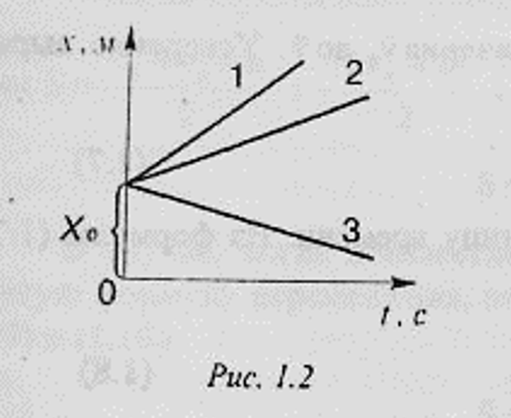
    - рис. 1.2显示了以不同速度运动的物体与时间的关系图。
    - 直线与时间轴之间的角度越大，速度就越大。
    - 直线1对应的物体的速度是最高的。
    - 图3所对应的物体以与X轴相反的速度运动。
    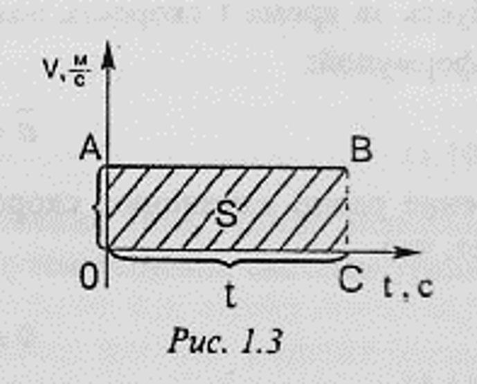
    - рис. 1.3显示了速度模量与时间的关系。
    - 它是一条平行于时间轴的直线，因为速度不随时间变化。
    - 根据速度图，可以确定物体在给定时间间隔内的位移模量，它就等于阴影的面积大小，由其边的乘积定义，其中一个对应于速度模量 $v$，另一个对应于时间 $t$。

##### §1.3. 匀变速直线运动
- 不均匀运动：
    - 定义：
        - 物体在相等的时间内做不等量的运动称为不均匀运动。
    - 特性：
        - 在不均匀运动中，物体的速度会随时间的变化而变化。
    - 平均速度：
        - 不均匀运动的平均速度是物体的位移与该运动发生的时间的比值：
            $$\vec{v_{ср}}=\frac{\vec{S}}{t}\qquad (1.5)$$
    - 瞬时速度：
        - 在某一时间点或在轨迹的某一点上的速度叫做瞬时速度。它可以被定义为在趋于无穷小的时间间隔 $Δt$ 内的平均速度，期间发生的位移 $ΔS$：
            $$\vec{v}=\lim{\frac{Δ\vec{S}}{Δt}}，Δt\longrightarrow0\qquad (1.6)$$
- 匀变速直线运动：
    - 定义：
        - 匀变速直线运动是指物体的速度在任何相等的时间间隔内发生相等的变化的运动，并且运动轨迹是一条直线。
    - 加速度：
        - 匀变速运动的物体的加速度是一个矢量值，它等于速度变化与发生这种变化的时间间隔之比。在时间 $t$ 内，让速度从 $\vec{v_{0}}$ 增加到 $\vec{v}$ ，加速度用公式表示：
            $$\vec{a}=\frac{\vec{v}-\vec{v_{0}}}{t}\qquad (1.7)$$
            加速度是单位时间内速度的变化，由公式 `(1.7)` 得：
            $$\vec{v}=\vec{v_0}+\vec{a}t\qquad(1.8)$$
            知道了物体的初始速度 $\vec{v_{0}}$ 和它的加速度 $\vec{a}$，就可以根据公式 `(1.8)` 计算出任意时刻的瞬时速度 $v$ 的值。
        - 单位：
            - 加速度的国际制单位是匀变速运动的加速度，$1$ 秒内速度每秒变化 $1$ 米。从公式 `(1.7)` 得出，加速度以米每秒的二次方为单位，$[a]=m/c^{2}$
    - 图像：
        - 如果我们将坐标 $x$ 轴指向运动轨迹，那么 $x$ 轴的方向将与向量 $\vec{v_{0}}$、$\vec{v}$ 和 $\vec{a}$ 重合。 这些向量 $\vec{v_{0}}$、$\vec{v}$ 和 $\vec{a}$ 的模等于它们在 $x$ 轴上的投影，表达式 `(1.8)` 可以写成标量形式：
            $$v=v_0+at\qquad(1.9)$$
            根据 `(1.9)`，速度-时间关系图是一条直线 $(v∼t)$。
        - 图 $1.4$ 展示了具有相同初始速度但具有不同加速度的匀加速运动的图像，以及图像 4 —— 初速度 $v_{0}=0$ 的匀加速直线运动。
            - 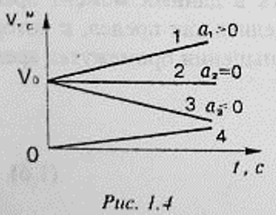
    - 位移：
        - 匀加速运动的位移公式可以用图解法得到 —— 求梯形 $OABC$ 的面积（图$1.5$）。它等于其底的一半与高的乘积。梯形的底在数值上等于：$ОА=v_0$，$ВС=v$。高等于 $t$。
            - 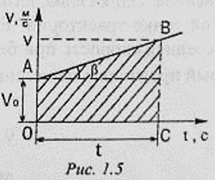
        - 位移的模等于：
            $$S=\frac{v_0+v}{2}\cdot t$$
          考虑到 $v=v_0+аt$，得：
            $$S=\frac{v_0+v_0+at}{2}\cdot t=\frac{2v_0+at}{2}\cdot t$$ 
          或 
            $$S=v_0t+\frac{at^{2}}{2}\qquad(1.10)$$
        - 在物体运动时间未知的情况下，可以使用求解方程组 `(1.9)` 和 `(1.10)` 得到的另一个位移公式：
            $$S= \frac{v^{2}-v_0^{2}}{2a}\qquad(1.11)$$

##### §1.4. 物体的自由落体
- 定义：
    - 匀加速直线运动的一种常见情况是自由落体 —— 物体在无空气空间中在重力作用下的运动。
- 发现：
    - 意大利物理学家伽利略伽利莱证实，在自由落体过程中，所有物体都以相同的加速度运动。
- 重力加速度：
    - 自由落体的加速度用字母 $g$ 表示。
    - 在地球表面上方的低海拔地区，$g=9.8m/s^2$，并指向地球的中心。在第 $2$ 章第 $6$ 节中，我们将说明自由落体的加速度随着物体离地球高度的增加而减小，并且还取决于地理纬度。
- 位移：
    - 自由落体期间的位移通常用字母 $h$ 表示。使用表达式 $(1.9)$、$(1.10)$ 和 $(1.11)$，用 $g$ 代替 $a$，用 $h$ 代替 $S$，可以得到速度模和自由落体位移的公式：
        $$
        \begin{aligned}
        v&=v_0+gt\qquad&(1.12)\\
        h&=v_0t+\frac{gt^{2}}{2}\qquad&(1.13)\\
        h&=\frac{v^{2}-v_0^{2}}{2g}\qquad&(1.14)\\
        \end{aligned}
        $$

##### §1.5. 运动的相对性、速度的合成
- 运动的相对性：
    - 物体在空间的每个位置，其静止和运动都是相对的。
        - 静止相对性：
            - 物体静止的相对性在于，在某些参照系中，物体是静止的；而在其他参照系中，物体是运动的。例如，坐在一辆行驶中的公共汽车上的人，相对于公共汽车来说是静止的，相对于地球来说是与公共汽车一起运动的。
        - 运动相对性：
            - 物体的运动也是相对的，即物体的速度相对于不同的参照系是不同的，并由速度相加的法则决定。
            - 让我们在一个具体的例子上考虑这个法则。一艘机动船以 $v_1$ 的速度沿河航行，相对于这艘船，一个人以 $v_2$ 的速度移动。让我们将一个静止的坐标系与地球联系起来，并将一个移动的坐标系与船联系起来。人相对于地球的速度等于 $\vec{v} = \vec{v_1} + \vec{v_2}$，即它在移动参照系中的速度和移动参照系（船）相对于静止参照系（地球）的速度的几何总和。
- 速度的合成：
    - 速度根据向量相加的规则相加。如果 $\vec{v_1}$ 和 $\vec{v_2}$ 相互成一个角度，可以使用平行四边形法则：增加的速度 $\vec{v_1}$ 和 $\vec{v_2}$ 对应于平行四边形的边，在相同比例下产生的速度 $\vec{v}$ 对应于其对角线。

##### §1.6. 匀速圆周运动
- 定义：
    - 如果速度模量保持不变，那么物体的圆周运动被认为是恒定的。在这种情况下，速度矢量的方向随时间变化。
- 描述：
    - 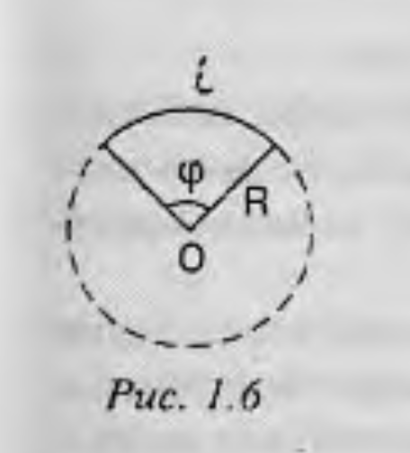
    - 物体的圆周运动可以通过设定连接圆心到物体任何一点的半径的转角 $\varphi$ 来描述。这个角度的单位是弧度。弧度（$rad$）等于圆周的两个半径之间的角度，其间的弧长等于半径。一圈相当于 $\frac{2\pi R}{R}=2\pi$ 弧度的角度。
- 角速度：
    - 旋转角 $\varphi$ 与旋转时间 $t$ 之比称为角速度：
        $$\omega=\frac{\varphi}{t}\qquad(1.15)$$
        角速度的测量单位是弧度每秒，$[ω]=rad/s$。
- 线速度:
    - 线速度 $v$ 是等于物体在运动过程中经过的周长 $l$ 与时间间隔 $t$ 的比值：
        $$v=\frac{l}{t}\qquad (1.16)$$
        它的方向与圆周相切。圆周弧长与旋转角度（图1.6）的关系是
        $$l=R\cdot\varphi$$
        让我们把这个表达式代入 `(1.16)`：
        $$v = \frac{R \varphi}{t}$$
        由此得到线速度和角速度之间的关系：
        $$v=R \omega \qquad (1.17)$$
- 除了所列举的量之外，物体在圆周上的运动可以用周期 $T$ 和频率 $\nu$ 来表示。
    - 周期：
        - 周期 $T$ 是指一个完整旋转所需的时间。其持续时间以秒为单位。
    - 频率：
        - 旋转频率 $\nu$ 是指每秒钟的旋转次数。频率以赫兹为单位（$1Hz=1rad/s$）。
    - 显而易见：
         $$\nu =\frac{1}{T}\qquad\omega=\frac{2\pi}{T}=2\pi\nu\qquad(1.18)$$
- 向心加速度：
    - 定义：
        - 速度方向发生变化是因为当物体做圆周运动时，它受到沿半径指向中心的加速度的作用，称为向心加速度。
    -模量：
        - 向心加速度的模由以下公式确定:
            $$a=\frac{v^2}{R}=\omega^2R\qquad(1.19)$$
            即它取决于圆周半径 $R$ 和运动速度。

#### 第二章：动力学基础

##### §2.1.牛顿第一定律。伽利略的相对性原理
- 牛顿第一运动定律（简称牛顿第一定律，又称惯性定律）：任何物体都要保持匀速直线运动或静止状态，直到外力迫使它改变运动状态为止。
- 力学相对性原理（伽利略相对性原理）：运动规律在所有惯性参照系中都是相同的。指经典力学定律在任何惯性参考系（惯性系）中数学形式不变，换言之，所有惯性系都是等价（平权）的。
##### §2.2.牛顿第二定律
- 牛顿第二运动定律（简称牛顿第二定律）：物体加速度的大小跟作用力成正比，跟物体的质量成反比，且与物体质量的倒数成正比；加速度的方向跟作用力的方向相同。
- 物质密度是一个标量，等于物体质量与体积之比

    $$\rho = \frac{m}{V}.$$

    - 密度的单位是$[\rho] = kg/m^3$
- 力是一个矢量，它是其他物体对某一特定物体的机械作用的量度。它用$\vec{F}$表示。力是物体相互作用时产生的加速度的原因。在实验的基础上，牛顿制定了最重要的力学定律，称为牛顿第二定律。

$$\vec{a} = \frac{\vec{F}}{m}$$
##### §2.3.牛顿第三定律
- 牛顿第三运动定律（简称牛顿第三定律）：相互作用的两个物体之间的作用力和反作用力总是大小相等，方向相反，作用在同一条直线上。作用力和反作用力是相互的，互相依赖相为依存，均以对方存在为自已存在的前提，没有反作用力的作用力是不存在的；力具有物质性，不能脱离开物体（物质）而存在；力总是两个以上物体之间的相互作用产生的。

$$\vec{F_1} = - \vec{F_2} $$

##### §2.4. 力矩

- 力矩是表示力对物体作用时所产生的转动效应的物理量。力矩是矢量，等于力与力臂（力的作用线到转动轴的垂直距离）的向量积。
- 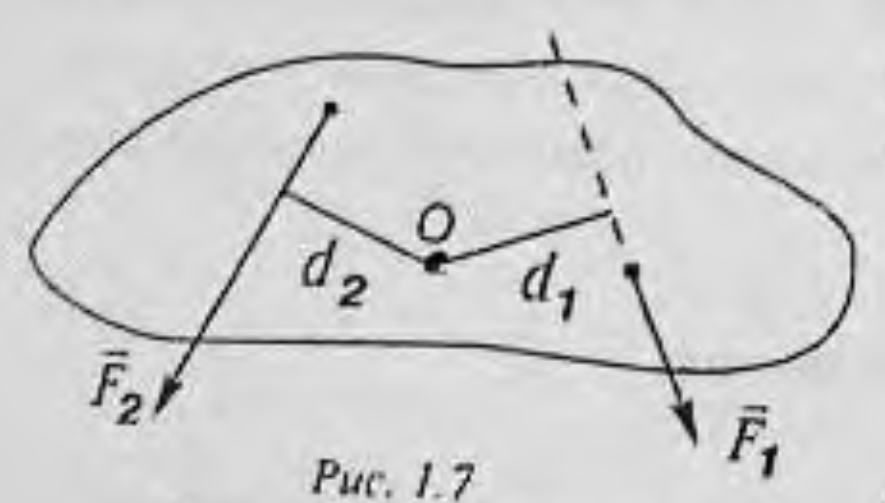
- 如上图（1.7），力矩的表达式可以写为：
    $$M=Fd$$
    - 力矩的单位为牛顿$\cdot$米（$H\cdot м$）
    - 力矩能使物体获得角加速度，并可使物体的动量矩发生改变，对同一物体来说力矩愈大，转动状态就愈容易改变。
- 力矩法则：如果施加在定轴物体上的力矩和为零，那么该物体就处于平衡状态。
- 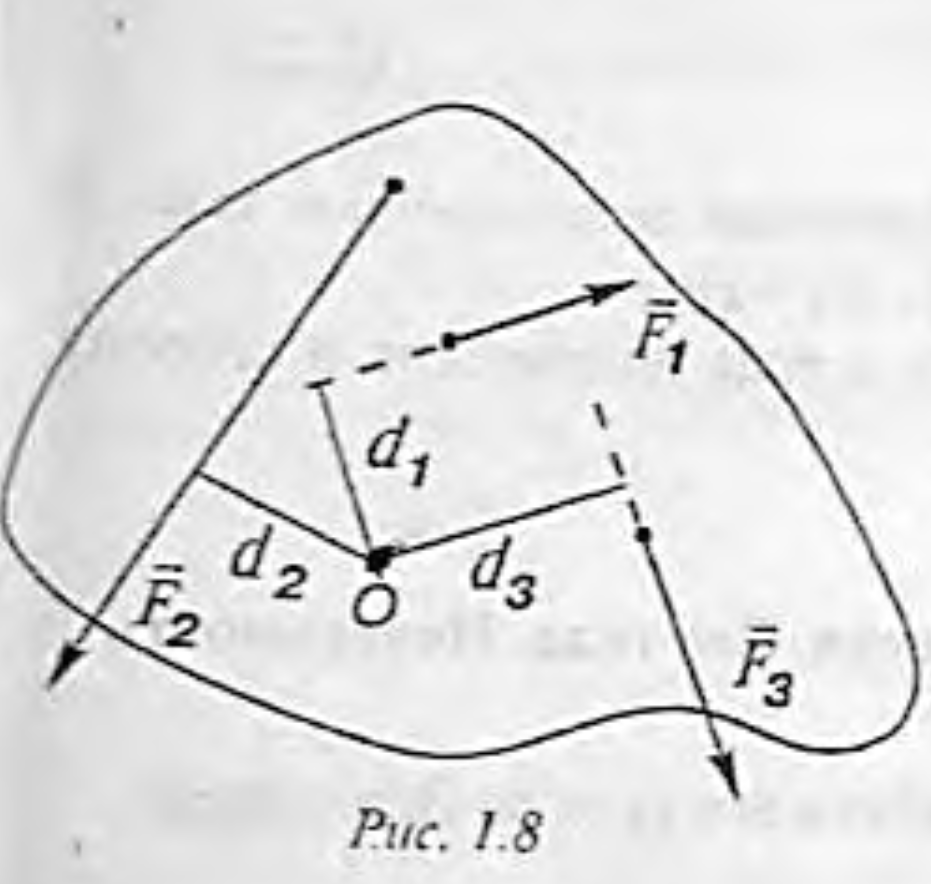
- 如图 1.8，令 $M_1=F_1d_1, M_2=F_2d_2, M_3=F_3d_3$，若该物体处于平衡状态，则
    $$M_1+M_2+M_3=0$$

##### §2.5. 弹力

- 弹性形变
    1. 形变：物体在力的作用下形状或体积会发生改变，这种变化叫形变。
    2. 弹性形变：有些物体在形变后撤去外力时能够恢复原状，这种形变叫弹性形变。
- 弹力
    - 发生弹性形变的物体，由于要恢复原状，对于他接触的物体会产生力的作用，这种力叫做弹力。
    - 弹力产生的条件：
        1. 物体间直接接触。
        2. 接触处发生弹性形变。
    - 弹力的本质是分子间的作用力（电磁力），属于电磁相互作用。当物体被拉伸或压缩时，分子间的距离便会发生变化，使分子间的相对位置拉开或靠拢，这样，分子间的引力与斥力就不会平衡，出现相吸或相斥的倾向，而这些分子间的吸引或排斥的总效果，就是宏观上观察到的弹力。
- 胡克定律
    - 内容：物体（弹簧）发生弹性形变时，弹力的大小 $F$ 跟物体（弹簧）伸长（或缩短）的长度 $x$ 成正比。其表达式为：
    $$F=kx$$
    - $k$ 为物体的劲度系数，仅由物体本身的性质决定，单位是牛顿每米（$N/m$），$x$ 为物体形变量。

##### §2.6. 万有引力

- 万有引力定律（law of universal gravitation）：自然界中任何两个物体都是相互吸引的，引力的方向沿两物体的连线，引力的大小 $F$ 与这两个物体质量的乘积 $m_1 m_2$ 成正比，与这两个物体间距离 $r$ 的平方成反比

    $$F=G \frac{m_1 m_2}{r^2}$$

    - 质量单位：$kg$
    - 距离单位：$m$
    - 力的单位：$N$
    - 引力常数：$G=6.67259×10^{−11} m^3/(kg \cdot s^2) = 6.67259×10^{−11} N\cdot m^2/kg^2$
    - 引力常数在数值上等于两个质量为 1 公斤的物体在距离为 1 米的情况下所产生的吸引力。

- 重力是地球对物体的吸引力，是万有引力的表现形式。设地球质量为 $M$，半径为 $R$，对任意质量为 $m$ 的物体重力为：

    $$F = G \frac{Mm}{R^2} \qquad (1.27)$$

- 根据牛顿第二定律，重力可写为以下形式：

    $$F = mg \qquad (1.28)$$

- 联立公式 (1.27) (1.28) 可得：

    $$g = G\frac{M}{R^2}$$

- 因此重力加速度不取决于物体质量，而取决于地球的质量和半径
- 地球对物体的吸引力被称为物体的重量，根据牛顿第三定律，压力与支持力相等且反向
    $$\vec{P} = -\vec{N} \qquad(1.30)$$
- 如果物体与平面相对静止，则有
    $$\vec{F_т} = - \vec{N} \qquad(1.31)$$
- 联立公式 (1.30) (1.31) 可得物体与平面相对静止时，有物体重量（压力）等于物体重力
    $$\begin{aligned}
        \vec{P} &= \vec{F_т}\\
        \vec{P} &= m\vec{g}
    \end{aligned}$$

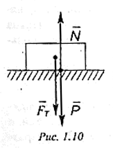

- 超重和失重
    - 超重现象：$\vec{P} > \vec{F_т} = mg$，即 $\vec{P} = \vec{F_т} + \vec{F} = m\vec{g}+m\vec{a}$，加速度 $\vec{a}$ 向上
    - 失重现象：$\vec{P} < \vec{F_т} = mg$，即 $\vec{P} = \vec{F_т} + \vec{F} = m\vec{g}-m\vec{a}$，加速度 $\vec{a}$ 向下
    - 完全失重：竖直向下匀加速运动的加速度正好等于重力加速度 g：$\vec{P} = m(\vec{g}-\vec{a})$

##### §2.7. 摩擦力

- 静摩擦力
    - 静摩擦力：当两个彼此接触、挤压的物体之间没有发生相对滑动，但具有相对滑动的趋势时，接触面上产生一种阻碍相对滑动趋势的力
    - 静摩擦力的方向总是与接触面相切，并且与相对滑动趋势的方向相反。
    - 最大静摩擦力：当拉力增大到某一特定值时，物体将开始沿接触面滑动。这时物体与接触面之间的静摩擦力达到最大，这个最大值称为最大静摩擦力，记为 $f_{max}$，静摩擦力f的的范围为 $0<f<f_{max}$
- 滑动摩擦力
    - 滑动摩擦力：两个物体彼此接触和挤压，并发生相对滑动时，在接触面上产生的一种阻碍相对滑动的力
    - 滑动摩擦力的方向总与接触面相切，并且与物体的相对运动方向相反
    - 滑动摩擦力的大小与压力成正比，还与接触面的性质有关
        $$f=\mu N$$
        - 比例系数 $\mu$ 叫做动摩擦因数。$\mu$ 值与接触面的材料及粗糙程度有关
    - 如果在水平方向上运动
        $$f=\mu mg$$

### 第二部分：分子物理学

#### 第一章：分子动力学理论的基本原理
    
##### §1.1. 分子动力学理论的基本规定及其实验依据
- 分子动理论
    - 定义：分子和动力学理论是通过构成物体的原子和分子的运动和相互作用来解释物体的结构和性质的学说。
    - 内容
        - 1，所有物质都是由大量的分子组成的，
        - 2，所有分子都在做永不停息的无规则运动
        - 3，分子之间存在相互作用力
        > 注意：物理学概念上的分子是指构成某一物质的具有其基本的化学性质的最小粒子（包括原子，离子甚至电子）
- 布朗运动
    - 定义：布朗运动是悬浮在液体中的 `颗粒` 的无规则运动。无规则运动的液体分子从四面八方作用于 `颗粒` ，与 `颗粒` 发生碰撞，从而改变了 `颗粒` 速度的大小和方向。
- 扩散运动
    - 定义：扩散运动是指一种物质的分子渗透到另一种物质分子之间的空隙中的过程，存在于气体，液体和固体之间
- 分子间作用力的证明
    - 分子间引力的证明：将两块铅各切出一个切口，将这两块铅沿新切口接合起来，可以承受相当大的拉力而不分开，可以证明出分子之间存在吸引力
    - 分子间斥力的证明：液体与固体很难被压缩，证明分子间存在斥力
- 物质的量
    - 物质的量是由构成该物质的分子数决定的，以摩尔为单位
    - 一摩尔等于 0.012 千克碳 C12 中含有多少个原子，就含有多少个分子的物质
    - 任何物质的一摩尔都含有相同数量的分子，称为阿伏加德罗常数：NA = 6.02·1023 个
- 摩尔质量
    - 物质的量为一摩尔的某物质的质量即为摩尔质量，以克每摩尔为单位
    - 摩尔质量在数值上等于该物质的相对分子质量
    - 物质的一个分子的质量可以用该物质的摩尔质量除以阿伏伽德罗常数来计算，即：$m_{0} = \frac{\mu}{N_{A}}$
    - 研究发现分子之间的距离约为 10-10m
    > 分子动力学理论的创始人是伟大的科学家M.V.罗蒙诺索夫。他根据分子动力学的概念，讲解了气体的性质、热的性质、固体的溶解等。

##### §1.2. 温度及其物理意义
- 温度的概念：    
    - 温度是描述物体冷热程度的物理量。从微观角度来说是物体分子进行热运动的剧烈程度。从分子运动论的观点来说是分子运动平均动能的标志
- 热量的转递：
    - 如果让两个温度不同的物体（或者同一物体温度不同的两个部分）接触，组成物体的分子会相互碰撞，使热量自发地从温度较高的物体（或部分）传到温度较低的物体（或部分）上，直到两物体（或部分）的温度变得相等。在这种情况下，可以说这两个物体（或这两个部分）处于热平衡状态。
- 分子热运动的平均动能：
    - 随温度的升高，分子热运动的平均动能增大。气体分子热运动的平均动能 $\overline{\varepsilon}$ 与其温度 $T$ 之间有直接的比例关系，由表达式定义为： 
        - $\overline{\varepsilon} = \frac{3}{2}KT$    (2.1)    
其中：К为玻尔兹曼常数，即理想气体常数与除以阿伏伽德罗常数的值，$K = 1.380649 \times 10^{-23} J/K$
- 温度的度量：
    - 绝对温度：若温度 $T \rightarrow 0$，则根据（2.1）$\overline{\varepsilon} \rightarrow 0$。我们规定分子热运动停止的温度称为绝对零度(абсолютным нулем)。这样定义的温度只能是正值。它被称为绝对温度(абсолютная температура)，以开尔文刻度来衡量。绝对温度的单位是开尔文($K$)，$[T] = K$
    - 摄氏温度：仅仅与开尔文刻度在零点位置上不同：$0K = -273.15℃$。若 $t$ 为摄氏刻度温度，$T$ 为绝对温度，则$T = t + 273.15$

##### §1.3. 理想气体与门捷列夫方程
- 理想气体：为了简化气体的研究，我们引入了理想气体的概念：
    - a)与容器的体积相比，气体分子的大小可以忽略不计
    - b)分子之间没有相互作用，则可以认为是理想的气体。    
        > 气体所服从的规律是复杂的。真正的气体按其性质来说，在足够小的压力和不太低的温度下，是接近理想气体的。
- 理想气体状态方程：
    - 气体的状态由一组参数表示。包括：质量$m$、温度$T$、体积$V$、压强$P$。将表征给定质量气体 $m$ 状态的参数$P$、$V$、$T$联系起来的方程，称为理想气体的状态方程。即 $PV = \frac{m}{\mu}RT$
    - 理想气体常数 $R$：对于一摩尔的任意理想气体，将该气体的压强 $P$ 与其摩尔体积 $V_{\mu}$ 的乘积除以气体的绝对温度 $T$，都会得到一个恒定的数，用字母 $R$ 表示，称之为理想气体常数，即：
        - $PV_{\mu} = RT ⇨ \frac{PV_{\mu}}{T} = R$, ( R=8.31 J/(mol·K) )    (2.2)
        > 理想气体常数 $R$，玻尔兹曼常数 $K$ 与阿伏伽德罗常数的关系为：$R = K \cdot N_{A}$
    - 物体的质量 $m$ 除以其摩尔质量 $μ$ 即为物体的物质的量 $ν$，即 $ν = \frac{m}{\mu}。将 (2.2) 乘以摩尔数 \frac{m}{\mu}$，得到：
        - $PV_{\mu}\frac{m}{\mu} = \frac{m}{\mu}RT$
    - 由于数值 $V_{\mu}\frac{m}{\mu} = V$ 为整个气体的体积，故而：
        - $PV = \frac{m}{\mu}RT$    (2.3)
        > 表达式（2.3）即为理想气体的状态方程。它是由克拉佩伦和门捷列夫建立的，称为门捷列夫-克拉佩伦方程。

#### 第二章：热力学要素

##### §2.1. 内能与热力学第一定律
- 热力学：
    - 概念：热力学是研究热功转换过程所遵循的规律的科学，不考虑物体的原子和分子内部结构
    - 基本内容：热力学的四个经验定律
        - 1，热力学第零定律：若两个热力学系统均与第三个系统处于热平衡状态（即温度相同），此两个系统也必互相处于热平衡。
        - 2，热力学第一定律：一个热力学系统的内能增量等于外界向它传递的热量与外界对它所做的功的和。（如果一个系统与环境孤立，那么它的内能将不会发生变化）
        - 3，热力学第二定律：
            - 克劳修斯表述：热量可以自发地从温度高的物体传递到较冷的物体，但不可能自发地从温度低的物体传递到温度高的物体；
            - 开尔文-普朗克表述：不可能从单一热源吸取热量，并将这热量完全变为功，而不产生其他影响。
            - 熵表述：随时间进行，一个孤立体系中的熵不会减小。
        - 4，热力学第三定律：绝对零度时，所有纯物质的完美晶体的熵值为零。 或者绝对零度（$T = 0K$ 即 $-273.15℃$）不可达到。
- 内能：
    - 定义：
        - 物质分子热运动的动能和它们相互作用的势能之和称为机体的内能，即：
            - $U = E_{k}+E_{p}$
        - 而对于理想气体，分子间相互作用的势能等于零，内能等于其所有分子混沌运动的动能之和，即：
            - $U = E_{k}$
    - 规律：理想气体的内能与其温度成正比，随着温度的升高，分子的热运动平均速度加快，因而其平均动能也随之增加。如果温度不改变，内能保持不变。
    - 内能变化的两种情况：    
        - 1，做功：外界对物体（或由物体组成的体系）做正机械功时，物体（或体系）内能增加，反之，物体（或体系）内能减少    
        - 2，热传递：内能从温度高的物体传到温度地的物体，或从同一物体的高温部分传到低温部分
            - 发生条件：存在温度差
            - 传递方向：从高温处传到低温处
        > 注意:
            - 1，内能 $U$ 与热量 $Q$ 的区别：内能是一个状态量，一个物体在不同的状态下有不同的内能。而热量是一个过程量，表示由于热传递而引起的变化过程中转移的能量，即内能的该变量。没有热传递就没有热量可言。    
            - 2，热量 $Q$ 和功 $A$ 的概念是相似的：它们是衡量从一个物体（或部分）转移到另一个物体（或部分）的能量。热量的计量单位是 $J$。
- 热力学第一定律：热力学第一定律是能量的守恒和转化定律，延伸到热现象：传递给系统的热量用于改变系统的内能和供系统对外部机构做功：
    - $Q = ΔU+A$    (2.5)
    > 例如，当一定量的热量传递给活塞下的容器中的气体时，它被用于气体的加热，即增加其内能，以及气体膨胀时活塞的提升工作。

##### §2.2. 热力学第一定律的应用
- 概念梳理：
    - 过程：在一定的环境条件下，系统的状态发生了变化，从一个状态变化到另一个状态，我们称系统发生了一个热力学过程，简称过程
    - 等过程：是指系统状态参数：温度 $T$，体积 $V$ 或压强 $P$ 中的任意一值保持不变进行的过程
    - 途径：系统变化所经历的具体路径称为途径
- 气体状态的变化过程的研究，
    - 1，等温变化过程
        - 概念：指温度恒定（即 $T = const$）的情况下发生的过程，该过程服从波义耳-马略特定律
        - 对于给定质量的气体，气体压强与体积的乘积不变，即：
            - $PV = const$    (2.6)
                > 由门捷列夫-克拉佩龙方程（见2.3）得出
        - 对于气体变化前后的两种状态：
            - $P_{1}V_{1} = P_{2}V_{2}$ 或 $\frac{P_{1}}{P_{2}} = \frac{V_{1}}{V_{2}}$    (2.7)    
            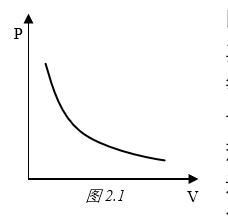    
            - 在恒温条件下，理想气体的压强与体积成反比。等温过程图像中的图线即为等温线（见图2.1）
            - 在等温过程中，由于温度不变，内能没有变化，$ΔU = 0$。根据热力学第一定律：$Q = ΔU+A$，应用于等温过程中，其形式为：$Q = A$，即传递给气体的热量仅与气体做工有关
    - 2，等容变化过程
        - 概念：指体积恒定（即 V=const）的情况下发生的过程，该过程服从查尔斯定律
        - 对于给定质量的气体，气体压强与温度的商不变，即：
            - $\frac{P}{T} = const$
                > 由门捷列夫-克拉佩龙方程（见2.3）得出
        - 对于气体变化前后的两种状态：
            - $P_{1}V = \frac{m}{\mu}RT_{1}$    ①
            - $P_{2}V = \frac{m}{\mu}RT_{2}$    ②    
            将①式除以②式，得到：
    >`此处缺一页`

##### §2.3. 比热容
- 物体的热容在数值上等于必须传递给物体以将其加热 1°C 或 1K 的热量
    - $C = \frac{Q}{∆T}$ (2.10)
        - $∆T$ - 热量 $Q$ 被传递给物体时的温度变化
- 物质的比热容是一个物理量，在数值上等于每加热 1°C（或 1K）一千克物质所需的热量
    - $c = \frac{Q}{m∆T}$ (2.11)
        - $m$ - 物体的质量
    - 比热容计量单位是 $[s] = J/(kg·K)$
        > 由公式 <a href="#a">(2.11)</a> 得出
        - 铜的比热容是 380 J / (kg·K)
            > 即给 1kg 铜加热使其温度升高 1℃（或 1K）所需的热量是 380J，冷却同样释放相同的热量
    - 用于计算将质量 $m$ 加热 $∆T$ 度所需的热量的公式
-    $Q = c \cdot m \cdot ∆T$
            > 由公式 <a href="#a">(2.11)</a> 得出
    - 热容不仅取决于物质的性质，还取决于物体体温变化的条件
        - 在等容过程中，传递给物体的热量仅用于增加内能
        - 在等压过程中，还用于做机械功。
            > 因此在恒压过程下的热容 $C_{p}$ 始终大于恒容过程下的热容    $C_{v}$
        - 在绝热过程中，当 $Q = O$ 时，热容为零
        - 在等温过程中，温度恒定，热容的概念没有意义

##### §2.4. 热力发动机的工作原理
- 能将内能转换为机械功的设备叫做热力发动机
 - 通常在热力外燃机中，机械工作是由气体（蒸汽）来完成的，气体被称为工作体。气体接受来自温度高于气体的加热装置的热量 $Q_{1}$，气体膨胀时，会带动机器的运动部件（例如气缸的活塞）。工作体每次做完功后，必须恢复到初始状态，使气体压缩时消耗的功小于膨胀时获得的功。为此气体在压缩前被冷却，使其与冷却装置（即温度低于气体温度的物体）接触。在这种情况下，气体传递给冷冻装置的热量 $Q_{2} < Q_{1}$，然后重复整个过程。一个周期的有用功 $A = Q_{1} - Q_{2}$
- 热机的效率 $\eta$ 是指一个周期内所做的有用功 $A$ 与从加热器接收的热量 Q1 之比。效率（КПД - Коэффициент полезного действия）表示发动机的有用功有多少是来自燃料完全燃烧所释放的全部能量。根据定义得：
 - $\eta = \frac{A}{Q} = \frac{Q_{1}-Q_{2}}{Q_{1}} = 1- \frac{Q_{2}}{Q_{1}}$
     > 由表达式可知，热机的效率总是小于 1
     - 理想热机的效率最大值可以通过……温度 $T_{1}$ 和……温度 $T_{2}$ 计算：
         - $\eta_{max} = \frac{T_{1} - T_{2}}{T_{1}}$
 - 加热装置的温度 $T_{1}$ 越高，冷却装置的温度 $T_{2}$ 越低，效率越高。大气环境也可以作为冷却装置。热机的实际效率 $\eta < \eta_{max}$，因为能量会因摩擦以及其他原因损失
- 热机有很大的实际用途。 蒸汽轮机用于热电厂和核电厂，大型船舶等。内燃机用于各种现代运输工具，包括公路，铁路，水以及农业机械。 在航空和太空火箭中-喷气发动机和涡轮喷气发动机。
    
#### 第三章：物态变化

##### §3.1. 物态的分子动力学解释
- 物态(агрегатное состояние)：即物质的聚集状态
- 根据温度和压力的不同，同一种物质可以处于某种集合状态：固体、液体、气体。还有其他的集合状态，如等离子体，我们就不考虑了。所有状态的共同点是构成物质的粒子的无规则运动
    > 根据条件的不同，物质可以从一种集合状态转变为另一种集合状态
    - 在气体中，分子之间的距离比其大小大很多倍，分子在气体所占的空间中自由移动。这就解释了气体能够被压缩并占据给它的整个体积。气体分子之间的引力很小，不能使它们相互靠近
    - 在液体中，粒子的位置几乎相互接近，并在自己的平衡位置附近进行振荡运动。在做了大约一百万次振荡之后，一个分子就会跳到另一个位置。每个分子每秒会发生 105 - 106次这样的变化。这就决定了液体的流动性和低压缩性等特性
    - 在固体中，粒子围绕其平衡位置振动。在晶体中，这些位置是晶格（кристаллическая решетка）的节点。固体之所以有形状和体积，是因为分子之间的吸引力大

##### §3.2. 熔化和结晶
- 熔化是指物质从固体到液体的转变。结晶体要想开始熔化，必须将其加热到一定的温度，称为熔点。直到物体完全熔化，其温度仍保持不变，因为熔化所提供的热量都用在打破固体的晶格上。[熔解比热(удельная теплота плавления) “λ” ](https://w.qianyix.com/index.php?q=%D1%83%D0%B4%D0%B5%D0%BB%D1%8C%D0%BD%D0%B0%D1%8F+%D1%82%D0%B5%D0%BF%D0%BB%D0%BE%D1%82%D0%B0+%D0%BF%D0%BB%D0%B0%D0%B2%D0%BB%D0%B5%D0%BD%D0%B8%D1%8F) （国内叫[熔化热](https://baike.baidu.com/item/%E7%86%94%E5%8C%96%E7%83%AD/2732316?fr=aladdin)） 是指将 1kg 的晶体固体在其熔点上变成液体所需的热量。熔化一个质量为 m 的物体，需要提供的热量为
    - $Q = \lambda \cdot m$ (2.15)
        >在结晶过程中（物质从液态向固态转变），会释放出一定的热量，可以用同样的公式计算。
        - 熔解比热的计量单位为 $[λ] = J/kg$

##### §3.3. 汽化和凝结
> 汽化是指液体转化为蒸汽的过程。凝结是物质从气态转变为液态的过程
- 汽化（парообразование）：有两种类型 —— 蒸发（испарение）和沸腾（кипение）
    > 研究问题：蒸汽 —— 饱和与不饱和蒸汽；沸腾 —— 沸点与压力的关系
    - 蒸发
        - 蒸发是从液体的自由表面发生的。最快的分子可以从液体中飞出，进入周围的空间，克服作用在液体表层的吸引力。这时，液体分子的平均动能降低，其温度也会降低。蒸发速度取决于液体的种类、温度、表面积、表面上方的空气运动
        - 蒸发过程伴随着分子返回到液体中的反向流动，因此，在物质的蒸发和冷凝过程之间建立了动态​​平衡。与液体处于动态平衡状态的蒸汽称为`饱和蒸汽`。这种状态的特点是：在同一时间内，离开液体表面的分子数等于返回液体的蒸汽分子数。
            - 蒸汽的名称 —— 饱和，这个名字强调的是在给定的温度下，给定的体积中不能有更多的蒸汽。可在恒温的密闭容器中获得。
            - 对于饱和蒸汽有以下特性
                - 在恒温下，饱和蒸汽的压强不取决于所占的体积
                - 体积恒定的饱和蒸气压随温度的升高而升高
        - 如果蒸汽还没有达到与液体的动态平衡状态，则称为`不饱和蒸汽`。在这种情况下，离开液体表面的分子数大于从蒸汽返回液体的分子数。不饱和蒸汽的压力取决于它的体积：
            - 体积增大时，压强减小
            - 体积减小时，压强增大
                > 直至蒸汽达到饱和
        - 蒸汽在恒温下进一步压缩，导致其转变为液体。其条件是温度必须低于临界温度，临界温度是指蒸汽和气体不能通过压缩而转变为液体状态的温度
    - 沸腾
        - 沸腾是指液体向蒸汽转变的过程，它不仅发生在表面，而且发生在液体内部。在沸腾过程中，液体的温度不会发生变化，因为提供给液体的所有热量都用于汽化。每种液体在固定的温度下沸腾，称为沸点。沸腾时，在整个液体体积中会形成蒸气气泡，一旦气泡内部的饱和蒸气压力等于或超过外部压力，气泡就会浮到表面。随着外界压力的降低，液体的沸腾温度降低，反之亦然。
    - 在恒定温度下，将1千克液体转化为蒸汽所需的热量称为[汽化比热 - 比蒸发热 - 比汽化热 (удельная теплота парообразования)](https://w.qianyix.com/index.php?q=%D1%83%D0%B4%D0%B5%D0%BB%D1%8C%D0%BD%D0%B0%D1%8F+%D1%82%D0%B5%D0%BF%D0%BB%D0%BE%D1%82%D0%B0+%D0%BF%D0%B0%D1%80%D0%BE%D0%BE%D0%B1%D1%80%D0%B0%D0%B7%D0%BE%D0%B2%D0%B0%D0%BD%D0%B8%D1%8F)（或许国内叫[蒸发热](https://baike.baidu.com/item/%E8%92%B8%E5%8F%91%E7%83%AD/9984575?fromtitle=%E6%B1%BD%E5%8C%96%E7%83%AD&fromid=4892269&fr=aladdin)？但又有些不同），其计量单位为 $[r] = J/kg$。将质量为 $m$ 的液体转化为蒸汽所需的热量根据如下公式计算：
        - $Q = r \cdot m\qquad(2.16)$

### 第三部分：电动力学

#### 第一章：静电学

##### §1.1. 带电物体，电荷及其性质，库仑定律
- 电动力学：研究带电体或粒子之间相互作用的物理学分支
- 静电学：电动力学的一个分支，研究静止体和拥有电荷的粒子的特性和相互作用
- 电荷
    - 定义：电荷是表征带电粒子与物体之间相互作用强度的物理量，用字母 $q$ 表示
    - 单位：库仑，$[q]=Кл$，库仑是指在1安培的电流强度下，1秒钟内通过导体截面的电荷。
    - 分类：自然界中只存在两种电荷
        - 正电荷：玻璃与皮肤摩擦时，玻璃上会产生正电荷
        - 负电荷：用羊毛擦过的琥珀上，会产生负电荷
    - 点电荷：物理学上把本身的线度比相互之间的距离小得多的带电体叫做点电荷，在进行研究时，我们忽略点电荷的尺寸
    - 物体带电的方式
        - 摩擦起电：
            - 实质：电子在不同物体间的转移
            - 原因：不同物体对电子的吸引和束缚能力不同
            - 带电特点：两物体带上等量异种电荷
            > 摩擦后的物体具有吸引轻小物体的现象
        - 感应起电
            - 实质：物体上电荷的再分布
            - 原因：物体在静电场的作用下，发生了的电荷上再分布，导体两端出现等量正负感应电荷
            - 带点特点：孤立的带电体和处于电场中的感应导体，处于静电平衡时，其特征：
                1. 导体内部场强处处为零，没有电场线(叠加后的);
                2. 整个导体是等势体，导体表面是等势面；
                3. 导体外部的电场线与导体表面垂直，表面场强不一定为零;
                4. 对孤立导体，静电荷分布在外表面，且表面曲率(1/R)越大，电荷密度越大，电场越强.
                >注意: 
                >1. 静电荷是指导体内正、负电荷中和后所剩下的多余电荷；
                >2. 感应电荷是指由于静电感应而使导体两端出现的等量异种电荷.
        - 接触起电
    - 电荷量：
        - 任何电荷，不论其符号如何，其电荷量总是最小电荷e的倍数，这个最小的电荷称为基本电荷(又称元电荷)，其电荷量为 $e\approx1.6\cdot10^{-19} Кл$ 基本电荷的载体是带负电的电子、带正电的质子和其他一些基本粒子
        - 表达式：
            $$q=ne$$
            其中：n为正整数，基本电荷值 $e=1.6\cdot10^{-19} Кл$
    - 电荷守恒定律：对于一个孤立系统，不论发生什么变化，其中所有电荷的代数和永远保持不变。
    - 电荷间的相互作用：同类电荷相互远离，相反电荷相互吸引
    
- 库仑定律
    - 库仑力：真空中两个点状静止电荷的相互作用力与电荷模块的乘积成正比，与它们之间距离的平方成反比，这种相互作用力叫库仑力
    - 库仑力的计算：如果场是由一个点电荷$q1$产生的，在这个场的某一点上又引入了另一个点电荷$q2$，根据库仑定律可以计算出它们之间的相互作用力
        - 真空介质中的库仑力：
            - $$F_0=k\frac{\lvert q_1\rvert\lvert q_2\rvert}{r^2}\qquad(3.1)$$
                >其中，库伦常数（静电力常量）$k=9\cdot10^9\frac{Н\cdot м^2}{Кл^2}$，它通常表示为：$k=\frac{1}{4\pi\varepsilon_0}$，$\varepsilon_0$（真空中的介电常数）$\approx8.85\cdot10^{-12}\frac{Кл^2}{Н\cdot м^2}$
        - 非真空均匀介质中的库仑力：
            - 如果相互作用的电荷是在均匀的电介质中，而不是在真空中，库仑力就会减少$\varepsilon$（电介质的介电常数）倍：
            - $$F=\frac{F_0}{\varepsilon},\quadили\quad F=k\frac{\lvert q_1\rvert\lvert q_2\rvert}{\varepsilon r^2}\qquad(3.2)$$
                >其中相对介电常数 $\varepsilon$（相对电容率）是一个没有单位的物理量，其值等于以该均匀材料为介质与以真空为介质制成的同尺寸电容器电容量之比，可以表征介质材料的介电性质，极化性质以及贮电能力，对于所有 $\varepsilon>1$ 的物质。同种或异种电荷的相互作用力方向如 `图3.1` 所示
            - 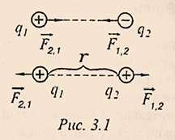

##### §1.2.电场
- 电场
    - 电场定义：电场是电荷及变化磁场周围空间里存在的一种特殊物质。这种物质与通常的实物不同，它虽然不是由分子原子所组成的，但它却是客观存在的特殊物质，具有通常物质所具有的力和能量等客观属性
    - 静电场：静止电荷所产生的场称为静电场
    - 电场力
        - 定义：电荷通过在周围空间产生电场来改变周围空间的性质。电场对于电场中的电荷的作用力与这个电荷的电荷量成正比：$\vec{F}$ 正比于 $q$
        - 表达式：$\vec{F}=\vec{E}q$
    - 电场强度
        - 定义：电场强度是用来表示电场的强弱的物理矢量，其方向与作用在正电荷上的电场力的方向一致，其值为作用在电荷上的力与该电荷量的比值，电场强度的大小取决与电场本身，或者说取决于激发电场的电荷，与电场中的受力电荷无关。
        - 单位：根据 (3.3) ，电场强度的单位是牛顿每库仑，$[E]=N/Кл$
        - 表达式：
            - 对于单个电荷构成的电场：
                - $$\vec{E}=\frac{\vec{F}}{q}=\frac{kq_0q}{\varepsilon r^2q}=k\frac{q_0}{\varepsilon r^2}\qquad(3.4)$$
                    >- 根据(3.4)，在这种情况下，场强与电荷上升、产生场的大小成正比，与电荷到场中给定点的距离g的平方成反比  
                    >- 其中 $r$ 为电荷 $q0$ 到场中给定点的距离  
                    >- 因为 $\vec{F}$ 正比于 $q$ ，所以 $\vec{E}$ 正比于 $q$
            - 对于由多个电荷构成的复合电场，根据电场的叠加原理，电场中某一点的电场强度等于每个电荷产生的电场强度的几何和：
                - $$\vec{E}=\vec{E_1}+\vec{E_2}+...+\vec{E_n}$$
        - 电场的图形描绘
            - 电场线：为了用图形描绘电场，我们采用带有方向箭头的曲线，称为电场线。电场线上每一点的切线方向和该点电场强度的方向一致；曲线密集的地方场强强，稀疏的地方场强弱。*电场线不是客观存在的一种物质，是人为地画出的形象描述电场分布的辅助工具*
            - 电场线的画法：电场线起于正电荷（或正无穷大），止于负电荷（或负无穷大）。在 `图3.2` 中显示了单个正负电荷的场，以及正负电荷系统的场。
            - 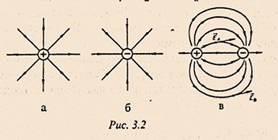
        - 匀强电场：电场中各点的电场强度相同，即 $\vec{E}=const$ 的电场
            - 典例：两个携带异种电荷的平行板电容器内的电场

##### §1.3. 电荷在静电场中的做功
- 在匀强电场中的做功
    - 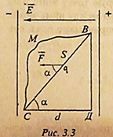
    - 如 `图3.3` ，在匀强电场中，一个点电荷 $q$ 在沿着电场强度方向的电场力 $F=Eq$ 的作用下，从 $B$ 点移动到 $C$ 点的过程中，求电场力 $F$ 做功
    - 如果电荷径直从 $B$ 点移动到 $C$ 点：
        - $$A_{ВС}=FS\cos\alpha=Eqd\qquad(3.6)$$
            >即电场力做功 $А$ 等于电荷量 $q$ 、场强 $E$ 和沿场线所取距离 $d$ 的乘积
    - 如果电荷沿路线 ВДС 从 В 点沿直线移动到 Д 点再沿直线移动到 С 点，电场力的做功为
        - $$A_{ВСД}=А_{ВД}А_{ДС}=FS\cos90\degree+FS\cos0\degree\qquad(3.7)$$
        >其结果与 (3.6) 相同
    - 当沿着B点和C点之间的任何曲线路径移动电荷时，将得到同样的结果（例如，ВМС）。这意味着在均匀的电场中，电场力的做功不取决于运动轨迹的形状和路径的长度，而只由起点和终点的位置决定。类似于重力场，力的做功不取决于运动轨迹形状和长度，我们将这种场称为势场 (потенциальное поле)。引力场和电场都是势场。
    - 电势能：引入电场的电荷与电场相互作用，从而拥有电势能。将电荷从位置1移到位置2的做功可以表示为势能的改变量：
        - $$А=\Delta W=-(W_2-W_1)=W_1-W_2\qquad(3.8)$$

##### §1.4. 电势，电势差，电场强度与电位的关系，点电荷的电势场
- 电势（又称电位）
    - 定义：处于电场中某个位置的单位电荷所具有的电势能与它所带的电荷量之比，等于静电场中每单位电荷具有的电势能，它是电场的一种能量特性。
    - 特点：电势只有大小，没有方向，是一个标量，其数值不具有绝对意义，只具有相对意义
    - 表达式：
        - $$\varphi=\frac{W}{q}\qquad(3.9)$$
    - 单位：
        - 电势和电势差的测量单位是伏特，$[\varphi]=[\Delta\varphi]=В=Дж/Кл$。
- 电势差
    - 定义：电场中两个点之间电势的差值
    - 表达式：
        - $$\Delta\varphi=\varphi_1-\varphi_2$$
    - 单位：同电势单位，如果 1 Кл 电荷从一点转移到另一点时做了 1 Дж 的工作，则两点之间的电位差等于 1 В
    - 使用电势差来计算电场力做功
        - 由表达式 (3.9) 可知$W=q\varphi$，根据 (3.8)，电荷在静电场中移动的功等于：
        - $$A=q\varphi_1-q\varphi_2=q(\varphi_1-\varphi_2)=q\Delta\varphi\qquad(3.10)$$
            电荷轨迹的初始点和最终点的电位差被括在括号中:
            - $$\Delta\varphi=(\varphi_1-\varphi_2)=\frac{A}{q}\qquad(3.11)$$
            - __即两点之间的电势差等于将相当于一个库仑的点电荷从一点移动到另一点的功__
    - 电场强度与电势差之间有一定的依赖性。如（图3.4），假设电荷 q 在均匀的静电场中沿电场线从 点1 移动到 点2 时，所做的功为：
        - $$A=qEd\qquad(3.11)$$
        - 该做功可以用 点1 和 点2 的电势差来表示：
        - $$A=q(\varphi_1-\varphi_2)=q\Delta\varPhi=qU\qquad(3.12)$$
    - 联立等式 (3.11) 和 (3.12)，我们可以找到场强矢量的模数：
        - $$E=\frac{U}{d}\qquad(3.13)$$
        - 根据 (3.13)，均匀静电场的强度在数值上等于每单位长度的电位差。由此可见，静电场强度的单位是 1 В/м，1 В/м=1 Н/Кл
        - 如果一个点电荷q0产生了静电场，那么在距离电荷r的任何一点上，电势是相等的:
            - $$\varphi=k\frac{q_0}{\varepsilon r}\qquad(3.14)$$

##### §1.5. 电容，电容器与电能
- 电容
    - 概念：经验表明，如果将不同量的电荷$q_1, q_2, ...$先后通过一个单独的导体，导体的电势将分别为$\varphi_1, \varphi_2, ...$，电荷与相应电势的比值$\frac{q_1}{\varphi_1}=\frac{q_2}{\varphi_2}=...$保持不变，这个比值表征了导体的某种特性，它既不依赖于电荷，也不依赖于电势，称为导体的电容量：
    - 表达式：
        - $$C=\frac{q}{\varphi}\qquad(3.15)$$
        - 单独导体的电容量$C$是一个物理量，数值上等于每单位电势变化量下，电荷量的变化值。它取决于导体的材料，形状和大小以及周围的环境（例如平行板电容器的平行板之间的距离就会影响其电容量）
    - 单位：
        - 国际单位：法拉，$[C]=\Phi$
            >根据(3.15)，一法拉等于`通过 1 库伦的电荷时能发生 1 伏特电势的改变的导体的电容量`
        - 其他单位：
            - 微法拉($мк\Phi$)和皮法拉($п\Phi$)：
            - $мк\Phi=10^{-6}\Phi$
            - $п\Phi=10^{-6}мк\Phi=10^{-12}\Phi$
- 电容器
    - 定义：电容器是一个由两个导体（外壳）组成的系统，中间有一个介电层隔开。当电容器的两个极板之间加上电压时，电容器就会储存电荷
    - 特性：电容器有一个显著的特性，就是体积小却有很大的电容量，可以存储大量电荷
    - 平行板电容器：
        - 构造：通常使用由两个金属板组成，中间由电介质隔开
        - 特点：带电平行板电容器绝大部分的电场都集中在其内部
        - 电容量计算：
            - $$C=\frac{\varepsilon_0\varepsilon S}{d}\qquad(3.16)$$
            - >其中：
                - $\varepsilon$ - 是金属板间电介质的相对介电率。
                - $S$ - 两金属板正对面积
                - $d$ - 两金属板间距离
    - 电容器的充电：当电容器与电压源连接时，电容器充电，其两个导体之间产生电场。电源的做功用来积累电场的能量，而电场的能量由电容器的电容量和其导体间的电压决定的：
        - $$W=\frac{CU^2}{2}\qquad(3.17)$$
    - 电容器的放电：当电容器与电源断联时，电容器放电，集中在带电电容器的场内的能量会转化为其他类型的能量：例如热能、光能等。
    - 放电特性：当电容器通过低阻电路放电时，它几乎是在瞬间释放出能量，这种放电特性用在摄影用的闪光灯上。
    - 应用：电容器在无线电工程中应用广泛，特别是在无线电接收机的主要部分--振荡电路中，在自动装置中等都有使用。

#### 第二章：直流电定律

##### §2.1. 电流、电流强度、部分电路的欧姆定律、导体的电阻、[电阻率](https://baike.baidu.com/item/%E7%94%B5%E9%98%BB%E7%8E%87/786893?fromtitle=%E6%AF%94%E7%94%B5%E9%98%BB&fromid=10626206&fr=aladdin)（又叫比电阻）
- 电荷的定向运动叫做电流。取正电荷的运动方向为电流方向。物质中电流的出现和存在，必须要有自由电荷载体和电场，在电场的影响下，带电粒子才会有序地运动。
- 电流强度是在一定时间间隔内通过导体横截面的电荷 $∆q$ 与该时间间隔 $∆t$ 之比:
    - $I=\frac{∆q}{∆t}\qquad(3.18)$
- 如果电流强度不随时间而变化，则称为恒定电流。电流强度的单位是安培，$[I]=A$,这个单位是根据电流的“磁相互作用”建立起来的。安培是指直流电的强度，当它流过两根长度为无穷大的平行直线导体（在真空中距离为1米）时，在这两根导体之间将产生 $2\times10^{7}N/m$ 的磁相互作用力。测量电流的设备称为电流表。它与待测电流的电路部分串联，并用符号  $A$ 表示。
- 一段电路上的电势差称为电压。
- 用电压表测量某段电路的电压。它与待测部分并联，用符号 $V$ 表示。
- 1826年，德国物理学家欧姆发现，作为电路一部分的金属导体两端的电压与电路中的电流强度之比是一个定值：
    - $\frac{U}{I}=R=const\qquad(3.19)$
- $R$ 的值被称为导体的电阻。电阻的单位是 - 欧姆：$[I]=\Omega\quad(Ом)$。对于 $1\Omega$ 电阻的导体，$1V$ 的电压产生 $1A$ 的电流。由公式 `(3.19)` 得：
    - $I=\frac{U}{R}\qquad(3.20)$
- 这个比表示了部分电路的欧姆定律:
     - 电流强度与该部分电路的电压成正比，与该部分的电阻成反比。
- 导体的电阻取决于它的几何尺寸和制造它的物质。对于长度为 $l$、横截面积为 $s$ 的导体来说：
    - $R=\rho\frac{l}{s}\qquad(3.21)$
- 比例系数 $\rho$ 称为电阻率，它取决于物质的类型。 电阻率在数值上等于单位长度和单位截面积的导体的电阻。 电阻率单位是 - $[\rho]=\Omega·m\quad(Ом·м)$

##### §2.2. 导体的并联和串联
- 直流电路中的导体可以串联和并联在一起。
- 在串联电路中，第一根导体的端部与第二根导体的端部相连，以此类推。在这种情况下，所有导体中的电流相同，整个电路两端的电压 $U$ 等于串联的所有导体的电压之和。利用欧姆定律写出一个电路的部分:
    - $U=U_{1}+U_{2}+U_{3}+……+U_{n}\quad$或$\quad IR=I_{1}R_{1}+I_{2}R_{2}+I_{3}R_{3}+……+I_{n}R_{n}\qquad(3.22)$
    - 即 $\quad R=R_{1}+R_{2}+R_{3}+……+R_{n}\qquad(3.23$)
- 当导体串联时，它们的总电阻等于所有导体的电阻之和。
- 当导体处于并联状态时，其始端和末端与电流源有共同的连接点。所有导体上的电压 $U$ 相同，无支路中的电流 $I$ 等于所有并联导体中的电流之和。将欧姆定律应用到电路中，我们发现：
    - $I=I_{1}+I_{2}+I_{3}+……+I_{n}\quad$ 或 $\quad\frac{U}{R}=\frac{U_{1}}{R_{1}}+\frac{U_{2}}{R_{2}}+\frac{U_{3}}{R_{3}}+……+\frac{U_{n}}{R_{n}}\qquad(3.24)$
    - 即 $\quad\frac{1}{R}=\frac{1}{R_{1}}+\frac{1}{R_{2}}+\frac{1}{R_{3}}+……+\frac{1}{R_{n}}\qquad(3.25)$
- 在并联时，导体总电阻的倒数等于所有并联导体的电阻倒数之和。

##### §2.3. 电动势、闭合电路的欧姆定律
- 一个最简单的电路由电流源（内电路部分）和电能消费者（外电路部分）组成。电流源在外电路两端保持恒定的电位差。在电路的外侧，电荷在库仑力的作用下运动，而在内侧，电荷在电场力的作用下运动。
- 作用在电流源内部，并使电荷向与电场方向相反的方向运动的非电性力称为外力。
- 外力的工作是以牺牲电流源（化学、热、机械、原子）的能量为代价的。电流源的电动势（ЭДС:Электродвижущая сила）是指外力使单位电荷在闭合电路中移动所做的功：
    - $\varepsilon=A_{стро.}{q}\qquad(3.26)$
- 电动势的测量单位与电压相同，即以伏特（вольт）为单位，$[\varepsilon]=B$。
- 图 $3.7$ 为闭合电路,外电阻 $R$ 和内电阻 $r$ 之和就是电路的总电阻 $R+r$，闭合电路的欧姆定律为:
    - $I=\frac{\varepsilon}{R+r}\qquad(3.27)$
    - 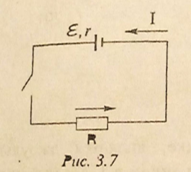
- 闭合电路中的电流与作用在电路中的电动势成正比，与它的总电阻成反比。
    - $I_{к.з.}=\frac{\varepsilon}{r}\qquad(3.28)$
- 当 $R=0$ 时的电流流动方式称为短路电流。
- 公式 `(3.27)` 还可表示为以下形式：
    - $\varepsilon=IR+Ir=U_{внеш}+U_{виутр}$
        - $U_{внеш}=IR$ - 外部电压  
          $U_{виутр}=Ir$ - 内部电压
- 若 $R\gg r$，则 $U_{внеш}\gg U_{виутр}$，且 $\varepsilon\approx U_{внеш}$。若外电路断路（此时，我们可以认为 $R\longrightarrow\infty$），则源端电压等于电动势的值。

##### §2.4. 电流的功和功率
- 产生电流的电场强度的功被称为电流的功，电场强度的功用公式 `(3.12)` 来定义：
    - $A=q(\varphi_{1}-\varphi_{2})=qU$
        - $q=It\quad$ - 在时间 $t$ 内流经导体横截面的电荷量的数值
    - 因此，时间 $t$ 电流做d的功等于：
        - $A=UIt=I^{2}Rt=\frac{U^{2}}{R}t\qquad(3.29)$
            - $I$- 该处电流强度  
              $U$- 电压  
              $R$- 该段电路电阻
    - 和在力学中一样，功的单位是焦耳：$1J=1V·1A·1s$。焦耳是指在电压为 $1V$ 的区域内，$1A$ 的直流电 $1s$ 内所做的功。
- 电流的功率等于单位时间内电流所做的功：
    - $P=\frac{A}{t}=U·I=I^{2}R=\frac{U^{2}}{R}\qquad(3.30)$
    - 电流功率的单位是瓦特（ватт,式中写作Вт），$1W=1J/s$。电流功率的倍数单位是千瓦：$1kW=1000W$。
    - 电流的工作单位焦耳也称为瓦特秒（ватт секунда）：$1J=1W·1s$。体系外的（非单位制的）电流的功的单位是千瓦时（киловатт-час）：$1kW·h=3.6\times10^{6}W·s$。

##### §2.5. 电流的热效应、焦耳-楞次（Ленца）定律
- 如果在电场的作用下，电路部分不做机械功，物质不发生化学转化，电流做的功只导致导体的加热。因此，在时间 $t$ 内，该电路部分放出的热量等于电流的功。
    - $Q=A\qquad(3.31)$
    - 或根据`(3.29)`：
        - $Q=I^{2}Rt\qquad(3.32)$
        > 该表达式被称为焦耳-楞次定律  
        - 通电导体释放的热量与电流的平方、导体的电阻和电流通过导体的时间成正比。
- 电流的热效应用于白炽灯、电热设备等。

##### §2.6. 金属中的电流、金属导体的电阻及与温度的关系
- 由于金属中存在自由的带电粒子 - 电子，所有金属都是电流的导体，$1cm$ 中电子数量可达 $10^{22}$。在没有电场的情况下，电子在金属中无规则运动。在电场的影响下，电子除了做无规则运动外，还获得定向运动，并产生了电流。电子的定向运动因其与晶格离子、缺陷和杂质的碰撞而受到阻碍——因此会产生电阻。在每次碰撞中，电子在电场的作用下在自由路径中获得的动能的一部分也转移到离子上。当电流流过导体时，会导致导体发热。金属的电阻率在加热时大约呈线性增加：
    - $\rho=\rho_{0}(1+\alpha t)\qquad(3.33)$
        - $\rho_{0}$- $0℃$ 时的电阻率
        - $\rho$- 温度 $t$ 时的电阻率（以摄氏度为标准）
        - $\alpha$- 电阻温度系数
        > 在纯金属中 $\alpha\approx\frac{1}{273}\frac{1}{град}$
- 1911年，人们发现，当汞的温度降到 $4.1K$ 时，其电阻率突然降为零。这种现象称为超导性，在一些金属和合金中都能观察到。电流流经超导体不会发生能量损失，因此在超导环中激发的电流可以无限期存在而不发生变化。超导性通常在非常低的温度下观察到——低于 $20K$。
- 1986年，人们创造出在更高的温度 $~100K$ 时保留超导性的材料。这为超导体在低损耗输电线路、强力电磁铁等方面的实施创造了广泛的应用前景。

##### §2.7. 电解液中的电流、电解定律
- 其溶液能传导电流的物质叫电解质。其中包括酸，碱和盐以及熔融盐的溶液。这些物质的分子溶于水后，由于它们在水中的相互作用力减小（81倍 -  $\varepsilon_{воды}\approx81$），分子分解成阳离子和阴离子。这个过程被称为解离。当电流流过电解液时，阳离子流向阴极 $K$（负电极），阴离子流向阳极 $A$（正电极）。如图：  
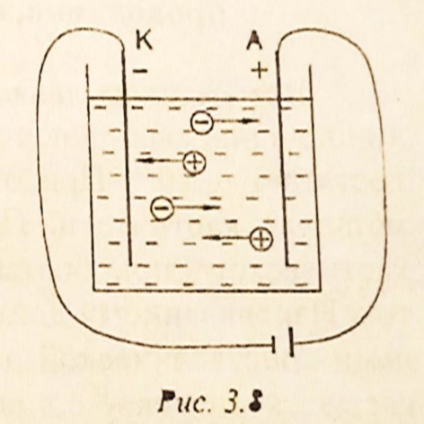
电流通过电解液时，会在电极上释放出构成电解质的物质。在阳极，阴离子丢失多余的电子；在阴极，阳离子得到缺少的电子。因此，会有纯净的化学物质在电极上沉积。例如：当电流通过 $CuCl$ 水溶液时，氯气在阳极释放，铜在阴极沉积。当电流通过电解液时，电极上物质释放的过程称为电解。释放物质的质量取决于法拉第建立的**电解定律**：
    - 电流流过的过程中，电极上释放的物质质量与通过电解液的电荷 $e$ 成正比：  
        $\qquad m=kq\quad$ 或 $\quad m=kIt\qquad(3.34)$
        - $I$- 电流强度  
          $t$- 电流通过电解液的时间  
          $k$- 比例系数——物质的电化学当量，它在数值上等于 $1C$ 的电荷通过电解质时的释放物质的质量，单位为 $kg/C$。
- 电解被广泛应用于从金属中去除杂质（精炼）；用于在金属产品上涂覆另一种金属的薄层（电镀）；从浮雕图像等中获取金属副本（电铸）。电池中应用了电解现象。

#### 第三章：磁场与电磁感应

##### §3.1 电流的相互作用，磁场与磁感应
- 电流间的相互作用
    - 现象：经验表明，两个平行导体中流过的电流，如果这些导体中的电流方向相同，就会相互吸引，如果电流流向相反，就会相互排斥
    - 原因：任何移动的电荷都会在周围的空间内产生磁场。因此，任何有电流的导体周围都会形成磁场。并且磁场对运动的电荷会产生一种作用力。由于这些电流中的每一个电荷都处于另一个电流产生的磁场作用下。因此，平行电流之间就会产生这种相互作用力，
- 磁场
    - 产生：
        - 一个静止的电子具有一定质量和单位负电荷，因此对外产生引力和单位负电场力。当外力对这个静止电子作用并使之运动时，该外力不但要为电子的整体运动提供动能，还要为运动电荷所产生的磁场提供磁能。由此可见，磁场是电子由于外力作用于运动电子并通过能量转换的方式产生的。
        - 带负电的点电荷运动形成的电流产生的磁场是大量运动的电子产生磁场的宏观表现。
        - 同样道理，带正电的点电荷运动形成的磁场，是其中过剩的质子产生磁场的宏观体现。
    - 磁感应强度：与电场相仿，磁场是在一定空间区域内连续分布的向量场，描述磁场的基本物理量是磁感应强度矢量$\vec{B}$，
        - 单位：磁感应强度的单位是特斯拉，$[B]=Тл$。将带有1A恒定电流的直长导线垂直放在均匀磁场中，若导线每米长度上受到1Н的力，则该均匀磁场的磁感应强度定义为 $1Тл$
    - 磁场的图形描述：
        - 磁感线：磁场可以通过磁感应线以图形的方式来描述
            - 特点：
                - 曲线上每一点的切线方向都和这点的磁场方向一致
                - 磁感应强度的方向与该点的磁力线切线方向相同，其大小与磁力线的密度成正比
                - 磁力线是人为的假设的曲线。磁力线有无数条，磁力线是立体的，所有的磁力线都不交叉，磁力线总是从 N 极出发，进入与其最邻近的 S 极并形成
                - 磁力线都是闭合的，具有闭合场线的场称为涡流场，因此磁场是涡流
                - 同电流类似，磁力线总是走磁阻最小（磁导率最大）的路径，因此磁力线通常呈直线或曲线，不存在呈直角拐弯的磁力线。任意二条同向磁力线之间相互排斥，因此不存在相交的磁力线
    - 安培定则（右手螺旋定则）：
        - 安培定则一：用右手握住通电直导线，让大拇指指向直导线中电流方向，那么四指指向就是通电导线周围磁场的方向
        - 安培定则二：用右手握住通电螺线管，让四指指向电流的方向，那么大拇指所指的那一端是通电螺线管的N极
        - 安培定则在直线型导体中的运用：
            - >例：如 `图3.9`，有电流的直形导体磁场的场线是垂直于导体的平面上的圆圈，圆的中心位于导体的轴线上。磁感应线的方向如图所示，当右手四指螺旋的的方向与导体中的磁场方向一致，那么右手大拇指指向的方向将与电流的方向一致
            - 

##### §3.2 安培力与洛伦兹力
- 安培力：
    - 将通有电流的导体置于磁场中，作用在该导体上的力称为安培力。通过在磁铁的两极之间放置一个带电流的移动导体，我们可以观测到这个力的作用，如 `图3.10`"：在安培力的作用下，根据导体中电流的方向，将导体向内拉入两极间的空隙或向外推出
    - 
    - 表达式：安培力与磁感应矢量的模数 $B$、电流强度 $I$、导体的长度 $l$ 和磁感应矢量方向与导体中电流的角度 $\alpha$ 的正弦值成正比。
        - $$F_A=BIlsin\alpha\qquad(3.35)$$
        - >安培力可以认为是磁场作用在带电流的导体中所有运动电荷上的力（即洛伦兹力）的总和。
- 洛伦兹力
    - 磁场作用在运动的电荷上的力叫洛伦兹力
    - 表达式：
        - $$F_a=qvsin\alpha\qquad(3.36)$$
        - 其中：
            - q - 电荷
            - v - 感应磁场场强
            - $\alpha$ - 速度与磁感应矢量的夹角
    - 左手定则：
        - 判断安培力：伸开左手，使拇指与其他四指垂直且在一个平面内，让磁感线从手心流入，四指指向电流方向，大拇指指向的就是安培力方向（即导体受力方向）
        - 判断洛伦兹力：将左手掌摊平，让磁感线穿过手掌心，四指表示正电荷的运动方向，则与四指垂直的大拇指所指方向即为洛伦兹力的方向
            - >需要注意的是：当四指指向的运动电荷是正的，大拇指的指向即为洛伦兹力的方向。反之，如果四指指向的运动电荷是负的，仍用四指表示电荷运动方向，那么大拇指的指向的反方向为洛伦兹力方向

##### §3.3 磁通量
- 磁通量
    - 定义：设再磁感应强度为 $B$ 的匀强磁场中，有一个面积为 $S$ 且与磁场方向垂直的平面，磁感应强度 $B$ 与这个面积 $S$ 的乘积，叫做这个平面的磁通量 ，简称磁通(Магнитный поток, или поток индукции магнитного поля)(图3.12)
    - 表达式：
        - $$\Phi=BScos\alpha\qquad(3.37)$$
    - 磁通量可以解释为与垂直透过这个表面的磁感应线数量与这个表面面积的比值。
    - 单位：磁通量的单位是韦伯 (Вебер) ，[F]=Вб。韦伯是指磁场强度为 1 特斯拉的匀强磁场通过垂直于磁感应线的 1 平方米表面积所产生的磁通量。

##### §3.4 电磁感应现象，电磁感应定律与楞次定律
- 电磁感应现象
    - 1831年，法拉第通过一系列实验发现，在交变磁场中的闭合电路中，出现了电流，这种电流叫感应电流，产生这种电流的电动势力叫感应电磁场。这种现象被称为电磁感应现象。
    - 电磁感应的三种实例
        - 通过关闭和打开其中含有一个线圈的电路，由于通过这个线圈的电流发生了变化，这个线圈产生的磁场于是也发生变化，因此在这个静止的线圈中产生了感应电流（图3.13，a）
        - 根据图3.13、b，当其中一个线圈中的电流发生变化，那么这个线圈产生的穿透第二个线圈的磁场强度也会发生变化，于是在第二个线圈中就会产生感应电流
        - 将永磁体推入线圈内，或者将磁体拉出线圈，也可以使通过线圈的磁场强度发生变化，因此可以产生感应电流（图3.13，c）
    - 电磁感应定律（即法拉第定律）
        - 电磁感应产生感应电流，对应也会产生感应电动势，这个感应电动势并不取决于磁通量的变化量，而是取决于磁通量的变化速度。
        - 闭合电路中的感应电动势与单位时间内磁通量的变化成正比：
            - $$\varepsilon_u\sim\frac{\Delta\Phi}{\Delta t},\quad или\quad\varepsilon_u=-\frac{\Delta\Phi}{\Delta t}\qquad(3.38)$$
            - 其中：
                - $\Delta\Phi$ - 在时间段 $\Delta t$ 内磁通量的变化量
                - 符号"-" - 在数学上表现了楞次定律的特点
    - 楞次定律
        - 感应电流总是以这样一种方式被引导，即该电流的磁场会有抵消引起该电流的磁通量变化的趋势。
        - 例如，如果穿过电路的磁通量减小，其产生的感应电流产生的磁场以试图补偿减小的磁场；如果穿过电路的磁通量增加，则产生的感应电流的磁场，会趋向于阻止磁通量增加，将向恢复原来状态的方向发展。
        - 应用：将机械能转化为电能的发电机、变压器等设备就是用了电磁感应现象的原理。

##### §3.5 电感，自感现象与磁场能量
- 电感
    - 定义：电感是闭合回路的一种属性，是一个物理量。当电流通过线圈后，在线圈中形成磁场感应，感应磁场又会产生感应电流来抵制通过线圈中的电流。这种电流与线圈的相互作用关系称为电的感抗，也就是电感
    - 表达式：流过导体的电流会在其周围产生磁场。通过有电流的电路所限定的区域的磁通量 $\Phi$ 与电路中的电流强度 $I$ 成正比:
        - $$\Phi\sim I,\quadили\quad\Phi=LI\qquad(3.39)$$
        - 由 `(3.39)` 可知，回路的电感在数值上等于电流强度等于1 A时通过回路的磁通量。电感的数值是根据 `(3.39)` 确定的：
        - $$L=\frac{\Phi}{I}$$
    - 决定因素：电感的大小取决于导体的大小和形状，以及它所处的介质的磁特性等
    - 单位：电感的单位取为亨利 $[L]=$Гн
        - 假设 $\Phi=1 Вб$ , $I=1 A$，我们得到：$1 Гн=\frac{1 Вб}{1 A}$，即 Гн 在电流强度为 1 A ，并且电路中通过着1 Вб 的磁通量时的电感。

- 自感现象
    - 定义：当电路或线圈中的电流强度发生变化时，该电流所产生的磁场就会发生变化。通过线圈的磁通量发生变化，会使线圈中产生感应电磁场。这种在电路中由于该电路中的电流变化而产生的感应电磁场现象称为自感。
    - 自感现象是电磁感应现象的一种特殊情况。自感电流既可以与电路中的直流、交流电方向相同，也可以方向相反。根据楞次定律，自感现象产生的感应电动势（即感生电动势）防止电路闭合时电流增大，开路时电流减小。根据法拉第定律和表达式 `(3.39)` ，自感现象产生的感应电动势的值等于：
        - $$\varepsilon_c=-\frac{\Delta\Phi}{\Delta t}=-L\frac{\Delta I}{\Delta t}\qquad (3.40)$$
        - 其中：
            - $\Delta I$是指在时间间隔 $\Delta t$ 内电流的变化量
    - <u>自感电磁场与线圈的电感量和其中的电流变化率成正比</u>
    - 电流源克服自感电磁场，在电感为L的线圈中产生电流 $I$ 所耗费的能量储存在电流产生的磁场中
    - 电流的磁场能量等于线圈电感大小与线圈中电流强度平方的乘积的一半: 
        - $$W=\frac{LI^2}{2}\qquad(3.41)$$

### 第四部分：振动与波

#### 第一章：机械振动与机械波

##### §1.1 振动

- 机械振动（Механи́ческие колеба́ние）
    - 定义：机械振荡是指随着时间的推移而重复的进行的运动（例如秋千、吉他弦等）
    - 应用：我们不仅在力学中研究振动，还将其用于研究各种现象，如交变光电流（переме́нный то́к све́та）。对于不同类型的振动都适用共同的经验法则
    - 振动周期（перио́д колеба́ний）
        - 定义：振动周期是指一次完整的振动发生的时间，用符号 $T$ 表示
        - 单位：
            - 秒（с）- $[T]=с$
    - 振动频率（частота колеба́ний）
        - 定义：振动频率是指每一秒内发生的的完整振动次数，用符号 $\nu$ 表示
        - 单位
            - 赫兹（Герц）- $[\nu]=Гц$
    - 频率与周期的关系式：
        - $$\nu=\frac{1}{T}\qquad(4.1)$$
        由 $(4.1)$ 可见，振动周期与振动频率成反比
    - 位移（смеще́ние）
        - 定义：位移是指在给定时刻 $t_0$ 下，振动物体的位置到稳定平衡位置的距离
    - 简谐振动（Гармони́ческое колеба́ние）
        - 定义：周期性振动的位移随时间的变化符合正弦函数或余弦函数的机械振动，称为简谐振动
        - 振动幅度（амплиту́да колеба́ний）
            - 定义：物体在进行简谐振动时产生位移的最大值，表示振动的强度
        - 相位（фа́за колеба́ний）
            - 定义：进行周期振动的物体在特定时刻下处在循环中的位置叫做相位，是一种表示振动物体在波峰还是波谷或者是在他们之间的标度，当 $t=0$ 时，相位等于初始相位 $\varphi_0$
            - 单位：弧度（рад） - $[\varphi]=рад$
        - 角频率（угло­ва́я частотыа́）
            - 定义：进行简谐振动的物体单位时间内相位的变化量叫做角频率，又称圆频率
            - 计算式
                - $$\omega=\frac{2\pi}{T}$$
            - 单位：弧度每秒 - $[\omega]=рад/с$
        - 简谐振动方程
            简谐振动的位移与时间的关系满足如下公式： 
            - $$x=A\sin{(\omega t+\varphi_0)}\qquad(4.2)$$
            其中：
            - $A$ - 振动幅度
            - $\omega t+\varphi_0$ - 相位
            - $\varphi_0$ - 初相位
            - $\omega$ - 角频率
        - 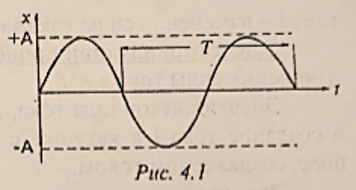
            `图4.1` 展示了简谐振动位移 $x$ 随时间的变化，其中
            - 位移 $x$ 的取值范围为：$-А \le х \le +А−А≤х≤+А$

##### §1.2 几种经典简谐振动及其能量转换

- 数学摆振动（Математи́ческий ма́ятник）
    - 数学摆：又称单摆，是一种能够产生往复摆动的小型装置，由一条不可伸长的轻质细线（或一根轻质细杆）与一个可被视作质点的重物作为摆锤组成。细线（或细杆）的一端连接着摆锤，另一端悬挂在重力场中，这样就形成了一个数学摆，如 `图4.2`
    - 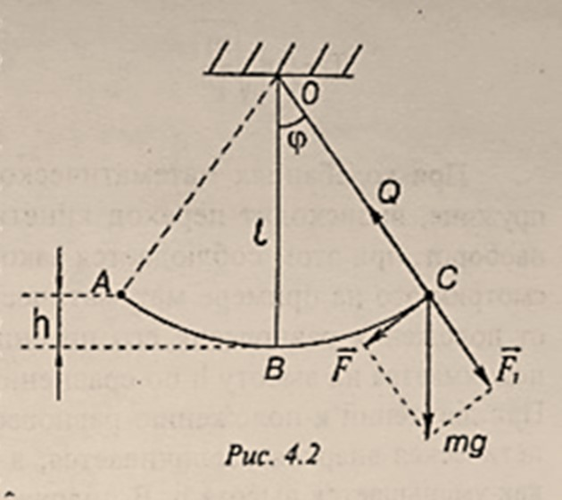
    - 振动过程
        - 将一个数学摆放置于重力场中，拨动物体使其与重力方向偏转 $\varphi$ 度，并撤去外力，这个物体将进行简谐振动
        - 如图，刚撤去外力时，细线（或细杆）对物体的拉力与重力 $m\vec{g}$ 的分力 $\vec{F_1}$ 平衡，在重力的另一个分力 $\vec{F}$ 作用下，摆锤开始加速沿圆弧向下摆动，
        - 当摆锤运动至最低点到达平衡位置，此时摆锤的运动速度达到最大值，加速度减小到0
        - 由于惯性原因，摆锤将进一步沿圆弧向上运动，达到与起点对称的最高点后停下，开始相反方向做相同的运动，如此往返，不难看出，摆的振动周期相同
    - 振动周期：数学摆的振动周期不取决于它的质量和偏转角。
        - $$T=2\pi\sqrt{\frac{l}{g}}\qquad(4.3)$$
        其中：
        - $l$ - 细绳（或细杆）的长度
        - $g$ - 重力加速度
    - 应用：摆动周期对自由落体加速度的依赖性，用于精确测量地球不同点的自由落体加速度，这些测量结果可用于确定矿产资源的位置
- 物体在弹簧上的振动
    - 将弹簧的一端连接一个重物，另一端竖直固定，如`图4.3`：
    - 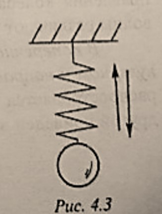
    - 振动过程
        - 将重物向上或向下挤压弹簧或拉伸弹簧，使其形变量为 $x$，重物就会在弹力$F_{упр.=кx}$下发生简谐振动，其中：$к$ 为弹性系数
    - 振动周期
        - $$T=1\pi\sqrt{\frac{m}{к}}\qquad(4.4)$$

- 振动过程中的能量转换
    - 当数学摆或悬挂在弹簧上的重物振动时，机体的动能与势能会相互转化，通过观察，我们可以总结出简谐振动中能量转换的规律
    - 以数学摆为例：
        - 当摆锤从平衡位置升高时，由于重物被提升到比平衡位置高出 $h$ 的高度，所以摆杆的重力势能增加（见图4.3）
        - 之后随着重物的高度 $h$ 减小，其重力势能减小，摆的速度增大，其动能增大
        - 在平衡位置上，速度以及由此产生的动能最大，势能最小
        - 过了平衡点后，速度减小，上升高度增加，动能再次转化为势能
        - 上升达到最高点时 $v=0$，$E_k=0$，势能最大
        - 在没有摩擦损失等情况下，摆动物体的机械能，等于动能和势能之和，在摆的运动过程中保持恒定

##### §1.3 波与其性质及其各性质之间的关系

- 波（Волна́）
    - 定义：波是指振动的传播，我们将某一物理量的扰动或振动在空间逐点传递时形成的运动称为波。不同形式的波虽然在产生机制、传播方式和与物质的相互作用等方面存在很大差别，但在传播时却表现出多方面的共性，可用相同的数学方法描述和处理
    - 特点：波浪不会带动环境中的粒子，它们只会在其平衡位置附近振动
    - 分类：根据粒子的振动方向相对于波的传播方向，存在横波和纵波
        - 横波（попере́чная волна́）：在横波中，介质的粒子在与波的传播方向垂直的方向上振荡。如图`4.4`，横波沿橡皮绳传播，橡皮绳的一端是固定的，而另一端是振荡运动的。
        - 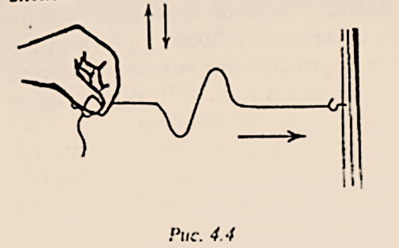
        - 纵波（продо́льная волна́）：质点的振动方向与波的传播方向在同一直线上的波。如图`4.5`，弹簧的一端受到周期性外力的作用，波就将以其收缩和变形的形式进行传播。
        - 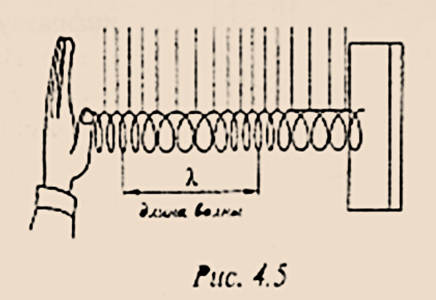
        - 纵波的传播是由于介质中各体元发生压缩和拉伸的变形，并产生使质点恢复原状的纵向弹性力而实现的。一般的固体、液体、气体都具有拉伸和压缩弹性，所以它们都能传递纵波。而横波只能在固体中传播，因为液体和气体没有切变弹性，因此只能传播纵波。
    - 机械波（механи́ческая волна́）
        - 由来：固体，液体和气体物质都由粒子组成，粒子与粒子之间存在相互作用的弹力。如果在弹性介质的某个位置激发了其粒子的振动，则由于粒子之间弹性的的相互作用，该振动将开始以一定的速度 $v$ 在粒子之间传播。这种振动在弹性介质中传播的过程称为机械波。
    - 横波的图像，如图`4.6`
        - 坐标轴：横轴表示各质点的平衡位置，纵轴表示该时刻各质点的位移。
        - 意义：表示在波的传播方向上，某时刻各质点离开平衡位置的位移。
        - 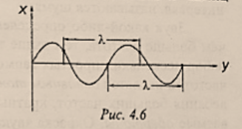
    - 定量分析
        - 波长 $\lambda$ （длина волны）：在波动中，振动相位总是相同的两个相邻质点间的距离。
        - 波速 $v$ （скорость волны）：波在介质中的传播速度，由介质本身的性质决定。
        - 频率 $\nu$ （частота）：等于振动周期的倒数 $\nu=\frac{1}{T}$ 由波源决定，等于波源的振动频率。
        - 它们的关系：
            - $$v=\frac{\lambda}{T}=\lambda\nu$$
  
##### §1.4 声波，声音的音调、速度和音量

- 声波：
    - 定义：声波是声音的传播形式，发出声音的物体称为声源。声波是一种机械波，由声源振动产生，声波传播的空间就称为声场。
    - 分类： 人耳可以听到的声波的频率一般在16 $Гц$ 到20000 $Гц$ 之间。根据声波频率的不同，可以分为以下几类：  
        1. 频率低于 $16\ Гц$ 的声波称为次声波或超低声；
        2. 频率 $16\ Гц\sim20000\ Гц$ 的声波称为可闻声；
        3. 频率 $20000\ Гц\sim10^9\ Гц$ 的声波称为超声波；
        4. 频率大于 $10^9\ Гц$ 的声波称为特超声或微波超声。
    - 常见属性
        - 声速（скорость звука）：声波在不同的介质中传播速度显著不同。现在已经测得空气中常温常压下声波速度是 $344\ м/с$，淡水中为 $1430\ м/с$，海水中 $1500\ м/с$，钢铁中 $5800\ м/с$，铝中 $6400\ м/с$，石英玻璃中 $5370\ м/с$，而在橡胶中仅为 $30-50\ м/с$。  
        介质的温度、压力变化，声速也随着改变。通常所指的常温是指 $20\ ℃$ 时的气温，当气温降到零度，声波在空气中传播的速度则将为 $331.5\ м/с$，而气温每升高 $1\ ℃$，声速就增加 $0.607\ м/с$。
        - 音量（громкость звука）：声音的大小与声源振动的强弱有关。声波的连续振动，使空气分子不断交替的压缩和松弛，使大气压迅速产生起伏，这种气压的起伏部分，就称为声压。声压大，声音就强；声压小，声音则弱。音量的大小除了与声压有关，还与声强和声功率有关。声强是在声波传播的方向上，单位时间内通过单位面积的声能量；声功率是声源在单位时间内辐射出来的总能量。音量与声强和声功率均成正比关系。（目前我们可以简单认为振幅越大，音量越大。）
        - 音调（высота тона）：在声波的频率范围内，发声的频率决定着音调的高低：频率高，音调也高，声音纤细；反之，频率低，音调也低，声音雄浑。

#### 第二章：电磁振荡与电磁波

##### §2.1 电路中的自由震荡。震荡的固有频率。振荡电路中的能量转换。

- 振荡电路
    - 定义：振荡电流是一种大小和方向都周期性发生变化的电流，能产生振荡电流的电路就叫做振荡电路。
    - 振荡电路的物理模型（即理想振荡电路）如图 `4.8`
        - 是由串联的电感线圈 $L$ 、电容 $C$ 和电阻 $R$ 组成的闭合电路。
        - 整个电路的电阻 $R$ =0（包括线圈、导线），从能量角度看没有其它形式的能向内能转化，即热损耗为零。
        - 电感线圈 $L$ 集中了全部电路的电感，电容器 $C$ 集中了全部电路的电容，无潜布电容存在。
        - 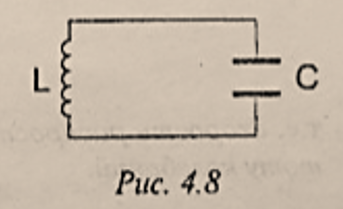
        - 振荡电路是观察电磁振荡最简单的系统。

- 在自由振荡的情况下，电容器外壳上的电荷 $q$ 和电势差 $U$ 以及电路中的电流强度 $I$ 的周期性变化是在没有外部能量消耗的情况下发生的。
    - 首先给电容器充电，使电容器两极板间的电势差达到最大值 $U_m$ 此时电路中的能量集中在两极板之间的电场中。
        - 充电完毕（放电开始）：此时回路中感应电流 $I$ = 0，电路中磁场能为零，电场能达到最大，如图 `4.9.а`，等于：
        - $$W_э=\frac{CU_m^2}{2}$$ 
        - 
        
    - 随着时间的推移，电容器逐渐放电，电路中产生电流。这将在电感线圈周围产生一个磁场。这使能量由电场能向磁场能转化。
        - 电流不是瞬间增加的，而是逐渐增加，最终放电结束时达到最大。这是因为自感线圈的原因：自感作用总是阻碍电流的变化，所以电路里的电流不能立刻达到最大值，而是由零逐渐增大。
        - 放电完毕（充电开始）：此时回路中感应电流达到最大，电场能为零，磁场能达到最大，如图 `4.9.б`，等于：
        - $$W_м=\frac{LI_м^2}{2}$$ 
    - 随后，电容器继续充电，最后与初始电压相等,但两极板所带电荷与初始相反。然后磁场能转化为电场能，然后电容器再次通过线圈放电，这些过程以相反的方向重复。如图 `4.9.в` `4.9.г`。
    - 此后，如图 `4.9.д`，上述的全部过程反复地循环下去，在电路中就出现了振荡电流。这种电场和磁场的周期性变化叫做电磁振荡。在电磁振荡的过程中，电场能和磁场能同时发生周期性的转化。周期 $T$ 的表达式为：
        - $$T=2\pi\sqrt{LC}$$
        - 所以电磁振荡的频率 $\omega$ 等于：
        - $$\omega_0=\frac{2\pi}{T}=\frac{1}{\sqrt{LC}}$$

##### §2.2 交变电流。交流发电机。变压器

- 交变电流：大小和方向都随时间做周期性变化的电流。如图 `4.10`
    - 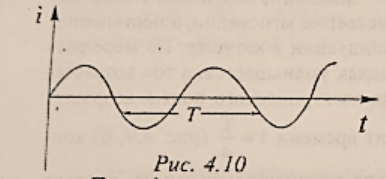
    - $$i=I_msin{\omega t}$$
        - $i$ 是对应时间的瞬时电流，$I_m$ 是振幅，即最大电流，$\omega$ 是变化频率，$t$ 是时间。
- 交变电流的产生（交流发电机）：
    - 一个线圈在匀强磁场中匀速转动。在时间 $t$ 时刻，线圈与磁感线成 $\alpha$ 角，此时通过线圈的磁通量为：
        - $$\Phi=BScos{\alpha}=BScos{\omega t}$$
- 感应电动势的产生：
    - 穿过线圈的磁通量的变化会在其中产生感应电动势，该感应电动势等于磁通量的变化率，即磁感应通量相对于时间的导数，取负号表示：  
    - $$e=-\Phi'=BS\omega sin{\omega t}=E_m sin{\omega t}\qquad(4.11)$$
        - 其中：$Е_m=BS\omega$ - 振幅或感应电动势的最大值
- 如果线圈的两端通过接触环和沿其滑动的电刷与电路相连，则在感应电动势的作用下，电路中会出现交流电。根据谐波规律，电流强度在时间上的变化符合表达式`(4.9)`，其频率 $\omega$ 与感应电动势的频率和环路的旋转频率一致。
- 交流发电机：
    - 在交流发电机中，磁场是由电磁铁产生的。通常情况下，电磁铁是转子，即机器的旋转部分，而由大量线圈组成的绕组位于定子（发电机的固定部分）上。总的感应电动势等于每个线圈中产生的电动势的总和。交流发电机将机械能转换为电能。交流电用于照明和工业生产，俄罗斯和欧洲的工业电流频率为 $50Hz$。
- 交流电的有效值：
    - 在电气工程中，引入了交流电有效值的概念来描述交流电的特征 —— 它等于在导体中发出与给定交流电相同时间的热能的直流电的强度。有效值与交变电流的振幅之间的关系是：  
    $$I=\frac{I_m}{\sqrt{2}}\qquad(4.12)$$
    - 交流电压的有效值以同样方式确定：
    $$U=\frac{U_m}{\sqrt{2}}\qquad(4.13)$$
    - 交流电的电流表和电压表测量的是电流和电压的有效值。
- 变压器：
    - 定义：变压器是一种旨在转换交流电的电压和功率的设备。- 组成：它由一个封闭的钢芯组成，该钢芯由彼此分开的绝缘板组装而成，在该钢芯上放置了两个匝数不同的线圈。其中一个-初级的-加入交流电源，另一个称为次级，连接到用电设备`（图4.12）`。
    - 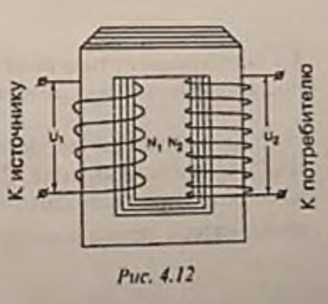
    - 运行方式：  
        - 变压器的运行基于电磁感应现象（见第三章第4节）。初级绕组中的电流在两个绕组中产生一个交流磁场。因此，在初级和次级绕组的每个绕组中都会感应到一个电动势。
    - 如果初级线圈的有功电阻 $R$ 可以忽略不计，而且次级绕组是开路的（变压器空载运行），则以下情况适用：
      - $$\frac{U_1}{U_2}=\frac{n_1}{n_2}=k\qquad(4.14)$$
        - $U_1$ 和 $U_2$ - 分别是初级和次级绕组上的电压
        - $n_1$ 和 $n_2$ - 其中包含的匝数
        - $k$ 的值被称为转化率。在 $k<1$ 时，变压器增加电压；在 $k>1$ 时，变压器降低电压。由于变压器的功率损耗小得可以忽略不计，所以一次回路的功率与二次回路的功率相同，$P_{1}=P_{2}$，电流和电压之间的关系如下所示:
        - $$I_1U_1=I_2U_2,\quad\frac{U_2}{U_1}=\frac{I_1}{I_2}\qquad(4.15)$$
            - 即输出电压的增加伴随着相同系数的电流强度的减少。特别是在长距离输电的情况下，有必要使用变压器来改变电压和电流强度。传输线中每焦耳热量的能量损失与电流强度的平方成正比。为了尽量减少这些损失，必须保持尽可能低的电流承载能力。这就是为什么升压变压器用于发电站，而降压变压器用于用户现场的原因。

##### §2.3 电磁场和它的物质性、电磁波及其特性、电磁波特性对频率的依赖性
- 英国物理学家麦克斯韦于$1865$年创立了电和磁现象的统一理论。根据麦克斯韦的说法，电场的每一次变化都会产生一个磁场，其力线包含着电场强度矢量 $\vec{E}$ 的线，反之亦然：磁场的每一次变化都会产生一个电场，其封闭力线包含着磁场 $\vec{B}$ 的感应线。
- 因此，交变电场和磁场始终同时存在，形成一个电磁场。 这是物质的一种特殊的形式。电磁是真实存在的，即不取决于我们，我们对它的了解。
- 电磁波：
    - 定义：空间中周期性变化的电磁场的传播过程称为电磁波。 
    - 区别：与机械波不同，电磁波不仅可以在物质中传播，而且可以在真空中传播。 它们在真空中的传播速度等于 $с=3\cdot10^8м/с$。
    - 特征：电磁波是横向的。电磁波中的向量 $\vec{E}$ 和 $\vec{B}$ 彼此垂直，并且与波的传播方向垂直`(图4.13)`。电磁波在其传播的环境中被吸收和散射。在两种介质的界面上被部分反射和部分折射，绕过与其波长相对应的障碍。
    - 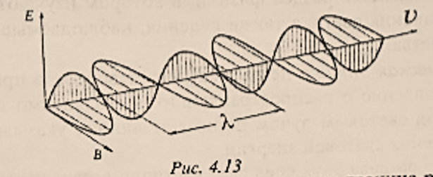
    - 电磁波的分类：
        - 根据形成电磁波标度的类型，可以细分所有电磁辐射。
        - 根据频率（波长）的不同，电磁波有不同的特性，如穿透力、可见度、反射系数等。每一波段的电磁波的应用都与该特定波段的特征属性有关：
            - 低频电磁波（频率不超过 $30kHz$）很难被土壤和水吸收，因此被用于地下和水下无线电通信。
            - 无线电波 $(3\cdot10^4\ ,\ 3\cdot10^{12}\ Hz)$ - 被用于无线电通信、电视等。
            - 红外 $(IR)$ 辐射 $(3\cdot10^{11}\ ,\ 4\cdot10^{14}\ Hz)$ - 用于红外光谱，IR 摄影，夜视设备等。
            - 紫外线 $(UV)$ 辐射 $(8\cdot10^{14}\ ,\ 3\cdot10^{16}\ Hz)$ - 用于紫外光谱学、发光管、医学、艺术科学。
            - $X$射线辐射 $(3,7\cdot10^{16}\ ,\ 3\cdot10^{20}\ Hz)$ - 广泛用于医学、$X$射线结构分析、探伤等领域。
            - 伽马辐射（高于 $3\cdot10^{13}\ Hz$）- 用途类似于$X$射线辐射，伴随核爆炸。

#### 参考文献：

- 预科物理教材——《МОЛЕКУЛЯРНО-КИНЕТИЧЕСКАЯ ТЕОРИЯ》

## 预科物理课件

### 第一部分：牛顿力学

#### 第一章：运动学
    
#### 第二章：力学守恒定律

#### 第三章：静力学

- 帕斯卡定律 Закон Паскаля
    - 加在密闭液体上的压强，能大小不变地在液体内部向各个方向传递
    - оказываемое внеш-ними силами давл-ение передается жидкостью одинак-ово по всем направлениям

- 阿基米德定律 Закон Архимеда
    - 浸入液体里的物体受到向上的浮力,浮力的大小等于它排开的液体受到的重力。
    - На тело, погруженное в жидкость (газ), действует выталкивающая сила, которая равна весу жидкости (газа) в объеме погруженной части тела

### 第二部分：分子物理学与热力学

#### 第一章：分子物理学

##### §1.1. 理想气体状态方程
- 理想气体状态方程
    - 恒温条件：$pV=T$
    - 恒容条件： $\frac{p}{T}=V$
    - 恒压条件： $\frac{V}{T}=p$
    - 理想气体状态方程：$\frac{pV}{T}=const$
        - $pV=νRT$ (理想气体常数 $R=8.314J\cdot mol^{-1}\cdot K^{-1})$
        - 理想气体常数（在标况下计算）：
            $$R=\frac{pV_\mu}{T}=\frac{1.01\cdot10^5pa\cdot22.4\cdot10^{-3}m^3/mol}{273.15K}=8.314\cdot J\cdot mol^{-1}/K^{-1}$$
        - $pV=\frac{m}{μ}RT$（用质量比摩尔质量代替粒子数量）
        - $pV=νN_Ak_БT$（ν-物质的量；这个式子相当于用$k_БN_A$代替了R）
        - $pV=Nk_БT$（粒子数$N=$物质的量$ν$ · 阿伏伽德罗常数$N_A$，和上式有所替代）
        - *p*=n*k*БT（浓度n=粒子数N/体积V，和上式有所替代）
        - 玻尔兹曼常数：$k_Б=\frac{R}{N_A}=1.380649\cdot10^{-23}J/K$
            - 理想气体常数R等于玻尔兹曼常数乘以阿伏伽德罗常数
- 阿伏伽德罗定律
    - 在相同的温度（$T$）和压强（$p$）下，相同体积（$V$）的任何气体都含有相同数目（$N_A$）的粒子
    - 标况下的1mol气体的体积（$T=0°C=273.15K, p=1atm=101,325pa$）
        - $V_μ=\frac{V}{n}=22.4·10^{-3}m^3/mol$
        
- 物质的量
    - $ν=\frac{m}{μ}$（μ-摩尔质量，*ν*-物质的量）
    - 化学中的等价表达：$n=\frac{m}{M}$
- 粒子数浓度计算
    - $n=\frac{N}{V}$ （n粒子数浓度，N粒子总数）
- 道尔顿分压定律
    - 在组分之间不发生化学反应的前提下，理想气体混合物的压强等于各组分的分压之总和。数学描述为：
    - $p_总=p_1+p_2+...+p_n$

##### §1.2. 分子动理论的基本方程
- 单个分子的速度可以分解到空间坐标系的三个坐标轴上：
    - $$\vec{v}=\vec{v_x}+\vec{v_y}+\vec{v_z}$$
- 当分子与容器壁发生碰撞时，可以认为只有其中某个坐标轴上的分速度方向变化，大小不变，其他坐标轴上的速度方向大小都不变，根据动量定理我们可以得到:
    - $$\vec{p_1}=\vec{p_2}+\vec{p_{ст}}$$
    - $$v_x'=-v_x$$
    - $$mv_x=-mv_x+p_{ст}$$
    - $$p_{ст}=2mv_x$$
- 计算单位时间内与容器壁碰撞的分子数
    - $$F=nSmv_x^2$$
    - $$p=mnv_x^2$$
    - $$p=\frac{2}{3}n\frac{mv^2}{2}$$
    - $\frac{mv^2}{2}$ - 热转化运动平均动能

##### §1.3. 温度对分子动力学的意义    
- 物体的温度是影响物体的分子热运动能量的重要物理量。
    - $$p=\frac{2}{3}nε_{пост}$$
    - $$p=nk_БT$$
    - $$ε_{пост}=\frac{3}{2}k_БT$$
    - ($ε_{пост}$ - 分子动能)

##### §1.4. 自由度的能量分布
- 刚性分子（指不考虑分子内部振动）的自由度数：是指可以给出其在空间位置的独立坐标数。
    - 单原子分子：拥有3个平动自由度，0个转动自由度
        >刚性单原子如氦He、氖Ne、氩Ar等分子只有一个原子，可看成自由质点，所以有3个平动自由度 $i=t=3$
    - 双原子分子：拥有3个平动自由度，2个转动自由度
        >刚性双原子分子如氢气、氧气、氮气、一氧化碳$CO$等分子，两个原子间联线距离保持不变。就像两个质点之间由一根质量不计的刚性细杆相连着（如同哑铃），确定其质心$O’$的空间位置，需3个独立坐标$(x,y,z)$；确定质点联线的空间方位，需两个独立坐标（如$\alpha,\beta$），而两质点绕联线的的转动没有意义。所以刚性双原子分子既有3个平动自由度，又有2个转动自由度，总共有5个自由度 $i=t+r=3+2=5$。
    - 三原子及多原子分子：拥有3个平动自由度，3个转动自由度
        >刚性三原子或多原子分子: 如$H_2O$ 、氨 等，只要各原子不是直线排列的（故$CO_2$的自由度为5，其为直线型），就可以看成自由刚体，共有6个自由度，$i=t+r=3+3=6$。
- 分子的振动自由度： 
    $n_{кол}=3N-n_{пост}-n_{вращ}$（$3N$ - 分子中的自由度总数，$N$ - 分子中的原子数，$n_{пост}$ - 分子整体平动自由度，$n_{вращ}$ - 分子整体转动自由度）
    - 对于线型分子整体有3个平动自由度($n_{пост}$)，2个转动自由度($n_{вращ}$)（因为线型分子沿着线轴转动没有意义，所以转动自由度比非线型少一个），因此线型分子的振动自由度为：
        - $3N-3-2=3N-5$
    - 对于非线型分子整体有3个平动自由度($n_{пост}$)，3个转动自由度($n_{вращ}$)，因此线型分子的振动自由度为：
        - $3N-3-3=3N-6$
    - 能量在自由度上的平均分布规律:
        对于分子的每个自由度，平均而言，有相同的动能，等于
        - $\frac{1}{2}k_БT$（即分子动能$ε_{пост}=\frac{3}{2}k_БT$除以$3$)    
        - $$ε_К=\frac{i}{2}k_БT$$
        - $$i=n_{пост}+n_{вращ}+2n_{кол}$$
    -   | Молекула   | nпост | nвращ | i   |
        | ---------- | ----- | ----- | --- |
        | 1-атомная  | 3     | 0     | 3   |
        | 2-атомная  | 3     | 2     | 5   |
        | ≥3-атомная | 3     | 3     | 6   |

##### §1.5. 理想气体的内能
- 任何物体的内能都等于这个物体的能量减去物体整体的动能和物体在外力场中的势能    
- 内能由与质心相连的参考系中分子混沌运动的动能和分子间相互作用的势能组成。
- 理想气体的内能是所有气体分子热运动的动能。
    - $$ε_К=\frac{i}{2}k_БT$$
    - $$U=N_К=\frac{i}{2}k_БTN=\frac{i}{2}\cdot\frac{m}{μ}k_БT$$ 
    - $$U=\frac{i}{2}\cdot\frac{m}{μ}k_БT$$

### 第三部分：电磁学

### 第一章：电介质中的电场

##### §1.1. 极性分子和非极性分子
- 电介质(Диэлектриками)：电工中一般认为电阻率超过10欧·厘米的物质便归于电介质。电介质的带电粒子是被原子、分子的内力或分子间的力紧密束缚着，因此这些粒子的电荷为束缚电荷。在外电场作用下，这些电荷也只能在微观范围内移动，产生极化。在静电场中，电介质内部可以存在电场，这是电介质与导体的基本区别。不导电的物质，如空气、玻璃、云母片、胶木等。
- 电偶极矩(Дипольный момент)：是正、负电荷中心间的距离和电荷中心所带电量的乘积，它是一个矢量，方向规定为从负电中心指向正电中心，用符号$\vec{p_e}$表示，单位为D（德拜）
    - 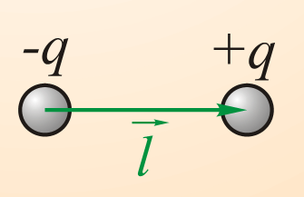

    - $$\vec{p_e}=q \cdot l \qquad (2.1)$$
- 如果在没有外电场的情况下，分子中正电荷和负电荷的分布中心重合，则称为非极性电介质（非极性分子的电介质）。
    - 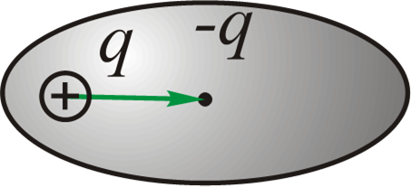

    - $$\vec{l}=0 \quad \Rightarrow \quad \vec{p_e}=0$$
    - 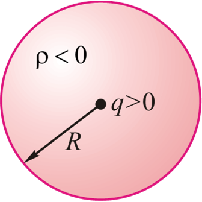

    - $$R\approx10^{-10}m$$
    - $$\rho=-\frac{3q}{4\pi R^3}

    - 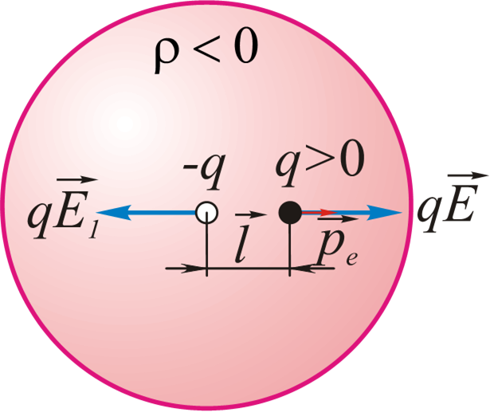

    - $$q\vec{E}+q\vec{E_1}=0\quad \Rightarrow \quad E=E_1$$
    - $$При\quad l<R$$
    - $$E_1=-\frac{\rho l}{3\varepsilon _0}=\frac{ql}{4\pi \varepsilon_0R^3}$$
    - $$p_e=ql=4\pi \varepsilon_0R^3E$$
    - $$\vec {p_e}=αε_0\vec{E}\qquad(2.2)$$    
    - $$α=4πR^3$$
    最高可达$E=10^7–10^8 В/м\quad l~10^{-13}м.$
- 极性电介质是一种分子即使在没有外场的情况下，分子的偶极矩也不同于零的电介质，
    - $$\vec{l}≠0 \quad \Rightarrow \quad \vec{p_e}≠0$$
##### §1.2. 外部静电场中的偶极子
- 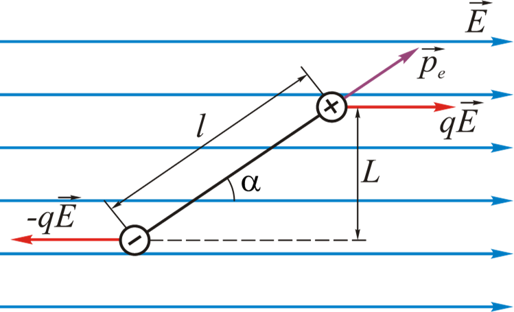

- $$L=l\sin\alpha$$
- $$M=F\cdot L=qE\cdot l\cdot \sin\alpha=p_eE\cdot\sin\alpha$$
- $$\vec{M}=\vec{p_e}\times\vec{E}\qquad(2.3)$$
- 偶极子的势能：当偶极子旋转一个小角度$d\alpha$时，由于势能相应减少，场力做功$dA$。
    - $$dA=\vec{M}\cdot d\vec{\alpha}=p_eE\cdot\sin\alpha\cdot d\alpha=-dW_П$$
    - $$W_П=0 при \alpha=\frac{\pi}{2}$$
    - $$W_П=\int_{W_П}^{0}dW_П=-\int_{\alpha}^{\frac{\pi}{2}}p_eE\cdot\sin\alpha\cdot d\alpha$$
    - $$=p_eE\cdot\cos\alpha\mid_{\alpha}^{\frac{\pi}{2}}=-p_eE\cdot\cos\alpha$$
    - 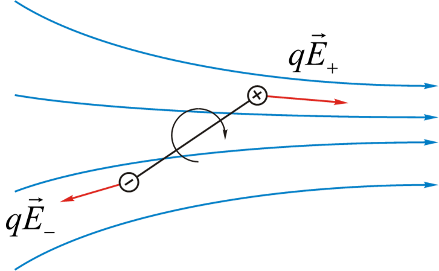
    
    - $$W_П=-\vec{p_e}\cdot\vec{E}\qquad(2.4)$$
    - $$\vec{F}=q\vec{E_+}-q\vec{E_-}=ql\cdot\frac{\partial\vec{E}}{\partial l}=p_e\cdot\frac{\partial\vec{E}}{\partial l}$$
    - $$vec{F}=grad(\vec{p_e\cdot\vec{E}})\qquad(2.5)$$

##### §1.3. 电介质极化
- 电介质极化
    - 定义：电介质极化是指外电场作用下，电介质显示电性的现象
    - 解释：理想的绝缘介质内部没有自由电荷，但实际的电介质内部总是存在少量自由电荷，它们是造成电介质漏电的原因。 一般情形下，未经电场作用的电介质内部的正负束缚电荷平均说来处处抵消，宏观上并不显示电性。在外电场的作用下，束缚电荷的局部移动导致宏观上显示出电性，在电介质的表面和内部不均匀的地方出现电荷，这种现象称为极化，出现的电荷称为极化电荷。这些极化电荷改变原来的电场。
    - 当外部电场$E=0$时：
        - 非极性电介质：$p_{ei}=0$
        - 极性电介质：
            - 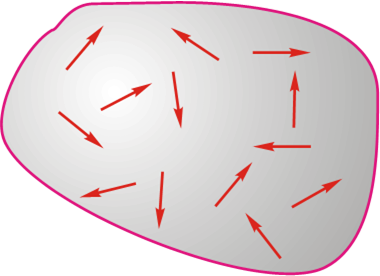
            
        - 在这两种情况下：
            $$\sum_{\Delta V}\vec{p_{ei}}$$
    - 当外部电场*E*≠0时：
        - 非极性电介质：$\vec{p_{ei}}=\alpha\varepsilon_0\vec{E}$
            - 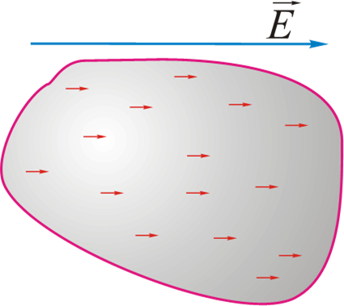
            
        - 极性电介质：
            - 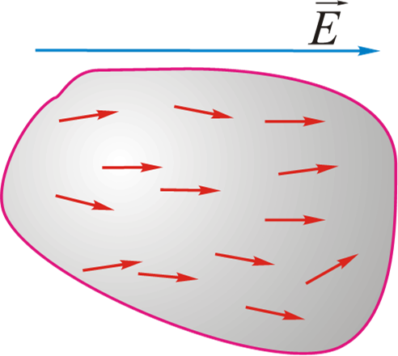
            
- 极化强度
    - 不同电介质的极化程度是不一样的。为了分析电介质极化的宏观效应，常引入极化强度P这一物理量来表征电介质的极化特性。极化强度是一个矢量，定义单位体积内电偶极矩的矢量和为极化强度，即电介质体积的总偶极矩与该体积之比：
    - $$\vec{P}=\frac{\sum_i^n\vec{p_{ei}}}{\Delta V}\qquad(2.6)$$
    - $$\vec{P}=к\varepsilon_0\vec{E}$$
    - κ为介电敏感度。
        - 对于非极化电介质：
        $$к=\alpha\cdot n_0$$
        - 对于极化电介质：
        $$к=\frac{n_0p_e^2}{3\varepsilon_0k_БT}$$
    - 未补偿的极化电荷是由于在其表面薄层的介电极化而产生的。
        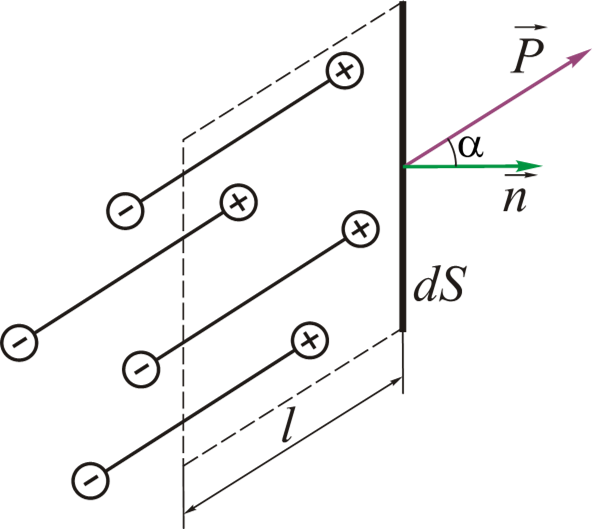
        
    - 表面电荷密度：
        - $$\sigma_p=\frac{dq_p}{dS}$$
        - $$dn=n_0ldS\cdot\cos\alpha\qquad(2.8)$$
        - $$dq_p=q\cdot dn=n_0ql\cdot dS\cdot\cos\alpha=n_0p_e\cdot dS\cdot\cos\alpha$$
        - $$\begin{aligned}
            \vec{P}=n_0\vec{p_e}\\
            P_n=P\cdot\cos\alpha\\
            \end{aligned}
            \Big\}\longrightarrow \sigma_p=\frac{dq_p}{dS}=P_n$$
        - $$\sigma_p=P_n\qquad(2.9)$$
    - 在不均匀的电场中也会产生体积极化电荷。    
        - $\sigma_p=\frac{dq_p}{dV}$ - 体积电荷密度
        - $$\sigma_p=-\frac{\partial P_x}{\partial x}-\frac{\partial P_y}{\partial y}-\frac{\partial P_z}{\partial z}=-div\vec{P}\qquad(2.10)$$

##### §1.4 电感应矢量

- $$\vec{E}_{микро}=\vec{E}_{своб}+\vec{E}_{связ}\qquad(2.11)$$
- $$\vec{E}=<\vec{E}_{микро}>=<\vec{E}_{своб}>+<\vec{E}_{связ}>$$
- $$\underset{(S)}{\oint}\vec{E}\cdot d\vec{S}=\frac{1}{\varepsilon_0}(q_{охв}^{своб}+q_{охв}^{связ})\qquad(2.12)$$
- 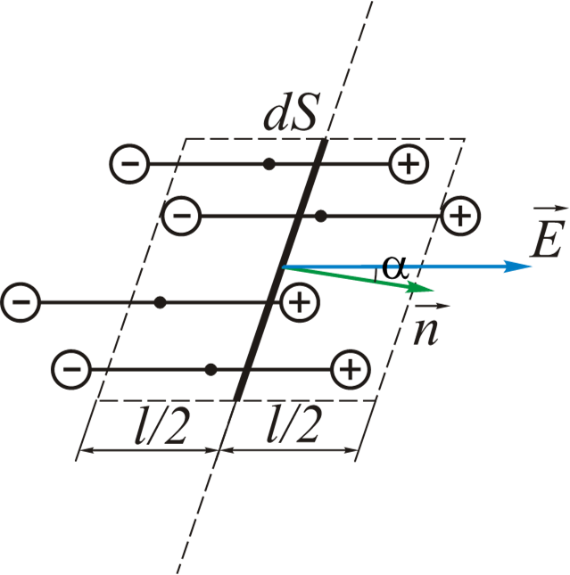

- $$d\vec{S}=dS\cdot\vec{n}$$
- $$dn=n_0ldS\cdot\cos\alpha\qquad(2.13)$$
- $$dq_{охв}^{связ}=-q\cdot dn=-n_0ql\cdot dS\cdot\cos\alpha=$$
- $$-n_0p_e\cdot dS\cdot\cos\alpha=-PdS\cdot\cos\alpha=-\vec{P}\cdot d\vec{S}$$
- $$q_{охв}^{связ}=-\underset{(S)}{\oint}\vec{P}\cdot d\vec{S}\qquad(2.14)$$
- $$\varepsilon_0\underset{(S)}{\oint}\vec{E}d\vec{S}=q_{охв}^{своб}-\underset{(S)}{\oint}\vec{P}d\vec{S}$$
- $$\underset{(S)}{\oint}\varepsilon_0\vec{E}d\vec{S}+\underset{(S)}{\oint}\vec{P}d\vec{S}=q_{охв}^{своб}$$
- $$\underset{(S)}{\oint}(\varepsilon_0\vec{E}+\vec{P})\cdot d\vec{S}=q_{охв}^{своб}\qquad(2.15)$$
- $\vec{D}=\varepsilon_0\vec{E}+\vec{P}$ - 电感应矢量
- $$\underset{(S)}{\oint}\vec{D}\cdot d\vec{S}=q_{охв}^{своб}\qquad(2.16)$$
- 静电场的电感应矢量通过任意封闭表面的通量等于这个表面所覆盖的自由电荷的代数和。
- $$\vec{P}=к\varepsilon_0\vec{E}$$
- $$\vec{D}=\varepsilon_0\vec{E}+к\varepsilon_0\vec{E}=(1+к)\varepsilon_0\vec-{E}=\varepsilon\varepsilon_0\vec{E}\qquad(2.17)$$
- $\varepsilon=1+к$ - 相对介电常数

##### §1.5 在两种介质之间的界面处产生静电场的条件

- 第一种媒介——$E_1,D_1\varepsilon_1$
- 第二种媒介——$E_2,D_2,\varepsilon_2$
- 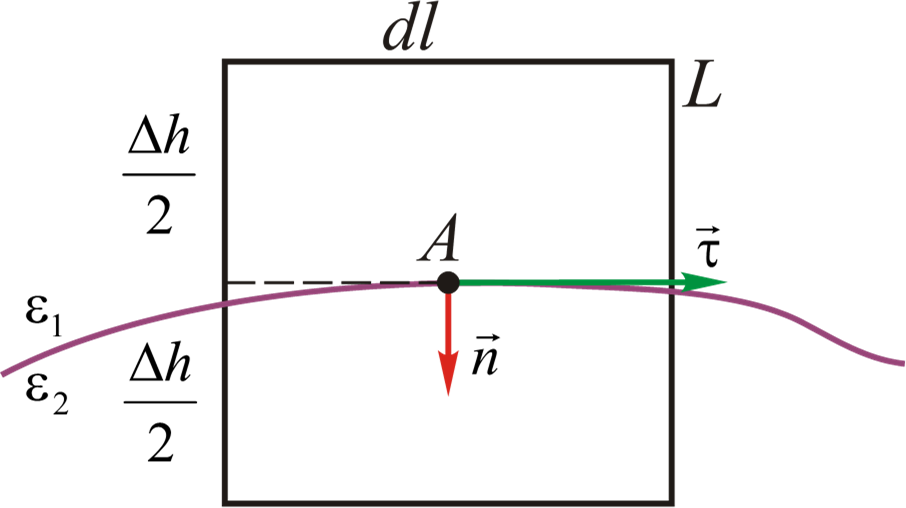

- $$\underset{(L)}{\oint}\vec{E}d\vec{l}=0$$
- $$\lim_{\Delta h\to 0}\underset{(L)}{\oint}\vec{E}d\vec{l}=(E_{2\tau}-E_{1\tau})\cdot dl=0$$
- $$E_{2\tau}=E_{1\tau}\qquad(2.18)$$
- 穿过该表面时，与两种介质之间的界面相切的场强分量不变。
- $$D=\varepsilon\varepsilon_0E$$
- $$\frac{D_{2\tau}}{D_1\tau}=\frac{\varepsilon_2\varepsilon_0E_{2\tau}}{\varepsilon_1\varepsilon_0E_{1\tau}}\quad\Rightarrow\quad D_{1\tau}=\frac{\varepsilon_2}{\varepsilon_1}D_{1\tau}\qquad(2.19)$$
- 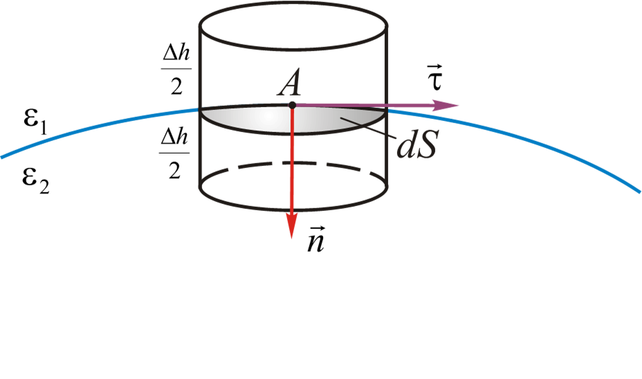

- $$\underset{(S)}{\oint}\vec{D}d\vec{S}=q_{охв}^{своб}$$
- $$\lim_{\Delta h\to 0}\underset{(S)}{\oint}\vec{D}d\vec{S}=\lim_{\Delta h\to 0}q_{охв}^{своб}$$

- 如果在界面上没有自由电荷

- $$\lim_{\Delta h\to 0}q_{охв}^{своб}=0$$
- $$\lim_{\Delta h\to 0}\underset{(S)}{\oint}\vec{D}d\vec{S}=(D_{2n}-D_{1n})d\vec{S}=0$$
- $$D_{2n}=D_{1n}\qquad(2.20)$$
- 当穿过两种介质之间的界面时，在没有表面自由电荷的情况下，电位移的法向分量不会改变。
- $$\frac{E_{2n}}{E_{1n}}=\frac{D_{2n}/\varepsilon_2\varepsilon_0}{D_{1n}/\varepsilon_1\varepsilon_0}\quad\Rightarrow\quad E_{2n}=\frac{\varepsilon_1}{\varepsilon_2}E_{1n}\qquad(2.21)$$

##### §1.6 铁电体（中文译名不确定）
- 铁电体 (Сегнетоэлектрики) 是一组在一定温度范围内具有自发（自发）极化的晶体电介质，它们在电场，变形，温度变化等外部影响的影响下发生很大变化。
    - сегнетова соль    $NaKC_4H_4O_6\cdot4H_2O$
    - титанат бария    $BaTiO_3$
        - 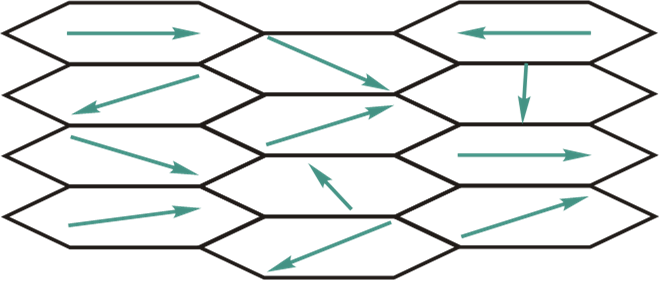
        - 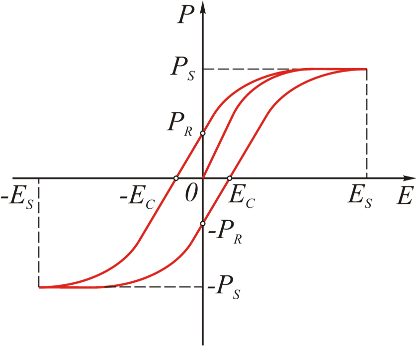
        - $P_S$ - 饱和极化
        - $P_R$ - 残余极化
        - $E_C$ - 矫顽磁力
        $K_{max}~10^3$
        - 在$T>TC$（居里温度）时，隔离电介质变成了普通的极性电介质
            - $BaTiO_3-T_C=406K$
            - $LiNbO_3-T_C=1483K$

#### 第二章：静电场中的导体

##### 3.1. 导体中的电荷分布
- 存在大量自由电荷的物质叫做导体
    - 金属 —— 自由电子
    - 电解质 —— 正负离子
    - 气体（离子化） —— 电子和正离子
- 在静电场的作用下，导体中电荷的重新分布称为[静电感应](https://baike.baidu.com/item/%E9%9D%99%E7%94%B5%E6%84%9F%E5%BA%94/5484462?fr=aladdin)：
    - $\overrightarrow{F}=q\overrightarrow{E}_{0}$
        - 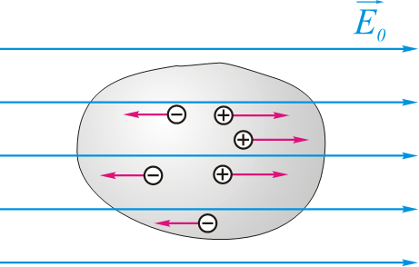
    - $\overrightarrow{E}=\overrightarrow{E}_{0}+\overrightarrow{E_{i}}$
        > $\overrightarrow{E}=0$
        - 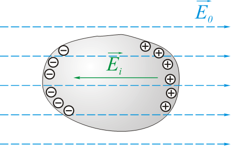
    - 1.导体内部的电场为0，表面上的电场沿法线方向
        > $E=E_{n}\quad\quad\quad\quad\quad\quad E_{τ}=0$
        - 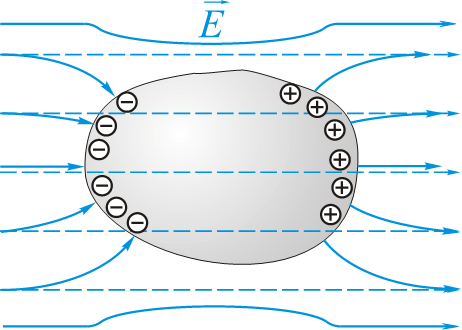
    - 2.导体范围内电势相等
        > $\frac{d\varphi}{dl}=-E_{l}=0$
    - 3.导体的表面是等势的
        > $\frac{d\varphi}{dl}=-E_{τ}=0$
    - 4.未补偿的（未抵消的）感应电荷分布于导体表面
        - 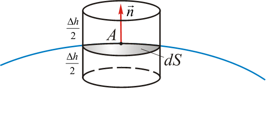
            > - $q =\underset{(s)}{\oint}\varepsilon_{0}\overrightarrow{E}d\overrightarrow{S}=0$
            > - $\underset{(s)}{\oint}\overrightarrow{D}d\overrightarrow{S}=q^{своб}_{охв}$
            > - $\underset{∆h\rightarrow0}{\lim}\underset{(s)}{\oint}\overrightarrow{D}d\overrightarrow{S}=D_{n}dS$
            > - $q^{своб}_{охв}=\sigma dS$
            > - $D_{n}=\sigma\qquad\qquad E_{n}=\frac{\sigma}{\varepsilon\varepsilon_{0}}\qquad(3.1)$

##### 3.2. 孤导体的电容量
- 孤导体（绝缘导体，隐蔽导体）（уединенный проводник）是指距离其他物体很远，可以忽略其电场影响的导体
    - $\sigma=k\cdot q$
    - $k=k(x,y,z)$
    - $\varphi=\frac{1}{4\pi\varepsilon\varepsilon_{0}}\underset{(S_{пров})}{\int}\frac{\sigma dS}{r}=\frac{q}{4\pi\varepsilon\varepsilon_{0}}\underset{(S_{пров})}{\int}\frac{kdS}{r}$
- 孤导体的电荷 $q$ 与电位 $\varphi$ 的比值 $C$,称为该导体的电容.
    - $C=\frac{q}{\varphi}\qquad(3.2)$
        > 国际单位：容量 - $1F$(Фарад 法拉)
        - $1F$ 是这种孤立导体的容量，当向其传递 $1C$ 电荷时，它获得 $1V$ 的电势。
- 例题：
    - 让我们来求一个位于介电常数为 $ε$ 的均质的，各向同性介质中的孤立导电球的电容。
        - $r\geq R$
        - $E_{r}=\frac{q}{4\piεε_{0}r^{2}}$
        - $\varphi=-\int\limits_{R}^{\infty}E'{R}dr=\frac{q}{4\piεε_{0}R}$
    - $C=4\piεε_{0}R\qquad(3.3)$
    > 地球的电容：$C=4\pi\cdot8.85\cdot10^{-12}F/m\cdot6.4\cdot10^{6}m=7\cdot10^{-4}F=700mkF$

##### 3.3. 电容器
- 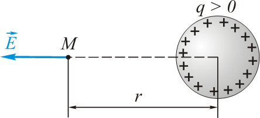
    > - $E'_{r}<E_{r}=\frac{q}{4\piεε_{0}r^{2}}$
- 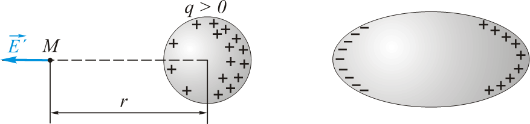
    > - $\varphi'=\frac{q}{C'}=\int\limits_{R}^{\infty}E'_{r}dr<\int\limits_{R}^{\infty} \frac{qdr}{4\piεε_{0}r^{2}}=\frac{q}{4\piεε_{0}R}=\frac{q}{C}=\varphi$
    > - $C'>C$
- 未连接的导体的电容量始终大于单独使用时同一导体的电容量
- 电容器是由两个导体（称为极板）组成的系统，由电介质层隔开
    - 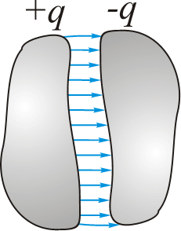
- 一个极板的电荷与极板之间的电势差的比值称为电容器的电容
    - $C=\frac{q}{\varphi_{1}-\varphi_{2}}\qquad(3.4)$
- 例子：
    - 1.扁平电容器
        - $0\le x\le d$
        - 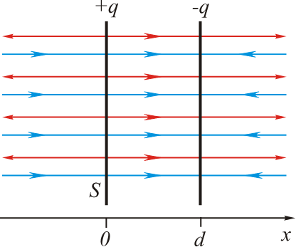
            > - $E_{x}=\frac{\sigma}{2\varepsilon \varepsilon_{0}}+\frac{\sigma}{2\varepsilon\varepsilon_{0}}=\frac{\sigma}{\varepsilon \varepsilon_{0}}$
            > - $\sigma=\frac{q}{S}$
            > - $\varphi_{1}-\varphi_{2}=\int\limits_{0}^{d}E_{x}dx=\frac{\sigma}{\varepsilon\varepsilon_{0}}\int\limits_{0}^{d}dx=\frac{qd}{\varepsilon\varepsilon_{0}S}$
        - $C=\frac{\varepsilon \varepsilon_{0}S}{d}\qquad(3.5)$
    - 2.球形电容器
        - 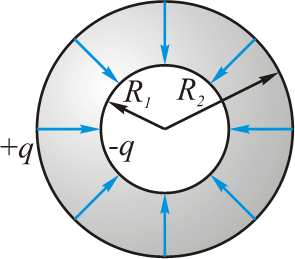
            - $E_{r}=\frac{q}{4\pi\varepsilon\varepsilon_{0}r^{2}}$
            - $\varphi_{1}-\varphi_{2}=\int\limits_{R_{1}}^{R_{2}}E_{r}dr=\frac{q}{4\piεε_{0}}\int\limits_{R_{1}}^{R_{2}}\frac{dr}{r^{2}}=\frac{q}{4\piεε_{0}}(\frac{1}{R_{1}}-\frac{1}{R_{2}})$
        - $C=\frac{4\pi\varepsilon\varepsilon_{0}R_{1}R_{2}}{R_{2}-R_{1}}\qquad(3.6)$
    - 3.圆柱形电容器
        - 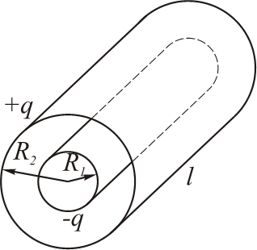
            - $τ=q/l$
            - $E_{r}=\frac{τ}{2\pi\varepsilon\varepsilon_{0}r}=\frac{q}{2\pi\varepsilon\varepsilon_{0}lr}$
            - $\varphi_{1}-\varphi_{2}=\int\limits_{R_{1}}^{R_{2}}E_{r}dr=\frac{q}{2\piεε_{0}l}\int\limits_{R_{1}}^{R_{2}}\frac{dr}{r}=\frac{q}{2\piεε_{0}l}\ln{\frac{R_{2}}{R_{1}}}$
        - $C=\frac{2\pi\varepsilon\varepsilon_{0}l}{\ln{(R_{2}/R_{1})}}\qquad(3.7)$
- 击穿电压(击穿电压)是指电容器的电极之间的最小电位差，在这个电位差上，通过电容器中的介电层发生放电。

##### 3.4. 电容器的连接
- 并联(Параллельное соединение)
    - 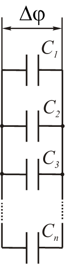
        > - $q_{i}=C_{i}\cdot∆\varphi$
        > - $q=C\cdot∆\varphi$
        > - $q=\sum_{i=1}^{n}C_{i}\cdot\varphi=∆\varphi\cdot\sum_{i=1}^{n}C_{i}$
    - $C=\sum_{i=1}^{n}C_{i}\qquad(3.8)$
- 串联(Последовательное соединение)
    - 
        > - $∆\varphi_{i}=\frac{q}{C_{i}}$
        > - $∆\varphi=\sum_{i=1}^{n}∆\varphi_{i}=\sum_{i=1}^{n}\frac{q}{C_{i}}=q\cdot\sum_{i=1}^{n}\frac{1}{C_{i}}$
        > - $∆\varphi=\frac{q}{C}$
    - $\frac{1}{C}=\sum_{i=1}^{n}\frac{1}{C_{1}}\qquad(3.9)$
    - 
        > - $∆\varphi_{посл}=n\cdot∆\varphi_{пар}$

### 参考文献：

- 预科物理课件
    - 《статика_(теория).pdf》
    - 《Динамика материальной точки. Силы в механике.pptx》
    - 《1.08_МКТ.ppt》
    - 《02_Эл_поле в диэлектриках.ppt》
    - 《03_Эл_поле в прводниках.ppt》
    

## МЕХАНИКА

### Текст

___

3

### Глава 1. Кинема́тика

#### §1. Механи́ческое движе́ние. Систе́ма отсчёта. Материа́льная то́чка. Траекто́рия. Путь и перемеще́ние.

<mark>*Меха́ника - нау́ка о механи́ческом движе́ние тел и происходя́щих при э́том взаимоде́йствиях ме́жду ни́ми.*</mark>

<mark>*Механи́ческим движе́нием те́ла называ́ется измене́ние его́ положе́ния в простра́нстве относи́тельно други́х тел с тече́нием вре́мени.*</mark>

<mark>*Кинема́тика изуча́ет движе́ние тел без учёта причи́н, кото́рые вызыва́ют это движе́ние.*</mark>

Для описа́ния движе́ния те́ла необходи́мо указа́ть, относи́тельно како́го друго́го те́ла бу́дет рассма́триваться это движе́ние, и связа́ть с э́тим те́лом систе́му координа́т. Кро́ме того́, необходи́мо зада́ть нача́ло отсчёта вре́мени.

Совоку́пность систе́мы координа́т, те́ла отсчёта, с кото́рым она́ связа́на, и прибо́ра для определе́ния вре́мени называ́ется систе́мой отсчёта.

<mark>*Материа́льной то́чкой называ́ют те́ло, разме́рами кото́рого мо́жно пренебре́чь в да́нных усло́виях.*</mark> Наприме́р, косми́ческий кора́бль, дви́жущийся по орби́те, мо́жно приня́ть за материа́льную то́чку, сра́внивая его разме́ры с разме́рами Земли́ и расстоя́нием до неё: но нельзя́ пренебре́чь разме́рами корабля́, рассма́тривая движе́ние космона́вта вну́три его́.

<mark>*Траекто́рией движе́ния называ́ется ли́ния, кото́рую опи́сывает те́ло при своём движе́нии.*</mark>

Пусть материа́льная то́чка перемести́­лась вдоль некото́рой траекто́рии из то́чки $A$ в то́чку $B$ (рис. 1.1).

<mark>*Длина́ траекто́рии $l$ называ́ется про́йденным путём.*</mark> Путь явля́ется скаля́рной величино́й.

<mark>*Перемеще́нием $\vec{S}$ называ́ется ве́ктор, проведённый из нача́льного положе́ния $A$ дви́жущейся то́чки в её коне́чное положе́ние $B$*.</mark>

Путь и перемеще́ние - это два ра́зных поня́тия. Наприме́р, те́ло, бро́шенное вертика́льно вверх, дости́гнув максима́льной высоты́ $h$ и упа́в на Зе́млю, прохо́дит путь $l = 2 h$, а перемеще́ние равно́ нулю́.

___

4

#### § 2. Равноме́рное прямолине́йное движе́ние. Ско́рость. Гра́фики зави́симости ско́рости и перемеще́ния от вре́мени при равноме́рном движе́нии 

<mark>Движе́ние, при кото́ром те́ло за любы́е ра́вные промежу́тки вре́мени соверша́ет одина́ковые перемеще́ния, а траекто́рия явля́ется прямо́й ли́нией, *называ́ется равноме́рным прямолине́йным движе́нием.*</mark>

<mark>*Ско́ростью* равноме́рного прямолине́йного движе́ния называ́ется величина́, ра́вная отноше́нию перемеще́ния те́ла, к промежу́тку вре́мени, в тече́ние кото́рого это перемеще́ние произошло́:</mark>

$$\vec{v}=\frac{\vec S}{t}\qquad(1.1)$$

т.е. ско́рость пока́зывает, како́е перемеще́ние соверша́ет те́ло в едини́цу вре́мени. Так как перемеще́ние - величина́ ве́кторная, то ско́рость - то́же ве́кторная величина́. В слу́чае прямолине́йного движе́ния ве́ктора $\vec{S}$ и $\vec{v}$ напра́влены одина́ково.

<mark>*Зa едини́цу ско́рости принима́ют ско́рость тако́го равноме́рного движе́ния, при кото́ром те́ло за 1 секу́нду соверша́ет перемеще́ние в 1 метр*, $[v] = м/с$.</mark>  

> <u>Примеча́ниe</u>: в посо́бии едини́цы измере́ния всех величи́н ука́зываются в междунаро́дной систе́ме едини́ц - СИ.

Зна́я ско́рость, мо́жно найти́ перемеще́ние те́ла за да́нное вре́мя t:

$$\vec{S}=\vec{v}t\qquad(1.2)$$

Для выполне́ния расчётов необходи́мо соверши́ть перехо́д от запи́си уравне́ния (1.2) в ве́кторной фо́рме к запи́си в алгебраи́ческой фо́рме, когда́ в уравне́ние вхо́дят не ве́кторы, а их прое́кции на ось координа́т х, кото́рую целесообра́зно напра́вить вдоль траекто́рии движе́ния. Тогда́ ве́кторы ско́рости и перемеще́ния бу́дут напра́влены вдоль оси́ х, а мо́дули э́тих ве́кторов равны́ их прое́кциям на ось х, т.е.

$$S=vt\qquad(1.3)$$

Для нахожде́ния координа́ты те́ла, в любо́й моме́нт вре́мени t на́до к нача́льной координа́те $x_0$ то́чки приба́вить прое́кцию ве́ктора перемеще́ния на ось x:
$$x=x_0+5 \qquad и́ли \qquad x=x_0+vt\qquad(1.4)$$

___

5

На рис. 1.2 предста́влены гра́фики зави́симости координа́ты от времени для тел, Дви́жущихся с ра́зными скоростя́ми. С наибо́льшей ско́ростью движется тело, которому соотве́тствует график 1: ско́рость тем больше, чем больше у́гол между гра́фиком и о́сью времени. Тело, которому соотве́тствует гра́фик 3, движется со ско́ростью, напра́вленной противополо́жно оси́ х.

На рис. 1.3 изображён гра́фик зависи́мости мо́дуля ско́рости от времени. Он представля́ет собо́й пряму́ю, паралле́льную оси́ времени, так как скорость с тече́нием времени не меня́ется. По графику скорости можно определить мо́дуль перемеще́ния тела за да́нный промежу́ток времени. Он числе́нно раве́н пло́щади заштрихо́ванного прямоуго́льника, определя́емой произведе́нием его сторо́н, одна из которых соотве́тствует мо́дулю ско́рости $v$, а другая - времени $t$.

#### § 3. Равноуско́ренное прямолине́йное движение

<mark>*Движе́ние, при кото́ром те́ло за ра́вные промежу́тки времени соверша́ет неодина́ковые перемеще́ния, называ́ется неравноме́рном.*</mark> При неравномерном движении ско́рость тела изменя́ется с тече́нием времени. 

<mark>*Сре́дней скоростью* неравноме́рного движения называется отношение перемеще́ния тела к промежу́тку времени, за который произошло́ это перемеще́ние:</mark>  

$$\vec{v}_{ср}=\frac{\vec{S}}{t}\qquad(1.5)$$  
`вэ срежний вектор равно эс вектор делить на тэ`

<mark>*Мгнове́нной скоростью* называется скорость в да́нный моме́нт времени или в да́нной то́чке траекто́рии.</mark> Её можно определить как преде́л, к которому стреми́тся сре́дняя скорость при бесконе́чном уменьше́нии промежу́тка времени $\Delta t$, за который произошло́ перемеще́ние $\Delta\vec{S}$:  

$$\vec{v}=\lim{\frac{\Delta\vec{S}}{\Delta t}}\ ,\ \Delta t\to 0.\qquad(1.6)$$  
`вэ вектор есть лимит отношения дельта эс вектор к дельта тэ, при дельта тэ стремящемся к нулю`

___

6

<mark>*Равноуско́ренным прямолине́йным движе́нием* называ́ется движе́ние те́ла, при кото́ром его ско́рость за любы́е ра́вные промежу́тки вре́мени изменя́ется одина́ково, я траекто́рией движе́ния явля́ется пря́мая ли́ния.</mark> 

<mark>*Ускоре́нием те́ла*, дви́жущегося равноуско́ренно, называ́ется ве́кторная величина́, ра́вная отноше́нию измене́ния ско́рости к промежу́тку вре́мени, в тече́ние кото́рого это измене́ние произошло́.</mark>

Пу́сть за вре́мя $t$ ско́рость возросла́ от значе́ния $\vec{v_0}$ до $\vec{v}$  Ускоре́ние вырази́тся фо́рмулой:

$$\vec{a}=\frac{\vec{v}-\vec{v_0}}{t} \qquad(1.7)$$

Ускоре́ние равно́ измене́нию ско́рости за едини́цу вре́мени. Из фо́рмулы (1.7) сле́дует, что

$$\vec{v}=\vec{v_0}+\vec{a}t \qquad (1.8)$$

Зна́я нача́льную ско́рость $\vec{v_0}$ те́ла и его ускоре́ние $\vec{a}$, можно вы́числить значе́ние мгнове́нной ско́рости $\vec{v}$ в любо́й моме́нт вре́мени по фо́рмуле (1.8).

</mark>За едини́цу ускоре́ния в СИ принима́ют ускоре́ние тако́го равноуско́ренного движе́ния, при кото́ром за 1 секу́нду ско́рость изменя́ется на 1 ме́тр в секу́нду</mark>

Из фо́рмулы (1,7) сле́дует, что ускоре́ние измеря́ется в ме́трах в секу́нду за секу́нду, $[a] = m/c^2$.

Если напра́вить координа́тную ось $x$ вдо́ль траекто́рии движе́ния, то направле́ния оси́ $x$ и ве́кторов $\vec{v_0}$,$\vec{v}$ и $\vec{a}$ совпаду́т. Мо́дули этих ве́кторов $v_0$,$v$ и $а$ равны́ их прое́кциям на ось $x$ и выраже́ние (1.8) мо́жно записа́ть в скаля́рной фо́рме:

$$v=v_0+at\qquad(1.9)$$

Согла́сно (1.9), гра́фик зави́симости ско́рости от вре́мени представля́ет собо́й пряму́ю ($v \sim t$).

На рис. 1.4 приведе́ны гра́фики для равноуско́ренных движе́ний с одина́ковой нача́льной ско́ростью, но с разли́чными ускоре́ниями, и гра́фик 4 - движе́ния с нача́льной ско́ростью $v_0=0$ 

___

7

Фо́рмулу перемеще́ния при равноуско́ренном движе́нии мо́жно получи́ть, е́сли воспо́льзоваться графи́ческим ме́тодом —— найти́ пло́щадь трапе́ции $ОАВС$ (рис. 1.5). Она́ равна́ произведе́нию полусу́ммы её основа́ний на высоту́. Осно­ва́ния трапе́ции чи́сленно равны́: $ОА=v_0$, $ВС=v$. Высота́ равна́ $t$.

Мо́дуль перемеще́ния ра́вен $S=\frac{v_0+v}{2}\cdot t$. Учи́тывая, что $v=v_0+аt$, полу́чим $S=\frac{v_0+v_0+at}{2}\cdot t=\frac{2v_0+at}{2}\cdot t$, и́ли

$$S=v_0t+\frac{at^{2}}{2}\qquad(1.10)$$

В слу́чае, когда́ неизве́стно вре́мя движе́ния те́ла, мо́жно испо́льзовать другу́ю фо́рмулу перемеще́ния, полу́ченную путём реше́ния систе́мы уравне́ний $(1.9)$ и $(1.10)$;

$$S= \frac{v^{2}-v_0^{2}}{2a}\qquad(1.11)$$

#### § 4. Свобо́дное паде́ние тел

<mark>Ча́стным слу́чаем равноуско́ренного прямолине́йного движе́ния явля́ется *свобо́дное паде́ние* — движе́ние тел под де́йствием си́лы тя́жести в безвозду́шном простра́нстве.</mark> Италья́нский фи́зик Галиле́о Галиле́й установи́л, что при свобо́дном паде́нии все тела́ дви́жутся с одина́ковым ускоре́нием. <mark>*Ускоре́ние свобо́дно­го паде́ния* обознача́ется бу́квой $g$.</mark> При ма́лых высо́тах над пове́рхностью Земли́ $g =9,8 м/с^{2}$ и напра́влено к це́нтру Земли́. В главе́ 2, § 6 мы пока́жем, что уско­ре́ние свобо́дного паде́ния уменьша́ется с ро́стом высоты́ те́ла над Землёй, а та́кже зави́сит от географи́ческой широты́. Перемеще́ние при свобо́дном паде́нии при́нято обознача́ть бу́квой $h$. Фо́рмула для мо́дулей ско́рости и перемеще́ния свобо́дно па́дающего. те́ла полу́чим, испо́льзуя выраже́ния $(1.9)$, $(1.10)$ и $(1.11)$ замени́в обозначе́ния $a$ на $g$ и $S$ на $h$: 

$$
\begin{aligned}
v&=v_0+gt\qquad&(1.12)\\
h&=v_0t+\frac{gt^{2}}{2}\qquad&(1.13)\\
h&=\frac{v^{2}-v_0^{2}}{2g}\qquad&(1.14)\\
\end{aligned}
$$

___

8

#### § 5. Относи́тельность движе́ния. Сложе́ние скоросте́й

Вся́кое положе́ние те́ла в простра́нстве, его́ поко́й и движе́ние относи́тель­ны. Относи́тельность поко́я те́ла состои́т в том, что в одни́х систе́мах отсчёта те́­ло мо́жет поко́иться, в то вре́мя как в други́х - дви́гаться. Наприме́р, челове́к, сидя́щий в дви́жущемся авто́бусе, неподви́жен относи́тельно авто́буса и движе́т­ся вме́сте с авто́бусом по отноше́нию к Земле́.

Движе́ние тел та́кже относи́тельно, т.е. по отноше́нию к ра́зным систе́мам отсчёта ско́рости движе́ния тел разли́чны и определя́ются пра́вилом сложе́ния скоросте́й. Рассмо́трим э́то пра́вило на конкре́тном приме́ре. По реке́ плывёт теплохо́д со ско́ростью $\vec{v_1}$, Относи́тельно теплохо́да дви́жется челове́к со ско́ро­стью $\vec{v_2}$. Свя́жем с Землёй неподви́жную систе́му координа́т, а с теплохо́дом - дви́жущуюся. Ско́рость челове́ка относи́тельно Земли́ равна́ $\vec{v} = \vec{v_1} + \vec{v_2}$, т.е. геометри́ческой су́мме его́ ско́рости в подви́жной систе́ме отсчёта и ско́рости подви́жной систе́ме отсчёта (теплохо́да) относи́тельно неподви́жной (Земли́). <mark>*Ско́рости скла́дываются по пра́вилу сложе́ния ве́кторов.*</mark> Если $\vec{v_1}$ и $\vec{v_2}$ напра́в­лены под угло́м друг к дру́гу, то мо́жно воспо́льзоваться пра́вилом параллело­гра́мма: скла́дываемые ско́рости $\vec{v_1}$ и $\vec{v_2}$ соотве́тствуют сторона́м параллело­гра́мма, а результи́рующая ско́рость $\vec{v}$ в том же масшта́бе соотве́тствует его́ диагона́ли.

#### § 6. Равноме́рное движе́ние по окру́жности

Движе́ние те́ла по окру́жности счита́ют равноме́рным, е́сли мо́дуль ско́ро­сти остаётся постоя́нным. При э́том направле́ние ве́ктора ско́рости изменя́ется со вре́менем.

<mark>Движе́ние те́ла по окру́жности мо́жно описа́ть, зада́в *у́гол $\varphi$* поворо́та ра́­диуса, соединя́ющего це́нтр окру́жности с любо́й то́чкой те́ла.</mark> Этот у́гол изме­ря́ют в радиа́нах. <mark>*Радиа́н (рад)* ра́вен углу́, ме́жду двумя́ ра́диусами окру́жности, дли́на дуги́, ме́жду кото́рыми равна́ ра́диусу.</mark> Одному́, по́лному оборо́ту соотве́тствует у́гол $\frac{2 \pi R}{R} = 2 \pi$ радиа́н. <mark>Отноше́ние угла́ поворо́та $\varphi$ к промежу́тку вре́мени, в тече́ние кото́рого соверше́н этот поворо́т, называ́ется *углово́й ско́ростью*:</mark>

$$\omega = \frac{\varphi}{t} \qquad (1.15)$$

<mark>*Едини́ца измере́ния углово́й ско́рость - радиа́н в секу́нду $[\omega]$ = рад/с.*</mark>
Лине́йной ско́ростью $v$ называ́ется величина́, ра́вная отноше́нию длины́ дуги́, окру́жности $l$ про́йденной те́лом при движе́нии, к промежу́тку вре́мени $t$:

___

9

$$v = \frac{l}{t} \qquad (1.16)$$

Она́ напра́влена по каса́тельной к окру́жности.
Длина́ дуги́ окру́жности свя́зана с угло́м поворо́та (рис. 1.6) соотноше́нием $l=R\cdot\varphi$ Подста́вим э́то выраже́ние в (1.16):

$$v = \frac{R \varphi}{t}$$

Отсю́да получа́ем связь ме́жду лине́йной и углово́й ско­ростя́ми:

$$v=R \omega \qquad (1.17)$$

<mark>Поми́мо перечи́сленных величи́н движе́ние те́ла по окру́жности мо́жно характеризова́ть *пери́одом $T$ и частото́й $\nu$*.</mark>

<mark>*Перио́д — это вре́мя, необходи́мое для соверше́ния одного́ по́лного оборо́та. Его дли́тельность измеря́ется в секу́ндах.*</mark>  

<mark>*Частота́ враще́ния - это число́ оборо́тов, соверша́емых за одну́ секу́нду. Частота́ измеря́ется в Ге́ргцах ( 1 Гц = 1 оборо́т в секу́нту).*</mark>

Очеви́дно, что

$$\nu =\frac{1}{T} \quad \omega = \frac{2 \pi}{T} = 2 \pi \nu \qquad (1.18)$$

<mark>Измене́ние направле́ния ско́рости происхо́дит всле́дствие того́, что при движе́нии те́ла по окру́жности на него́ де́йствует ускоре́ние, напра́вленное по ра́диусу к це́нтру и называ́емое *центростреми́тельным ускоре́нием*.</mark> Мо́дуль центростреми́тельного ускоре́ния определя́ется по фо́рмуле:

$$a = \frac{v^2}{R} = \omega ^2 R \qquad (1.19)$$
т.е. зави́сит от ра́диуса окру́жности и ско́рости движе́ния.

___

10

### Глава́ 2. Осно́вы дина́мики

#### § 1. Пе́рвый зако́н Ньюто́на. инерциа́льные систе́мы отсчёта. При́нцип относи́тельности Галиле́я

<mark>*Дина́мика - разде́л меха́ники, изуча́ющий движе́ние тел в совоку́пности с причи́нами, вызыва́ющими и́ли изменя́ющими э́то движе́ние.*</mark> В осно́ве класси́ческой меха́ники лежа́т три зако́на дина́мики, сформули́рованные Ньюто́ном в 1687 г. и нося́шие его́ и́мя.

<mark>*Пе́рвый зако́н Ньюто́на* формули́руется сле́дующим о́бразом:</mark>

<mark>**Существу́ют таки́е систе́мы отсчёта, относи́тельно кото́рых поступа́тельно дви́жущееся те́ло сохраня́ет свою́ ско́рость постоя́нной, е́сли на него́ не де́йствуют други́е тела́, и́ли де́йствие други́х тел взаи́мно компенси́руется.**</mark>

Наприме́р, движе́ние автомоби́ля не прекраща́ется при отключе́нии дви́гателя, а лишь постепе́нно замедля́ется. Причи́ной измене́ния ско́рости автомоби́ля явля́ется де́йствие на него́ тре́ния. При отсу́тствии тре́ния автомоби́ль двига́лся бы равноме́рно прямолине́йно бесконе́чно до́лго. Равноме́рное движе́ние автомоби́ля мо́жно осуще́ствить, е́сли скомпенси́ровать де́йствие тре́ния с по́мощью дви́гателя. <mark>*Явле́ние сохране́ния ско́рости те́ла при отсу́тствии вне́шних возде́йствий и́ли при их компенса́ции называ́ется ине́рцией.*</mark>

По э́тому пе́рвый зако́н Ньюто́на называ́ют зако́ном ине́рции. Явле́ние ине́рции проявля́ется, наприме́р, при ре́зком торможе́нни авто́буса, когда́ пассажи́ры по ине́рции наклоня́ются вперёд.

<mark>*Систе́ма отсчёта, в кото́рой выполня́ется пе́рвый зако́н Ньюто́на, называ́ется инерциа́льной.*</mark> Для большинства́ практи́ческих це́лей систе́му, свя́занную с Землёй, мо́жно счита́ть инерциа́льной. Люба́я систе́ма отсчёта, кото́рая дви́жется равноме́рно и прямолине́йно относи́тельно инерциа́льной систе́мы отсчёта, то́же явля́ется инерциа́льной.

<mark>***При́нцип относи́тельности Галиле́я:*  во всех инерциа́льных систе́мах отсчёта зако́ны движе́ния одина́ковы. э́то означа́ет, что механи́ческие явле́ния в разли́чных инерциа́льных систе́мах отсчёта протека́ют одина́ковым о́бразом.**</mark>

#### § 2. Ма́сса. Си́ла. Второ́й зако́н Ньюто́на

<mark>*Cво́йство тел сохраня́ть величину́ и направле́ние ско́рости в отсу́тствие взаимоде́йствия с други́ми тела́ми называ́ется ине́ртностью.*</mark> Коли́чественной ме́рой ине́ртности те́ла явля́ется ма́сса. э́то скаля́рная физи́ческая величина́. Чем бо́льшей ма́ссой облада́ет те́ло, тем ме́ньшее ускоре́ние оно́ получа́ет при взаимоде́йствии с други́ми тела́ми, т.е. тем бо́льше проявля́ется его́ ине́ртность. Наприме́р, при одно́м и том же возде́йствии на грузово́й и легково́й автомоби́ли 

___

11

в тече́ние одина́кового вре́мени грузово́й автомоби́ль ме́ньше изме́нит свок ско́рость, чем легково́й. Едини́ца ма́ссы в СИ - килогра́мм, $[m] = кг$.
<mark>*Пло́тностью вещества́ называ́ется физи́ческая величина́, ра́вная отноше́нию ма́ссы те́ла к абъёму:*</mark>
$$ \rho = \frac{m}{V} \qquad (1.20)$$
Едини́ца пло́тности - $[\rho] = \frac{кг}{м^3}$

<mark>*Си́ла — физи́ческая величина́ явля́ющаяся ме́рой механи́ческого де́йствия на да́нное те́ло други́х тел.*</mark> Э́то ве́кторная величина́ и в ка́ждый моме́нт времени характеризу́ется числовы́м значе́нием, направле́нием и то́чкой приложе́ния. Её обознача́ют $\vec{F}$. Си́ла явля́ется причи́ной ускоре́ния, возника́ющего при взаимоде́йствии тел.

На основа́нии о́пытов Ньюто́н сформули́ровал важне́йший зако́н меха́ники, кото́рый был на́зван <mark>*вторы́м зако́ном Ньюто́на:*</mark>
<mark>**Ускоре́ние, сообща́емое те́лу, пря́мо пропорциона́льно де́йствующе на него́ си́ле и обра́тно пропорциона́льно ма́ссе те́ла:**</mark>
$$\vec{a} = \frac{\vec{F}}{m} \qquad (1.21)$$ 

Направле́ние ве́ктора ускоре́ния совпада́ет с направле́нием ве́ктора си́лы, Если в фо́рмуле (1,21) приня́ть $m = 1 кг, а = 1 м/c^2$, то полу́чим едини́цу измере́ния си́лы - ньюто́н, $[H] = \frac{кг \cdot м}{с^2}$. <mark>Ньюто́н — си́ла,</mark> кото́рая сообща́ет те́лу ма́ссой $1 кг$ ускоре́ние $1 м/с^2$.

Е́сли на те́ло де́йствуют не́сколько сил, то определя́ют равноде́йствующую си́лу, ра́вную геометри́ческой су́мме э́тих сил. Она́ нахо́дится пра́вилом сложе­ния ве́кторов. В фо́рмуле (1.21) под $\vec{F}$ на́до понима́ть равноде́йствующую всех сил, прило́женных к те́лу.

#### § З. Тре́тий зако́н Ньюто́на
Любы́е де́йствия тел друг на дру́га но́сят хара́ктер взаимоде́йствия. Уско­ре́ния, приобрета́емые взаимоде́йствующими тела́ми, обра́тно пропорциона́льны их ма́ссам, и име́ют противополо́жные направле́ния:

$$
\begin{aligned}
\frac{\vec{a}_1}{-a_2} &= \frac{m_2}{m_1} \quad  или\\
m_1 \vec{a}_1 &= -m_2 \vec{a}_2\\
\end{aligned}
$$

___

12

Замени́в согла́сно второ́му зако́ну Ньюто́на произведе́ние ма́ссы на уско­ре́ние си́лой, полу́чим:
$$\vec{F_1} = - \vec{F_2} \qquad (1.22)$$

Ра́венство (1.22) выража́ет <mark>*тре́тий зако́н Ньюто́на*</mark>：
Тела́ де́йствуют друг на дру́га с си́лами, ра́вными по мо́дулю и проти­вополо́жными по направле́нию.
Тре́тий зако́н Ньюто́на ука́зывает на то, что не мо́жет быть односторо́нне­го де́йствия. Наприме́р, е́сли, находя́сь в одно́й ло́дке, нача́ть подтя́гивать за верёвку другу́ю ло́дку, то обе ло́дки бу́дут двига́ться, приближа́ясь друг к дру́гу.Друго́й приме́р: чем сильне́е мы бу́дем нажима́ть руко́й на пове́рхность стола́, тем бо́льшее противоде́йствие бу́дем ощуща́ть со стороны́ стола́.Сле́дует по́мнить, что си́лы, возника́ющие при взаимоде́йствии двух тел, прило́жены к ра́зным тела́ми поэ́тому не уравнове́шивают друг дру́га.

#### § 4 Моме́нт си́лы. Усло́вие равнове́сия те́ла, име́ющего ось  враще́ния
Вы́ясним, при каки́х усло́виях те́ло с закреплённой о́сью не бу́дет повора́чиваться под де́йствием прило́женных к нему сил, т.е. бу́дет нахо́диться в рав­нове́сии. Пусть к не́которому те́лу в ра́зных то́чках прило́жены две си́лы $\vec{F_1}$ и $\vec{F_2}$ (рис. 1.7). Предполо́жим, что в то́чке $O$ прохо́дит закреплённая ось, перпендику­ля́рная пло́скости чертежа́. <mark>*Kpaтча́йшee расстоя́ние $d$ от оси́ враще́ния до ли́нии де́йствия си́лы называ́eтcя плечо́м си́лы.*</mark>
Опыт пока́зывает, что враща́ющее де́йствие си́лы характери́зуется произведе́нием мо́дуля си́лы на её плечо́:
$$M = Fd \qquad (1.23)$$

Эта величина́ называ́ется <mark>*моме́нтом си́лы относи́тельно оси́ враще́ния.*</mark>

Едини́ца измере́ния моме́нта си́лы $[М] = Н \cdot м$. Моме́нтам сил, вызыва́ю­щих враще́ние те́ла по часово́й стре́лке усло́вно припи́сывают положи́тельный знaк, a вызыва́ющих враще́ние про́тив часово́й стре́лки — отрица́тельный. На pиc.1.8 моме́нт си́лы $\vec{F_1}$ положи́телен, а моме́нт си́лы $\vec{F_2}$ —— отрица́телен.

Пра́вило моме́нтов: <mark>*те́ло, име́ющее неподви́жную ось враще́ния, нахо́дится в равнове́сии, е́сли алгебраи́ческая су́мма моме́нтов сил, прило́женных к те́лу, равна́ нулю́.*</mark> Для слу́чая, изображённого на рис 1.8, име́ем:

___

13

$$M_1 = F_1d_1, \quad M_2 = F_2d_2, \quad M_3 = F_3d_3 \qquad (1.24)$$
Моме́нты си́л $М_1$ и $М_3$ положи́тельны, а мо­ме́нт си́лы $М_2$ - отрица́телен. Тогда́ согла́сно пра́вилу моме́нтов:
$$M_1 - M_2 + M_3 = 0$$

#### § 5. Си́ла упру́гости. Зако́н Гу́ка

Под де́йствием вне́шних си́л те́ло мо́жет измени́ть свою́ фо́рму или объём.

Тако́е измене́ние называ́ется <mark>деформа́цией. Деформа́ция называ́ется упру́гой, е́сли она́ исчеза́ем по́сле прекраще́ния де́йствия вне́шних си́л.</mark> Рассмо́трим одно­ро́дный сте́ржень, один коне́ц кото́рого закреплён, а к друго́му прило́жена вне́шняя си́ла $\vec{F_{вн}}$ `Эф большое вектор внешнее` (рис. 1.9).

Под де́йствием этой си́лы сте́ржень бу́дет растя́нут или сжа́т на величину́ $x$. При деформа́ции сте́ржня в нём возника́ет си́ла упру́гости, направле́нная в сто́­рону, противополо́жную смеще́нию час­ти́ц те́ла, вы́званному деформа́цией. Она стреми́тся восстанови́ть пре́жние разме́ры те́ла. Деформа́цию растяже́ния испы́тывают, наприме́р, тро́сы подъе́мных кра́нов, букси́рные тро́сы, а деформа́цию сжа́тия - сте́ны, фунда́менты зда́ний и др.

Приро́да упру́гих си́л объясня́ется нали́чием электростати́ческих си́л притяже́ния и отта́лкивания ме́жду моле́кулами веще́ства. При деформа́ции растя­же́ния начина́ют преоблада́ть си́лы притяже́ния, а при деформа́ции сжа́тия - си́­лы отта́лкивания.

Для ма́лых по сравне́нию с длино́й те́ла деформа́ций был устано́влен за­ко́н Гу́ка:

<mark>**Си́ла упру́гости, возника́ющая всле́дствие деформа́ции те́ла, пропорциона́льна его́ удлине́нию и напра́влена противополо́жно направле́нию перемеще́ния части́ц те́ла при деформа́ции.**</mark>

Математиче́ская за́пись зако́на Гу́ка:

___

14

$$F_{упр} = -kx \qquad(1.25)$$

<mark>где к - коэффицие́нт пропорциона́льности, называ́емый *жёсткостью те́ла*.</mark> В СИ жёсткость име́ет разме́рность Ньюто́н на метр, $[к] = Н/м$.

Знак "ми́нус" означа́ет, что си́ла упру́гости всегда́ напра́влена в сто́рону, противополо́жную деформа́ции.

#### § 6. Зако́н всеми́рного тяготе́ния. Си́ла тя́жести. Вес те́ла. Невесо́мость

В 1667 г. Ньюто́н высказа́л предположе́ние, что все тела́ во Вселе́нной притя́гиваются друг к дру́гу.

<mark>В настоя́щее вре́мя *си́лы вза́имного притяже́ния тел называ́ют гравитацио́нными си́лами*.</mark>

<mark>Ньюто́ну принадлежи́т откры́тие *зако́на всеми́рного тяготе́ния*:</mark>

> Тела́ притя́гиваются друг к дру́гу с си́лой, мо́дуль кото́рой пропорциона́лен произведе́нию ма́сс тел и обра́тно пропорциона́лен квадра́ту расстоя́ния ме́жду ни́ми:

$$F = G \frac{m_1 m_2}{r^2} \qquad(1.26)$$
где $m_1$ и $m_2$ - ма́ссы тел;  
$r$ - расстоя́ние ме́жду ни́ми;  
$G$ - коэффицие́нт пропорциона́льности, одина́ковый для всех тел, и назы­ва́емый гравитацио́нной постоя́нной.

Гравитацио́нная постоя́нная чи́сленно равна́ си́ле притяже́ния двух тел ма́ссами по 1 кг, находя́щихся на расстоя́нии $1 м$. Её значе́ние $G \approx 6,67 \cdot 10^{-11} \frac{Нм^2}{кг^2}$ (`жэ-большое примерно-равно шесть и шестдесят семь сотых умножить на десять в минус одинадцатой степени Ньютон на метр в квадрате делить на килограмм в квадрате`)
Зако́н всеми́рного тяготе́ния справедли́в для тел, кото́рые мо́жно приня́ть за материа́льные то́чки, т.е. для тех слу́чаев, когда́ расстоя́ние $r$ ме́жду тела́ми во мно́го раз бо́льше разме́ров тел. Если тела́ име́ют фо́рму ша́ра, то в ка́честве $r$ берётся расстоя́ние ме́жду це́нтрами шаро́в. Гравитацио́нные си́лы напра́влены вдоль ли́нии, соединя́ющие взаимоде́йствующие материа́льные то́чки.
<mark>*Си́ла тя́жести — это си́ла притяже́ния тел к Земле́.*</mark> Это одно из проявле́ний зако́на всеми́рного тяготе́ния. Если обозна́чить ма́ссу Земли́ $М$, а её ра́диус $R$, то си́ла тя́жести, де́йствующая на те́ло ма́ссой $m$ вблизи́ пове́рхности Земли́, равна́
$$F_т = G \frac{Mm}{R^2} \qquad (1.27)$$
(`эф-тяжести равно жэ-большое умножить на масса Земли умножить на масса тела делить на эр квадрат между ними`)
(`或者直接读字母也行`)
___

15

Под де́йствием си́лы тя́жести при отсу́тствии други́х сил те́ло соверша́ет свобо́дное паде́ние. Согла́сно второ́му зако́ну Ньюто́на си́лу тя́жести мо́жно за­писа́ть в ви́де:

$$ F_т=mg\qquad(1.28)$$

Сра́внивая (1.27) и (1.28) нахо́дим:

$$g=G\frac{M}{R^2}\qquad(1.29)$$
Сле́довательно, ускоре́ние свобо́дного паде́ния не зави́сит от ма́ссы $m$ те́ла. Анализи́руя фо́рмулу (1.29), мы убежда́емся, что с ро́стом высоты́ те́ла над по­верхностью Земли́ ускоре́ние свобо́дного паде́ния уменьша́ется. На пове́рхности Земли́ ускоре́ние свобо́дного паде́ния зави́сит от географи́ческой широты́: на по́люсах оно́ бо́льше, чем на эква́торе. Свя́зано это с тем, что земно́й шар не́­сколько сплю́снут у по́люсов и экваториа́льный ра́диус Земли́ бо́льше поля́рного на 21 $км$.
<mark>*Ве́сом те́ла называ́ют си́лу, с кото́рой те́ло всле́дствие притяже́ния к Земле́ де́йствует на горизонта́льную опо́ру или подве́с.*</mark>

В соотве́тствии с тре́тьим зако́ном Ньюто́на со стороны́ опо́ры или подве́­са на те́ло де́йствует упру́гая си́ла, ра́вная по величине́ ве́су те́ла и противопо­ло́жно напра́вленная. (Рис. 1.10) Ча́сто её называ́ют си́лой реа́кции опо́ры и обознача́ют бу́квой $\vec{N}$.

$$\vec{p}=-\vec{N} \qquad (1.30)$$
`Пэ малое вектор равно минус Энь большое вектор`

Если те́ло нахо́дится в поко́е на горизонта́льной пове́рх­ности или дви́жется равноме́рно вме́сте с ней. то де́йствующие на те́ло две си́лы - си́ла тя́жести и упру́гая си́ла - уравнове́­шивают друг дру́га. (Рис. 1.11)

$$\vec{F_т}=-\vec{N} \qquad (1.31)$$
`Эф большое с индексом тэ вектор равно с минусом Энь большое вектор`

Сопоставля́я (1.30) и (1.31). полу́чим:

$$\vec{P}=\vec{F_т},\ или\ \vec{P}=m\vec{g} \qquad (1.32)$$
`Пэ большое вектор равно Эф большое тэ вектор, или Пэ большое вектор равно Эм Жэ вектор`

т.е. вес те́ла на неподви́жной или равноме́рно дви́жущейся опо́ре ра́вен си́ле тя́­жести. Сле́дует по́мнить, что си́ла тя́жести прило́жена к те́лу, а вес - к опо́ре.

Если же те́ло вме́сте с опо́рой дви́жется равноуско́ренно в вертика́льном напра́влении, то вес те́ла отлича́ется от си́лы тя́жести.

___

16

напра́влено противополо́жно ускоре́нию свобо́дного паде́ния $\vec{g}$, то $P>mg$ возника́ет состоя́ние <mark>перегру́зки</mark>. Де́йствие перегру́зки испы́тывают на себе, космона́вты при взле́те косми́ческой раке́ты. В слу́чае совпаде́ния направле́ния $\vec{a}$ и $\vec{g}$ ве́с те́ла стано́вится ме́ньше си́лы тя́жести. Если те́ло вме́сте с опо́рой дви́жется с ускоре́нием $\vec{a}=\vec{g}$, то вес ока́зывается ра́вным нулю́. Состоя́ние с нульвы́м ве́сом называ́ют <mark>невесо́мостью</mark>. В состоя́нии невесо́мости на те́ло де́йствуют то́лько си́ла тя́жести. В тако́м состоя́нии нахо́дятся, наприме́р, космона́вты и в предме́ты внутри́, косми́ческого корабля́, дви́жущегося по о́колозе́мной орби́ти. В этом слу́чае фо́рмула (1.32) приобрета́ет ви́д.

$$\vec{P}=m(\vec{g}-\vec{a})$$

<!--эм умножить на скобку, а скобки - жэ-вектор минус а-вектор-->

#### § 7. Си́ла тре́ния. Коэффицие́нт тре́ния.

<mark>Сила, возника́ющая в о́бласти соприкоснове́ния тел и препя́тствующая и относи́тельному перемеще́нию, называ́ется си́лой тре́ния.</mark>
Причи́ной возникнове́ния си́лы тре́ния явля́ется шерохова́тость пове́рхности соприкаса́ющихся тел, а та́кже нали́чие сил межмолекуля́рного взаимоде́йствия.

<mark>*Си́ла тре́тия поко́я*</mark> возника́ет при попы́тке привести́ те́ло в движе́ние. Она́ напра́влена в сто́рону, противополо́жную возмо́жному движе́нию и растёт по ме́ре увеличе́ния вне́шней си́лы, прило́женной к те́лу. Если вне́шняя си́ла, при­ло́женная к те́лу, ра́вна максима́льной си́ле тре́ния поко́я и́ли превыша́ет её. то происхо́дит скольже́ние те́ла по пове́рхности друго́го. В э́том слу́чае си́лу тре́­ния называ́ют <mark>*си́лой тре́ния скольже́ния*</mark>. Её направле́ние противополо́жно направле́нию ско́рости движе́ния те́ла. Си́ла тре́ния скольже́ния пропорциона́льна си́ле давле́ния, напра́вленной перпендикуля́рно пове́рхности, по кото́рой сколь­зи́т тело:

$$F_{тр}=\mu F_д \qquad (1.34)$$

где $\mu$ - коэффицие́нт пропорциона́льности, называ́емый <mark>*коэффицие́нтом тре́­ния скольже́ния*</mark>. Он зави́сит от материа́лов, ка́чества обрабо́тки пове́рхностей, а та́кже от ско́рости относи́тельного движе́ния соприкаса́ющихся тел. Это безраз­ме́рная величина́.

В слу́чае движе́ния те́ла по горизонта́льной пове́рхности си́ла давле́ния совпада́ет с ве́сом те́ла, и в э́том случае.

$$F_{тр}=\mu mg \qquad (1.35)$$

Тре́ние мо́жет быть поле́зным и вре́дным. Благодаря́ тре́нию поко́я мы мо́жет уде́рживать предме́ты в рука́х; тре́ние скольже́ния поле́зно в тормозны́х

___

17

систе́мах автомоби́льного тра́нспорта и т.д. С друго́й стороны́, у всех механи́змов всле́дствие тре́ния происхо́дит изно́с дета́лей. Уменьше́ния си́лы тре́ния добива́ются с по́мощью сма́зки.

## 预科物理教材(动力学)

### 第一章 振荡

#### §1.1 振荡以及相关知识点
 - 振荡
     - 定义：振荡运动是一种周期性运动，其特征在于一些物理参数在时间上有规律地重复出现。 振荡运动的特征在于振荡的幅度，周期和频率，为了使身体开始振荡运动，它需要传达（传递）一些初始能量。 该能量可以是动能，势能或两者的组合。
 - 振幅
     - 振动幅度A，[m]是振动体与其平衡位置的最大偏差。 振动幅度是一个标量值，以米（m）为单位进行测量。
 - 周期
     - 振荡周期T，[s]是最小时间间隔，在此之后，振荡体返回到其初始时刻的相同状态。 振荡周期是一个完整的振荡发生的时间。 振荡周期是一个标量值，以秒为单位进行测量。
 - 振荡频率
     - 振荡频率ν[Hz]是每单位时间（每1秒）发生的振荡次数。 振荡频率是一个标量，其单位是赫兹（Hz）。 1 Hz的振荡频率表示在1秒钟内发生1次振荡，该振荡频率与振荡周期的比率为：ν=1/T
 - 循环频率
     - 循环频率ω，[rad/s]为2π秒内进行的振荡次数。循环频率是一个标量，其计量单位是每秒弧度（rad/s）。循环频率又称圆周频率。循环频率与振荡周期的关系为：ω=2π/T
 - 初始相位
     - 振荡的初始相位φ0[rad]是描述振荡过程或波动过程的周期性变化函数的初始变量。 振荡的初始相位是一个标量，以弧度（rad）为单位。

     
#### §1.2 谐波振荡
 - 谐波振荡
     - 定义：谐波振荡是指某些物理量x在时间上按周期性规律变化的振荡。x(t) = Asin ( ωt + φ ) ω和φ0的量是恒定的，谐波振荡定律中的sin或cos函数由原点的选择决定。
 - 振荡相位
     - 定义：振荡相位φ，[rad]是描述振荡或波浪过程的周期性变化函数的参数，它是一个以弧度（rad）为单位的标量，由关系式定义：φ = ωt + φ0 
     - 给定振幅的相位可随时确定振动系统的状态。
     - 特点
         - 自由（自然）振动是物体的谐波振动，仅在没有外部影响的情况下才通过初始传递的能量来执行。 可以通过例如机械系统中的初始位移（势能）或初始速度（动能）来赋予势能或动能。
         - 自由振荡的物体通常会与其他物体相互作用，并与其他物体一起形成一个物体系统，称为振动系统。 内力作用在振荡系统的主体之间，并且所有其他主体作用在振荡系统上的力都称为外力。 发生自由振动的条件是：由于最初传递的能量，物体被带离初始位置后，有使物体会到原位置的力， 系统中缺乏摩擦。
 - 数学摆
     - 定义：数学摆锤是质量为m的绝对刚体，它悬挂在长度为l的无重量且不可伸长的绳子上，并在两个力（重力和螺纹弹力）的作用下产生无谐波振动。 重力和弹性力的总和指向系统的平衡位置。
     
     - 对于数学摆，谐波自由振荡的循环频率由以下关系式确定：ω = $\sqrt{\frac{g}{l}}$
     - 振荡中能量变化
         - 在振荡运动期间，势能会连续转换为动能，反之亦然。 如果系统中没有介质的摩擦和阻力，则根据总机械能守恒定律，振动的总能量将保持不变。
         - 在偏离平衡位置最大的位置，势能最大，动能为零。 当它回到平衡位置时，振荡体的速度增加，动能也随之增加，达到平衡位置的最大值。 然后，势能降为零。
         - 进一步的运动会随着速度的降低而发生，当偏差达到第二个最大值时，速度会降低为零。 此处的势能增加到其初始（最大值）值（在没有非势力的情况下：摩擦，介质的阻力）。
 - 弹簧摆
    
     - 对于弹簧摆，谐波自由振荡的循环频率由以下比率确定：ω = $\sqrt{\frac{k}{m}}$
 - 由于存在介质的摩擦和阻力，自由振荡会衰减，这意味着系统的能量和振荡幅度会随着时间的推移而降低。
   
#### §1.3 波
 - 弹性波
     - 定义：弹性波是由于介质中存在弹力而在固体，液体或气体介质中传播的振动。 在任何弹性介质中，同时存在两种类型的运动：介质颗粒的振动和干扰（振动）的传播。 弹性波有两种类型：纵向和横向。
         - 纵向波是一种弹性波，其中介质的粒子沿其传播方向（平行）振动。
           
         - 横波是一种弹性波，介质中的粒子与其传播方向横向（垂直）振荡。
           
 - 波长与波速
     - 波速：波速$\overrightarrow{c}$是扰动在介质中传播的速度。 波速由该波在其中传播的介质的属性决定。 波在介质中的运动是均匀的，因为波的速度对于给定的介质是恒定值。
     - 波长：波长λ[m]是在相同的振荡相位中，在等于振荡周期T.的时间内，波以恒定速度c在介质中传播的距离。 波长由以下关系确定：λ= cT（或v = f λ  其中 v 是波速, f 是频率, λ 是波长。）
     - 特点
         - 液体中的波速大于气体中的波速。 固体中的波速大于液体和气体中的波速；
         - 当波从一种介质传播到另一种介质时，速度和波长会发生变化，但波频率保持不变。

    

## Колеба́ния и во́лны

### Текст
___

53

### Разде́л 4 Колеба́ние и во́лны

#### Глава́ 1. Механи́ческие колеба́ния и во́лны

##### §1. Гармони́ческие колеба́ния. Амплиту́да, перио́д, частота́ и фа́за колеба́ний

<mark>*Механи́ческими колеба́ниями* называ́ют движе́ния тел, кото́рые повто­ря́ются во вре́мени (каче́ли, стру́ны гита́ры и т.д)</mark>. С колеба́ниями мы встреча́­емся не то́лько в меха́нике, но и при изуче́нии са́мых разли́чных явле́ний: переме́нных

___

54

то́ков све́та и т.д. Ра́зные по приро́де ви́ды колеба́ний име́ют о́бщие за­кономе́рности.

<mark>*Перио́дом колеба́ний* называ́ется вре́мя, за кото́рое соверша́ется одно́ по́лное колеба́ние.</mark> Он измеря́ется в секу́ндах, $[Т]=с$.

<mark>*Частото́й колеба́ний* $\nu$ называ́ется число́ по́лных колеба́ний за 1(одну) секу́нду.</mark>
Едини́ца измере́ния частоты́ колеба́ний — герц, $[\nu]=Гц$.

Лине́йная частота́ и перио́д свя́заны зави́симостью  
$$\nu=\frac{1}{T}\qquad(4.1)$$
(`ню равно единица разделить на тэ`)

Смеще́нием называ́ют расстоя́ние от положе́ния коле́блющегося те́ла в за́­данный моме́нт вре́мени до положе́ния усто́йчивого равнове́сия.

<mark>*Колеба́ние* называ́ется гармони́ческим,</mark> е́сли периоди́ческое измене́ние смеще́ния в зави́симости от вре́мени происхо́дит по зако́ну си́нуса или ко́синуса.

Уравне́ние гармони́ческого колеба́ния позволя́ет определи́ть смеще́ние $х$ коле́б­лющегося те́ла в за́данный моме́нт вре́мени $t$:

$$x=Asin{(\omega t+\varphi_0)}\qquad(4.2)$$
(`икс равно а большое умножить на синус суммы омега тэ плюс фи ноль, это формулы четыре точка два`)

где А - *амплиту́да колеба́ний - мо́дуль наи­бо́льшего смеще́ния те́ла от положе́ния ра́внове­сия*. <mark>Величину́ $\omega t+\varphi_0=\varphi$, стоя́щую под знако́м си́нуса (и́ли ко́синуса), называ́ют *<u>фа́зой колеба́ния</u>*</mark>. В нача́льный моме́нт вре́мени $t=0$ фа́за равна́ нача́льной фа́зе $\varphi_0$. Фа́за определя́ет со­ стоя́ние коле́блющегося те́ла в любо́й моме́нт вре́мени. Фа́за измеря́ется в радиа́нах, $[\varphi]=рад$.

За вре́мя одного́ перио́да фа́за изменя́ется на величину́ $2\pi$. Очеви́дно, что <mark>ско́рость измене́ния фа́зы $\omega=\frac{2\pi}{T}=2\pi \nu$ (`фазы омега - это два пи разделить на тэ большое, или два пи умножить на ню`).</mark> <mark>Эта величина́ получи́ла назва́ние угло­во́й частоты́.</mark> Она измеря́ется в радиа́нах в секу́нду, $[\omega] = рад/с$ (размерность омега - это радиан на секунду).

На рис. 4.1 пока́зано измене́ние смеще́ния $х$ во вре́мени. Смеще́ние при­нима́ет значе́ния в преде́лах $-А \le х \le +А$ (`от минус А до плюс А`).

___

55

##### §2. Математи́ческий ма́ятник. Пружи́нный ма́ятник. Превраще́ние эне́ргии при́ механи́ческих колеба́ниях

<mark>*Математи́ческим ма́ятником* назы­ва́ется те́ло ма́лых разме́ров, кото́рое мо́жно приня́ть за материа́льную то́чку, подве́шенное на ни́ти, ве́сом и растяже́нием, кото́рой мо́жно пренебре́чь.</mark> Колеба́ния, соверша́емые математи́ческим ма́ятником в по́ле си́лы тя́жести при откло­не́нии его́ на небольшо́й у́гол $\varphi$ (см. рис. 4.2), явля́ются приме́ром гармони́ческих коле­ба́ний. Си́ла упру́гости ни́ти $Q$ уравнове́­шивается составля́ющей си́лы тя́жести $\vec{F_1}$. По́д де́йствием друго́й составля́ющей си́лы тя́жести $\vec{F}$ ма́ятник начина́ет дви́гаться по дуге́ окру́жности вниз с нарас­та́ющей ско́ростью, достига́ющей максима́льного значе́ния в моме́нт, когда́ ма́­ятник прохо́дит положе́ние равнове́сия. Всле́дствие свое́й ине́ртности ма́ятник дви́жется да́льше, поднима́ясь вверх. В кра́йней то́чке он остана́вливается, и на­чина́ется движе́ние в противополо́жную сто́рону. Мо́жно показа́ть, что перио́д колеба́ний математи́ческого ма́ятника ра́вен:

$$T=2\pi \sqrt{\frac{l}{g}}\qquad(4.3)$$
(`Тэ большое равно два пи умножить на корень кватрадный из эл делить на жэ.`)  

где 
- $l$ - длина́ ни́ти 
- $g$ - ускоре́ние свобо́дного паде́ния.

Перио́д колеба́ний математи́ческого ма́ятника не зави́сит от его́ ма́ссы и угла́ отклоне́ния.

Зави́симость перио́да $Т$ от ускоре́ния свобо́дного паде́ния испо́льзуется для́ то́чных измере́ний ускоре́ния свобо́дного паде́ния в ра́зных то́чках Земли́. По результа́там таки́х измере́ний мо́жно определи́ть райо́ны залега́ния поле́зных ископа́емых.

Други́м приме́ром гармони́ческого колеба́ния явля́­ются колеба́ния гру́за на пружи́не (рис. 4.3).

Если вы́вести гру́з из положе́ния равнове́сия, смести́в его́ вниз на расстоя́ние $х$, то пружи́нный ма́ятник начнёт соверша́ть колеба́ния под де́йствием си́лы упру́гости пру­жи́ны $F_{упр.}=-кх$, где $к$ - коэффицие́нт упру́гости.

___

56

Перио́д колеба́ний пружи́нного ма́ятника с ма́ссой гру́за $m$ определя́ется фо́рмулой:

$$T=2\pi\sqrt{\frac{m}{к}}\qquad(4.4)$$
(`Тэ большое равно два пи умножить на корень кватрадный из эм делить на ка.`)  

При колеба́ниях математи́ческого ма́ятника и́ли гру́за, подве́шенного на пружи́не, происхо́дит перехо́д кинети́ческой эне́ргии тела́ в потенциа́льную и наоборо́т, при э́том соблюда́ется зако́н сохране́ния механи́ческой эне́ргии. Рассмо́трим э́то на приме́ре математи́ческого ма́ятника. При отклоне́нии ма́ятника от положе́ния равнове́сия его́ потенциа́льная эне́ргия увели́чивается, т.к. гру́з поднима́ется на высоту́ $h$ по сравне́нию с положе́нием равнове́сия (см. ри́с. 4.3). При движе́нии к положе́нию равнове́сия ско́рость ма́ятника возраста́ет, его́ кинети́ческая эне́ргия увели́чивается, а потенциа́льная эне́ргия уменьша́ется, так как уменьша́ется высота́ $h$. В положе́нии равнове́сия ско́рость, а сле́довательно, и кинети́ческая эне́ргия достига́ют ма́ксимума, а потенциа́льная эне́ргия минима́льна. По́сле прохожде́ния равнове́сия ско́рость убыва́ет, высота́ подъёма возраста́ет, и происхо́дит превраще́ние кинети́ческой эне́ргии в потенциа́льную. В ве́рхней то́чке подъёма $v=0$, $Е_к=0$, а потенциа́льная эне́ргия максима́льна. По́лная механи́ческая эне́ргия коле́блющегося тела́ при отсу́тствии поте́рь на тре́ние и др., ра́вная су́мме кинети́ческой и потенциа́льной эне́ргий, оста́ется постоя́нной в любо́й то́чке траекто́рии движе́ния ма́ятника.

##### §3. Во́лны. Попере́чные и продо́льные во́лны, длина́ во́лны. Свя́зь дли́ны во́лны со ско́ростью и частото́й колеба́ний

Твёрдые, жи́дкие и газообра́зные вещества́ состоя́т из части́ц, взаимоде́й­ствующих между собо́й упру́гими си́лами. Если в како́м-ли́бо ме́сте упру́гой среды́ возбуди́ть колеба́ния её части́ц, то всле́дствие взаимоде́йствия между час­тицами э́то колеба́ние начнёт распространя́ться от части́цы к части́це с неко́то­рой ско́ростью $v$. <mark>*Проце́сс распростране́ния колеба́ний в упру́гой среде́* называ́­ется механи́ческой волно́й.</mark> Части́цы среды́ не перено́сятся волно́й, они́ лишь со­верша́ют колеба́ния о́коло свои́х положе́ний равнове́сия. В зави́симости от на­правле́ния колеба́ний части́ц по отноше́нию к направле́нию распростране́ния во́лны различа́ют попере́чные и продо́льные во́лны.

<mark>*В попере́чной волне́* части́цы среды́ коле́блются в направле́нии, перпенди­куля́рном к направле́нию распростране́ния волны́.</mark> Наприме́р попере́чная волна́ распространя́ется вдо́ль рези́нового шнура́, оди́н коне́ц кото́рого закреплён, а друго́й приведён в колеба́тельное движе́ние (рис 4.4).

___

57

<mark>*В продо́льной волне́* части́цы коле́блются вдо́ль направле́ния распростране́ния волны́.</mark> Продо́льная волна́ возника́ет, наприме́р, в пружи́не (`рис. 4.5`): е́сли оди́н коне́ц пружи́ны подве́ргнуть периоди́ческому вне́шнему возде́йствию, то в не́й распространи́тся волна́ в ви́де перемеща́ющихся сгуще́ний и разреже́ний её витко́в.

Продо́льные во́лны мо́гут возника́ть в га́зах, жи́дкостях и твёрдых те́лах, а попере́чные то́лько в твёрдых, в кото́рых возника́ют си́лы упру́гости при деформа́ции сдви́га. На `рис. 4.6` предста́влена зависи́мость смеще́ния $x$ части́ц во́лны от расстоя́ния $y$ ме́жду исто́чником колеба́ний и да́нной части́цей среды́ в определённый моме́нт вре́мени. <mark>Расстоя́ние ме́жду ближа́йшими дру́г к другу́ части́цами, коле́блющимися в одина́ковых фа́зах, называ́ется *длино́й волны́.*</mark> За вре́мя, ра́вное одному́ перио́ду колеба́ний, волна́ распространя́ется на расстоя́ние, ра́вное длине́ во́лны $\lambda$, поэ́тому ско́рость её распростране́ния.

$$v=\frac{\lambda}{T}\qquad(4.5)$$
(`вэ равно отношению лямбда к тэ большому`)

Так как перио́д колеба́ний $T$ и частота́ $\nu$ связа́ны соотноше́нием $T=\frac{1}{\nu}$(`тэ большое равно единица делить на ню`), то

$$v=\lambda\nu\qquad(4.6)$$
(`вэ равно произведению лямбда умножить на ню`)

<mark>т.е. *ско́рость распростране́ния волны́* равна́ произведе́нию дли́ны волны́ на частоту́ колеба́ний.</mark>

___

58

##### §4. Звуковы́е во́лны. Ско́рость зву́ка. Гро́мкость зву́ка и высота́ то́на

Разде́л фи́зики, изуча́ющий звуковы́е явле́ния, называ́ется акусти́ческой.

<mark>*Звуковы́е во́лны* – э́то механи́ческие во́лны с частото́й колеба́ний от $16$(`шестьнадцать`) до $20000$ Гц(`двадцать тысяч`), воспринима́емые у́хом челове́ка.</mark> Во́лны с частото́й колеба́ний $\nu<16Гц$(`шестьнадцать`) - инфразвуковы́е, а с частото́й $\nu>20000 Гц$(`двадцать тысяч`) - ультразвуковы́е. Исто́чником зву́ка являе́тся коле́блющееся те́ло, наприме́р, но́жки камерто́на (`рис. 4.7`), вы́веденные из положе́ния равнове́сия уда́ром молото́чка.

Ско́рость зву́ка зави́сит от сво́йств среды́. Наприме́р, ско́рость зву́ка в во́здухе при температу́ре $0℃$ равна́ $332м/с$(`триста тридцать два метр в секунду`), а в воде́ - о́коло $1450м/с$(`тысяча четыреста пятьдесят метр в секунду`). С повыше́нием температу́ры ско́рость зву́ка возраста́ет.

<mark>*Гро́мкость зву́ка* определя́ется переноси́мой волно́й эне́ргией, кото́рая пропорциона́льна квадра́ту *амплиту́ды* колеба́ния части́ц.</mark> Че́м бо́льше амплиту́да. Те́м гро́мче зву́к.

Зву́ки, образу́ющие набо́р часто́т, непреры́вно заполня́ющих некото́рый интерва́л, называ́ются шу́мами.

Зву́к како́й-ли́бо определённой частоты́ характеризу́ется высото́й то́на: че́м бо́льше частота́, тем вы́ше то́н. Обы́чно <mark>*музыка́льному зву́ку* соответству́ет набо́р неско́льких просты́х гармони́ческих колеба́ний.</mark> <mark>*Колеба́ние с наиме́ньшей частото́й* явля́ется осно́вным то́ном.</mark> Задаю́щим высоту́ музыка́льного зву́ка. <mark>Колеба́ння больши́х часто́т, кра́тных частоте́ основно́го то́на, образу́ют так называ́емые *оберто́ны*</mark>. <mark>Окра́ска зву́ка, называ́емая *те́мбром*</mark>, зави́сит от коли́чества обертоно́в, их часто́т и амплиту́д. Наприме́р, при одно́й высоте́ то́на зву́ки, издава́емые гита́рой и пиани́но, отлича́ются те́мбром.

#### Глава́ 2. Электромагни́тные колеба́ния и во́лны

##### §1. Свобо́дные электромагни́тные колеба́ния в ко́нтуре. Со́бственная частота́ колеба́ний. Превраще́ние эне́ргии в колеба́тельном ко́нтуре 

<mark>*Колеба́тельным ко́нтуром* называ́ется за́мкнутая электриче́ская це́пь, состоя́щая из после́довательно соединённых кату́шки индукти́вности $L$, конденса́тора $C$ и электриче́ского сопротивле́ния $R$.</mark> В просте́йшем идеализи́рованном слу́чае сопротивле́ние $R\rightarrow0$ (эр стремится к нулю), и им можно пренебре́чь. Тако́й ко́нтур изображён на `рис. 4.8`.

Колеба́тельный ко́нтур – (`это`) просте́йшая систе́ма, в кото́рой наблюда́ются электромагни́тные колеба́ния.

___

59

В слу́чае <mark>*свобо́дных электромагни́тных колеба́ний*</mark> в колеба́тельном ко́нтуре происхо́дит периоди́ческое измене́ние заря́да $q$ и ра́зности потенциа́лов $U$ на обкла́дках конденса́тора,а та́кже,си́лы то́ка $I$ в ко́нтуре без потребле́ния эне́ргии от вне́шних исто́чников. 

Сообщи́м конденса́тору в нача́льный моме́нт вре́мени $t=0$ каким-либо спо́собом электри́ческий заря́д $q_m$. Ме́жду обкла́дками конденса́тора возни́кнет ра́зность потенциа́лов, принима́ющая максима́льное значе́ние $U_m$ (`у большое с индексом эм`). При этом конденса́тору сообща́ется эне́ргия, сосредото́ченная в электри́ческом по́ле ме́жду его обкла́дками (рис. 4.9,а) и ра́вная 

$$W_э=\frac{CU_m^2}{2}$$ 
(` Дубль-вэ с индексом э равно Цэ У максима́льное в квадрате делить пополам`)

где $С$ — электроёмкость конденса́тора.  С тече́нием вре́мени конденса́тор постепе́нно разряжа́ется, и в ко́нтуре возника́ет электри́ческий ток. Он вызыва́ет появле́ние магни́тного по́ля вокру́г кату́шки индукти́вности. Си́ла то́ка возраста́ет не мгнове́нно, а постепе́нно, т.к. нараста́нию то́ка препя́тствует ЭДС самоинду́кции в кату́шке. По ме́ре разря́дки конденса́тора напряже́ние на его обкла́дках уменьша́ется, а ток возраста́ет. Это сопровожда́ется уменьше́нием эне́ргии электри́ческого по́ля и возраста́нием эне́ргии магни́тного по́ля то́ка. В моме́нт вре́мени $t=\frac{T}{4}$ (`тэ малое равно тэ большое делить на четыре`) (рис. 4.9,б) конденса́тор по́лностью разряди́тся, а ток в ко́нтуре дости́гнет ма́ксимума. Эне́ргия электри́ческого по́ля ста́нет ра́вной нулю́, а эне́ргия магни́тного по́ля ока́жется максима́льной и ра́вной      

$$W_м=\frac{LI_м^2}{2}$$ 
(`Дубль-вэ с индексом эм равно эль большое умножить на И максима́льное в квадрате делить пополам`)

В тече́ние второ́й че́тверти перио́да си́ла то́ка в ко́нтуре убыва́ет. Мгнове́нному прекраще́нию то́ка препя́тствует ЭДС самоинду́кции,создаю́щая электри́ческий ток того́ же направле́ния. В моме́нт вре́мени $\frac{T}{2}$ (`тэ большое пополам`) ток обрати́тся в ну́ль,к этому времени произойдёт заря́дка обкла́док конденса́тора до первонача́льного значе́ния напряже́ния ме́жду ни́ми, но знак за́ряда бу́дет противополо́жен первонача́льному (рис. 4.9,в). При этом эне́ргия магни́тного по́ля то́ка по́лностью преврати́ться в эне́ргию электри́ческого поля заря́женного конденса́тора. Зате́м вновь происхо́дит разря́д конденса́тора че́рез кату́шку, и проце́ссы повторя́ются в обра́тном направле́нии (рис. 4.9,гд ). Если сопротивле́ние ко́нтура равно́ нулю́, то о́бщая величина́, эне́ргии ко́нтура остаётся неизме́нной, и свобо́дные электромагни́тные колеба́ния будут <u>незатуха́ющцми.</u>  

___

60

Перио́д свобо́дных,или со́бственных колеба́ний в ко́нтуре определя́ется фо́рмулой То́мсона: 

$$T=2\pi\sqrt{LC}\qquad(4.7)$$ 
(`Тэ большое раино 2 пи умножьное на корень из Эль Цэ`)

т.е. зави́сит от индукти́вности кату́шки $L$ и ёмкости конденса́тора $С$. Со́бственная цикли́ческая частота́ 

$$\omega_0=\frac{2\pi}{T}=\frac{1}{\sqrt{LC}}\qquad(4.8)$$  
(`омега с нолька равна два пи делить на тэ большое, и равна единица делить на корень из эль цэ`)  

Колеба́тельный ко́нтур явля́ется неотъе́млемой ча́стью любо́го ра́диопередатчика и ра́диоприёмника.  

##### §2. Переме́нный электри́ческий то́к. Генера́тор переме́нного то́ка. Трансформа́тор

<mark>*Переме́нным* называ́ется ток, си́ла и направле́ние кото́рого периоди́чески изменя́ются во вре́мени по гармони́ческому зако́ну</mark> (рис. 4.10): 

$$i=I_msin{\omega t}\qquad(4.9)$$ 
`И малое равно И большое максима́льное умножить на синус омега тэ`

где $i$ - мгнове́нное значе́ние то́ка; 
$I_m$ (`и большое с индексом эм`) - амплиту́да, т.е. максима́льное значе́ние си́лы то́ка;
$\omega$ - цикли́ческая частота́;
$t$ - время.  

<mark>*Перио́д переме́нного то́ка* – наиме́ньший промежу́ток вре́мени,че́рез кото́рый значе́ния си́лы то́ка повторя́ются.</mark>  

Для получе́ния переме́нного то́ка служа́т <u>генера́торы переме́нного то́ка.</u>Что́бы вы́яснить при́нцип де́йствия генера́тора, рассмо́трим враще́ние витка́ про́вода пло́щадью $S$ в одноро́дном магни́тном по́ле с инду́кцией $\vec{B}$ (рис. 4.11) Ве́ктор инду́кции $\vec{B}$ составля́ет у́гол $\alpha$ с норма́лью $\vec{n}$ к пло́скости витка́.  

При враще́нии витка́ с углово́й ско́ростью $\omega$ у́гол $\alpha$ в любо́й момент вре́мени ра́вен $\omega t$, и магни́тный пото́к че́рез вито́к определи́тся выраже́нием: 

$$\Phi=BScos{\alpha}=BScos{\omega t}\qquad(4.10)$$
`Фи большое равно бэ-большое на эс-большое на косинус альфа равно бэ-большое на эс-большое на косинус омега тэ`

___

61

Измене́ние магни́тного пото́ка, прони́зывающего вито́к, вызыва́ет в нём ЭДС инду́кции $е$, ра́вную ско́рости измене́ния магни́тного пото́ка, т.е. произво́д­ной пото́ка магни́тной инду́кции по вре́мени, взя́той со зна́ком "ми́нус": 

$$e=-\Phi'=BS\omega sin{\omega t}=E_m sin{\omega t}\qquad(4.11)$$
`е равно минус фи с штрихом равно бэ-большое на эс-большое на омега на синус омега тэ равно е с индексом эм на синус омега тэ`

где $Е_m=BS\omega$ - амплиту́да, и́ли максима́льное значе́ние ЭДС инду́кции. 

Если с по́мощью конта́ктных коле́ц и скользя́щих по ним щёток соедини́ть концы́ витка́ с электри́ческой це́пью, то под де́йствием ЭДС инду́кции в цепи́ возника́ет переме́нный ток. Си́ла то́ка изменя́ется во вре́мени по гармони́ческо­му зако́ну в соотве́тствии с выраже́нием (4.9) с частото́й $\omega$, совпада́ющей с час­тото́й ЭДС инду́кции и частото́й враще́ния витка́.

В генера́торе переме́нного то́ка магни́тное по́ле создаётся электромагни́­том. Обы́чно электромагни́т явля́ется ро́тором, т.е. враща́ющейся ча́стью маши́­ны, а обмо́тка, состоя́щая из большо́го числа́ витко́в, располага́ется о ста́торе - неподви́жной ча́сти генера́тора. Сумма́рная ЭДС инду́кции равна́ су́мме ЭДС, возника́ющих в ка́ждом витке́. Генера́тор переме́нного то́ка осуществля́ет пре­враще́ние механи́ческой эне́ргии в электри́ческую. Переме́нный ток испо́льзует­ся в освети́тельной свети́, промы́шленном произво́дстве Частота́ промы́шленно­го то́ка в Росси́и и Евро́пе равна́ 50 Гц (`пятидесяти герц`).

В электроте́хнике для характери́стики переме́нного то́ка вво́дится поня́тие <mark>*де́йствующего значе́ния си́лы переме́нного то́ка* - оно́ равно́ си́ле постоя́нного то́ка, кото́рый в проводнике́ выделя́ет тако́е же коли́чество теплово́й эне́ргии, что и да́нный переме́нный ток за то же вре́мя.</mark> Де́йствующее значе́ние свя́зано с амплиту́дой переме́нного то́ка соотноше́нием:

$$I=\frac{I_m}{\sqrt{2}}\qquad(4.12)$$
`и равно и-максимальное делить на корень из двух`

Де́йствующее значе́ние переме́нного напряже́ния определя́ется аналоги́чно: 

$$U=\frac{U_m}{\sqrt{2}}\qquad(4.13)$$
`у-большое равно у-максимальное делить на корень из двух`

Амперме́тр и вольтме́тр переме́нного то́ка измеря́ют и́менно де́йствующие зна­чения си́лы то́ка и напряже́ния.

<mark>*Трансформа́тор* явля́ется устро́йст­вом, предназна́ченным для преобразова́ния напряже́ния и си́лы переме́нного то́ка.</mark> Он состои́т из за́мкнутого стально́го сердеч­ни́ка, на́бранного из отде́льных изоли́рованных

___

62

друг от дру́га пла́стин, на кото́рый наде́ты две кату́шки с разли́чным число́м витко́в. <mark>Одна́ из них - перви́чная - присоединя́ется к исто́чнику *пере­ме́нного то́ка*</mark>, <mark>а друга́я, называ́емая *втори́чной*</mark>, соединя́ется с потреби́телем (рис. 4.12).

<mark>В осно́ве рабо́ты трансформа́тора лежи́т явле́ние электромагни́тной инду́кции</mark> (см. §4. гл 3). При прохожде́нии переме́нного то́ка по перви́чной об­мо́тке возника́ет переме́нное магни́тное по́ле, прони́зывающее о́бе обмо́тки. В результа́те в ка́ждом витке́ перви́чной и втори́чной обмо́ток индуци́руется ЭДС.

Если акти́вное сопротивле́ние $R$ перви́чной кату́шки ничто́жно мала, а втори́чная обмо́тка разо́мкнута (режи́м холосто́го хо́да трансформа́тора), то со­блюда́ется соотноше́ние:

$$\frac{U_1}{U_2}=\frac{n_1}{n_2}=к\qquad(4.14)$$
`у-первое делить на у второе равно эн-первое делить на эн-второе равно ка`

где
- $U_1$ и $U_2$ - соотве́тственно напряже́ния на перви́чной и втори́чной обмо́тках, а
- $n_1$ и $n_2$ - число́ витко́в содержа́щихся в них.

Величина́ $к$ называ́ется коэффицие́нтом трансформа́ции. При $к<1$ (`ка меньше в единицу`) трансформа́­тор повыша́ет напряже́ние, при $к>1$ (`ка больше в единицу`) - понижа́ет его́. Поско́льку в трансформа́­торе поте́ри мо́щности пренебрежи́мо малы́, то мо́щность в перви́чной цепи́ та­ка́я же. как во втори́чной $Р_1 = Р_2$ (`пэ-один равно пэ-два`) и име́ет ме́сто сле́дующее соотноше́ние ме́жду то́ками и напряже́ниями:

$$I_1U_1=I_2U_2,\quad и́ли \quad \frac{U_2}{U_1}=\frac{I_1}{I_2}\qquad(4.15)$$
(`и-один умножить на у-один равно и-два умножить на у-два, или отношение у-два к у-один равно и-один к и-два`)

т.е. увеличе́ние напряже́ния на вы́ходе сопровожда́ется уменьше́нием си́лы то́ка во сто́лько же раз. Изменя́ть напряже́ние и си́лу то́ка с по́мощью трансформа́то­ра осо́бенно необходи́мо при переда́че электри́ческой эне́ргии на больши́е рас­стоя́ния. Поте́ри эне́ргии на джо́улево тепло́ в передаю́щих провода́х пропорциона́льны квадра́ту си́лы то́ка. Что́бы свести́ их к ми́нимуму, необходи́мо пере­дава́ть ток ма́лой величины́. Поэ́тому на электроста́нциях ста́вят повыша́ющие трансформа́торы, а у потреби́теля - понижа́ющие.
<!-- а́ о́ у́ э́ и́ ы́ я́ е́ ю́ -->
##### §3. Электромагни́тное по́ле и его́ материа́льность. Электромагни́тные во́л­ны, их сво́йства. Зави́симость сво́йств электромагни́тных волн от частоты́

Англи́йский фи́зик Ма́ксвелл в 1865 г (`в тысяча восемьсот шестьдесят пятом году`). созда́л еди́ную тео́рию электри́че­ских и магни́тных явле́ний. Согла́сно Ма́ксвеллу вся́кое измене́ние электри́че­ского по́ля порожда́ет магни́тное по́ле с силовы́ми ли́ниями, охва́тывающими ли́нии ве́ктора напряжённости электри́ческого по́ля $\vec{E}$ , и наоборо́т: вся́кое измене́ние

___

63

магни́тного по́ля порожда́ет электри́ческое по́ле с <u> за́мкнутыми </u> силовы́ми пи́ниями, охва́тывающими ли́нии инду́кции магни́тного по́ля $\vec{B}$.

Таки́м о́бразом, переме́нные электри́ческое и магни́тное поля́ существу́ют всегда́ совме́стно, образу́я еди́ное <mark>*электромагни́тное по́ле*</mark>. Это осо́бая фо́рма мате́рии. Электромагни́тное по́ле существу́ет реа́льно, т.е. незави́симо от нас, от на́ших зна́ний о нём.

<mark>Проце́сс распростране́ния периоди́чески изменя́ющегося электромагни́т­ного по́ля в простра́нстве называ́ется *электромагни́тной волно́й*.</mark> В отли́чие от механи́ческих волн, электромагни́тные во́лны мо́гут распространя́ться, не то́ль­ко в веществе́, но и в ва́кууме. Ско́рость их распростране́ния в ва́кууме равна́ $с = 3\cdot10^8 м/с$ (`цэ, три на десять в восемой степень метр в секунду`). <mark>*Электромагни́тные во́лны* явля́ются попере́чными. Ве́кторы $\vec{E}$ и $\vec{B}$ в электромагни́тной волне́ перпендикуля́рны друг к дру́гу и направле́нию распро­стране́ния волны́ (рис. 4,13).</mark> Электромагни́тные во́лны поглоща́ются и рассе́иваются Средо́й, в кото́рой они́ распространя́ются; на грани́це разде́ла дву́х сред части́чно отража́ются и части́чно преломля́ются; огиба́ют препя́тствия, соизме­ри́мые с их длино́й волны́.

<mark>Совоку́пность все́х электромагни́тных излуче́ний подразделя́ют по ви́дам, образу́ющим <u>шкалу́ электромагни́тных волн.</u></mark>

В зави́симости от частоты́ (длины́ волны́) электромагни́тные во́лны обла­да́ют разли́чными сво́йствами, наприме́р, проника́ющей спосо́бностью, ви́димо­стью. коэффицие́нтом отраже́ния и т.д. Примене́ние ка́ждого диапазо́на элек­тромагни́тных волн свя́зано с хара́ктерными сво́йствами, прису́щими и́менно э́тому диапазо́ну.

<mark>*<u>Ни́зкочасто́тные электромагни́тные во́лны</u>*</mark> (частота́ не бо́лее $30\ кГц$ (`трицать килогерц`)) -
сла́бо поглоща́ются землёй и водо́й и поэ́тому применя́ются при подзе́мной и подводно́й ра́диосвязи.

<mark>*<u> Радиово́лны </u>*</mark> ($3\cdot10^4\div 3\cdot10^{12}\ Гц$ (`от трёх на десять в четвертой степени до трёх на десять в двенадцатой степени герц`)) - применя́ются в радиосвя́зи, телеви́дении и т.п.

<mark>*<u>Инфракра́сное (ИК) излуче́ние</u>*</mark> ($3\cdot10^{11}\div4\cdot10^{14}\ Гц$ (`от трёх на десять в одиннацатой степени до четырёх на десять в четырнадцатой степени герц`)) испо́льзуется в ИК-спектроскопи́и, ИК-фотогра́фии, в прибо́рах ночно́го виде́ния и т.п. (`и тому подо́бное`)

<mark>*<u>Ви́димый свет</u>*</mark> ($4\cdot10^{14}\div8\cdot10^{14}\ Гц$). Огро́мную часть све́дений об окружа́ющем ми́ре челове́к получа́ет с по́мощью зре́ния. Без све́та не мо́гут развива́ться зелёные расте́ния.

<mark>*<u>Ультрафиоле́товое (УФ) излуче́ние</u>*</mark> ($8\cdot10^{14}\div3\cdot10^{16}\ Гц$) испо́льзуется в УФ- спектроскопи́и, люминесце́нтных ла́мпах, медици́не, искусствове́дении.

<mark>*<u>Рентге́новское излуче́ние</u>*</mark> ($3,7\cdot10^{16}\div3\cdot10^{20}\ Гц$) - ши́роко испо́льзуется в медици́не, рентгенострукту́рном ана́лизе, дефектоскопи́и и др.(`другом`)

<mark>*<u>Га́мма-излуче́ние</u>*</mark> (свыше $3\cdot10^{13}\ Гц$) - примене́ние аналоги́чно ре́нгеновскому излуче́нию, сопровожда́ет я́дерные взры́вы.

### Вопросы
___
#### Страница 53
1. Что такие механические колебания?  
    >什么是机械运动？

    Механи́ческими колеба́ниями называ́ют движе́ния тел, кото́рые повторя́ются во вре́мени.  
    >机械振荡是指随着时间的推移而重复的进行的运动。
#### Страница 54
2. Что такой период колеба́ний?  
    >什么是振动周期？
    
    Перио́дом колеба́ний называ́ется вре́мя, за кото́рое соверша́ется одно́ по́лное колеба́ние.  
    >振动周期是发生一次完整震荡的时间。 
3. Что размерность периода колеба́ний?  
    >振动周期的单位是什么？

    Размерность периода колеба́ний - секунда.  
    >振动周期的单位是秒。
4. Что такая частота колеба́ний?  
    >什么是振动幅度？

    Частото́й колеба́ний $\nu$ называ́ется число́ по́лных колеба́ний за 1(одну) секу́нду.  
    >振动频率 $\nu$ 是每秒完全振动的次数。
5. Что размерность частота колеба́ний?  
    >振动频率的单位是什么？

    Размерность частота колеба́ний - герц.  
    >振动频率的单位是赫兹。
6. Какова связь между частотой колеба́ний и периодом колеба́ний?  
    >振动频率与振动周期的关系是什么？

    Частота колеба́ний обратно пропорциональна периоду колеба́ний.  
    >振动频率与振动周期成反比。
7. 关于公式 $x=A\sin{(\omega t+\varphi_0)}\qquad(4.2)$
    1. Что такая $A$?  
        >$A$ 表示什么？

        $А$ - амплиту́да колеба́ний - мо́дуль наи­бо́льшего смеще́ния те́ла от положе́ния ра́внове­сия.  
        >$A$ 表示振幅，也就是指最大位移量。
    2. Что такая величину́ $\omega t+\varphi_0=\varphi$?  
        >表达式 $\omega t+\varphi_0=\varphi$ 表示了什么？

        Величину́ $\omega t+\varphi_0=\varphi$ называ́ют фа́зой колеба́них.  
        >表达式 $\omega t+\varphi_0=\varphi$ 表示相位。
    3. Что такой $\varphi_0$?  
        >什么是 $\varphi_0$？

        $\varphi_0$ - нача́льная фа́за в нача́льный моме́нт вре́мени $t=0$.  
        >$\varphi_0$ 是一开始时间 $t=0$ 时的初相位。
    4. Что размерность фа́зы?  
        >相位的单位是什么？

        Размерность фа́зы - рад.  
        >相位的单位是拉德。
    5. Что такой $\omega$?  
        >$\omega$ 表示什么？

        $\omega$ - угловая частота.  
        >$\omega$ 表示角频率。
    6. Что размерность угловой частоты?    
        >角频率的单位是什么？

        Размерность угловой частоты - рад/с.  
        >角频率的单位是拉德每秒。
    7. В каком пределе при­нима́ет значе́ния смеще́ния $х$?  
        >位移值 $x$ 处在什么范围内？

        Значе́ния смеще́ния $х$ при­нима́ет в преде́лах $-А \le х \le +А$.  
        >位移值 $x$ 处在 $-А \le х \le +А$ 范围内。

#### Страница 55  
1. Что такой математический маятник?
    > 什么是数学钟摆?
    
    Математи́ческим ма́ятником назы­ва́ется те́ло ма́лых разме́ров, кото́рое мо́жно приня́ть за материа́льную то́чку, подве́шенное на ни́ти, ве́сом и растяже́нием, кото́рой мо́жно пренебре́чь.
    > 数学上的钟摆是一个尺寸很小的体，可以假设它是一个悬挂在线上的物质流，其重量和拉伸可以忽略不计。
2. 关于公式$T=2\pi \sqrt{\frac{l}{g}}\qquad(4.3)$
    1. Что такое l?
        >l表示什么？  
        
        l - длина́ ни́ти.
        >l-螺纹长度。
    2. Что такое g? 
        >g表示什么?
        
        g - ускоре́ние свобо́дного паде́ния.
        >g-自由落体的加速度。
3. 关于公式$F_{упр.}=-кх$
    1. Что такое x?
        >x表示什么?
            
        x-коэффицие́нт упру́гости.
        >x-弹性系数。
    
#### Страница 56
1. 关于公式$T=2\pi\sqrt{\frac{m}{к}}\qquad(4.4)$
    1. Что такое m?
        >m表示什么?

        m-ма́ссa гру́за.
        >m-货物的质量。
2. При каких условиях потенциальная энергия максимальна?
    >什么情况下势能最大?

    В ве́рхней то́чке подъёма $v=0$, $Е_к=0$, а потенциа́льная эне́ргия максима́льна. 
    >在上升的最高点，$v=0$，$E_k=0$，势能是最大的。
3. Что такая механическая волноа?
    >什么是机械波?

    Проце́сс распростране́ния колеба́ний в упру́гой среде́ называ́­ется механи́ческой волно́й. 
    >振动在弹性介质中传播的过程被称为机械波。
4. В какой волне́ части́цы среды́ коле́блются в направле́нии, перпендикуля́рном к направле́нию распростране́ния во́лны?
    >在哪种波中介质的粒子在与波的传播方向垂直的方向上振荡?

    В попере́чной волне́ части́цы среды́ коле́блются в направле́нии, перпендикуля́рном к направле́нию распростране́ния во́лны.
    >在横波中，介质的粒子在与波的传播方向垂直的方向上振荡。

#### Страница 57
1. Вдо́ль какого направле́ния в продо́льной волне́ части́цы коле́блются?
    > 在纵波中，粒子沿着什么方向振荡？

    В продо́льной волне́ части́цы коле́блются вдо́ль направле́ния распростране́ния во́лны.
    > 在纵波中，粒子沿着波的传播方向振荡。
2. Где продо́льные во́лны мо́гут возника́ть, а попере́чные? Почему?
    > 纵波可以在哪里产生？横波呢？为什么？

    Продо́льные во́лны мо́гут возника́ть в га́зах, жи́дкостях и твёрдых те́лах, а попере́чные то́лько в твёрдых. Потому что в твёрдых возника́ют си́лы упру́гости при деформа́ции сдви́га.
    > 纵波可以在气体、液体和固体中产生，但横波只在固体中产生。因为剪切变形会产生一个弹性力。
3. Что называ́ется длино́й во́лны?
    > 什么是波长？

    Расстоя́ние ме́жду ближа́йшими дру́г к другу́ части́цами, коле́блющимися в одина́ковых фа́зах, называ́ется длино́й во́лны. 
    > 在同一相位上振动的最接近的粒子之间的距离被称为波长。
4. 关于公式 $v=\frac{\lambda}{T}$
    - $v$ - скорость распространения - 传播速度
    - $\lambda$ - длина во́лны - 波长
    - $T$ - перио́д колеба́ний - 振荡周期
5. Какая связь между перио́дом колеба́ний $T$ и частотой $\nu$?
    > 振荡周期 $T$ 和频率 $\nu$ 之间有什么关系？

    Перио́д колеба́ний $T$ и частота́ $\nu$ связа́ны соотноше́нием $T=\frac{1}{\nu}$
6. 关于公式 $v=\lambda\nu$
    - $v$ - скорость распространения - 传播速度
    - $\lambda$ - длина во́лны - 波长
    - $\nu$ - частота́ - 频率

#### Страница 58
1. Что такое акусти́ческа?
    > 什么是声学？

    Разде́л фи́зики, изуча́ющий звуковы́е явле́ния, называ́ется акусти́ческой.
    > 物理学中涉及声音现象研究的分支被称为声学。
2. Какие механи́ческие во́лны воспринима́емые у́хом челове́ка?
    > 人能感受到的机械波是什么？

    Механи́ческие во́лны с частото́й колеба́ний от $16$ до $20000$ Гц(двадцать тысяч), воспринима́емые у́хом челове́ка.
    > 人耳所感知的频率范围为 $16$ 至 $20000Hz$ 的机械波。
3. Что такое инфразвуковы́е и ультразвуковы́е во́лны?
    > 什么是次声波和超声波？

    Во́лны с частото́й колеба́ний $\nu<16$ Гц - инфразвуковы́е, а с частото́й $\nu>20000$(двадцать тысяч)Гц - ультразвуковы́е.
    > 振荡频率 $\nu<16Hz$ 的波是次声波，而频率 $ν>20000Hz$ 的波是超声波。
4. Как являе́тся исто́чником зву́ка?
    > 声音的来源是什么？
    
    Исто́чником зву́ка являе́тся коле́блющееся те́ло.
    > 声音由振动的物体产生。
5. От чего ско́рость зву́ка зави́сит?
    > 声速取决于什么？

    Ско́рость зву́ка зави́сит от сво́йств среды́. Cко́рость зву́ка в во́здухе при температу́ре 0℃ равна́ 332м/с(метр в секунду), а в воде́ - о́коло 1450м/с.
    > 声速取决于介质特性。0℃时空气中的声速为 $332m/s$，水的声速约为 $1450m/s$。
6. Как меняется скорость звука при изменении температуры?
    > 随着温度的改变，声速如何改变？

    С повыше́нием температу́ры ско́рость зву́ка возраста́ет.
    > 声速随着温度的升高而增加。
7. Как определя́ется гро́мкость зву́ка?
    > 声音的振幅由什么决定？

    Гро́мкость зву́ка определя́ется переноси́мой волно́й эне́ргией, кото́рая пропорциона́льна квадра́ту амплиту́ды колеба́ния части́ц. Че́м бо́льше амплиту́да, те́м гро́мче зву́к.
    > 声音的振幅由输送的波能决定，它与振动粒子振幅的平方成正比。振幅越大，声音就越大。
8. Что такое шум?
    > 什么叫噪音？

    Зву́ки, образу́ющие набо́р часто́т, непреры́вно заполня́ющих некото́рый интерва́л, называ́ются шу́мами.
    > 频率持续填充在一定范围内的声音被称为噪音。

#### Страница 59
1. В слу́чае свобо́дных электромагни́тных колеба́ний，что и заря́да $q$ и ра́зности потенциа́лов $U$ на обкла́дках конденса́тора есть периодический изменение?
    > 在自由电磁震荡的情况下，什么和电荷量$q$与电位差$U$有周期性的变化？

    си́лы то́ка I
    > 电流$I$
2. 关于公式 $W_э=\frac{CU_m^2}{2}$ 
    - $W_э$ - сосредото́ченная в электри́ческом по́ле ме́жду его обкла́дками - 电容器两板间能量
    - $U_m$ - ра́зности потенциа́лов ме́жду обкла́дками конденса́тора возни́кнет принима́ющая максима́льное значе́ние- 电容器两板间电位差的最大值
    - $C$ - электроёмкость конденса́тора - 电容器的电容量
3. По ме́ре разря́дки конденса́тора,как меняется напряже́ние на его обкла́дках и ток?
    > 随着电容器逐渐放电，电压和电流如何变化？
    
    напряже́ние на его обкла́дках уменьша́ется,а ток возраста́ет. 
    > 电压减少，电流增加
4. 关于公式$W_м=\frac{LI_м^2}{2}$
    - $W_м$ - эне́ргия магни́тного по́ля ока́жется максима́льной - 处于最大状态的磁能
    - $L$ - индукти́вности кату́шки - 线圈的电感
5. Что свобо́дные электромагни́тные колеба́ния будет,если сопротивле́ние ко́нтура равно́ нулю́, то о́бщая величина́, эне́ргии ко́нтура остаётся неизме́нной?
    > 如果线圈的电阻为零，线圈能量的总大小保持不变，自由电磁振荡将发生什么变化？ 
    
    свобо́дные электромагни́тные колеба́ния будут незатуха́ющцми.
    > 自由电磁振荡将不受阻尼。

#### Страница 60
1. 关于公式$T=2\pi\sqrt{LC}以及\omega_0=\frac{2\pi}{T}=\frac{1}{\sqrt{LC}}$
    - $T$ - перио́д колеба́ний - 振荡周期
    - $C$ - электроёмкость конденса́тора - 电容器的电容量
    - $L$ - индукти́вности кату́шки - 线圈的电感
2. 关于公式$i=I_msin{\omega t}$
    - $i$ - мгнове́нное значе́ние то́ка - 电流值
    - $I_m$  - амплиту́да, т.е. максима́льное значе́ние си́лы то́ка - 电流的最大值
    - $\omega$ - цикли́ческая частота́ -循环频率
    - $t$ - время 
3. 关于公式$\Phi=BScos{\alpha}=BScos{\omega t}$
    - $\Phi$ - магни́тный пото́к че́рез вито́к определи́тся - 通过线圈的磁通量
    - $S$ - площадь, которую ограничивает виток
    - $B$ - модуль вектора магнитной индукции поля
    - $\omega$ - угловая скорость
    - $t$ - время 
#### Страница 61
1. Чему равен ЭДС индукции $е$ ?
    >感应电动势等于什么？

    ЭДС индукции равен произведение магни́тная инду́кция на площади на угловую частоту на угол
    >感应电动势等于磁感应强度与面积和角速度以及角度之间的积，如公式:
    - $e=-\Phi'=BS\omega sin{\omega t}=E_m sin{\omega t}$  
        - где $S$ – площадь, которую ограничивает виток.  
        - $B$ – модуль вектора магнитной индукции поля
        - $\omega$ — угловая скорость
        - $\omega t$ – угол поворота контура
        - $E_m =BS\omega$ — амплитуда, или максимальное значение ЭДС индукции

2. Какова частота промышленного тока в России， Европе и вашем стране? 
    >俄罗斯、欧洲、和你们国家的工业电流频率是多少？

    Частота́ промы́шленного то́ка в Росси́и и Евро́пе равна́ $50 Гц$, В Китае тоже $50 Гц$.
    >工业电流频率在俄罗斯和欧洲是 $50 Hz$，中国也是 $50 Hz$。
3. Чему равно де́йствующего значе́ния си́лы переме́нного то́ка?
    >交流电流的有效值等于什么？

    Действующее значение силы переменного тока равно силе такого постоянного тока, при котором в проводнике выделяется то же количество теплоты, что и при переменном токе за то же время.
    >交流电流的有效值等于在相同时间内，导体中发出的热量与交流电流相同的直流电流。
4. Де́йствующее значе́ние свя́зано с амплиту́дой соотноше́нием, какое соотношение между ними?
    >有效值与电流振幅之间的比值关系是什么？

    Де́йствующее значе́ние равно амплитуда делить на корень из двух.
    >有效值等于振幅除以根二。
5. Что такое трансформатор?
    >什么是变压器

    Трансформа́тор явля́ется устройст­вом, предназна́ченным для преобразова́ния напряже́ния и си́лы переме́нного то́ка.
    >变压器是一种用于转换交流电的电压和强度的装置。

#### Страница 62
1. Что лежит в основе трансформатора?
    >变压器的基础是什么？

    В осно́ве рабо́ты трансформа́тора лежи́т явле́ние электромагни́тной инду́кции.
    >变压器的基础是电磁感应现象。
2. С чем связаны поте́ри эне́ргии на джо́улево тепло́ в передаю́щих провода́х?
    >传输线中每焦耳热量的能量损失与什么有关？

    Поте́ри эне́ргии на джо́улево тепло́ в передаю́щих провода́х пропорциона́льны квадра́ту си́лы то́ка.
    >传输线中每焦耳热量的能量损失与电流强度的平方成正比。
3. Кто созда́л еди́ную тео́рию электри́ческих и магни́тных явле́ний?
    >谁创造了电磁统一理论？
    
    Англи́йский фи́зик Ма́ксвелл в 1865 г созда́л еди́ную тео́рию электри́ческих и магни́тных явле́ний.
    >1865年，英国物理学家麦克斯韦创立了电和磁现象的统一理论。

#### Страница 63
1. Что такое электромагни́тная волна?
    什么是电磁波？

    электромагни́тная волна, это проце́сс распростране́ния периоди́чески изменя́ющегося электромагни́т­ного по́ля в простра́нстве.

2. Сколько скорость электромагни́тной волны в вакууме?
    电磁波在真空中的速度是多少？

    $с=3\cdot10^8\ м/с$.

## Магни́тное По́ле Эле́ктромагни́тная Инду́кция 

### Текст
___

49

#### Глава́ 3. Магни́тное По́ле. Эле́ктромагни́тная Инду́кция 

##### §1 Взаимоде́йствие то́ков. Магни́тное по́ле. Магни́тная инду́кция 

Опыт пока́зывает, что́ два паралле́льных проводника́, по кото́рым теку́т то́ки, притя́гиваются дру́г к дру́гу, е́сли то́ки в э́тих проводника́х напра́влены одина́ково, и отта́лкиваются, е́сли то́ки теку́т в противополо́жных направле́ниях, Это взаимоде́йствие мо́жно объясни́ть сле́дующим о́бразом. <mark>Вся́кий дви́жущийся электри́ческий заря́д создаёт в окружа́ющем простра́нстве магни́тное по́ле.</mark> Это одна́ из фо́рм существова́ния мате́рии. таки́м о́бразом, вокру́г любо́го про­водника́ с то́ком образу́ется магни́тное по́ле. <mark>Магни́тное ноле́ ока́зывает де́йст­вие на движу́щиеся заря́ды.</mark> Си́ла взаимоде́йствия между паралле́льными то́ками возника́ет потому́, что ка́ждый из э́тих то́ков нахо́дится в магни́тном по́ле друго́­го то́ка. 

В ато́мах любо́го веще́ства происхо́дит движе́ние электро́нов вокру́г ядра́. За счёт э́того движе́ния возника́ют так называ́емые микрото́ки. Они́ явля́ются причи́ной намагни́чивания не́которых веще́ств, наприме́р, желе́за. 

<mark>Силово́й характери́стикой магни́тного по́ля явля́ется ве́ктор магни́тной инду́кции В.</mark> магни́тная стре́лка, внесённая в магни́тное по́ле, устана́вливается так, что́ её се́верный по́люс ориенти́руется по направле́нию ве́ктора магни́тной инду́кции. <mark>Величина́ ве́ктора магни́тной инду́кции определя́ется си́лой, де́йст­вующей со стороны магни́тного по́ля на проводни́к с то́ком 1 А и длино́й 1 м, располо́женный перпендикуля́рно ве́ктору магни́тной инду́кции.</mark>

Магни́тная инду́кция измеря́ется в те́слах. [В] = Тл. Те́сла - э́то инду́кция тако́го магни́тного по́ля, в кото́ром на 1 м проводника́ с то́ком 1 А, располо́жен­ного перпендикуля́рно ве́ктору магни́тной инду́кции, де́йствует си́ла в 1 Н. 
<!-- а́ о́ у́ э́ и́ е́ я́ -->
<mark>Магни́тное по́ле изобража́ют графи́чески с по́мощью ли́нии магни́тной ин­ду́кции, кото́рые прово́дятся так, что́бы ве́ктор В в любо́й то́чке бы́л напра́влен по каса́тельной к э́тим ли́ниям. В отли́чие от силовы́х ли́ний электростати́ческо­го поля́, ли́нии магни́тной инду́кции всегда́ за́мкнуты. По́ля с за́мкнутыми сило­выми ли́ниями называ́ются вихревы́ми, сле́довательно, и магни́тное по́ле вихре­во́е.</mark> Силовы́е ли́нии магни́тного по́ля прямо́го про­водника́ с то́ком представля́ют собо́й окру́жности, лежа́щие в плоскостя́х, перпендикуля́рных провод­нику́ (ри́с. 3.9). Це́нтры окру́жностей лежа́т на о́си проводника́. <mark>Направле́ние ли́ний магни́тной инду́к­ции определя́ется пра́вилом бура́вчика, е́сли поступа́­тельное движе́ние бура́вчика совмести́ть с направле́­нием то́ка в проводнике́, то́ направле́ние враще́ния рукоя́тки совпадёт с направле́нием силовы́х ли́ний. </mark>

___

50

##### §2. Зако́н Ампе́ра. Си́ла Ло́ренца 

<mark>Си́ла, де́йствующая на проводни́к с то́ком, помещённый в магни́тное называ́ется си́лой Ампе́ра.</mark> Де́йствие э́той си́лы мо́жно обнару́жить, помеща́я подви́жный провод­ни́к с то́ком между полюса́ми магни́та (ри́с. 3.10). По́д де́йствием си́лы Ампе́ра проводни́к втя́гива­ется в промежу́ток ме́жду полюса́ми и́ли выта́лки­вается в зави́симости от направле́ния то́ка в про­воднике́. 

<mark>Зако́н Ампе́ра формули́руется сле́дующим о́бразом: 
Си́ла Ампе́ра пропорциона́льна мо́дулю ве́ктора магни́тной нндукций $В$, си́ле то́ка $I$, длине́ проводника́ $l$ и́ си́нусу угла́ а между напра́влен ве́ктора магни́тной инду́кции и то́ка в проводнике́,
$$F_A=BIl\sin{\alpha}\qquad(3.35)$$</mark>  

Си́лу Ампе́ра мо́жно рассма́тривать как су́мму си́л, де́йствующих на сво­бодные заря́ды, дви́жущиеся в проводнике́ с то́ком. 
<!-- а́ о́ у́ э́ и́ е́ я́ -->
<mark>Си́ла де́йствующая на заря́д, дви́жущийся в магни́тном по́ле, называ́ется си́лой Ло́ренца, мо́дуль кото́рой ра́вен: 
$$F_a=qvB\sin{\alpha}\qquad(3.36)$$</mark>  
где $q$ - заря́д;  
$v$ - Ско́рость движе́ния заря́да;  
$В$ - мо́дуль ве́ктора магни́тной инду́кции;  
$\alpha$ - у́гол ме́жду ве́кторами ско́рости и́ магни́тной инду́кции.  

<mark>Направле́ние си́л Ампе́ра и Ло́ренца определя́ется пра́вилом ле́вой руки́</mark>, е́сли ле́вую ру́ку расположи́ть так, что́бы ли́нии ин­ду́кции входи́ли в ладо́нь, а четы́ре па́льца бы́ли напра́влены по движе́нию положи́тель­ных заря́дов (и́ли про́тив движе́ния отрица­те́льных), то ото́гнутый на 90° большо́й па́лец пока́жет направле́ние де́йствующей си́лы (ри́с. 3.11). 

___

51

##### §3. Магни́тный пото́к 

<mark>Магни́тным пото́ком $\Phi$ (пото́ком инду́кции магни́тного по́ля) сквозь пове́рхность пло́щади $S$ в слу́чае одноро́дного магни́тного по́ля называ́ется скаля́рная величина́, ра́вная произведе́нию мо́дуля ве́ктора магни́тной инду́кции на пло́щадь пове́рхно­сти и на ко́синус угла́ между направле́ниями ве́ктора магни́тной инду́кции $\vec{В}$ и норма́ли $\vec{n}$ к пове́рхности $S$ (ри́с. 3.12)  
$$\Phi=BS\cos{\alpha}\qquad(3.37)$$</mark>  

Магни́тный пото́к мо́жно истолкова́ть как величину́, пропорциона́льную числу́ ли́ний магни́тной инду́кции, прони́зывающих пове́рхность.  
Едини́цей магни́тного пото́ка явля́ется ве́бер, $[\Phi] = Вб$. Ве́бер - э́то маг­ни́тный пото́к, создава́емый магни́тным по́лем с инду́кцией 1(один) $Тл$ че́рез поверх­ность пло́щадью 1(один) $м^2$, располо́женную перпендикуля́рно ли́ниям магни́тной ин­ду́кции.

##### §4.  Явле́ние электромагни́тной инду́кции. Зако́н электромагни́тной инду́кции. Пра́вило Ле́нца 

<mark>В 1831 г. Фараде́й обнару́жил с по́мощью се́рии о́пытов, что в проводя́щем за́мкнутом ко́нтуре, находя́щемся в переме́нном магни́тном по́ле, возника́ет электри́ческий ток, кото́рый называ́ют индукцио́нным, а создаю́щую его электродви́жущую си́лу называ́ют ЭДС инду́кции. Это явле́ние было на́звано явле́нием электромагни́тной инду́кции.</mark>  
<!-- а́ о́ у́ э́ и́ е́ я́ -->
Первонача́льно инду́кция была́ откры́та в неподви́жных друг относи́тельно дру́га кату́шках при замыка́нии и размыка́нии цепи́ одно́й из них (рис. 3.13 а). В соотве́тствии с рису́нком. 3.13 б при измене́нии си́лы то́ка в одно́й из кату́шек, магни́тное по́ле которо́й прони́зывает втору́ю кату́шку, в после́дней возника́ет индукцио́нный ток. Появле́ния индукцио́нного то́ка мо́жно доби́ться при вдвиже́нии постоя́нного магни́та вну́трь кату́шки и выдвиже́нии магни́та из неё (рис. 3.13 в).  

  

___

52

ЭДС инду́кции не зави́сит от причи́н измене́ния магни́тного пото́ка，а определя́ется ско́ростью его измене́ния. Зако́ну эле́ктромагни́тной инду́кции (зако́ну Фараде́я)：  
<mark>ЭДС инду́кции в за́мкнутом ко́нтуре пря́мо пропорциона́льна измене́ния магни́тного пото́ка за едини́цу вре́мени: 
$$\varepsilon_u=-\frac{\Delta\Phi}{\Delta t}\qquad(3.38)$$</mark>   
где  $\Delta \Phi$- измене́ние магни́тного пото́ка за вре́мя $\Delta t$.  
<mark>Знак " -(минус) " математически выра́жает пра́вило Ле́нца:</mark>  

<mark>Индукцио́нный ток всегда́ напра́влен так, что свои́м магни́тным по́лем он противоде́йствует измене́нию магни́тного пото́ка, вызыва́ющему этот ток.</mark>  

Наприме́р, если магни́тный пото́к, прони́зывающий ко́нтур, убыва́ет, то возникаю́щий при этом индукцио́нный ток создаёт магни́тное по́ле, напра́вленное одина́ково с убыва́ющим магни́тным по́лем, стремя́сь скомпенси́ровать его у́быль. Если же магни́тный пото́к, прони́зывающий ко́нтур возраста́ет то магни́тное по́ле индукцио́нного то́ка, препя́тствуя возраста́нию магни́тного пото́ка, будет напра́влено в противополо́жную сто́рону.

Явле́ние электромагни́тной инду́кции лежи́т в осно́ве устро́йства генера́торов, превраща́ющих механи́ческую эне́ргию в электри́ческую́ трансформа́торов и други́х устро́йств  

##### §5.  Индукти́вность. Явле́ние самоинду́кции. Эне́ргия магни́тного по́ля
<!-- а́ о́ у́ э́ и́ е́ я́ -->
Электри́ческий ток, проходя́щий по проводнику́，создаёт вокру́г него маг­ни́тное поле. Магнитный поток $\Phi$ скво́зь пло́щадь, ограни́ченную ко́нтуром с то́ком, пропорциона́лен си́ле то́ка в ко́нтуре:  
$$\Phi \sim I,\quad или \quad\Phi=LI\qquad(3.39)$$  
(Фи пропорциально И большое, или Фи большое равно Эл большое умножить на И большое)  

<mark>Коэффицие́нт пропорциона́льности L называ́ется индукти́вностью ко́нтура, Из (3.39) сле́дует, что индукти́вность ко́нтура чи́сленно равна́ магни́тному пото́ку, прони́зывающему ко́нтур при си́ле то́ка в нём ра́вном 1 А.</mark> Индукти́вность зави́сит от разме́ров и фо́рмы проводника́， а также от магни́тных сво́йств среды́， в кото́ром он нахо́дится. За едини́цу индукти́вности принима́ется ге́нри, $[L] = Гн$. Она определя́ется на осно́ве (3.39):  
$$L=\frac{\Phi}{I}$$  

___

53

Приня́в $\Phi$ = 1 Вб, $I$ = 1 А, полу́чим: 1 Гн = $\frac{1Вб}{1А}$,  т.е. ге́нри - индукти́вность ко́нтура, кото́рый при си́ле то́ка 1 А прони́зывается магни́тным пото́ком 1 Вб.   

При измене́нии си́лы то́ка в ко́нтуре или кату́шке происхо́дит измене́ние магни́тного по́ля, создава́емого этим то́ком. Измене́ние магни́тного пото́ка, прони́зывающего кату́шку, вызыва́ет появле́ние ЭДС инду́кции в кату́шке. 

<mark><u>Явле́ние возникнове́ния ЭДС инду́кции в электри́ческой цени́ в ре­зульта́те измене́ния си́лы то́ка в э́той цепи́ называ́ется самоинду́кцией.</u></mark>  

Самоинду́кция - э́то ча́стный слу́чай явле́ния электромагни́тной инду́кции. Ток самоинду́кции мо́жет быть напра́влен и́ли одина́ково с основны́м, изме­ня́ющимся то́ком в цепи́, и́ли в противополо́жную сто́рону. В соотве́тствии с пра́вилом Ле́нца ЭДС самоинду́кции препя́тствует нараста́нию то́ка при замы­ка́нии электри́ческой цепи́ и убыва́нию то́ка при её размыка́нии. Величина́ ЭДС самоинду́кции согла́сно зако́ну Фараде́я и в соотве́тствии с выраже́нием (3.39) равна́:  
$$\varepsilon_c=-\frac{\Delta\Phi}{\Delta t}=-L\frac{\Delta I}{\Delta t}\qquad(3.40)$$  
где $\Delta I$ - измене́ние си́лы то́ка за промежу́ток вре́мени $\Delta t$.  

<mark><u>ЭДС самоинду́кции пропорциона́льна индукти́вности кату́шки и ско́рости измене́ния си́лы то́ка в ней.</u></mark>  
Эне́ргия исто́чника то́ка, затра́ченная на преодоле́ние ЭДС самоинду́кции и созда́ние то́ка $I$ в кату́шке с индукти́вностью $L$, нака́пливается в магни́тном по́ле, создава́емом то́ком.  
<mark><u>Эне́ргия магни́тного по́ля</u> то́ка ра́вна полови́не произведе́ния индукти́вно­сти кату́шки на квадра́т си́лы то́ка в ней:
$$W=\frac{LI^2}{2}\qquad(3.41)$$
(Дубль вэ равно половине Эл умножить на И в кватрате)
</mark>

### Вопросы

___
#### Страница 49

##### Вопросы в записи
1. От величины заряда зависит сила магнитного поля? Если заряд идёт в один кулон или в два кулона поля, будет индукция поле В, будет разные или одинаковые，зависит ли индукция создаваемая движущимся зарядом поля от величины заряда?  
    磁场强度与电荷的大小有关吗，如果电荷走到一库仑或两库仑的场中，场的感应强度 B 不同还是相同，场中移动的电荷所产生的感应强度与电荷的大小有关吗？

    Зависит.Они разные.  
    有关，不同
2. Могнитное поле на неподвижной заряд действует или нет?（Действует ли могнитное поле на неподвижной заряд?）Почему?  
    磁场是否对静电荷起作用？为什么？

    Нет.Потому что сила Лоренциа $F_{a}=qvB\sin{\alpha}$,если $v=0$,то $F=0$  
    否，因为洛伦兹力 $F_{a}=qvB\sin{\alpha}$，若 $v=0$，则 $F=0$

3. Вот величина заряда.Как зависит действующая сила,если заряд увеличим два раза？Сколько раз вырастет сила?  
    这里是电荷量的大小，如果电荷量增加 2 倍，有效力如何？ 将增加多少倍？
    
    Вырастет 2 раза.Потому что сила Лоренциа $F_{a}=qvB\sin{\alpha}$,если заряд $q$ увеличим два раза,то сила вырастет вырастет 2 раза  
    增加两倍。因为洛伦兹力 $F_{a}=qvB\sin{\alpha}$，若电荷量 $q$ 增大两倍，则力也增大两倍
4. Если увеличим ещё раз величину заряда, увеличим 2 раза, что произойдёт здесь включить на него силой?  
    如果我们把电荷的大小增加 2 倍，那么作用在它身上的力会怎样？
    
    Большее в 2 раза  
    扩大两倍

5. От направления движения зарядов,дейстующая на него сила зависит или нет?  
    作用在电荷上的力取决于电荷移动的方向吗？

    Да,зависит.Сила Лоренциа $F_{a}=qvB\sin{\alpha}$,если угол $\alpha$ изменяется,то $\cos{\alpha}$ изменяется,поэтому сила Лоренциа тоже изменяется.  
    是的，取决于。洛伦兹力 $F_{a}=qvB\sin{\alpha}$，若角 $\alpha$ 改变，则 $\cos{\alpha}$，因此洛伦兹力也改变

6. силовые линии магнитного поля замкнутые или они начинаются на плюс зарядах оканчивается на минус. В чём разница между линиями электрического и магнитного поля. линие силовой электрического поля на каких зарядах начинается? на положительных. А кончивается на отрицательных. А линии магнитного поля какие они?  
    磁场力线是闭合的，或者是以正电荷为起点，以负电荷为终点。电场线和磁场线有什么区别.电场线的力线是从什么电荷上开始的呢，是在正电荷上。它以负电荷结束。而磁场线，是什么？

    В отли́чие от силовы́х ли́ний электростати́ческого поля́, ли́нии магни́тной инду́кции всегда́ за́мкнуты. По́ля с за́мкнутыми силовыми ли́ниями называ́ются вихревы́ми, сле́довательно, и магни́тное по́ле вихрево́е. Силовы́е ли́нии магни́тного по́ля прямо́го проводника́ с то́ком представля́ют собо́й окру́жности, лежа́щие в плоскостя́х, перпендикуля́рных проводнику́ (ри́с. 3.9). Це́нтры окру́жностей лежа́т на о́си проводника́.   
    与静电场相反，磁感应总是短路的。场线闭合的场称为涡流场，因此磁场也是涡流场。载流导体的直接磁场的力线是垂直于导体的圆（图3.9）。周长位于导体轴线上。

7. Как называется Поля с замкнутыми силовыми линиями?  
   闭合力线的字段的名称是什么？

   вихрение  
   涡旋

8.  но вихревая обучения может быть в разные стороны слева направо и справа налево Как узнать. Куда направлена линия каким правилам направление линии определяется как она называется?  
    但是从左到右以及从右到左，涡旋学习可以在不同的方向上。如何找到答案。 线指向什么规则，线的方向由线的调用方式决定？
   
    Направле́ние ли́ний магни́тной инду́к­ции определя́ется пра́вилом бура́вчика, е́сли поступа́­тельное движе́ние бура́вчика совмести́ть с направле́­нием то́ка в проводнике́, то́ направле́ние враще́ния рукоя́тки совпадёт с направле́нием силовы́х ли́ний.  
    如果磁感线的方向是由磁芯规则决定的，那么磁芯规则的旋转方向与导体中的电流方向是一致的。

##### Вопрос может быть

1. Как двигают два паралле́льных проводника́, по кото́рым теку́т то́ки, е́сли то́ки в э́тих проводника́х напра́влены одина́ково. А в противополо́жных направле́ниях?  
    若两个平行载流导体中的电流方向相同，它们如何运动？若电流相反呢？
    
    Если то́ки в э́тих проводника́х напра́влены одина́ково —— притя́гиваются дру́г к дру́гу；в противополо́жных направле́ниях —— отта́лкиваются  
    若电流方向一致 —— 相互吸引；电流方向相反 —— 相互排斥

2. Что такое ве́ктор магни́тной инду́кции $В$?  
    什么是磁感应矢量 $В$？

    Силово́й характери́стикой магни́тного поля́ явля́ется ве́ктор магни́тной инду́кции $В$  
    磁场的力特性是磁感应的矢量 $В$

3. Как определя́ется величина́ ве́ктора магни́тной инду́кции?  
    磁感应矢量的大小如何确定？

    Величина́ ве́ктора магни́тной инду́кции определя́ется си́лой, де́йствующей со сто́роны магни́тного поля́ на проводни́к с то́ком $1A$ и́ длино́й $1A$, располо́женный перпендикуля́рно ве́ктору магни́тной инду́кции  
    磁通量场的大小是由磁场对电流为 $1A$、长度为 $1m$、与磁通量场垂直的导体所施加的力决定的

4. Как изобража́ют магни́тное по́ле?  
    如何描绘磁场？
    
    Изобража́ют графи́чески с по́мощью ли́нии магни́тной инду́кции, кото́рые прово́дятся так, что́бы ве́ктор $В$ в любо́й то́чке бы́л напра́влен по каса́тельной к э́тим ли́ниям  
    借助于磁感应线以图形方式描绘，使矢量 $B$ 在任何一点都与这些磁感应线相切

5. Что называ́ются вихревы́ми полем?  
    涡流场是什么？

    Поля́ с за́мкнутыми силовыми ли́ниями называ́ются вихревы́ми  
    具有封闭场线的场称为涡流场

6. 问：Что силовы́е ли́нии магни́тного по́ля прямо́го проводника́ с то́ком представля́ют собо́й?  
  问：Где це́нтры окру́жностей?  
  问：Как определя́ется направле́ние ли́ний магни́тной инду́кции?
    > 通电直导体的磁感应线是什么？  
    > 圆心在哪？
    > 磁感应线的方向如何确定？
    - 答：Силовы́е ли́нии магни́тного по́ля прямо́го проводника́ с то́ком представля́ют собо́й окру́жности, лежа́щие в плоскостя́х,перпендикуля́рных проводнику́  
      答：Це́нтры окру́жностей лежа́т на о́си проводника́  
      答：Направле́ние ли́ний магни́тной инду́кции определя́ется пра́вилом бура́вчика, е́сли поступа́тельное движе́ние бура́вчика совмести́ть с направле́нием то́ка в проводнике́, то́ направле́ние враще́ния рукоя́тки совпадёт с направле́нием силовы́х ли́ний.
        > 答：通电直导体的磁场线是位于垂直于导体的平面上的圆  
        > 答：圆心位于导体轴线上  
        > 答：磁感应线的方向是由右手法则决定的，如果大拇指指向与导体中的电流方向一致，那么拇指的旋转方向就与磁感应线的方向一致
        
___
#### Страница 50

##### Вопросы в записи

1.  Как называется сила действующая на проводник с током в магнитном поле？  
    >在磁场中，电流对导体的作用力是什么？

    Силой Амперa  
    >安培力

2.  Cила ампера действующая на проводник силы тока в проводнике зависит?  
    >安培力取决于导体的电流强度吗？

    да.

3.  Если силу тока увеличить в 5 раз сила ампера во сколько раз увеличится?  
    >安培力取决于导体中电流的强度。如果电流增加5倍，安培力将增加多少倍？

    5 раз  
    >5倍

4.  Если изменить направление провода доставка в пространстве сила, действующая на него изменится или нет?  
    >如果你改变了空间中导线输送的方向，作用在它上的力就会改变还是不变？

    изменится  
    >改变($\alpha$改变)

5.  Что называется силой ампера?  
    >什么叫安培力？

    Сила, действующая на проводник с током, помещённый в магнитное называется силой Ампера.  
    >放在磁场中的电流作用在导体上的力称为安培力。

6.  Cилой ампера величина индукции магнитного поля зависит или нет?  
    >安培力的大小是否取决于磁场的大小？

    Зависит  
    >安培力的大小取决于磁场的大小

7.  Если индукция магнитного поля увеличится в 3 раза сила ампера, что?  
    >如果磁场的感应力增加3倍，则安培力的大小如何改变？ 

    увеличится в 3 раза  
    >增加3倍

8.  Как называется сила, действующая на заряд в магнитном поле?  
    >在磁场中作用在电荷上的力叫什么？

    Силой Лоренца  
    >洛伦兹力

##### Вопрос может быть

1. Что называется cилой Лоренца?  
    >什么叫洛伦兹力？

    Си́ла де́йствующая на заря́д, дви́жущийся в магни́тном по́ле, называ́ется си́лой Ло́ренца.
    >作用在磁场中运动的电荷上的力叫洛伦兹力

2. 对于公式中与安培力及洛伦兹力成正比的电荷量电流等增加或减少n倍时安培力及洛伦兹力的变化进行考察  
    $F_A=BIl\sin{\alpha}\qquad$  $F_a=qvB\sin{\alpha}\qquad$  
    $I$ - сила тока  
    $l$ - длина проводника  
    $q$ - заря́д;  
    $V$ - Ско́рость движе́ния заря́да;  
    $В$ - мо́дуль ве́ктора магни́тной инду́кции;  
    $\alpha$ - у́гол ме́жду ве́кторами ско́рости и́ магни́тной инду́кции.
    
___
#### Страница 51

##### Вопросы в записи 

1. Что такое явление электромагнитной индукции?  
    什么是电磁感应现象？

    В 1831 г. Фарадей обнаружил с помощью серии опытов, что в проводящем замкнутом контуре, находящемся в переменном магнитном поле, возникает электрический ток, который называют индукционным, а создающую его электродвижущую силу называют ЭДС индукции. Это явление было названо явлением электромагни́тной индукции.  
    1831年，法拉第通过一系列实验发现，在位于交变磁场中的导电闭合电路中，存在着电流，这种电流叫感应电流，产生它的电动势力叫感应电磁场。这种现象被称为电磁感应现象。
2. Как сделать , чтобы магнитный поток через него был равен нулю?  
    怎么使穿过的磁通量为零

    Надо расположить контур так, чтобы он был касательным силовым линиям, чтобы силовые линии не пересекались контур начинаем поворачивать вокруг угла $\alpha$ сделаем так чтобы контур  был параллелен силовым линиям силовиие линии контур не пересекает косинус $\alpha$ равен нулю и $\Phi$ большое равно нулю (老师原话)  

##### Вопрос может быть

1. Магнитным потоком $Phi$ (потоком индукции магнитного поля) сквозь поверхность площади S в случае однородного магнитного поля называется скалярная величина или векторная величина?  
    在磁场均匀的情况下，通过表面积S的磁通量$Phi$（磁感应通量）为标量还是矢量？

    Cкалярная величина.  
    标量。

2. 对公式 $\Phi=BS\cos\alpha$ 进行考察

    $В$ - модуль вектора магнитной индукции;  
    $S$ - пло́щадь поверхно сти;  
    $\alpha$ - косинус угла между направлениями вектора магнитной индукции $B$ и нормали $n$ к поверхности $S$

3. Kак магнитный поток можно истолковать?  
    磁通量可以解释成什么？

    Магнитный поток можно истолковать как величину, пропорциональную числу линий магнитной индукции, пронизывающих поверхность.  
    磁通量可以解释为与穿透磁极的磁感应线数量成正比的大小。

4. Что такое единицы магнитного потока?  
    磁通量的单位是什么？

    Ве́бер.  
    韦伯。

5. Oбъясните единицы магнитного потока——вебер.  
    解释磁通量单位——韦伯。

    Вебер - это магнитный поток, создаваемый магнитным полем с индукцией 1 Тл через поверх ность площадью 1 м, расположенную перпендикулярно линиям магнитной индукции.  
    这是在垂直于磁感应线的1米表面上感应1特斯拉的磁场所产生的磁通量。

___
#### Страница 52

##### Вопросы в записи

ничего нет

##### Вопрос может быть

1. ЭДС индукций от причин изменения магнитного потока зависит или нет?  
    >感应电动势取决于磁通量的变化量吗？

    Нет, не зависит.  
    >不，不是的

2. Что определяет ЭДС индукций?  
    >感应电动势由什么确定？

    ЭДС индукций определяется скоростью изменения магнитного потока.  
    >感应电动势是由磁通量的变化率决定的。

3. Что прямо пропорциональна ЭДС индукций в замкнутом контуре?  
    >闭合线圈内的感应电动势与什么成正比？

    ЭДС индукции в замкнутом контуре прямо пропорциональна изменению магнитного потока за единицу времени.  
    >闭合电路中的感应电动势与单位时间内磁通量的变化量成正比。

4. О формуле $\varepsilon_u=-\frac{\Delta\Phi}{\Delta t}\qquad(3.38)$

    1. Что такой "$\Delta\Phi$"?  
        >"$\Delta\Phi$" 是指什么？

        "$\Delta\Phi$" - изменение магнитного потока за время $\Delta t$.  
        >"$\Delta\Phi$" 指的是单位时间内磁通量的变化量。

    2. Что знак "-" выражает?  
        >符号 "-" 表示了什么？

        Знак "-" математически выражает правило Ленца.  
        >符号 "-" 表示了楞次定律。
    
    3. Если время постояное, а изменения магнитного потока увеличмвает(уменьшается) в 3 раза, то как изменится ЭДС индукции?  
        >如果时间恒定，磁通量的变化量增加（减小）了3倍，那么感应电动势将如何变化？

        ЭДС индукции увеличится(уменьшится) в 3 раза.  
        >感应电动势会增加（减小三倍）。

5. Что такой правило Ленца?  
    >什么是楞次定律？

    Индукционный ток всегда направлен так, что своим магнитным полем он противодействует изменению магнитного потока, вызывающему этот ток.  
    >感应电流总是会以这样一种方式被引导，即它的磁场会抵消了引起该电流的磁通量的变化。

6. Если магнитный поток, пронизывающий контур, убывает, то что происходит с направлением электромагнитного поля, создаваемого наведенным током?  
    >如果通过线圈的磁通量减小，那么产生的感应电磁场的方向会怎样？

    Если магнитный поток, пронизывающий контур, убывает, то возникающий при этом индукционный ток создает магнитное поле, направленное одинаково с убывающим магнитным полем.  
    >如果通过电路的磁通量减小，则感应电流产生的磁场与减小的磁场方向相同。

6. Если магнитный поток, пронизывающий контур, возрастает, то что происходит с направлением электромагнитного поля, создаваемого наведенным током?  
    >如果通过线圈的磁通量增大，那么产生的感应电磁场的方向会怎样？

    Если магнитный поток, пронизывающий контур, возрастает, то  магнитное поле индукционного тока, препятствуя возрастанию магнитного потока, будет направлено в противоположную сторону.  
    >如果通过电路的磁通量增大，则感应电流的磁场会阻止磁通量的增大，将向相反的方向发展。

7. Что пропорционально магнитному потоку $\Phi$ сквозь площадь, ограниченную контуром с током?  
    >通过有电流的电路所限定的区域的磁通量F与什么成正比？

    Магнитный поток $\Phi$ сквозь площадь, ограниченную контуром с током, пропорционален силе тока в контуре.  
    >通过有电流的电路所限定的区域的磁通量F与电路中的电流强度成正比。

8. О формуле $\Phi\sim I,\quadили\quad\Phi=LI\qquad(3.39)$  
    
    1. Чем называется коэффициент пропорциональности L?  
        >比例系数L指的是什么？

        Коэффициент пропорциональности L называется индуктивностью конту­ра.  
        >比例系数L指的是电感系数

    1. Если сила тока $I$ постояное, а коэффициент пропорциональности $L$ увеличмвает(уменьшается) в 3 раза, то как изменится Магнитный поток Ф?  
        >如果电流恒定，比例系数 $L$ 增大（减小）3倍，那么磁通量如何变化？

        Магнитный поток $\Phi$ увеличмвает(уменьшается) в 3 раза.  
        >磁通量会增加（减小三倍）。

9. От чего индуктивность зависит?  
    >电感系数取决于什么？

    Индуктив­ ность зависит от размеров и формы проводника, а также от магнитных свойств среды, в котором он находится.  
    >电感量取决于导体的大小和形状，以及它所处介质的磁特性。

10. За единицу индуктивности принимается что?  
    >电感系数的单位是什么？

    За единицу индуктивности принимается генри, $[L]=Гн$  
    >电感系数的单位是亨利，$[L]=Гн$

11. На что единица индуктивности определяется?  
    >电感的单位是由什么确定的？

    Единица индуктивности определяется на основе (3.39): $L=\frac{\Phi}{I}$  
    >电感的单位由公式 (3.39) 确定：$L=\frac{\Phi}{I}$

___
#### Страница 53

##### Вопрос может быть

1. Что такое ЭДС индукции ?
    >什么是感生电动势 ？

    Когда катушка (петля проводника) не движется и магнитное поле изменяется, магнитный поток через петлю также изменяется , и в результате этого наведенный электрический потенциал , возбужденный в петле , называется ЭДС индукции .
    >当线圈（导体回路）不动而磁场变化时 ，穿过回路的磁通量也发生变化 ，由此在回路中激发的感应电动势叫做感生电动势 。

2. Что такое самоиндукция ?
    >什么是自感 ？

    Явление возникновения ЭДС индукции в электрической цепи  в результате изменения силы тока в этой цепи называется самоиндукцией .
    >由于电路中电流的变化而在电路中产生的感应电磁场的现象称为自感。
    （由于通过导体自身的电流发生变化而产生的电磁感应现象）

3. Что определяет ЭДС самоиндукции ?
    >什么决定了自感电动势 ？  
    
    ЭДС самоиндукции определяется индуктивностью катушки и скоростью изменения силы тока в ней .
    >自感电动势由线圈的电感系数 $L$ 和其中通过电流的变化率决定 。

    $$\varepsilon_c=-\frac{\Delta\Phi}{\Delta t}=-L\frac{\Delta I}{\Delta t}$$ 

4. Если время постояное, а изменения силы тока увеличмвает(уменьшается) в 3 раза, то как изменится ЭДС самоиндукции ?
    >如果时间恒定，电流的变化量增加（减小）了3倍，那么感生电动势将如何变化 ？

    ЭДС самоиндукции увеличится(уменьшится) в 3 раза.  
    >感生电动势会增加（减小三倍）。

5. Что такое энергия магнитного поля тока ?
    >磁场能等于什么 ？

    Энергия магнитного поля тока равна половине произведения индуктивно­сти катушки на квадрат силы тока в ней .
    >等于线圈电感系数与线圈中电流平方的乘积的一半。
    $$W=\frac{LI^2}{2}$$

6. Если сила тока в катушке увеличится(уменьшится) в два раза , то как изменится энергия магнитного поля тока ?
    >如果线圈中的电流增加（减少）2倍，那么磁场能将发生怎样的变化？

    энергия магнитного поля тока увеличится(уменьшится) в 4 раза. 
    >磁场能将增加（减少）4倍。

## 热力学公式总结

### 理想气体状态方程
- Уравнение Клапейрона-Менделеева(理想气体状态方程)
    $$pV = \frac{m}{\mu}RT$$ 
    其中$p$为气体压力；$V$为气体体积；$m$为气体质量；${\mu}$为摩尔质量；$R$为通用气体常数，$R$=8.31 Дж/(моль$\cdot$К)；$T$为热力学温度；$\frac{m}{\mu}$为体系中气体的物质的量
- Количество вещества(物质的量)
    $$ν = \frac{m}{\mu} = \frac{N} {N_A}$$
    其中$N$为气体分子数；$N_A$为阿伏伽德罗常数，$N_A$=6.02$\cdot$$10^{23}$ ${моль}^{-1}$
- Объединённый газовый закон(理想气体方程)
    $$ \frac{pV}{T} =const $$
- Уравнение состояния изотермического процесса(等温过程变化方程)
    $$ pV = const \quad при\quad  T=const$$ 
 - Уравнение состояния изобарного процесса (等压过程变化方程)
    $$ \frac{V}{T} =const \quad  или \quad  \frac{V_{1}}{T_{1}} = \frac{V_{2}}{T_{2}}   $$

- Уравнение состояния изохорного процесса (等容过程变化方程)
    $$ \frac{p}{T} = const \quad  или \quad \frac{p_{1}}{T_{1}} = \frac{p_{2}}{T_{2}} $$
- Плотность вещества(物质密度)
    $$ \rho =\frac{p \mu}{RT} $$
    其中$\rho$为物质密度；${\mu}$为摩尔质量
- Закон Дальтона(道尔顿定律) 
    $$p=p_1+p_2+...+p_n$$

### 气体分子动力学理论的基本方程及理想气体内能
- Основное уравнение молекулярно-кинетической теории идеальных    газов(气体分子动力学理论的基本方程)
    $$p=\frac{2}{3} n <\varepsilon_n>=\frac{2}{3} n\frac{m <v^2>}{2} $$
    其中$p$为气体压力；$n$为气体分子浓度；$<\varepsilon_n>$为是一个分子运动的平均能量；$m$为分子质量；$<v^2>$为速度平方的平均值
- Средняя кинетическая энергия, приходящаяся на одну степень свободы(单自由度平均动能)
    $$<\varepsilon_1>=\frac{1}{2}kT$$
- Средняя кинетическая энергия молекулы(分子平均动能)
    $$<\varepsilon>= \frac{i}{2}kT$$
    其中$k$为玻尔兹曼常数，$k$=$\frac{R}{N_A}$=1.38 $\cdot$ $10^{-23}$ Дж/К；i为分子自由度，对于单原子气体$i$=3，对于双原子气体$i$=5，对于三种以上的原子气体$i$=6
- Внутренняя энергия произвольной массы идеального газа (理想气体质量内能)
    $$U=\frac{m}{\mu} \frac{i}{2} RT$$
- Зависимость давления газа от концентрации молекул и абсолютной температуры(气体压力与分子浓度和绝对温度的关系)
    $$p=nkT$$
### 气体分子速率
- Скорости молекул(分子速率)
    - 最概然速率
        $$<v_{B}>=\sqrt{\frac{2kT}{m_1}}=\sqrt{\frac{2RT}{\mu}}$$
    - 平均速率
        $$<v>=\sqrt{\frac{8kT}{\pi m_1}}=\sqrt{\frac{8RT}{\pi \mu}}$$
    - 均方根速率
        $$<v_{kb}>=\sqrt{\frac{3kT}{m_1}}=\sqrt{\frac{3RT}{\mu}}$$
        其中$m_1$为分子质量
- Средняя длина свободного пробега молекул газа(气体分子的平均自由路径长度)
    $$<l>  =\frac{1}{\sqrt{2}\pi d^2 n}$$
    其中d为分子的有效直径
- Среднее число соударений, испытываемых одной молекулой газа в единицу времени(一个气体分子在单位时间内经历的平均碰撞次数)
    $$<z>=\sqrt{2} \pi d^2 n <v>$$
    其中$<v>$为分子的平均速率
- Барометрическая формула, выражающая зависимость давления идеального газа от высоты h над поверхностью Земли(理想气体压力与地面上空h高度的关系式)
    $$p=p_0e^{-\frac{\mu g h}{RT}}$$
    其中$p$为气体在高度$h$时的压力；$p_0$为气体在高度$h$=0时的压力；$T$为海拔h=0时的绝对气温
### 热力学第一定律及比热容 
- Первое начало термодинамики(热力学第一定律)
    $$Q=\Delta U+A$$
    其中$Q$为与环境之间交换的热量；$\Delta$U为气体内能的变化；$A$为系统对环境做功
- Молярная теплоемкость газа при постоянном объёме(恒容气体比热容)  
    $$C_{V_{\mu}}=\frac{i}{2}R$$
- Молярная теплоёмкость газа при постоянном давлении(恒压气体比热容)
    $$C_{P_{\mu}}=\frac{i+2}{2}R$$
- Связь между удельной (c) и молярной $C_{\mu}$ теплоемкостями  (气体比热容与分子比热容之间的关系)
    $$C_{\mu}=c\mu$$
- Внутренняя энергия идеального газа (理想气体内能)
    $$U=\frac{m}{\mu} \frac{i}{2} RT=\frac{m}{\mu} C_{V_{\mu}}T$$
- Работа расширения газа в изотермическом процессе(等温过程中的气体膨胀做功)
    $$A=\frac{m}{\mu}RT ln\frac{V_2}{V_1}$$
- Работа расширения газа в изобарном процессе(等压过程中的气体膨胀做功)  
    $$A=p {\Delta V} =\frac{m}{\mu}R \Delta T$$
- Работа расширения в адиабатном процессе(绝热过程中的气体膨胀做功)
    $$A=- \Delta U=\frac{m} {\mu}C_{V_{\mu}} \Delta T \quad  или \quad A=\frac{RT_1}{\gamma-1}\cdot \frac{m}{\mu}[1-{(\frac{V_2}{V_1})}^{\gamma-1}]$$
    其中$\gamma$为绝热指数，$\gamma$=$\frac{c_p}{c_v}$=$\frac{i+2}{i}$
- Уравнение состояния адиабатного процесса(绝热过程状态方程)
    $$PV^{\gamma}=const$$
### 热机效率与卡诺循环
- Коэффициент полезного действия тепловой машины(热机效率)
    $$\eta =\frac{A}{Q_1}=\frac{Q_1-Q_2}{Q_1}$$
    其中A为气体在循环中做功；$A=Q_1-Q_2$; $Q_1$为工作体从散热器接收的热量；$Q_2$为工作体给予受热体的热量
- КПД цикла Карно(卡诺循环)
    $$\eta=\frac{T_1-T_2}{T_1} $$
    其中$T_1$为散热器温度；$T_2$为受热器温度
- 通过上面两个公式不难得出 $\eta =\frac{Q_1-Q_2}{Q_1}=\frac{T_1-T_2}{T_1}$；即$\frac{Q_1}{T_1}=\frac{Q_2}{T_2}$；所以对于两个绝热物体之间的等温变迁，都有一个常数$\frac{Q}{T}$
